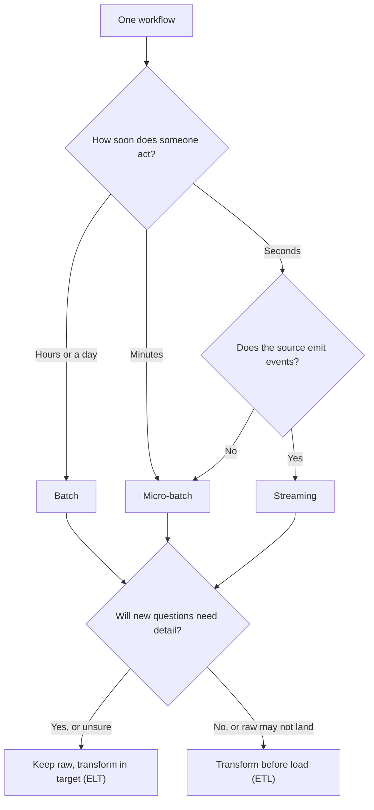

## Start with the missing half-hours

Kilbride Energy, an energy supplier, asked for an assistant that helps billing agents answer "why is my bill so high?" from each customer's meter readings. Aisha, the forward deployed engineer, built what her last project had used: a streaming pipeline that read every reading as it arrived, turned the 48 half-hourly readings per meter into one daily total and discarded the raw half-hours to save space. Within three months two problems surfaced. The meter data provider delivered readings once a day, in a file at 06:00, so the pipeline sat idle for 23 hours and paged an engineer whenever the file came late. Then Kilbride launched a time-of-use tariff, agents needed each customer's use between 16:00 and 19:00, and the daily totals could not answer. The provider took six weeks to resend 13 months of files. Call this **the shape chosen by habit**: a pipeline shaped by the last project, not by the customer's workflow and source.

> **What you'll learn**
>
> - Tell ETL from ELT, and decide where the transform should run.
> - Tell batch from micro-batch and streaming, and set freshness from the decision it serves.
> - Read the source system's constraints before choosing a shape.
> - Keep a raw copy so a new question does not need a new extract.

## Where the transform runs

Every pipeline extracts data from a source, transforms it and loads it into a target. The order of the last two steps is the first choice.

- **ETL (extract, transform, load).** Data is cleaned and reshaped on the way, and only the result reaches the target.
- **ELT (extract, load, transform).** Raw data lands in the target first, then transforms run inside it, usually as SQL in a warehouse.

| Question | ETL fits | ELT fits |
| --- | --- | --- |
| Can the target hold raw data? | No: storage is limited or costly | Yes: cheap storage, a warehouse or object store |
| Must sensitive fields be removed before landing? | Yes: the target may not hold them | No: or they can be masked in a restricted raw zone |
| Will new questions need old detail? | Unlikely | Likely: you can rebuild from raw |
| Who writes transforms? | Engineers, in pipeline code | Analysts too, in SQL |

*Table 1: ETL against ELT. The deciding questions are about the customer's target and rules.*

Kilbride's mistake was an ETL pattern with no raw copy. ELT would have kept the half-hourly readings, and the tariff question would have been a new SQL view. In a customer's estate the choice is often set for you. A hospital may forbid identifiable fields from landing in the analytics account, which forces at least the masking step before load. Ask the security team before you design.

A common middle path keeps three layers: raw (as received, append-only, restricted access), cleaned (typed, deduplicated, validated) and served (shaped for one use, such as the assistant's lookup table).

## How fresh the data must be

The second choice is when data moves.

- **Batch.** Process a bounded set, such as yesterday's file, on a schedule.
- **Micro-batch.** Small batches every few minutes. Simpler than streaming, fresher than nightly.
- **Streaming.** Process each event as it arrives, continuously, with results in seconds.

Set freshness from the **decision latency**: how soon after an event someone acts on it, and what a delay costs. A billing agent answering a question about last month's bill is fine with yesterday's data. An outage alert that waits until tomorrow is useless.

Then check the source. A pipeline cannot be fresher than its input. Kilbride's provider sent one file a day. Streaming bought no freshness for billing, only cost and pages. Kilbride's meters also sent "power lost" signals through a separate event feed within seconds. That feed did suit streaming.

| Shape | Typical freshness | Running cost and effort | Fits |
| --- | --- | --- | --- |
| Batch | Hours to a day | Lowest. Reruns are easy | Reports, billing, model training data |
| Micro-batch | Minutes | Moderate | Dashboards, queues for review, near-live sync |
| Streaming | Seconds | Highest. Always on, harder to replay | Alerts, fraud checks, live operations |

*Table 2: Batch, micro-batch and streaming. Freshness is bounded by the source.*

## Read the source before you choose

In a customer's estate, the source decides more than your preference does. Before choosing, find out:

- **How it can be read.** A daily export file, an API with a rate limit, a read replica of the database, or a change feed.
- **When it can be read.** Some systems forbid heavy queries in business hours or have a nightly maintenance window.
- **Who owns it.** A change feed on a production database needs the database team's approval and often weeks of change control.
- **What it costs to read again.** If a re-extract takes six weeks, keep raw data. If it takes ten minutes, raw copies matter less.

These answers often settle the shape. An API capped at 10 requests a second rules out reading every record each hour. A vendor that only sends files rules out streaming for that data.

## Choosing for one workflow

Figure 1 is the decision Kilbride's team should have made, one workflow at a time.

*Figure 1: Choosing a pipeline shape per workflow. Freshness comes first, then the source, then where the transform runs.*

The switcher applies it to Kilbride's billing assistant.

Kilbride's billing assistant needs half-hourly readings for 400,000 meters. The provider sends one file a day at 06:00, about 19.2 million rows.

<button type="button" data-mode="stream" aria-pressed="false" aria-controls="stream-result">Streaming, ETL</button>
<button type="button" data-mode="micro" aria-pressed="false" aria-controls="micro-result">Hourly micro-batch</button>
<button type="button" data-mode="batch" aria-pressed="false" aria-controls="batch-result">Daily batch, ELT</button>

<section id="stream-result" class="mode-panel" data-announcement="Streaming with ETL selected. No fresher data, raw detail lost."><h4>Streaming, ETL</h4><ul><li>Data is no fresher than 06:00, because the file arrives once a day.</li><li>Always-on infrastructure, and an alert each time the file is late.</li><li>Half-hourly detail is discarded. The tariff question cannot be answered.</li></ul>
The most effort for no gain in freshness.
</section>
<section id="micro-result" class="mode-panel" data-announcement="Hourly micro-batch selected. 23 of 24 runs find nothing."><h4>Hourly micro-batch</h4><ul><li>23 of 24 runs a day find no new file.</li><li>Freshness is the same as daily batch.</li><li>Cheaper than streaming, but still runs for nothing.</li></ul>
Fits only if the provider moves to hourly files.
</section>
<section id="batch-result" class="mode-panel" data-announcement="Daily batch with ELT selected. Same freshness, raw kept."><h4>Daily batch, ELT</h4><ul><li>Runs when the file lands, triggered by its arrival.</li><li>Raw readings land first, about 19.2 million rows a day.</li><li>The tariff question becomes a new SQL view over raw data.</li></ul>
Same freshness, least effort, and the raw detail survives.
</section>

Kilbride's final design used two shapes: daily batch ELT for billing, and streaming for the power-lost feed that drives outage alerts. One customer, two workflows, two shapes.

Whatever the shape, a pipeline must survive a failed run. Checkpoints, replay and reconciliation are taught in [recoverable data syncs](../../../../01_Concept_Tutorials/Consolidated_Lessons/T1.5_Distributed_Systems_Essentials/04_Recoverable_Data_Syncs.md), and the idempotent writes they rely on in [durability and idempotency](../../../../01_Concept_Tutorials/Consolidated_Lessons/T3.7_Agentic_Workflow_Platforms/04_Durability_and_Idempotency.md). The rest of this module assumes them.

## Limits of this lesson

- **Categories blur.** Many tools run streaming code in micro-batches. Choose by the freshness and effort, not the label.
- **Raw copies carry risk.** A raw zone holds every sensitive field. It needs access control and a retention rule agreed with the customer.
- **Composite engagement.** Kilbride Energy, its staff and its figures are illustrative, not a real customer.

## Interview angle

Each answer is an outline to say in about two minutes. Open the question and try it aloud before reading.

Interview question 1. Explain ETL against ELT, and batch against streaming. How do you choose for a customer's workflow?

- **Answer:** ETL transforms before loading, so only the result lands. ELT loads raw data and transforms inside the target, so you can rebuild when questions change. Batch processes bounded sets on a schedule, streaming processes each event as it arrives. I choose per workflow: how soon someone acts on the data, how fresh the source can be, whether sensitive fields may land raw, and how costly a re-extract would be. Default to batch ELT with a raw layer, and stream only where seconds matter.
- **Trade-off:** Streaming gives seconds of freshness for always-on cost and harder replays. ETL saves storage but loses detail.
- **Follow-up to expect:** "The customer wants real time everywhere." Ask which decision changes if data is an hour old.

## References

1. Amazon Web Services, [What's the difference between ETL and ELT?](https://aws.amazon.com/compare/the-difference-between-etl-and-elt/), accessed 17 November 2026. Definitions of both approaches and when each fits.
2. Google Cloud, [Streaming pipelines](https://cloud.google.com/dataflow/docs/concepts/streaming-pipelines), accessed 17 November 2026. Unbounded data, windows and the cost of continuous processing.
3. Martin Kleppmann, [Designing Data-Intensive Applications](https://dataintensive.net/), accessed 17 November 2026. Batch and stream processing as two views of derived data.
4. The author's own field experience, the basis for the source-first checklist.

## Key takeaways

- ETL transforms before load. ELT lands raw data and transforms in the target.
- Keep a raw layer unless the customer's rules forbid it, so new questions do not need new extracts.
- Set freshness from how soon someone acts, and remember the source caps it.
- Read the source's access, timing, ownership and re-extract cost before choosing.
- One customer often needs different shapes for different workflows.

## Check yourself

1. Why did streaming give Kilbride's billing assistant no fresher data?

The provider delivered readings in one file a day at 06:00. A pipeline cannot be fresher than its source.

2. What would ELT have changed when the time-of-use tariff arrived?

The raw half-hourly readings would have been in the target, so the peak-hours question would have been a new transform, not a six-week re-extract.

3. When might a customer's rules force ETL?

When sensitive fields may not land in the target, so they must be removed or masked before load.

