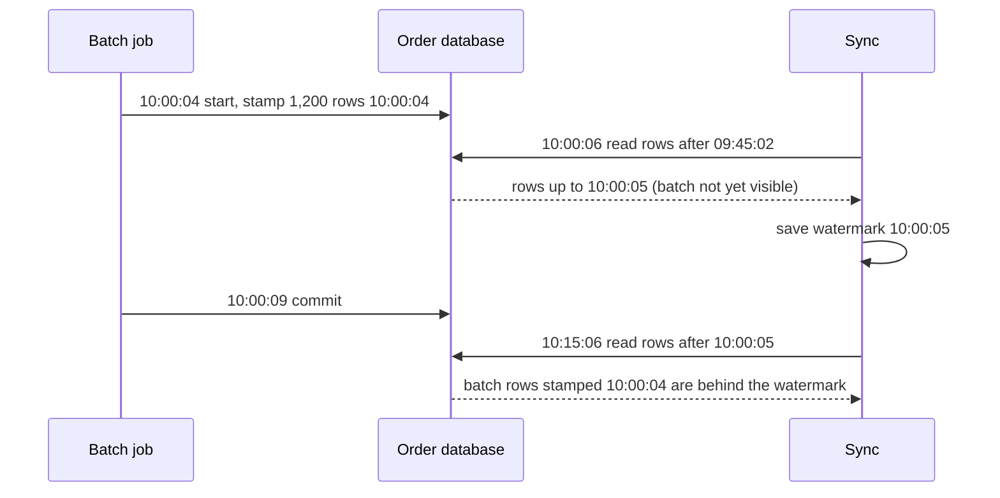

## Start with the orders that never arrived

Lowther Grocers, a supermarket chain, synced its online orders into a warehouse every 15 minutes for a substitution assistant that suggests replacements for out-of-stock items. Daniel, the forward deployed engineer, wrote the sync as one query: read every order whose `updated_at` is later than the last value seen, then store the newest `updated_at` as the **watermark** for the next run. It passed every test. A month later a weekly comparison with the order system found 0.3% of orders stale. A batch job had stamped 1,200 orders 10:00:04 and committed at 10:00:09. The sync ran at 10:00:06, saw rows up to 10:00:05 and moved its watermark there. When the 1,200 rows became visible, their timestamp was already behind it, and no later run would read them. Call this **the watermark that skipped**: a watermark that moves past rows no reader could see yet.

> **What you'll learn**
>
> - Choose between timestamps, increasing IDs and change data capture.
> - Handle tied timestamps and late commits without losing rows.
> - Order the write and the checkpoint so a crash between them is harmless.
> - Name what incremental tracking cannot see, and how to catch it.

## Three ways to know what changed

An **incremental load** reads only what changed since the last run, instead of the whole table. It needs a way to tell new and changed rows from the rest.

| Method | How it works | Sees updates? | Sees deletes? | Main risk |
| --- | --- | --- | --- | --- |
| Timestamp column | Read rows with `updated_at` after the watermark | Yes, if every write sets it | No | Ties, late commits, writes that skip the column |
| Increasing ID | Read rows with an ID above the last one seen | No | No | IDs committed out of order |
| Change data capture (CDC) | Read the database's own change log | Yes | Yes | Needs access and approval from the database owner |

*Table 1: Three ways to track change. Each answers "what changed?" with different blind spots.*

An increasing ID suits append-only data, such as a payments ledger where rows never change. A timestamp suits tables that change in place, if the application sets the column on every write. **Change data capture** reads the database's write log, so it sees inserts, updates and deletes in commit order. PostgreSQL calls this logical decoding, and tools such as Debezium package it.

CDC is the most complete, and it is also the hardest to get in a customer's estate. It touches the production database, and its owner may need weeks to approve it. Ask early. Start with timestamps if you must, and plan for their limits.

## Ties and late commits

Two separate faults break a simple timestamp watermark.

**Ties at a page boundary.** Lowther reads at most 10,000 rows per run, ordered by `updated_at`. Suppose 300 rows share the timestamp 10:00:05, and the page fills after 120 of them. The run saves 10:00:05 as its watermark. The next run asks for `updated_at > 10:00:05` and skips the other 180.

The fix is a **composite cursor**: order by `updated_at` and then by the primary key, and save both. The next run reads rows after that pair, so it continues inside the tied second.

**Late commits.** A timestamp records when a write started, not when other readers could see it. In PostgreSQL, `now()` returns the start time of the transaction. A row stamped 10:00:04 can become visible at 10:00:09, after a reader has moved past it. Figure 1 shows the Lowther case.

*Figure 1: A late commit. The rows become visible after the watermark has passed their timestamp.*

The fix is a **lookback window**. Each run reads from the watermark minus a margin longer than your longest transaction, such as 10 minutes. It re-reads some rows, so the target must absorb repeats: write with an **upsert** keyed on the order ID, which inserts new rows and replaces existing ones. Re-reading a row then changes nothing.

Ask the database team how long their longest transactions run. A nightly batch job can hold a transaction open for an hour, and your margin must cover it.

## Write, then checkpoint

The watermark is saved as a **checkpoint**: the point the next run starts from. The order of the write and the checkpoint decides what a crash does.

- **Checkpoint first, then write.** A crash after the checkpoint loses the batch. The next run starts after it.
- **Write first, then checkpoint.** A crash after the write repeats the batch. The next run starts from the old checkpoint.

Repeating is recoverable. Losing is not. So write first, and make the write idempotent so a repeat is harmless. Where the target is a database, a stronger option writes the rows and the checkpoint in one transaction, so both happen or neither does.

The walkthrough follows one Lowther run that crashes in the gap.

One sync run reads 4,000 changed orders. The process is killed after the write and before the checkpoint is saved.

<button type="button" data-step="0" aria-pressed="false" aria-controls="ckpt-step-0">1. Read</button><button type="button" data-step="1" aria-pressed="false" aria-controls="ckpt-step-1">2. Write</button><button type="button" data-step="2" aria-pressed="false" aria-controls="ckpt-step-2">3. Crash</button><button type="button" data-step="3" aria-pressed="false" aria-controls="ckpt-step-3">4. Rerun</button>

<section id="ckpt-step-0" class="step-panel" aria-labelledby="ckpt-heading-0"><h4 id="ckpt-heading-0">1. Read from the checkpoint</h4><dl><dt>State</dt><dd>Checkpoint holds 10:00:05 and order 88,412.</dd><dt>Action</dt><dd>Read rows after that pair, minus the 10-minute lookback: 4,000 rows.</dd></dl></section><section id="ckpt-step-1" class="step-panel" aria-labelledby="ckpt-heading-1"><h4 id="ckpt-heading-1">2. Write with an upsert</h4><dl><dt>State</dt><dd>Target now holds the 4,000 orders at their latest values.</dd><dt>Action</dt><dd>Each row is inserted or replaced by order ID.</dd></dl></section><section id="ckpt-step-2" class="step-panel" aria-labelledby="ckpt-heading-2"><h4 id="ckpt-heading-2">3. Crash before the checkpoint</h4><dl><dt>State</dt><dd>Target is updated. Checkpoint still holds 10:00:05 and order 88,412.</dd><dt>Risk</dt><dd>If the write had been a plain insert, the next run would double these orders.</dd></dl></section><section id="ckpt-step-3" class="step-panel" aria-labelledby="ckpt-heading-3"><h4 id="ckpt-heading-3">4. Rerun from the old checkpoint</h4><dl><dt>State</dt><dd>The same 4,000 rows are read again, plus anything new.</dd><dt>Result</dt><dd>The upsert replaces each order with the same values. Totals are unchanged, and the checkpoint now advances.</dd></dl></section>

<button type="button" data-walk="previous">Previous</button>

<button type="button" data-walk="next">Next step</button>

The walkthrough is a scripted illustration. Checkpoint storage, replay and reconciliation are taught in [recoverable data syncs](../../../../01_Concept_Tutorials/Consolidated_Lessons/T1.5_Distributed_Systems_Essentials/04_Recoverable_Data_Syncs.md), which feeds incremental reads, events and reconciliation into one idempotent processor, and idempotent writes in [durability and idempotency](../../../../01_Concept_Tutorials/Consolidated_Lessons/T3.7_Agentic_Workflow_Platforms/04_Durability_and_Idempotency.md).

## What incremental tracking cannot see

A watermark only sees rows whose tracking column moved. It misses:

- **Hard deletes.** A deleted row has no timestamp to read. Ask for soft deletes, a deletes table or CDC.
- **Writes that skip the column.** A support engineer runs a bulk SQL fix and forgets `updated_at`. A database trigger that sets the column on every update closes this gap.
- **Clock changes.** If the application sets timestamps from several servers, their clocks disagree. Use the database clock.
- **Reset or recycled IDs.** A restore or migration can restart a sequence below your watermark.

None of these raise an error. Catch them with a regular **reconciliation**: compare row counts and a checksum of key fields per day between source and target, and alert on a mismatch. Lowther's weekly comparison was what found the skipped rows. Run it daily, and run a full reload of a recent window when it fails.

## Limits of this lesson

- **Database details vary.** Timestamp precision, transaction behaviour and CDC options differ by engine. Check the customer's version.
- **Lookback is a guess.** It covers transactions up to its length. A longer one still slips through, which reconciliation must catch.
- **Composite engagement.** Lowther Grocers, its staff and its figures are illustrative, not a real customer.

## Interview angle

Each answer is an outline to say in about two minutes. Open each question and try it aloud before reading.

Interview question 1. How do you track progress in an incremental load, and where does that tracking break?

- **Answer:** Keep a checkpoint of the last position read: a timestamp, an increasing ID, or a position in the change log. Timestamps miss ties at page boundaries, late commits and writes that skip the column. IDs miss updates and out-of-order commits. Neither sees hard deletes. I use a composite cursor of timestamp and key, a lookback window, upserts so re-reads are harmless, and a daily reconciliation of counts and checksums.
- **Trade-off:** CDC sees everything in commit order but needs the database owner's approval and more operation.
- **Follow-up to expect:** "How long is the lookback?" Longer than the longest transaction, which you ask the database team for.

Interview question 2. Your job writes a batch to the target, then crashes before saving its checkpoint. What happens next, and how do you design for it?

- **Answer:** The next run starts from the old checkpoint and reads the same batch again. With plain inserts, that doubles the rows. So write first, checkpoint second, and make the write idempotent: upsert by primary key, or replace a whole partition. If the target is a database, write the rows and the checkpoint in one transaction. Never checkpoint first, because a crash then loses the batch silently.
- **Trade-off:** Upserts cost more than appends. Appends are faster but need deduplication downstream.
- **Follow-up to expect:** "The target only supports appends." Add a batch ID and deduplicate on read, keeping one copy per key.

## References

1. PostgreSQL, [Logical decoding](https://www.postgresql.org/docs/current/logicaldecoding.html), accessed 17 November 2026. Streaming committed changes from the write-ahead log.
2. Debezium, [Debezium documentation](https://debezium.io/documentation/reference/stable/), accessed 17 November 2026. Change data capture from database logs, including deletes.
3. PostgreSQL, [Transaction isolation](https://www.postgresql.org/docs/current/transaction-iso.html), accessed 17 November 2026. When a transaction's changes become visible to other readers.
4. The author's own field experience, the basis for the Lowther failure and the reconciliation habit.

## Key takeaways

- Timestamps, increasing IDs and change capture each have blind spots. Know them before you choose.
- Use a composite cursor of timestamp and key so ties at a page boundary are not skipped.
- Add a lookback window for late commits, and upsert so re-reads change nothing.
- Write first, checkpoint second, and make the write idempotent.
- Reconcile counts and checksums daily to catch deletes and silent misses.

## Check yourself

1. Why did Lowther's watermark skip 1,200 orders without any error?

The rows were stamped 10:00:04 but became visible at 10:00:09, after the sync had moved its watermark to 10:00:05.

2. Why is writing before checkpointing safer than the reverse?

A crash after the write repeats the batch, which an idempotent write absorbs. A crash after the checkpoint skips the batch, and nothing reads it again.

3. Which change does a timestamp watermark never see?

A hard delete, because the deleted row has no timestamp left to read.

