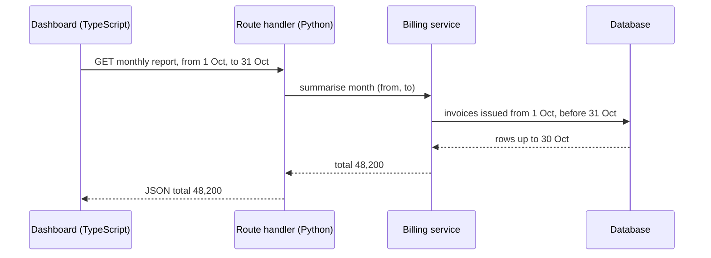

## Start with the cover-to-cover read

Garrow Software, a fictional company, sells a subscription-billing product. Its finance team reported that the October revenue dashboard showed £48,200, while the finance ledger said £51,700. Tomasz, the forward deployed engineer on the account, had never seen the code. It was a Python backend with a TypeScript frontend, about 180,000 lines in one repository.

Tomasz started with the README, then read the backend package by package, building notes on each module. Two days later he understood the folder layout well and still had not found the bug. Bea, Garrow's backend developer, found it in forty minutes the next morning. She opened the dashboard, looked at the request it sent, searched for that route, and followed it to a query.

The gap was £3,500, exactly the 14 invoices issued on 31 October. The frontend sent the end date as the last day of the month. The backend treated it as exclusive and stopped at the end of 30 October. Call this **the cover-to-cover read**: studying a codebase in general when the task needs one path through it.

> **What you'll learn**
>
> - Start from a symptom and pick the one request that produces it.
> - Find entry points by convention in common Python and TypeScript stacks.
> - Trace a request from the screen to the data, and confirm each step.
> - Work in a half-known stack by crossing it at the HTTP boundary.

## Start from the symptom, not the README

A codebase is too large to read before acting. The task gives you something smaller: a wrong number, an error message, a slow page. That symptom belongs to one request, and one request touches a thin slice of the code.

Turn the task into a question you can answer by following data:

- **What does the user see?** A dashboard figure of £48,200 for October.
- **What should they see?** £51,700, the ledger figure, which finance trusts.
- **Which request produces it?** Whatever the dashboard calls when it loads October.
- **Where could the difference arise?** In the inputs sent, the query, the calculation or the display.

The README and architecture notes still help, but as a map you consult while tracing, not as a book to finish first. Ten minutes on them is usually enough to learn how to run the system and where the main folders are.

## Find the entry points

Every request enters code at a place the framework defines. Knowing the conventions tells you where to search before you read anything.

| Stack | Where requests enter | What to search for |
| --- | --- | --- |
| Python, FastAPI or Flask | Functions with route decorators | The URL path, such as `/reports/monthly` |
| Python, Django | `urls.py` maps paths to views | The path in `urls.py`, then the view |
| TypeScript, React or Next.js | Components that call `fetch` or an API client | The visible label, then the API call near it |
| Scheduled jobs | Cron files, task queue definitions | The job name in the scheduler configuration |
| Command-line tools | The `main` function or the console scripts in `pyproject.toml` | The command name |

*Table 1: Where requests enter common stacks. Search for the path or label, not for a concept.*

Dependency files tell you the stack before you open any code. `pyproject.toml` or `requirements.txt` names the Python framework and database driver. `package.json` names the frontend framework and its API client. The continuous integration (CI) configuration shows how tests run, which is often the fastest way to learn how to start the system locally.

Search for concrete strings: the URL path, a label on the screen, an error message, a column name. Text that a user or a database sees has to exist somewhere in the code, and a search finds it in seconds.

## Trace one request to the data

Follow the request through each layer and confirm what you see at every hop, instead of assuming what the code does. The walkthrough shows Bea's forty minutes.

Follow Garrow's October total from the screen to the database. Each step shows where to look, what it showed and the next question.

<button type="button" data-step="0" aria-pressed="false" aria-controls="trace-step-0">1. Screen</button><button type="button" data-step="1" aria-pressed="false" aria-controls="trace-step-1">2. Route</button><button type="button" data-step="2" aria-pressed="false" aria-controls="trace-step-2">3. Service</button><button type="button" data-step="3" aria-pressed="false" aria-controls="trace-step-3">4. Data</button>

<section id="trace-step-0" class="step-panel" aria-labelledby="trace-heading-0"><h4 id="trace-heading-0">1. Read the request the screen sends</h4><dl><dt>Look at</dt><dd>The browser's network panel while the dashboard loads October.</dd><dt>Found</dt><dd>A call to the monthly report path with from 2026-10-01 and to 2026-10-31. The JSON reply already says 48,200.</dd><dt>Next question</dt><dd>The backend computes the wrong figure. The frontend display is not the cause. Where does that path land?</dd></dl></section><section id="trace-step-1" class="step-panel" aria-labelledby="trace-heading-1"><h4 id="trace-heading-1">2. Find the route</h4><dl><dt>Look at</dt><dd>A search for the path across the backend.</dd><dt>Found</dt><dd>One route decorator in the reports module. Its handler parses the two dates and calls a billing service function.</dd><dt>Next question</dt><dd>Does the handler change the dates before passing them on?</dd></dl></section><section id="trace-step-2" class="step-panel" aria-labelledby="trace-heading-2"><h4 id="trace-heading-2">3. Read the service</h4><dl><dt>Look at</dt><dd>The billing function that builds the query, and its tests.</dd><dt>Found</dt><dd>It selects invoices issued on or after the start and before the end. The tests pass an end date of the first day of the next month.</dd><dt>Next question</dt><dd>The service expects an exclusive end. The frontend sends an inclusive one. Which invoices fall in the gap?</dd></dl></section><section id="trace-step-3" class="step-panel" aria-labelledby="trace-heading-3"><h4 id="trace-heading-3">4. Confirm against the data</h4><dl><dt>Look at</dt><dd>The same query run by hand with both end dates, then the history of the frontend file.</dd><dt>Found</dt><dd>Ending at 1 November gives 51,700. The 14 invoices of 31 October total 3,500. A frontend change three weeks ago switched from "first of next month" to "last of this month".</dd><dt>Next question</dt><dd>Which side owns the contract? Fix it there, and add a test at the boundary.</dd></dl></section>

<button type="button" data-walk="previous">Previous</button>

<button type="button" data-walk="next">Next step</button>

The walkthrough is a scripted illustration. Notice that each step ends with a narrower question, and that step 1 ruled out half the stack in a minute.

*Figure 1: The traced request. The two sides disagreed on whether the end date is included, and the 14 invoices of 31 October fell between them.*

Version history finishes the trace. `git log` on the file shows when the behaviour changed, and `git blame` on the changed line shows the commit and its message. Read the message and the pull request before deciding the fix: the change may have been deliberate for another screen.

## A stack you only half know

Many forward deployed engineers know Python well and TypeScript a little, or the reverse. You do not need fluency in both to trace a bug across them, because they meet at a boundary written in neither language: HTTP requests and JSON.

- **Cross at the boundary.** Read the request and reply in the network panel or a log. Whatever the frontend code says it sends, the panel shows what it sent. This splits the search in two at once.
- **Let the types guide you.** In TypeScript, the type of the API response names the fields the frontend expects. In typed Python, the request model names what the backend accepts. Compare the two.
- **Read the weaker side through its tests.** Tests show how a function is meant to be called, in the simplest form the authors could write.
- **Pair for the unfamiliar half.** Ask the customer's developer for thirty minutes on the side you know less. They read it faster, and you learn which conventions matter.

Say plainly what you know and what you are inferring. "The backend expects an exclusive end date, I have confirmed that in the tests. I think the frontend change was meant for the weekly view, but I have not checked" lets the customer correct you before you change the wrong side.

## Leave a map behind

Tracing one request teaches you a path. Write it down while it is fresh, because the next bug will cross part of it:

- **A short path note.** Screen, route, handler, service, query, table, with file names.
- **How to run it.** The commands, environment variables and test data that worked.
- **Open questions.** Things you saw but did not confirm, with who might know.

Keep the note in the customer's repository or wiki, not in your own files, so their team can correct and extend it. Over a few weeks these notes grow into the architecture overview that Tomasz tried to build in two days.

## Limits of this lesson

- **Some bugs have no single request.** Race conditions, scheduled jobs and data written by another system need other entry points, covered in [reproduce, isolate, fix](03_Reproduce_Isolate_Fix.md).
- **Production access varies.** You may only see logs, not run queries. Ask early for read access to a copy of the data.
- **Fictional data.** Garrow Software, its staff and its figures are illustrative.

## Interview angle

Each answer is an outline to say in about two minutes. Open each question and try it aloud before reading.

Interview question 1. You join a customer's repository on day one and must change one feature by Friday. How do you find your way around?

- **Answer:** Spend ten minutes on the README, dependency files and CI configuration to learn the stack and how to run it. Get it running locally, or at least its tests. Then start from the feature: find the entry point by searching for its route, label or job name, and trace one request through to the data. Write a short path note as I go, and ask a customer developer to confirm it.
- **Trade-off:** Tracing one path leaves most of the code unknown. Reading broadly first delays the change by days.
- **Follow-up to expect:** "There are no tests and no README." Then the running system and its logs become the documentation.

Interview question 2. The bug crosses a Python backend and a TypeScript frontend, and you only know Python well. How do you work on it?

- **Answer:** Split the stack at the HTTP boundary. Open the network panel, read the request the frontend sends and the JSON it gets back. If the reply is already wrong, the bug is in Python, where I am strong. If the reply is right and the screen is wrong, it is in TypeScript, and I read the component that renders that field, using its types and tests. I pair with a frontend developer for the fix.
- **Trade-off:** Pairing costs someone else's time. Guessing in an unfamiliar language costs more when the fix is wrong.
- **Follow-up to expect:** "Both sides look correct." Then the contract between them is ambiguous, such as an inclusive end date.

## References

1. Chrome for Developers, [Network features reference](https://developer.chrome.com/docs/devtools/network/reference), accessed 17 November 2026. Inspecting requests, payloads and responses in the browser.
2. Git, [git-blame documentation](https://git-scm.com/docs/git-blame), accessed 17 November 2026. Finding the commit that last changed each line.
3. FastAPI, [First steps](https://fastapi.tiangolo.com/tutorial/first-steps/), accessed 17 November 2026. Route decorators as the entry points of a Python API.
4. The author's own field experience, the basis for the tracing order and the path note.

## Key takeaways

- Start from the symptom and pick the one request that produces it.
- Find entry points by searching for concrete strings: paths, labels, error messages.
- Confirm each hop with evidence, and let each step narrow the next question.
- Cross a half-known stack at the HTTP boundary, then read only the side at fault.
- Leave a path note in the customer's repository for the next person.

## Check yourself

1. Why did the network panel rule out the frontend display in step 1?

The JSON reply already contained 48,200. The frontend displayed what it received. The wrong figure was computed before it reached the browser.

2. Garrow's two sides each looked correct on their own. Where was the bug?

In the contract between them. The frontend sent an inclusive end date and the backend treated it as exclusive, so invoices on the last day fell in neither month's report.

3. Why read the commit message before fixing the frontend change?

The change may have been deliberate for another screen. Reverting it could break that screen. The fix belongs on whichever side owns the contract.

