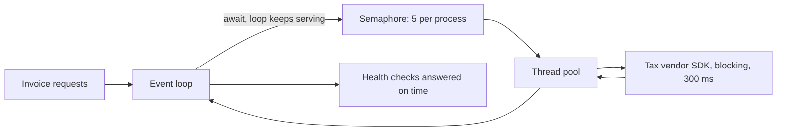

## Start with the frozen event loop

Garrow Software, a fictional billing company, runs its invoicing API as an async Python service: four worker processes, each with one event loop. Before month end, Garrow added a tax calculation to every invoice, using a tax vendor's Python software development kit (SDK). The SDK made ordinary blocking HTTP calls that took about 300 milliseconds each.

In testing, with a handful of requests, nothing looked wrong. On the last day of the month, traffic reached 40 invoice requests a second. Each blocking call froze its whole event loop for 300 milliseconds, so each process handled about three requests a second, and the service about 13 in total. Requests queued. Health checks waited behind them, passed their 2-second timeout, and the load balancer restarted instances in the middle of invoicing.

Nothing in the code was wrong line by line. A blocking call sat in a place that assumed nothing blocks. Call this **the frozen event loop**.

> **What you'll learn**
>
> - Choose async, threads or processes by the kind of work.
> - Keep a blocking SDK from freezing an async service.
> - Bound concurrency and size the limit from arrival rate and call time.
> - Use timeouts, cancellation and partial results so a slow dependency does not hang the caller.

## Async, threads and processes

Concurrency means making progress on several tasks over the same period. The right tool depends on what the tasks spend their time doing.

| Tool | Good for | How it waits | Watch out for |
| --- | --- | --- | --- |
| Async (one event loop) | Many network calls with async libraries | Tasks give way at each `await` | One blocking call freezes every task on the loop |
| Threads | Blocking libraries, file and network input and output | The operating system switches threads | Python's interpreter lock lets one thread run Python code at a time |
| Processes | Heavy computation, such as parsing or scoring | Each process has its own interpreter and memory | Start-up cost, more memory, data copied between processes |

*Table 1: Three concurrency tools. Waiting on the network suits async or threads. Computing suits processes.*

Most field code waits: on databases, partner APIs and files. Async handles thousands of such waits cheaply, but only if every library on the path cooperates with the loop. Threads work with any library, blocking or not, at a higher cost per task. Processes are for work that keeps a CPU busy, because in standard Python only separate processes run Python code in parallel.

Resources follow the same choice. Every concurrent task can hold a connection, a file handle or memory. Open them with context managers so they close on errors, and share pools, such as one HTTP client or one database pool per process, instead of opening one per task.

## A blocking SDK in an async service

An event loop runs one task at a time and switches only when a task awaits. A blocking call never awaits. The loop and every request on it stop until the call returns. Garrow's 300-millisecond SDK call was a 300-millisecond pause for every request in that process.

There are three fixes, in order of preference:

1. **Use an async client** if the vendor offers one, or call the vendor's HTTP API with your async HTTP library.
2. **Run the blocking call in a thread.** In Python, `asyncio.to_thread` hands the call to a thread pool and lets the loop await the result. The loop keeps serving other requests.
3. **Move the work off the request path.** If the result is not needed in the response, put the job on a queue and let a worker call the SDK.

Garrow took the second fix. The thread pool needs a size. By Little's law, 40 requests a second times 0.3 seconds is 12 calls in flight on average. The vendor allowed 20 concurrent calls per account, so Garrow capped the SDK at 20 across the service, five per process, with a semaphore around the threaded call.

*Figure 1: Garrow's fix. The blocking SDK runs in a thread pool behind a semaphore, and the event loop stays free for other requests and health checks.*

The site's [keep the request path free](../../../../01_Concept_Tutorials/Consolidated_Lessons/T1.2_APIs_and_Backend/01_Keep_the_Request_Path_Free.md) lesson covers matching async and sync to the work and handing long jobs to a task queue.

## Bounded concurrency

Unbounded concurrency moves the overload somewhere else. Starting 5,000 calls at once exhausts connection pools and file handles, trips the upstream's rate limit, and turns a slow dependency into a flood of retries. A **bounded** design caps how many calls run at once and queues the rest.

The bound comes from three numbers: the upstream's concurrency or rate limit, your own pool sizes, and Little's law for how many calls the target rate needs. Pick the smallest. The switcher shows Garrow's account-status page, which fetches the payment status of 200 customer accounts from a payment provider that allows 20 concurrent calls. Calls normally take 0.5 seconds, and a few hang for 30 seconds.

Fetch 200 account statuses. The provider allows 20 concurrent calls. Calls take 0.5 seconds, and 3 of the 200 hang for 30 seconds.

<button type="button" data-mode="sequential" aria-pressed="false" aria-controls="sequential-result">One at a time</button>
<button type="button" data-mode="unbounded" aria-pressed="false" aria-controls="unbounded-result">All at once</button>
<button type="button" data-mode="bounded" aria-pressed="false" aria-controls="bounded-result">Bounded with timeouts</button>

<section id="sequential-result" class="mode-panel" data-announcement="One at a time selected. About 190 seconds."><h4>One at a time</h4><ul><li>197 calls at 0.5 seconds take about 99 seconds.</li><li>The 3 hanging calls add 90 seconds.</li><li>The page takes over three minutes, and the user leaves.</li></ul>
Easy to reason about. Far too slow.
</section>
<section id="unbounded-result" class="mode-panel" data-announcement="All at once selected. 180 calls rejected."><h4>All at once</h4><ul><li>All 200 calls start together.</li><li>The provider accepts 20 and rejects 180 as over the limit.</li><li>Retries arrive together and are rejected again. The page waits on the 3 hanging calls for 30 seconds.</li></ul>
Fast in theory. In practice it breaks the upstream's limit.
</section>
<section id="bounded-result" class="mode-panel" data-announcement="Bounded with timeouts selected. About 6 seconds, 197 results and 3 marked unavailable."><h4>Bounded with timeouts</h4><ul><li>20 calls run at a time. 200 calls take about 10 rounds of 0.5 seconds, about 5 seconds.</li><li>Each call has a 2-second timeout. The 3 hanging calls are cut off, adding about a second.</li><li>The page shows 197 statuses and marks 3 as unavailable, retried in the background.</li></ul>
Fast, inside the limit, and honest about what is missing.
</section>

In the bounded mode, a timed-out call holds its slot for 2 seconds, not 30, which is why three hangs add little. Without the timeout, the bound alone would still leave the page waiting 30 seconds for the last three.

## Timeouts, cancellation and partial results

A call without a timeout can wait for ever, and so can everything waiting on it. Give every external call two limits:

- **A per-call timeout**, based on the call's normal latency with headroom, such as 2 seconds for a call that normally takes 0.5.
- **An overall deadline** for the whole operation, such as 8 seconds for the page, after which you stop waiting and return what you have.

When a timeout fires, the waiting task is **cancelled**. In async Python, cancellation raises an exception inside the task at its next await. Cleanup code in `finally` blocks and context managers still runs. A call running in a thread cannot be stopped this way: the caller stops waiting, but the thread finishes its work in the background and still holds its slot. Set a timeout inside the blocking library too, where it offers one.

Then decide what the caller gets. **Partial results** return what succeeded, mark what did not, and say so. Garrow's page shows 197 statuses and three rows reading "not available, retrying". That is better than an error page, and better than leaving three rows silently blank. Partial results suit read-only views. For a write, such as charging 200 accounts, a partial result needs a record of exactly which succeeded, so a retry does not charge anyone twice.

For retry policy, circuit breakers and bulkheads around a flaky dependency, see the site's [retries, circuit breakers and bulkheads](../../../../01_Concept_Tutorials/Consolidated_Lessons/T4.6_Scaling_and_Reliability/04_Retries_Circuit_Breakers_and_Bulkheads.md) lesson.

## Limits of this lesson

- **Python specifics.** The examples use Python's asyncio and its interpreter lock. Other runtimes differ in detail, though the ideas carry over.
- **Bounds drift.** Upstream limits and latencies change. Watch rejections and timeouts, and revisit the numbers.
- **Fictional data.** Garrow Software, its vendors and its figures are illustrative.

## Interview angle

Each answer is an outline to say in about two minutes. Open each question and try it aloud before reading.

Interview question 1. When would you use async, threads or processes in a Python service, and how do you keep resources under control?

- **Answer:** Async for many network waits when the libraries are async. Threads when a library blocks, such as an older SDK or a file API. Processes for heavy computation, because only separate processes run Python code in parallel. In each case, bound concurrency to the smallest of the upstream limit and my pool sizes, share clients and pools, and open resources with context managers so errors still close them.
- **Trade-off:** Async handles the most waits per process but breaks on one blocking call. Processes give real parallelism at a cost in memory.
- **Follow-up to expect:** "Can threads speed up parsing?" Not much in standard Python. Use processes.

Interview question 2. A vendor's SDK only offers blocking calls, and your service is async. Latency spikes under load. What is happening, and what do you do?

- **Answer:** Each blocking call freezes the event loop, so every request on that process waits behind it. Throughput collapses to one call at a time per process, and health checks time out. I would use the vendor's async client or raw HTTP API if one exists. Otherwise run the call with `asyncio.to_thread`, capped by a semaphore sized from the vendor's limit and Little's law, with a timeout set inside the SDK.
- **Trade-off:** Threads add overhead and cannot be cancelled. A worker queue removes the call from the request path but makes the result asynchronous.
- **Follow-up to expect:** "How do you prove it?" Show event loop delay rising with SDK latency in traces.

## References

1. Python Software Foundation, [Coroutines and tasks](https://docs.python.org/3/library/asyncio-task.html), accessed 17 November 2026. `asyncio.to_thread`, timeouts, cancellation and gathering tasks.
2. Python Software Foundation, [Synchronisation primitives](https://docs.python.org/3/library/asyncio-sync.html), accessed 17 November 2026. The asyncio semaphore used to bound concurrency.
3. FastAPI, [Concurrency and async / await](https://fastapi.tiangolo.com/async/), accessed 17 November 2026. When to declare path operations async, and what blocking calls do inside them.
4. The site's [keep the request path free](../../../../01_Concept_Tutorials/Consolidated_Lessons/T1.2_APIs_and_Backend/01_Keep_the_Request_Path_Free.md) lesson, for async and task queues in API design.

## Key takeaways

- Async for many network waits, threads for blocking libraries, processes for computation.
- One blocking call in an async service freezes every request on its loop.
- Bound concurrency to the smallest of the upstream limit, your pools and the Little's law estimate.
- Give every call a timeout and every operation a deadline.
- Return partial results with what is missing marked, and track writes so retries are safe.

## Check yourself

1. Why did Garrow's health checks fail when only the tax call was slow?

The blocking call froze the event loop, and health checks run on the same loop. They waited behind invoice requests and passed their 2-second timeout.

2. In the bounded mode, why do the 3 hanging calls add little to the page time?

Each is cut off after 2 seconds and frees its slot. Without timeouts they would each hold a slot for 30 seconds.

3. Why are partial results harder for writes than for reads?

A retry must not repeat the writes that succeeded. The caller needs a record of exactly which accounts were charged.

