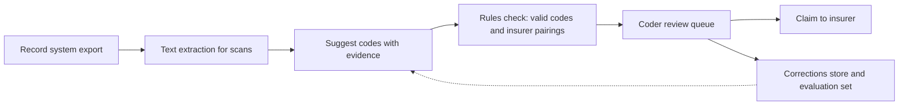
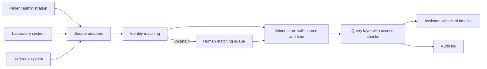

## How to use this practice

Each drill is a short case of the kind a decomposition or case-study round opens with. Give each one 20 minutes with a timer running:

1. Spend 2 minutes reading the brief and writing the questions you would ask.
2. Spend 6 minutes breaking the problem into parts, aloud.
3. Spend 8 minutes sketching the design and talking through the data flow.
4. Spend 4 minutes on the follow-up questions, answering before you open each one.

Open the outlines only after you have answered. They are one sound answer, not the only one. Every customer, name and figure below is fictional.

> **What you'll practise**
>
> - Turning a short brief into parts, owners and first questions within six minutes.
> - Drawing a design whose data flow you can explain box by box.
> - Defending a design when the interviewer changes a constraint.

## Drill 1. Billing codes from clinical notes

Full case for after the drill: the [document review copilot](../../../../02_System_Design_Case_Studies/Casebook_Rewrites/document-review-copilot/casebook.md) casebook and the [document processing in a legacy estate](../end-to-end-engagements/14_Document_Processing_in_a_Legacy_Estate.md) simulation.

Uffington Clinics runs 14 outpatient clinics paid by private insurers. Six clinical coders read each consultation note and assign diagnosis and procedure codes before a claim goes out. The clinics produce about 9,000 notes a week, the coding backlog stands at 11 days, and insurers reject 7% of claims for coding errors. The finance director asks you for "AI that does the coding".

Decompose: what are the parts, and what do you ask first?

- **The input.** Notes arrive as typed text in the record system, dictated letters and some scanned referral forms. Ask the share of each, because scans need text extraction and fail differently.
- **The rules.** Codes come from published code sets plus each insurer's pairing rules (which procedure codes are valid with which diagnoses). Ask who owns those rules today and how often they change.
- **The people.** Coders assign codes, a senior coder audits a sample, and finance submits claims. Ask who signs off a code and who carries the risk when a claim is wrong.
- **The measure.** Three numbers already exist: an 11-day backlog, a 7% rejection rate and coder throughput of about 300 notes per coder per day. Ask which one the director cares about most. Faster coding with more rejections is a loss.
- **The constraints.** Notes hold patient data. Ask where a model may run, whether data may leave the clinics' cloud tenancy, and what the data protection officer has approved.

The first three questions to ask, in order: which number defines success, who signs off a code, and where patient data may be processed.

Design: what do you build, and how does a note flow through it?

- **Ingest.** Pull finished notes from the record system's export, run text extraction on scanned forms, and keep the note identifier with every fragment.
- **Suggest with evidence.** A model inside the approved tenancy proposes candidate codes, each tied to the sentence in the note that supports it. A code with no supporting sentence is dropped.
- **Check rules.** A rules step (plain code, not a model) rejects invalid codes, retired codes and pairings the insurer forbids. Rules are cheaper and more predictable than a second model.
- **Coder review.** Coders see the note, the suggested codes and the highlighted evidence, then accept, change or add. Nothing is submitted without a coder's sign-off in the first release.
- **Learn from corrections.** Every accepted and changed code is stored as a labelled example. A weekly sample becomes the evaluation set that decides whether a new prompt or model ships.

Draw your own sketch first, then compare it with Figure 1.

*Figure 1: Uffington's coding assistant. The model suggests, a rules step filters, and a coder signs off every claim. Corrections feed the evaluation set.*

Practice question 1. The director says, "If the model is 98% confident, skip the coder." How do you respond?

- **Answer:** Not in the first release. Confidence scores from a model are not calibrated against Uffington's own rejection data yet. Run review-everything for six weeks, then measure how often coders change high-confidence suggestions. If coders change fewer than 1 in 200 of them for a given note type, propose auto-submission for that type only, with a weekly audit sample.
- **Trade-off:** Full review keeps coder time high early on. Auto-submission before measurement can raise the 7% rejection rate, which costs more than coder time.
- **Follow-up to expect:** "Who decides the threshold?" The director and the senior coder, using the measured change rate, not the model's score.

Practice question 2. The insurer updates its pairing rules every quarter and the code set changes once a year. How does the design cope?

- **Answer:** Keep both outside the model. Code sets and pairing rules live as versioned tables owned by the senior coder, and the rules check reads the version in force on the date of the consultation. On a change, rerun the evaluation set against the new tables before the effective date and brief the coders on codes that moved.
- **Trade-off:** Versioned tables need an owner and a release step. Putting rules in the prompt is quicker to start and impossible to audit.
- **Follow-up to expect:** "What about notes coded shortly before the change?" They follow the rules in force on the consultation date, which is why the date is stored with each note.

Practice question 3. Three months in, how do you show the director that the system works?

- **Answer:** Report the three baseline numbers side by side with the same measures before launch: backlog days, rejection rate and notes per coder per day. Add the coder change rate on suggestions as an early warning. Success means the backlog falls without the rejection rate rising. If notes per coder rise from about 300 to 450 a day, the six coders clear 13,500 notes a week against 9,000 arriving, and the backlog drains.
- **Trade-off:** Business measures move slowly and depend on other changes. Model accuracy moves fast but does not prove value on its own.
- **Follow-up to expect:** "Rejections went up." Pull the rejected claims, check whether the suggestion or the coder caused each one, and fix the rules table or prompt before scaling.

## Drill 2. A health-data hub across clinical systems

Full case for after the drill: the [three systems, one customer](../end-to-end-engagements/02_Three_Systems_One_Customer.md) simulation, and the [natural language over governed data](../../../../02_System_Design_Case_Studies/Casebook_Rewrites/nl-over-governed-data/casebook.md) casebook for the question-answering layer.

Vale of Wye Health Board runs a patient administration system, a laboratory system and a referrals system from three different suppliers. A clinician who wants a patient's full pathway opens all three and joins them in their head. The board wants a hub that joins the records and an assistant that answers questions such as "What happened to this patient since the referral?" About 4% of laboratory records have no national patient number, only a name and date of birth.

Decompose: what are the parts, and what do you ask first?

- **Identity.** Before anything is joined, records must be matched to the same patient. The 4% without a national number need matching on name, date of birth and address, and a wrong match is a clinical safety risk. Ask who owns identity disputes today.
- **Sources.** Three suppliers, three interfaces. Ask what each one offers (a standard health-data interface, a database replica or nightly files), how fresh each is, and whether the supplier contract allows extraction.
- **Questions.** List the five questions clinicians ask most. Each question decides which fields and joins the hub needs. Ask a clinician, not the IT team.
- **Access.** A clinician may see a record only when they have a care relationship with the patient. Ask how the board records that relationship and whether an emergency override exists.
- **Safety and audit.** An answer that drops a lab result can harm a patient. Ask about the board's clinical safety officer and what evidence they need before go-live.

The first three questions to ask, in order: which questions clinicians need answered, how patient identity is matched today, and who approves access rules.

Design: what do you build, and how does a record flow through it?

- **Source adapters.** One adapter per system pulls changes on that system's terms and records the time of each pull. Freshness is shown to the user, never hidden.
- **Identity matching.** Records with a national number join directly. The rest go through deterministic matching on name, date of birth and postcode. Uncertain matches go to a human queue and are kept apart until resolved.
- **Joined store.** Records land in a common shape based on the Fast Healthcare Interoperability Resources (FHIR) standard, with the source and pull time kept on every item.
- **Query layer with access checks.** Every request carries the clinician's identity, and the layer returns only records for patients they have a care relationship with. Emergency overrides are allowed, logged and reviewed.
- **Assistant.** The assistant calls the query layer, never the stores, and answers with a timeline in which every line cites its source record. If a source is stale, the answer says so.

Draw your own sketch first, then compare it with Figure 2.

*Figure 2: Vale of Wye's hub. Identity is resolved before joining, and the assistant reaches records only through the access-checked query layer.*

Practice question 4. A clinician reports that a patient's timeline shows another person's blood test. What do you do?

- **Answer:** Treat it as a clinical safety incident. Hide the wrong link at once, tell the clinical safety officer and find which matching rule joined the two records. Search for other links made by the same rule in the same period, and move them to the human queue. Then tighten the rule, for example by requiring postcode agreement as well as name and date of birth.
- **Trade-off:** Tighter rules send more records to the human queue. A looser rule saves effort and puts patients at risk.
- **Follow-up to expect:** "How big would the queue get?" Estimate from the 4% without a number, then measure how many of those the tighter rule leaves unmatched.

Practice question 5. The laboratory supplier allows only a nightly file, so lab data is up to 24 hours old. How does the design handle it?

- **Answer:** Show freshness in every answer, for example "Lab results as of 02:00 today." Do not let the assistant say a test is missing when the file has not arrived. Ask clinicians whether 24 hours is acceptable for their questions. For urgent results, link to the lab system instead of copying it, and raise a faster feed with the supplier as a contract item.
- **Trade-off:** A visible freshness label adds noise to every answer. Hiding it lets clinicians act on data they think is current.
- **Follow-up to expect:** "Could you scrape the lab screen instead?" No. It breaks the supplier contract and fails silently when the screen changes.

Practice question 6. The board asks for the assistant to summarise a patient's history in one paragraph. What changes?

- **Answer:** A summary drops detail, so it carries more risk than a timeline. Keep the timeline as the source of truth and make the summary a view of it, with each sentence citing timeline entries. Test it on a set of real pathways reviewed by clinicians, checking for omitted abnormal results. Release it to one specialty first, with the clinical safety officer's sign-off.
- **Trade-off:** Summaries save clinicians time. Each one is a new place for a missing result to hide.
- **Follow-up to expect:** "What would stop you shipping it?" Any omitted abnormal result in the review set.

## Limits of this practice

- **Outlines are not scripts.** Use your own words and examples in the round.
- **Fictional customers.** Uffington Clinics, Vale of Wye Health Board and every figure here are illustrative.
- **Not clinical or coding advice.** Real coding rules and clinical safety processes vary by country and insurer.

## References

1. HL7 International, [FHIR overview](https://hl7.org/fhir/overview.html), accessed 17 November 2026. The FHIR standard for exchanging health records, used for the joined store's shape.
2. WHO, [International Classification of Diseases (ICD)](https://www.who.int/standards/classifications/classification-of-diseases), accessed 17 November 2026. The diagnosis code set and its revisions behind drill 1's versioned tables.
3. The site's [document review copilot](../../../../02_System_Design_Case_Studies/Casebook_Rewrites/document-review-copilot/casebook.md) casebook, the full case for evidence-linked extraction with human review.
4. The author's own field experience, the basis for the drill timings and the order of first questions.

## Key takeaways

- Ask which number defines success before you design anything.
- Keep rules that change on a calendar in versioned tables, outside the model.
- In healthcare, resolve identity before you join, and send uncertain matches to a person.
- Show data freshness and source in every answer.
- Release automation one type at a time, after measuring how often people correct it.

## Check yourself

1. Why does the billing design use a rules step instead of a second model to check codes?

The insurer's pairing rules are exact and published. Plain code applies them the same way every time, can be audited, and changes when the table changes. A second model adds cost and its own errors.

2. In the health-data hub, why does the assistant call the query layer instead of the joined store?

The query layer enforces the care-relationship check and writes the audit log. An assistant reading the store directly would bypass both.

