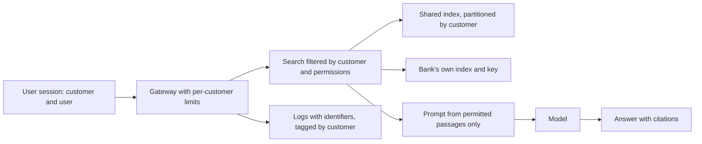
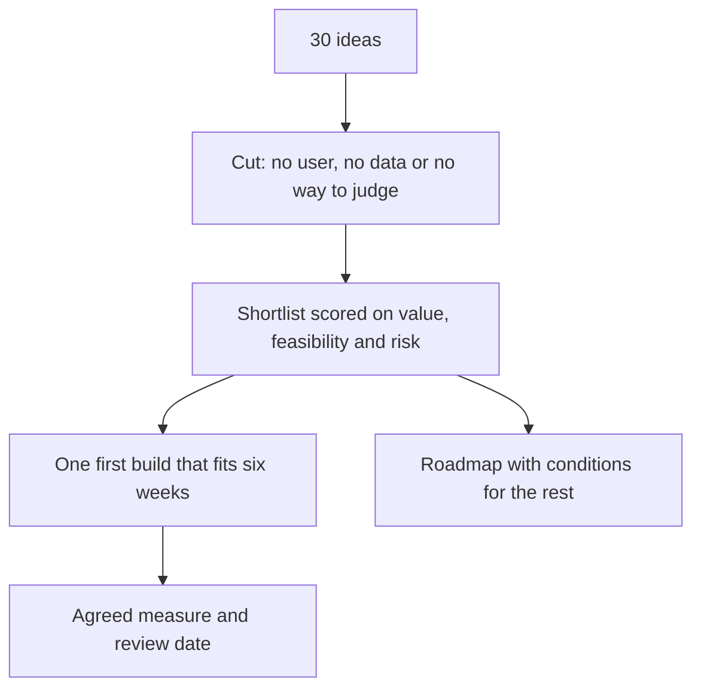

## How to use this practice

Run each drill in 20 minutes with a timer, as in [practise case drills 1](01_Practise_Case_Drills_1.md):

1. Spend 2 minutes reading the brief and writing the questions you would ask.
2. Spend 6 minutes breaking the problem into parts, aloud.
3. Spend 8 minutes sketching the design or the decision and talking it through.
4. Spend 4 minutes on the follow-up questions, answering before you open each one.

Drill 6 has no system to draw at first. Its design stage is a decision method and a first build. Every customer, name and figure below is fictional.

> **What you'll practise**
>
> - Keeping one customer's data away from another at every layer, not only the database.
> - Cutting a long list of ideas to one first build with reasons a sponsor accepts.
> - Answering a challenge from a large customer or an executive without dropping the design.

## Drill 5. An assistant on a platform with many customers

Full case for after the drill: the [secure multi-tenant AI platform](../../../../02_System_Design_Case_Studies/Casebook_Rewrites/secure-multi-tenant-ai-platform/casebook.md) casebook and the [one platform, many customers](../end-to-end-engagements/11_One_Platform_Many_Customers.md) simulation.

Kirkwall Software sells contract management software to 220 business customers from one shared platform. It wants to add an assistant that answers questions over each customer's own contracts. One customer, a bank with 4,000 users, says it will sign only if its data can never reach another customer's answers. The smallest customers have fewer than ten users each.

Decompose: what are the parts, and what do you ask first?

- **Tenancy today.** Ask how the platform separates customers now: a customer column on shared tables, a schema per customer or a database per customer. The assistant must not be weaker than the platform.
- **Where data can leak.** List every place customer text goes: the search index, any cache, the model prompt, logs, traces and evaluation sets. Each needs its own separation.
- **Access inside a customer.** Within the bank, not every user may see every contract. Ask whether the platform already has per-document permissions, because the assistant must respect them.
- **The bank's demands.** Ask what "never" means to the bank in writing: separate storage, separate encryption keys, no training on its data, or a dedicated deployment.
- **Cost and noise.** Ask how usage spreads across customers. One large customer can use most of the shared capacity and slow everyone else.

The first three questions to ask, in order: how the platform separates customers today, what the bank's contract requires, and whether per-document permissions exist.

Design: what do you build, and how does a question flow through it?

- **Customer identity on every request.** The customer and user come from the signed-in session, never from the question text. Every downstream call carries them.
- **Separated search.** Each customer gets its own index partition, and every search is filtered by customer and by the user's document permissions before ranking. The bank gets its own index and encryption key.
- **Prompt assembly.** Only passages returned for that customer and user enter the prompt. Caches are keyed by customer, so one customer's cached answer can never serve another.
- **Logs and evaluation.** Logs store document identifiers, not contract text, and are tagged by customer. Evaluation sets come only from customers who agreed in writing.
- **Fair use.** Rate limits and token budgets per customer stop one customer from slowing the rest.

Draw your own sketch first, then compare it with Figure 1.

*Figure 1: Kirkwall's assistant. Customer identity comes from the session and filters every layer: search, cache, prompt and logs.*

Practice question 1. How would you test that one customer can never see another's contracts?

- **Answer:** Build two test customers with planted contracts that contain unique marker phrases. Run questions as each customer that would match the other's markers, and fail the release if any marker appears in an answer, a citation, a cache entry or a log. Run the test on every release, and add a permission test inside one customer as well.
- **Trade-off:** The test suite needs upkeep as features grow. Without it, isolation rests on code review alone.
- **Follow-up to expect:** "What about the model provider?" Check its data-retention terms and confirm it does not train on prompts, in the contract.

Practice question 2. The bank now asks for a fully dedicated deployment. Do you agree?

- **Answer:** Price it, then decide with the account owner. A dedicated deployment removes shared-infrastructure risk but adds a second stack to patch, monitor and upgrade. Offer the separate index and key first, with the isolation test results. If the bank still requires dedication, charge for it and run it from the same release pipeline so it does not drift.
- **Trade-off:** One dedicated customer is manageable. Ten of them turn a platform into a services business.
- **Follow-up to expect:** "What would make you refuse?" A demand for custom code in their copy, which breaks the shared release process.

Practice question 3. A small customer complains that answers are slow every weekday morning. What do you check?

- **Answer:** Check whether a large customer's morning peak is using the shared capacity. Compare latency by customer and by hour against each customer's token use. If one customer dominates, tighten its per-customer limit or give it reserved capacity it pays for, so small customers keep their share.
- **Trade-off:** Stricter limits can slow the large customer at peak. Without them, every small customer pays for one customer's load.
- **Follow-up to expect:** "Which limit would you set first?" Tokens per minute per customer, because it tracks model cost and load more closely than request count.

## Drill 6. Thirty AI ideas, one first build

Full case for after the drill: the [prioritise AI use cases](../../../../02_System_Design_Case_Studies/Casebook_Rewrites/prioritize-ai-use-cases/casebook.md) casebook and the [vague AI for operations request](../end-to-end-engagements/01_The_Vague_AI_for_Operations_Request.md) simulation.

Tenby Insurance's chief operating officer hands you a list of 30 AI ideas gathered from every department and asks which to build first. The list includes claims triage, a chatbot for brokers, fraud scoring, call summaries and an AI that writes policy wording. The chief operating officer's favourite is the broker chatbot. You have six weeks and two engineers for the first build.

Decompose: what are the parts, and what do you ask first?

- **The goal behind the list.** Ask what the chief operating officer must show the board in six months: lower cost, faster claims, better broker retention. The goal decides the scoring.
- **Value.** For each idea, ask who does the work today, how often, and what it costs. Ideas without a named user and a number drop out early.
- **Feasibility.** Ask whether the data exists, is accessible and is good enough, and whether the work can be judged right or wrong. Fraud scoring needs labelled past fraud, which may not exist.
- **Risk.** Ask which ideas affect customers directly or touch regulated decisions. Policy wording and fraud decisions carry legal risk that call summaries do not.
- **Fit for six weeks.** Two engineers for six weeks can ship one narrow tool to real users. Ask which ideas can produce a measured result inside that window.

The first three questions to ask, in order: what result the board expects, which ideas have a named user and a measurable cost, and which have data you can reach this month.

Design: how do you decide, and what is the first build?

- **Cut to a shortlist.** Drop ideas with no named user, no data access or no way to judge correct output. A list of 30 often falls to six or eight this way.
- **Score the shortlist.** Rate each remaining idea on value, feasibility and risk with the department heads in the room, using their numbers. Show the scores on one page.
- **Pick one first build.** Choose the idea with high value, reachable data and low risk that fits six weeks. Call summaries for claims handlers often fit: the data exists, handlers can judge quality, and nothing reaches a customer unreviewed.
- **Name the favourite's path.** Place the broker chatbot on the roadmap with the conditions it needs, such as an approved answer source and broker testing, instead of rejecting it.
- **Define success up front.** Agree the measure for the first build, such as minutes of after-call work per claim, and the date it is reviewed.

Compare your method with Figure 2 after you have tried your own.

*Figure 2: Tenby's decision path. Most ideas leave at the cut, the shortlist is scored with department heads, and one build starts with an agreed measure.*

Practice question 4. The chief operating officer insists on the broker chatbot first. How do you respond?

- **Answer:** Take it seriously and show the scores. Explain what the chatbot needs before it is safe: an approved answer source, a way to measure wrong answers, and broker testing. Estimate whether six weeks covers that. If it does not, offer a narrower first step, such as an internal tool that drafts broker replies for staff to check, which tests the same content with less risk.
- **Trade-off:** Agreeing keeps the sponsor happy and risks a public failure. Refusing outright loses the sponsor.
- **Follow-up to expect:** "The board wants something visible." A measured internal win in six weeks is more visible than a chatbot pulled after a wrong answer.

Practice question 5. Two departments' ideas score the same. How do you break the tie?

- **Answer:** Prefer the one whose data you can reach this week and whose users will join a pilot. Then prefer the one that builds something reusable for later ideas, such as access to the claims document store. If both are still level, ask the chief operating officer to choose and record the reason.
- **Trade-off:** Reuse favours infrastructure over the most visible idea. It shortens every later build.
- **Follow-up to expect:** "Isn't scoring subjective?" Partly. Using each department's own numbers and showing the scores openly makes the judgement visible and open to challenge.

Practice question 6. Halfway through the six weeks, the call-summary data turns out to lack speaker labels. What now?

- **Answer:** Measure the damage before changing course. Test summaries on a sample without labels and have handlers rate them. If quality holds, continue. If not, see whether the call platform can add labels for new calls, and run the pilot on those. Tell the chief operating officer now, with the revised date, rather than at the review.
- **Trade-off:** Waiting for new calls delays the pilot by a few weeks. Switching to another idea throws away three weeks of work.
- **Follow-up to expect:** "Should discovery have caught this?" Yes. Add a data sample check to discovery for the next build.

## Limits of this practice

- **Outlines are not scripts.** Use your own words and examples in the round.
- **Fictional customers.** Kirkwall Software, Tenby Insurance and every figure here are illustrative.
- **Scores are a tool, not an answer.** Real prioritisation also weighs politics and timing the scores do not capture.

## References

1. AWS, [SaaS tenant isolation strategies](https://docs.aws.amazon.com/whitepapers/latest/saas-tenant-isolation-strategies/saas-tenant-isolation-strategies.html), accessed 17 November 2026. Silo, pool and bridge models for separating customers on a shared platform.
2. PostgreSQL Global Development Group, [Row security policies](https://www.postgresql.org/docs/current/ddl-rowsecurity.html), accessed 17 November 2026. Enforcing per-customer row access in the database itself.
3. The site's [prioritise AI use cases](../../../../02_System_Design_Case_Studies/Casebook_Rewrites/prioritize-ai-use-cases/casebook.md) casebook, the full case behind drill 6.
4. The author's own field experience, the basis for the drill timings and the six-week first-build framing.

## Key takeaways

- Take customer identity from the session and filter every layer by it: search, cache, prompt and logs.
- Prove isolation with planted markers on every release.
- Cut a long idea list on user, data and judgeable output before scoring anything.
- Place the sponsor's favourite on the roadmap with conditions instead of rejecting it.
- Agree the first build's measure and review date before the build starts.

## Check yourself

1. Why must the customer identity come from the session and not from the question?

Anything in the question is user input and can be changed or faked. The session is set by the platform's sign-in, so filters built on it cannot be steered by what the user types.

2. Why cut the list of 30 before scoring it?

Scoring 30 ideas takes hours and gives weak ideas a seat at the table. Removing ideas with no user, no data or no way to judge output leaves a shortlist worth the department heads' time.

