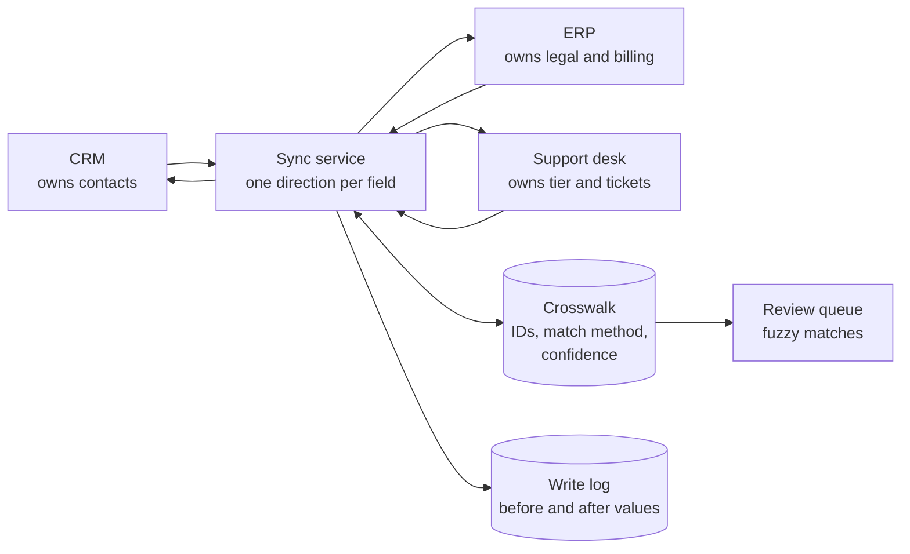

## Start with three versions of every customer

Bewick Telecom, a fictional business broadband provider, has 48,000 business customers. Sales work in a customer relationship management (CRM) system, finance bills from an enterprise resource planning (ERP) system, and support agents use a separate support desk. The head of customer operations asks: "Our people see three versions of each customer. Make them match."

A contractor had tried this the year before with a script that copied every changed field to the other two systems, in every direction. A support agent corrected a contact's postal address in the support desk. The script copied it to the ERP as the billing address, and the next month's invoices for that customer went to a site they had left. Finance switched the script off after two weeks.

Every system wrote to every other system, and nobody decided which one was right. Call this **the three-way echo**: a sync with no owners, which spreads each mistake to every copy.

> **What you'll learn**
>
> - Give every shared field one owning system and one direction of flow.
> - Map customer identifiers across systems with a crosswalk you can audit.
> - Keep a backfill moving when a vendor cuts your API quota mid-run.
> - Contain and reverse a wrong merge that has already spread.
> - Defend the design in terms of what can go wrong and how you would know.

## Discover: who owns each field

Start with fields, not systems. For each field the three systems share, ask which team creates it, which team is accountable when it is wrong, and which system records the real event. Table 1 is the result after a day of interviews with sales, finance and support leads.

| Field | Owning system | Why | Flows to |
| --- | --- | --- | --- |
| Legal name, company number | ERP | Finance verifies them for invoicing | CRM, support desk |
| Billing address, payment terms | ERP | They drive invoices and credit | CRM (read only) |
| Contacts, sales owner, contract stage | CRM | Sales create and maintain them | Support desk |
| Support tier, open tickets | Support desk | Agents set and work them | CRM (read only) |

*Table 1: One owner per field. Every other system reads a copy, and a copy is never edited.*

Two findings change the scope. First, contacts edited in the support desk must go back to sales as a request, not as a write, because the CRM owns them. Second, about 1,200 customer records change each day across the three systems, so the sync must handle a steady flow as well as a one-off backfill.

## Design: a crosswalk and one-way flows

The three systems use different identifiers: a CRM account ID, an ERP customer number and a support organisation ID. None holds the others. The design adds a **crosswalk**, a table with one row per real customer, holding each system's identifier, how the match was made, its confidence, and who confirmed it.

Matching runs in two tiers:

1. **Deterministic.** Match on the company registration number, then the value added tax (VAT) number. These link about 44,000 of the 48,000 customers.
2. **Fuzzy.** Name and postcode similarity for the rest. A fuzzy match goes to a review queue for a finance analyst. It never links on its own.

*Figure 1: The sync design. Every write goes through the crosswalk and the write log, which is what makes the later recovery possible.*

Each change is read from its owning system since a stored watermark, looked up in the crosswalk, and written to the other systems as an idempotent update keyed by the crosswalk ID. Repeating a write gives the same result. The write log keeps the before and after value of every field the sync touches.

## The constraint changes: a quota cut and a wrong merge

The backfill has loaded 30,000 customers when the support desk vendor cuts Bewick's API quota from 100,000 to 20,000 calls a day, effective immediately. The sync starts receiving HTTP 429 "Too Many Requests" responses with a `Retry-After` header.

Two days later, a support lead reports that a customer can see another company's tickets. Two dental practices with the same trading name share a business park and a postcode. An early version of the fuzzy rule, applied before the review queue existed, linked them. The sync then did its job: it copied one practice's legal name and billing address over the other's in the CRM and gave both organisations' contacts access to 37 tickets in the support desk. One bad link had changed 14 fields across three systems within an hour.

## Recover: budget the quota, then unwind the merge

**The quota.** The remaining 18,000 customers need about three support desk calls each, or 54,000 calls. Live changes need about 2,400 calls a day. Run the sync at 80 per cent of the quota, 16,000 calls, to leave room for the vendor's own tools and retries. That leaves 16,000 − 2,400 = 13,600 calls a day for the backfill: 54,000 ÷ 13,600 is a little under four days.

- Live changes go first, backfill second.
- Accounts with open tickets go to the front of the backfill.
- Honour `Retry-After` and back off. Never retry at once in a loop.
- Checkpoint the watermark after each page so a restart resumes where it stopped.
- Ask the vendor for a bulk export, which would remove most of the calls.

Tell the support leads the new date the same day: four days, with the reason.

**The merge.** Treat it as an incident, because it exposes one customer's data to another.

1. **Stop the spread.** Freeze the crosswalk row so the sync skips it. Remove the shared ticket access first.
2. **Find the blast radius.** Query the write log by crosswalk ID: 14 fields, 37 tickets, three systems.
3. **Unmerge.** Split the crosswalk row into two, each confirmed by finance against the company number.
4. **Restore.** Write the logged before-values back to each owning system, then let the sync copy them on.
5. **Prevent.** Re-run every early fuzzy link through the review queue, block any sync that would change a legal name or company number without review, and add a daily report of crosswalk rows whose identifiers conflict.

The customers affected are told by Bewick's own process for data incidents, with the facts from the log.

## Defend: the design under questioning

The walkthrough replays the engagement as you would tell it to Bewick's leadership or an interviewer.

Step through the Bewick engagement. Each phase shows what happened, your move and the evidence you kept.

<button type="button" data-step="0" aria-pressed="false" aria-controls="bewick-step-0">1. Discover</button><button type="button" data-step="1" aria-pressed="false" aria-controls="bewick-step-1">2. Design</button><button type="button" data-step="2" aria-pressed="false" aria-controls="bewick-step-2">3. Change</button><button type="button" data-step="3" aria-pressed="false" aria-controls="bewick-step-3">4. Recover</button><button type="button" data-step="4" aria-pressed="false" aria-controls="bewick-step-4">5. Defend</button>

<section id="bewick-step-0" class="step-panel" aria-labelledby="bewick-heading-0"><h4 id="bewick-heading-0">1. Discover field owners</h4><dl><dt>What happened</dt><dd>Three systems, three versions of each customer, a failed two-way script.</dd><dt>Your move</dt><dd>Interview each team per field and name one owning system for each.</dd><dt>Evidence</dt><dd>A field ownership table signed by sales, finance and support.</dd></dl></section><section id="bewick-step-1" class="step-panel" aria-labelledby="bewick-heading-1"><h4 id="bewick-heading-1">2. Design the crosswalk</h4><dl><dt>What happened</dt><dd>No system holds the others' identifiers.</dd><dt>Your move</dt><dd>A crosswalk with deterministic matching first, fuzzy matches to review, idempotent writes and a write log.</dd><dt>Evidence</dt><dd>44,000 of 48,000 customers linked on company or VAT number.</dd></dl></section><section id="bewick-step-2" class="step-panel" aria-labelledby="bewick-heading-2"><h4 id="bewick-heading-2">3. The constraint changes</h4><dl><dt>What happened</dt><dd>The support desk quota fell to 20,000 calls a day, and a wrong link merged two dental practices.</dd><dt>Your move</dt><dd>Separate the capacity problem from the data incident.</dd><dt>Evidence</dt><dd>429 responses in the logs, 14 fields and 37 tickets in the write log.</dd></dl></section><section id="bewick-step-3" class="step-panel" aria-labelledby="bewick-heading-3"><h4 id="bewick-heading-3">4. Recover</h4><dl><dt>What happened</dt><dd>18,000 customers left to load and one customer's data visible to another.</dd><dt>Your move</dt><dd>Budget the quota at 80 per cent, then freeze, unmerge and restore from the log.</dd><dt>Evidence</dt><dd>A four-day backfill date and a restored, re-reviewed crosswalk.</dd></dl></section><section id="bewick-step-4" class="step-panel" aria-labelledby="bewick-heading-4"><h4 id="bewick-heading-4">5. Defend the design</h4><dl><dt>What happened</dt><dd>Leadership asks whether the sync can be trusted.</dd><dt>Your move</dt><dd>Show the owner table, the match tiers, the guard on legal fields and the daily conflict report.</dd><dt>Evidence</dt><dd>Zero unreviewed fuzzy links and a conflict report with a named owner.</dd></dl></section>

<button type="button" data-walk="previous">Previous</button>

<button type="button" data-walk="next">Next step</button>

The walkthrough is a scripted illustration. The strongest defence is the write log: it is why a wrong merge took hours to reverse instead of weeks.

## Limits of this lesson

- **Composite engagement.** Bewick Telecom, its customers and every figure are illustrative, not a real customer.
- **Matching is a field of its own.** This lesson uses two tiers. Large estates may need a master data management product and a data steward team.
- **Notification duties vary.** Who must be told about a data exposure, and when, depends on law and contract. The customer's privacy owner decides.

## Interview angle

Each answer is an outline to say in about two minutes. The last question is timed: set a clock and talk it through before opening it.

Interview question 1. A CRM, an ERP and a support desk hold the same customers and disagree. How do you decide which system owns what?

- **Answer:** Decide per field, not per system. For each shared field, ask who creates it, who is accountable when it is wrong and which system records the real event. Legal and billing data usually belong to the ERP, contacts to the CRM, tickets to support. Each field flows one way from its owner. Copies are read only, and edits elsewhere become requests to the owner.
- **Trade-off:** One-way flows force some users to change where they edit. Two-way sync looks friendlier and spreads every mistake.
- **Follow-up to expect:** "Two teams both claim a field." The sponsor decides, and the decision is written down.
- **Go deeper:** [Stakeholder and workflow maps](../../../../01_Concept_Tutorials/Consolidated_Lessons/T6.1_Customer_Discovery_and_Problem_Decomposition/07_Stakeholder_and_Workflow_Maps.md).

Interview question 2. The three systems use different customer identifiers. How do you map them?

- **Answer:** Add a crosswalk table: one row per real customer with each system's identifier, the match method, a confidence and who confirmed it. Match first on stable keys such as company or tax numbers. Send fuzzy matches on name and address to a human review queue, never to an automatic link. Key every sync write on the crosswalk ID and log it.
- **Trade-off:** Review queues need people and slow the first load. Automatic fuzzy links are fast and merge customers who share a name.
- **Follow-up to expect:** "How do you handle a customer that splits or merges for real?" Change the crosswalk through the same review, with history kept.
- **Go deeper:** [Duplicates and entity resolution](../../fde-building-in-the-estate/customer-data-pipelines/03_Duplicates_and_Entity_Resolution.md).

Interview question 3. Halfway through a backfill, a vendor cuts your API quota by 80 per cent. What do you do?

- **Answer:** Work out the new budget: the quota, minus headroom, minus live traffic, leaves the backfill share. Divide the remaining calls by it to get a new date and tell people that day. Put live changes first and the most used records next. Honour 429 responses and `Retry-After`, checkpoint so restarts resume, and ask the vendor for a bulk export.
- **Trade-off:** Headroom slows the backfill. Running at 100 per cent starves live changes and the vendor's own tools.
- **Follow-up to expect:** "The business cannot wait four days." Ask the vendor for a temporary raise or a bulk file, and load the most used records first.
- **Go deeper:** [Backfills while live](../../fde-building-in-the-estate/customer-data-pipelines/05_Backfills_While_Live.md).

Interview question 4. A matching error merged two customers, and the sync has already copied the result everywhere. How do you recover?

- **Answer:** Treat it as a data incident. Freeze the crosswalk row so the sync stops, and remove any shared access first. Use the write log to list every field and record touched. Split the crosswalk row, confirmed against a stable key, and write the logged before-values back to the owning systems. Then re-review similar links and block automatic changes to legal identifiers.
- **Trade-off:** A write log costs storage. Without it you rebuild records from backups and memory.
- **Follow-up to expect:** "There is no write log." Restore from the owning systems' audit history or backups, and add the log before restarting the sync.

Interview question 5. Timed drill (20 minutes): a telecom wants its CRM, ERP and support desk to show one customer. Run the engagement.

- **Answer:** Minutes 0 to 4: discovery on fields, owners, volumes and what went wrong before. Minutes 4 to 8: the field ownership table and one-way flows. Minutes 8 to 12: the crosswalk, match tiers, idempotent writes and the write log. Minutes 12 to 15: a quota cut, with the budget arithmetic and new date. Minutes 15 to 18: a wrong merge, with freeze, blast radius, unmerge and prevention. Minutes 18 to 20: how you would show leadership the sync is trustworthy.
- **Trade-off:** Arithmetic takes interview time. A date with no working looks like a guess.
- **Follow-up to expect:** "Why not buy a master data product?" At this size a crosswalk is enough. Say what scale would change that.

## References

1. IETF, [RFC 6585: Additional HTTP Status Codes](https://www.rfc-editor.org/rfc/rfc6585), accessed 17 November 2026. The 429 Too Many Requests status.
2. IETF, [RFC 9110: HTTP Semantics](https://www.rfc-editor.org/rfc/rfc9110), accessed 17 November 2026. The `Retry-After` header.
3. Stripe, [Idempotent requests](https://docs.stripe.com/api/idempotent_requests), accessed 17 November 2026. Keys that make a repeated write return the same result.
4. The site's [incremental loads and watermarks](../../fde-building-in-the-estate/customer-data-pipelines/02_Incremental_Loads_and_Watermarks.md) lesson, and the author's own field experience, the basis for the crosswalk and the recovery steps.

## Key takeaways

- Decide ownership per field, by who records the real event, and let each field flow one way.
- A crosswalk with match method and confidence makes identifier mapping auditable.
- Never let a fuzzy match link records on its own.
- Budget a cut quota with headroom, put live changes first and give a new date with the working.
- A write log of before-values turns a spreading merge into a reversible incident.

## Check yourself

1. Why did the contractor's address correction end up on invoices?

The script copied every field in every direction, so a contact address edited in the support desk overwrote the billing address the ERP owned.

2. Where does the four-day backfill estimate come from?

54,000 remaining calls divided by 13,600 calls a day, which is 80 per cent of the 20,000 quota minus 2,400 calls for live changes.

3. What made the wrong merge reversible?

The write log, which held the before and after value of every field the sync changed, keyed by crosswalk ID.

