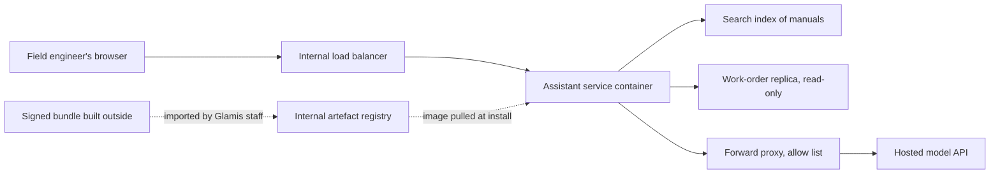

## Start with the request from Glamis Utilities

Glamis Utilities, a fictional water company, runs its maintenance systems on a private network segment. Its head of asset operations sends this request:

> "Our field engineers lose an hour a day searching manuals and old work orders. We want your assistant running inside our network by the end of the quarter. Security says nothing leaves except through the proxy, and your engineers can touch our systems only in change windows."

Glamis had tried a pilot with another supplier the year before. On install night the container started, then hung. At startup it tried to download a tokenizer file and two Python packages from the internet. The firewall dropped the calls without an error, and the two-hour change window ran out while the team read logs. Call this **the install that phones home**: software that assumes the internet at runtime, shipped into a network that has none.

> **What you'll learn**
>
> - Ask the questions that shape a deployment behind proxies, before you design.
> - Build an artefact that installs and starts with no runtime downloads.
> - Recover when the customer turns on TLS inspection mid-engagement.
> - Plan, rehearse and hand over changes that must fit a short access window.

## Discover: map the network before the design

The first meeting is about the network, not the model. You want facts that change the design, each with a named owner at Glamis. Table 1 shows the questions and what each answer did to the plan.

| Question | Answer at Glamis | Design consequence |
| --- | --- | --- |
| How does traffic leave the segment? | One forward proxy, with an allow list | Every outbound host must be listed and approved |
| How long does an allow-list change take? | 10 working days, through the change board | Name the one external host in week 1 |
| Does the proxy inspect TLS? | Not today, under review | Plan to trust Glamis's own root certificate |
| Where do images and packages come from? | An internal artefact registry, imported by Glamis staff | Ship one signed bundle, never pull at runtime |
| Who has hands on the keyboard? | A Glamis operator, with you on a recorded screen share | Write runbooks someone else can run |
| When can changes happen? | Tuesday and Thursday, 19:00 to 21:00 | Every change must fit two hours, rollback included |

*Table 1: The network questionnaire for Glamis. Each answer changes the build, the plan or the handover.*

Two more facts mattered. The work-order database was reachable only as a read-only replica. The hosted model API was the only external dependency, so the allow list needed one hostname. Fewer outbound hosts means fewer approvals, and less to break when the policy changes.

## Design: an artefact that never phones home

The design rule was simple to state: everything the service needs at startup is inside the bundle or inside Glamis's network. Figure 1 shows the result.

*Figure 1: The Glamis deployment. Solid lines are runtime traffic, dotted lines are the install path. Only one call crosses the proxy.*

Four choices made it work:

- **Build once, outside.** The image holds pinned dependencies, the tokenizer and the small embedding model used for search. It ships with a software bill of materials, a vulnerability scan and a signature that Glamis verifies on import.
- **Configuration from the environment.** The proxy address, the list of internal names that bypass it, and the path to a trust bundle are settings, not code.
- **A startup preflight.** Before serving traffic, the service checks DNS, the proxy, the TLS chain, the model API and the replica, and prints one line per layer. A failure names its layer instead of "connection failed".
- **Proof before shipping.** You run the image in a test network with all egress blocked except a stand-in proxy. If it starts, it does not phone home.

## A constraint changes: inspection and a shorter window

In week 3 two things changed. Glamis's security team turned on TLS inspection for all outbound traffic. The proxy now decrypted each call and re-signed it with a certificate from Glamis's own authority. Every model call failed with a certificate verification error, because the container trusted only public authorities.

Inspection also broke streaming. The proxy buffered responses. The assistant's word-by-word answers arrived in one block after up to 40 seconds, and some hit the proxy's 30-second idle timeout.

The same week, after an unrelated outage, the change board cut the windows to one 90-minute slot on Thursdays. A fix that needed two attempts would now take two weeks.

## Recover: trust the customer's authority, and plan the window

The tempting fix for the certificate error is to turn off verification. That removes the check that stops an attacker posing as the model API. The right fix is to add Glamis's root certificate to the trust bundle the service reads. Each runtime reads its own setting: Python's `requests` library honours `REQUESTS_CA_BUNDLE`, Node.js reads `NODE_EXTRA_CA_CERTS`. The preflight now reports which authority signed the chain it saw.

Inspection raised a data question too. The proxy now saw prompts that held work-order text. You asked security what the proxy logged and for how long. They agreed to exclude the model hostname from content logging. Streaming was the second request: either an inspection exemption for that one host, or a longer idle timeout. Security chose the timeout, and you switched the assistant to show a progress message instead of streaming.

For the 90-minute window, you rehearsed every change on a staging copy Glamis owned, with timings:

- **Before the window:** Glamis imports and verifies the bundle. The window never waits on a transfer.
- **0 to 10 minutes:** preflight on the current version, to prove the baseline.
- **10 to 35:** deploy, then preflight on the new version.
- **35 to 55:** functional checks the operator runs from the runbook.
- **55 to 90:** reserved for rollback to the previous image, still in the registry.

Database changes were additive only, so a rollback never needed a schema change.

## Defend: show the evidence, not the effort

At the end of the quarter the sponsor and the security lead asked two questions: is it safe, and will it keep working when you leave?

Your answer was a short evidence pack. It held the bill of materials, the signatures, the scan results and the single egress host. It held a preflight log from a container run with egress blocked, and the timings from the last three changes: 52, 47 and 49 minutes of 90. The Glamis operator had run the last change alone, with you watching.

You also named what you chose not to do. You did not ask for a proxy bypass, because one exception invites the next. You did not turn off verification, even for one night.

The walkthrough replays the engagement as you would tell it in an interview, one phase per step.

Step through the Glamis engagement. Each step shows what you knew, what you decided and what you can show for it.

<button type="button" data-step="0" aria-pressed="false" aria-controls="glamis-step-0">1. Discover</button><button type="button" data-step="1" aria-pressed="false" aria-controls="glamis-step-1">2. Design</button><button type="button" data-step="2" aria-pressed="false" aria-controls="glamis-step-2">3. Constraint</button><button type="button" data-step="3" aria-pressed="false" aria-controls="glamis-step-3">4. Recover</button><button type="button" data-step="4" aria-pressed="false" aria-controls="glamis-step-4">5. Defend</button>

<section id="glamis-step-0" class="step-panel" aria-labelledby="glamis-heading-0"><h4 id="glamis-heading-0">1. Map the network</h4><dl><dt>You know</dt><dd>One proxy, a 10-day allow-list process, an internal registry, two-hour windows.</dd><dt>You decide</dt><dd>Name the single external host in week 1.</dd><dt>Evidence</dt><dd>The questionnaire, with an owner per answer.</dd></dl></section><section id="glamis-step-1" class="step-panel" aria-labelledby="glamis-heading-1"><h4 id="glamis-heading-1">2. Build a bundle that never downloads</h4><dl><dt>You know</dt><dd>The last supplier's install hung on a download.</dd><dt>You decide</dt><dd>Pin everything, sign the bundle, add a layer-by-layer preflight.</dd><dt>Evidence</dt><dd>The image starts with all egress blocked.</dd></dl></section><section id="glamis-step-2" class="step-panel" aria-labelledby="glamis-heading-2"><h4 id="glamis-heading-2">3. Inspection arrives, the window shrinks</h4><dl><dt>You know</dt><dd>Certificate errors on every model call, buffered streams, one 90-minute slot.</dd><dt>You decide</dt><dd>Treat it as a trust and timing problem, not a bug in the model.</dd><dt>Evidence</dt><dd>The preflight names the TLS layer.</dd></dl></section><section id="glamis-step-3" class="step-panel" aria-labelledby="glamis-heading-3"><h4 id="glamis-heading-3">4. Trust their authority, rehearse the change</h4><dl><dt>You know</dt><dd>Disabling verification would hide an attacker.</dd><dt>You decide</dt><dd>Add the root certificate, agree logging, drop streaming, time every step.</dd><dt>Evidence</dt><dd>A rehearsed runbook with 35 minutes kept for rollback.</dd></dl></section><section id="glamis-step-4" class="step-panel" aria-labelledby="glamis-heading-4"><h4 id="glamis-heading-4">5. Hand over with proof</h4><dl><dt>You know</dt><dd>Security wants safety, the sponsor wants it to last.</dd><dt>You decide</dt><dd>Let the Glamis operator run the last change alone.</dd><dt>Evidence</dt><dd>Signatures, one egress host, three changes under 55 minutes.</dd></dl></section>

<button type="button" data-walk="previous">Previous</button>

<button type="button" data-walk="next">Next step</button>

## Limits of this lesson

- **One proxy, one host.** Many estates have several proxies and many dependencies. The method holds, and the allow list grows.
- **Fully disconnected sites** have no proxy at all. The [air-gapped AI system](../../../../02_System_Design_Case_Studies/Casebook_Rewrites/air-gapped-ai-system/casebook.md) case covers that design.
- **Fictional data.** Glamis Utilities, its timings and its people are illustrative.

## Interview angle

Each answer is an outline to say in about two minutes. Open each question and try it aloud before reading.

Interview question 1. A customer wants your AI service inside their private network, and every outbound call goes through proxies. How do you plan the deployment?

- **Answer:** Start with a network questionnaire: how traffic leaves, the allow-list process and its lead time, TLS inspection, the internal registry, who runs commands and when. List every external host the service needs and cut it to the minimum. Submit the allow-list request in week 1. Make the proxy, bypass list and trust bundle configuration, and add a startup check that reports each layer.
- **Trade-off:** Discovery takes a week before any build. Skipping it moves the surprises to install night.
- **Follow-up to expect:** "They will not tell you the proxy policy." Ask for a test from inside their network instead.
- **Go deeper:** [Following a request through the network](../../fde-deploying-in-the-estate/networks-and-identity/01_Following_a_Request_Through_the_Network.md).

Interview question 2. The customer's network allows no downloads at runtime. What must be true of what you ship?

- **Answer:** Everything needed at startup is in the artefact or in their network: pinned packages, tokenizers, model files, with certificate paths as settings. Build once outside, ship a signed bundle with a bill of materials and scan results, and let their team import it. Prove it by starting the image with all egress blocked before you ship.
- **Trade-off:** Bundles get large and every update is a new transfer. Runtime downloads are smaller and fail silently in their network.
- **Follow-up to expect:** "How do you patch a vulnerability fast?" Keep a rebuild-and-transfer path rehearsed, with a known turnaround.
- **Go deeper:** [Disconnected and hybrid installs](../../fde-deploying-in-the-estate/deployment-models-and-environments/03_Disconnected_and_Hybrid_Installs.md).

Interview question 3. Mid-engagement, security turns on TLS inspection and every model call fails with a certificate error. What do you do?

- **Answer:** Confirm the cause: the chain the service sees is signed by the customer's authority. Add that root certificate to the trust store each runtime reads, never turn off verification. Then ask what the proxy logs, because it now sees prompts. Check side effects such as buffered streaming and idle timeouts, and agree an exemption or a longer timeout.
- **Trade-off:** Trusting their authority lets their proxy read your traffic. Refusing inspection usually means no deployment.
- **Follow-up to expect:** "The certificate rotates next year." Mount the bundle from their configuration, not the image.

Interview question 4. You get one 90-minute window a week on the customer's systems. How do you ship changes and fix problems?

- **Answer:** Do everything possible outside the window: transfer and verify artefacts beforehand, and rehearse each change on a staging copy with timings. Split the window into baseline check, deploy, verification and a protected rollback slot. Keep schema changes additive so rollback is a version switch. Write runbooks their operator can run, and collect a diagnostic bundle you can read later.
- **Trade-off:** Rehearsal costs days per change. A failed change costs a week.
- **Follow-up to expect:** "Something breaks outside the window." Agree an emergency change path and who can use it.

Interview question 5. Timed drill (20 minutes): deploy an AI assistant into a customer network with a TLS-inspecting proxy, short change windows and no runtime downloads.

- **Answer:** Minutes 0 to 4: ask about egress, inspection, the registry, operators and windows. Minutes 4 to 8: draw the system with one external call through the proxy. Minutes 8 to 12: the bundle, configuration and preflight. Minutes 12 to 16: inspection arrives, trust their root, check logging and streaming, plan the window with a rollback slot. Minutes 16 to 20: the evidence pack and the handover.
- **Trade-off:** A fixed plan can skip a question the interviewer cares about. Say the plan aloud so they can redirect you.
- **Follow-up to expect:** "Which question matters most?" The allow-list lead time, because it sets the critical path.

## References

1. IETF, [RFC 9110: HTTP Semantics](https://www.rfc-editor.org/rfc/rfc9110), accessed 17 November 2026. The `CONNECT` method that forward proxies use to tunnel HTTPS.
2. SLSA, [SLSA specification v1.0](https://slsa.dev/spec/v1.0/), accessed 17 November 2026. Build provenance for artefacts the customer verifies on import.
3. Python Requests, [Advanced usage: CA certificates](https://requests.readthedocs.io/en/latest/user/advanced/), accessed 17 November 2026. The `REQUESTS_CA_BUNDLE` setting. Node.js documents `NODE_EXTRA_CA_CERTS` in its [command-line options](https://nodejs.org/api/cli.html).
4. The site's [disconnected and hybrid installs](../../fde-deploying-in-the-estate/deployment-models-and-environments/03_Disconnected_and_Hybrid_Installs.md) and [containers and persistent data](../../fde-deploying-in-the-estate/deployment-models-and-environments/05_Containers_and_Persistent_Data.md) lessons, and the author's own field experience, the basis for the window plan.

## Key takeaways

- Discover the network first: egress, allow-list lead time, inspection, registry, operators and windows.
- Ship one signed bundle with everything pinned, and prove it starts with egress blocked.
- When inspection arrives, trust the customer's root certificate. Never disable verification.
- Inspection changes data handling and streaming as well as trust. Ask about both.
- Fit every change to the window with rehearsed timings and a protected rollback slot.

## Check yourself

1. Why did the earlier supplier's install hang without a clear error?

The container downloaded files at startup, and the firewall dropped those calls silently. Nothing in the code reported which layer had failed.

2. Why is disabling certificate verification the wrong fix for inspection errors?

It removes the check that the service is talking to the real model API, so anyone on the path could pose as it. Trusting the customer's root keeps the check and accepts the inspection.

3. Why were database changes kept additive at Glamis?

So a rollback inside the 35-minute slot was a switch to the previous image, with no schema change to undo.

