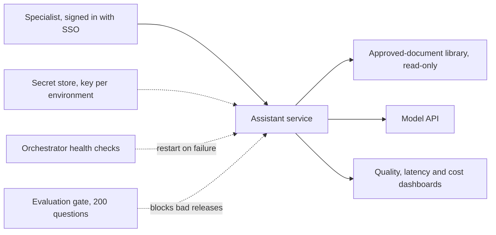

## Start with the request from Ingleby Pharma

Ingleby Pharma, a fictional drug maker, runs a medical information team. Its specialists answer questions from doctors and pharmacists about Ingleby's products, using only approved documents. Your team built a pilot assistant in four weeks. It drafts each answer with citations, and a specialist reviews it before it goes out.

Twelve UK specialists used it and liked it. The vice president for medical affairs writes:

> "This is exactly what we need. Let's put it in front of all 180 specialists across our six countries. Can we start next month?"

The pilot had been built to learn, not to last. It used one API key, stored in the code repository. It read documents through one service account that could see the whole document store, drafts included. When it crashed, an engineer on your team restarted it by hand. Its quality rested on 40 questions checked by hand. Call this **the pilot promoted by announcement**: a prototype that becomes production because someone senior says so, with every shortcut still inside.

> **What you'll learn**
>
> - Sort a prototype's shortcuts into keep, fix before launch and fix after.
> - Decide what production readiness means for this customer, with evidence.
> - Answer a launch-tomorrow demand when credentials are shared and recovery is manual.
> - Find why costs came in at three times the pilot's estimate, and fix the drivers.

## Discover: list every shortcut and what it risks

Shortcuts are how a pilot finishes in four weeks. The problem is not that they exist. It is that nobody lists them, so they survive by default. Your first task was to write them down with the specialists' lead and Ingleby's IT security contact, as in Table 1.

| Shortcut | Fine in the pilot because | Risk in production | Fix |
| --- | --- | --- | --- |
| One API key in the repository | Twelve users, one environment | Leaks with the code, cannot be rotated per environment | Before launch |
| Service account reads the whole store | Faster to set up | Answers could cite unapproved drafts, a compliance breach | Before launch |
| Manual restart by your engineer | Low usage, office hours | Nobody restarts it at night or after you leave | Before launch |
| 40 hand-checked questions | Enough to learn | Too few to catch failures in other countries and products | Within two weeks |
| Cost measured on 12 users | Small volume | Real use may differ | Before scaling past one country |

*Table 1: Ingleby's pilot shortcuts. Each row names why it was acceptable and when it stops being acceptable.*

Two shortcuts were fine to keep. The pilot ran on a single region, which suited a UK launch. It had no admin screen, and prompt changes went through your release process instead.

## Design: what production means for Ingleby

Production readiness is a set of conditions agreed with the people who will run and audit the service. At Ingleby they were: no shared credentials, access limited to approved documents, automatic recovery with a named owner, an evaluation gate on every change, monitoring of quality and cost, and a runbook Ingleby's support team could use. Figure 1 shows the design.

*Figure 1: Ingleby's production design. Dotted lines are controls around the service. The pilot had none of them.*

The evaluation set grew from 40 to 200 questions, drawn from real enquiries in all six countries. Each question had an approved answer and the documents it should cite.

## A constraint changes: launch tomorrow, and the bill

Two things changed in the same fortnight.

First, Ingleby's regulator approved a new indication for one of its products a week early. The UK team expected a surge of enquiries, and the vice president asked to launch the assistant for them the next morning. The shared key, the broad service account and the manual restart were all still in place.

Second, a two-week trial with 60 specialists in two countries produced the first real cost figures. The pilot estimate for full rollout was £1,800 a month. The trial projected £5,400, three times as much. The number of enquiries matched the forecast. The cost per enquiry did not.

## Recover: a smaller launch tomorrow, and a cost breakdown

Refusing the launch outright would have lost the sponsor. Launching as-is would have put a shared key and access to unapproved drafts in front of a regulated team. You split the request.

The launch went ahead for the 30 UK specialists, not all 180. Three fixes were done that night, each small and testable:

- A new key per environment in the secret store, with the old key revoked after the switch.
- The service account limited to the approved library, approved by Ingleby's on-call IT lead.
- Health checks that restart the service, with you named on call for the first week.

The vice president accepted, in writing, that the larger evaluation set would follow within two weeks.

For cost, you measured where the tokens went. Average input per enquiry was 6,000 tokens against 2,000 in the pilot. Two causes explained the rise:

- Specialists in the trial pasted whole email threads, quoted history and all, adding about 2,500 tokens.
- A retrieval setting returned 20 passages instead of 8, adding about 1,500.

You stripped quoted history before the model call and returned 8 passages after a reranking step. Input fell to about 2,500 tokens. The projected cost became about £2,250 a month, 1.25 times the original estimate. A budget alert at £2,500 went to the service owner.

## Defend: conditions met, risks owned

At the go-live review for the other five countries, the vice president and Ingleby's quality lead asked whether the service was ready.

You answered with the readiness conditions and the evidence for each: the secret store audit log, the service account's permissions, two restarts handled by the orchestrator, the 200-question evaluation results, and the cost per enquiry for each week. You named the one condition not yet met: per-country document libraries for two countries were still being approved. Those countries would launch when their libraries were signed off, not before.

The walkthrough replays the engagement as you would tell it in an interview, one phase per step.

Step through the Ingleby engagement. Each step shows what you knew, what you decided and what you can show for it.

<button type="button" data-step="0" aria-pressed="false" aria-controls="ingleby-step-0">1. Discover</button><button type="button" data-step="1" aria-pressed="false" aria-controls="ingleby-step-1">2. Design</button><button type="button" data-step="2" aria-pressed="false" aria-controls="ingleby-step-2">3. Constraint</button><button type="button" data-step="3" aria-pressed="false" aria-controls="ingleby-step-3">4. Recover</button><button type="button" data-step="4" aria-pressed="false" aria-controls="ingleby-step-4">5. Defend</button>

<section id="ingleby-step-0" class="step-panel" aria-labelledby="ingleby-heading-0"><h4 id="ingleby-heading-0">1. List the shortcuts</h4><dl><dt>You know</dt><dd>A liked pilot with a shared key, broad access and manual restarts.</dd><dt>You decide</dt><dd>Sort each shortcut by when it stops being acceptable.</dd><dt>Evidence</dt><dd>A shortcut table agreed with IT security.</dd></dl></section><section id="ingleby-step-1" class="step-panel" aria-labelledby="ingleby-heading-1"><h4 id="ingleby-heading-1">2. Define production</h4><dl><dt>You know</dt><dd>A regulated team, six countries, approved documents only.</dd><dt>You decide</dt><dd>Six readiness conditions, each with evidence.</dd><dt>Evidence</dt><dd>The design, with controls around the service.</dd></dl></section><section id="ingleby-step-2" class="step-panel" aria-labelledby="ingleby-heading-2"><h4 id="ingleby-heading-2">3. Launch tomorrow, cost tripled</h4><dl><dt>You know</dt><dd>An early approval brings a surge, and the trial projects £5,400 a month.</dd><dt>You decide</dt><dd>Neither refuse nor launch as-is.</dd><dt>Evidence</dt><dd>Enquiry volume matched, cost per enquiry did not.</dd></dl></section><section id="ingleby-step-3" class="step-panel" aria-labelledby="ingleby-heading-3"><h4 id="ingleby-heading-3">4. Launch small, cut the tokens</h4><dl><dt>You know</dt><dd>Three fixes fit one night. Input tokens tripled from two causes.</dd><dt>You decide</dt><dd>30 UK users, three overnight fixes, strip threads, 8 passages.</dd><dt>Evidence</dt><dd>Projected cost down to about £2,250 a month.</dd></dl></section><section id="ingleby-step-4" class="step-panel" aria-labelledby="ingleby-heading-4"><h4 id="ingleby-heading-4">5. Show the conditions</h4><dl><dt>You know</dt><dd>Two countries' libraries are not approved yet.</dd><dt>You decide</dt><dd>Launch country by country as conditions are met.</dd><dt>Evidence</dt><dd>Audit logs, permissions, restarts, evaluation results, weekly cost.</dd></dl></section>

<button type="button" data-walk="previous">Previous</button>

<button type="button" data-walk="next">Next step</button>

## Limits of this lesson

- **A cooperative sponsor.** The vice president accepted a smaller launch. Some sponsors will not, and then the escalation path matters more than the design.
- **Cost in tokens only.** Ingleby's costs were mostly model calls. Other services spend more on compute, storage or people.
- **Composite engagement.** Ingleby Pharma, its figures and its regulator's timing are illustrative, not a real customer.

## Interview angle

Each answer is an outline to say in about two minutes. Open each question and try it aloud before reading.

Interview question 1. Your prototype took shortcuts to finish fast. Which can stay in production, and which must go?

- **Answer:** List every shortcut, with why it was acceptable and the risk it carries at production scale. Shortcuts that touch security, access, data correctness or recovery go before launch: shared credentials, broad permissions, manual restarts. Shortcuts that limit scale or convenience, such as one region, can stay until the need arrives. Agree the list with the customer's security contact.
- **Trade-off:** Fixing everything delays launch. Fixing nothing keeps pilot risks in front of real users.
- **Follow-up to expect:** "Who decides the order?" The service owner, with security, against the risk each one carries.

Interview question 2. How do you decide a pilot is ready for production?

- **Answer:** Agree readiness conditions with the people who will run and audit it, each with evidence: credentials and access, recovery with an owner, an evaluation gate, monitoring of quality and cost, a runbook, and support handover. Then check each condition, show the evidence and name any condition not met, with what it blocks.
- **Trade-off:** A formal review adds a week. An informal one misses the gap someone else finds first.
- **Follow-up to expect:** "The pilot metrics were great." Pilot users volunteered. Production users did not.
- **Go deeper:** [Pilots that predict production](../../../../01_Concept_Tutorials/Consolidated_Lessons/T6.3_Delivery_Six_Stages_Gates_and_Two_Week_Launch/08_Pilots_That_Predict_Production.md).

Interview question 3. The sponsor wants to launch tomorrow, but the service still uses shared credentials and recovery is manual. What do you do?

- **Answer:** Split the request. Name what is unsafe to launch with, and what can be fixed overnight: a key per environment in a secret store, tighter service permissions, automatic restarts with a named on-call person. Offer a smaller launch, fewer users or one region, with those fixes done. Get written acceptance for the risks that remain, with dates.
- **Trade-off:** A smaller launch disappoints the sponsor. A full launch on shared keys can end in a breach.
- **Follow-up to expect:** "The sponsor insists on the full launch." Escalate with the specific risk, and record the decision.
- **Go deeper:** [Secrets and leaks](../../fde-deploying-in-the-estate/networks-and-identity/04_Secrets_and_Leaks.md).

Interview question 4. Production costs come in at three times the pilot estimate. How do you find out why and fix it?

- **Answer:** Split cost into volume and cost per task. If volume matches the forecast, measure where tokens go per task: input context, retrieved passages, retries, extra calls. Compare pilot and production inputs, because real users behave differently. Fix the largest drivers first, check quality on the evaluation set after each change, and set a budget alert.
- **Trade-off:** Cutting context can cut quality. Measure both after every change.
- **Follow-up to expect:** "Could you switch to a cheaper model?" Possibly, for simple enquiries, if the evaluation set says quality holds.
- **Go deeper:** [RAG and agent cost controls](../../../../01_Concept_Tutorials/Consolidated_Lessons/T4.5_Cost_and_Latency/06_RAG_and_Agent_Cost_Controls.md).

Interview question 5. Timed drill (20 minutes): a well-liked pilot must become production, the sponsor wants launch tomorrow on shared credentials, and costs run at three times the estimate.

- **Answer:** Minutes 0 to 4: list the shortcuts and their risks. Minutes 4 to 8: readiness conditions and the design with its controls. Minutes 8 to 12: the launch request, split into a smaller launch with overnight fixes and written risk acceptance. Minutes 12 to 16: cost split into volume and cost per task, then the drivers and fixes. Minutes 16 to 20: evidence per condition.
- **Trade-off:** Covering both constraints leaves less time for each. Name the one you would act on first.
- **Follow-up to expect:** "Which comes first?" The credentials, because they carry the risk you cannot take back.

## References

1. OWASP, [Secrets Management Cheat Sheet](https://cheatsheetseries.owasp.org/cheatsheets/Secrets_Management_Cheat_Sheet.html), accessed 17 November 2026. Central storage, per-environment secrets and rotation.
2. Google, [Site Reliability Engineering: The Evolving SRE Engagement Model](https://sre.google/sre-book/evolving-sre-engagement-model/), accessed 17 November 2026. The production readiness review.
3. The site's [scale a prototype to production](../../../../02_System_Design_Case_Studies/Casebook_Rewrites/scale-prototype-to-production/casebook.md) case, for the full system design.
4. The site's [safe rollouts](../../fde-deploying-in-the-estate/releases-cutover-and-recovery/02_Safe_Rollouts.md) and [AI cost per successful task](../../fde-deploying-in-the-estate/reliability-performance-and-cost/04_AI_Cost_per_Successful_Task.md) lessons, for the launch and the cost checks.
5. The author's own field experience, the basis for the shortcut table and the split launch.

## Key takeaways

- Write every pilot shortcut down with the risk it carries and when it must go.
- Production readiness is a list of conditions, each with evidence, agreed with the people who run and audit the service.
- Answer a launch-tomorrow demand by splitting it: a smaller launch, overnight fixes, written acceptance for the rest.
- When costs triple, separate volume from cost per task, then find where the tokens go.
- Check quality after each cost fix, and set a budget alert.

## Check yourself

1. Why was the broad service account a launch blocker at Ingleby, not a later fix?

It could read unapproved drafts, so the assistant could cite them in answers to doctors. For a regulated medical information team that is a compliance breach, not a performance issue.

2. The trial's enquiry volume matched the forecast. What did that tell you about the cost overrun?

The overrun came from cost per enquiry, not from more enquiries. That pointed the search at what each call sent to the model.

3. Why did the evaluation set grow before scaling to other countries?

Forty UK questions could not show failures on other products, languages or local documents. The larger set drew on real enquiries from all six countries.

