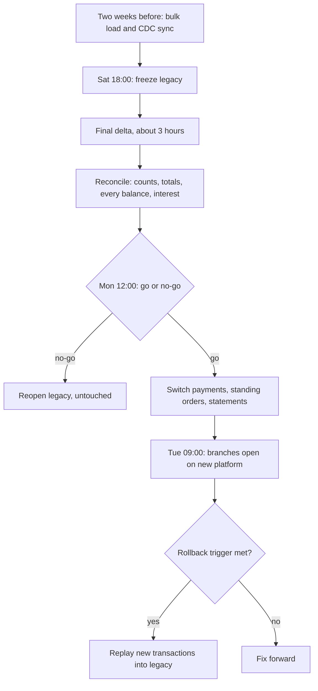

## Start with the request from Jedburgh Building Society

Jedburgh Building Society, a fictional mutual, is moving its savings accounts from a legacy servicing system to your company's platform. It holds 412,000 accounts and 61.3 million transactions from nine years. The chief operating officer writes:

> "We want to move over the August bank holiday weekend. Branches close Saturday at noon and open again Tuesday at nine. Members must not notice."

The first plan was a single move inside the weekend. Freeze the legacy system on Saturday at 18:00, copy everything, check it and open on the new platform. The first rehearsal copied the full history in 31 hours. That left no time to reconcile, and none to roll back if the checks failed. Call this **the freeze that does not fit**: a cutover plan that assumes the whole move happens inside the window.

> **What you'll learn**
>
> - Plan a live migration that moves most of the data before the window opens.
> - Define acceptance that goes past row counts to money.
> - Diagnose balances that differ when every count matches.
> - Decide between rolling back and fixing forward once live transactions exist.

## Discover: the window, the signatories and the way back

The window ran from Saturday 18:00 to Tuesday 09:00, 63 hours. Inside it you needed the final move, reconciliation, a go or no-go decision, and enough time left to undo everything if the answer was no.

Discovery found the facts that shaped the plan:

- **Who signs.** The finance controller signs that the money is right. The head of savings operations owns the go or no-go call and any rollback.
- **What else moves.** The payments feed, standing orders and statement runs all read account data. Each needed a switch-over step.
- **What rollback means.** Before go-live, rollback is switching back to a legacy system that never stopped being correct. After go-live, it means carrying every new transaction back.

The 31-hour rehearsal changed the design. Most data had to move before the window, not during it.

## Design: move early, keep in sync, gate on money

The history was bulk-loaded two weeks before the weekend. A change data capture (CDC) feed then copied every change from the legacy database to the platform as it happened. In the window, only the final changes since the last sync needed to move. In rehearsal that took 2 hours 40 minutes.

Acceptance was agreed in writing before the first rehearsal. Every level had to pass:

- Account and transaction counts equal per product.
- Total balance per product equal to the penny.
- Balance equal for every single account.
- Accrued interest equal per account.
- A deep comparison of the full history for a sample of 500 accounts.

Figure 1 shows the weekend with its gates.

*Figure 1: Jedburgh's cutover weekend. Before the go decision, rollback is free. After it, rollback carries live transactions back.*

The rollback triggers were written down too: balances that cannot be trusted across the platform, or payments unavailable for more than two hours.

## A constraint changes: counts match, balances do not

The third rehearsal passed the first check. Counts matched exactly: 412,000 accounts and 61.3 million transactions. Totals per product did not. 1,140 accounts had different balances, and the differences added up to £18,412.67.

A count shows that every row arrived. It cannot show that each row means the same thing on both sides. You grouped the 1,140 accounts by the size and pattern of their difference, and two groups appeared:

- **1,002 accounts** differed by exactly their accrued interest. The legacy system held interest earned but not yet paid in a separate table. The mapping had not included it.
- **138 accounts** differed by one transaction each. Each was posted on the Friday with a value date of Saturday. The extract filtered by value date, the platform's balance used posting date, and those transactions fell between them.

1,002 and 138 make 1,140, so every difference was explained.

## Recover: fix the mapping, then the live defect

Both causes were mapping errors, fixed and re-run in a fourth rehearsal with zero unexplained differences. The finance controller signed it. The live weekend followed the plan, and the go decision came on Monday at 11:40.

On Tuesday at 11:30 a new problem appeared. The platform's standing-order run had paid 212 standing orders twice, because a migrated "last run" date was a day behind. By then members had made 3,870 transactions on the new platform.

Rolling back would mean closing services, exporting those 3,870 transactions and replaying each into legacy with its own reference, then reconciling again. The plan estimated five hours, with branches closed. Neither trigger was met. Balances outside the 212 accounts were sound, and payments worked. The head of savings operations chose to fix forward. The duplicate payments were reversed through the platform's own reversal process, the scheduler was paused until the date was corrected, and the 212 members were told the same day.

## Defend: the evidence behind each decision

At the board's review, the chief operating officer asked two questions: how do we know the money moved correctly, and why did we not roll back?

For the first, you showed the reconciliation at every level, the two explained differences from rehearsal three, and the finance controller's signature on the fourth. For the second, you showed the triggers agreed a month earlier, the 3,870 live transactions a rollback would have had to carry, and the 212 accounts the defect touched. The decision followed rules written before anyone was under pressure.

The walkthrough replays the engagement as you would tell it in an interview, one phase per step.

Step through the Jedburgh cutover. Each step shows what you knew, what you decided and what you can show for it.

<button type="button" data-step="0" aria-pressed="false" aria-controls="jedburgh-step-0">1. Discover</button><button type="button" data-step="1" aria-pressed="false" aria-controls="jedburgh-step-1">2. Design</button><button type="button" data-step="2" aria-pressed="false" aria-controls="jedburgh-step-2">3. Constraint</button><button type="button" data-step="3" aria-pressed="false" aria-controls="jedburgh-step-3">4. Recover</button><button type="button" data-step="4" aria-pressed="false" aria-controls="jedburgh-step-4">5. Defend</button>

<section id="jedburgh-step-0" class="step-panel" aria-labelledby="jedburgh-heading-0"><h4 id="jedburgh-heading-0">1. Size the window</h4><dl><dt>You know</dt><dd>63 hours, and a full copy took 31.</dd><dt>You decide</dt><dd>Name who signs the money and who calls rollback.</dd><dt>Evidence</dt><dd>Rehearsal timings and named signatories.</dd></dl></section><section id="jedburgh-step-1" class="step-panel" aria-labelledby="jedburgh-heading-1"><h4 id="jedburgh-heading-1">2. Move early, gate on money</h4><dl><dt>You know</dt><dd>Only the final changes must move in the window.</dd><dt>You decide</dt><dd>Bulk load, CDC sync, five levels of acceptance, written triggers.</dd><dt>Evidence</dt><dd>A final delta of 2 hours 40 minutes.</dd></dl></section><section id="jedburgh-step-2" class="step-panel" aria-labelledby="jedburgh-heading-2"><h4 id="jedburgh-heading-2">3. Counts match, balances do not</h4><dl><dt>You know</dt><dd>1,140 accounts differ by £18,412.67 in total.</dd><dt>You decide</dt><dd>Group the differences by pattern before fixing anything.</dd><dt>Evidence</dt><dd>Two groups that explain every account.</dd></dl></section><section id="jedburgh-step-3" class="step-panel" aria-labelledby="jedburgh-heading-3"><h4 id="jedburgh-heading-3">4. Fix forward after go-live</h4><dl><dt>You know</dt><dd>212 double payments, 3,870 live transactions.</dd><dt>You decide</dt><dd>No trigger met, so reverse the duplicates and pause the scheduler.</dd><dt>Evidence</dt><dd>Members told the same day.</dd></dl></section><section id="jedburgh-step-4" class="step-panel" aria-labelledby="jedburgh-heading-4"><h4 id="jedburgh-heading-4">5. Show the rules were set first</h4><dl><dt>You know</dt><dd>The board asks about the money and the rollback.</dd><dt>You decide</dt><dd>Answer with reconciliation and the triggers.</dd><dt>Evidence</dt><dd>Signed acceptance and a decision made by agreed rules.</dd></dl></section>

<button type="button" data-walk="previous">Previous</button>

<button type="button" data-walk="next">Next step</button>

## Limits of this lesson

- **One source system.** Migrations that merge several systems add matching and duplicate problems on top of these.
- **A cooperative legacy system.** Jedburgh's legacy database supported change capture. Some systems allow only nightly extracts, which widens the final delta.
- **Composite engagement.** Jedburgh Building Society, its figures and its weekend are illustrative, not a real customer.

## Interview angle

Each answer is an outline to say in about two minutes. Open each question and try it aloud before reading.

Interview question 1. Plan the migration of a live system's data to a new platform when the cutover window is one weekend.

- **Answer:** Rehearse first to learn how long a full move takes. Move history in advance and keep it in sync with change data capture, so the window holds only the final delta. Map every downstream feed that must switch. Fix the timeline with a go or no-go gate that still leaves time to undo. Name who signs acceptance and who decides rollback.
- **Trade-off:** Early loading and sync add weeks of running two copies. A big-bang move rarely fits the window.
- **Follow-up to expect:** "The source cannot do change capture." Use frequent incremental extracts by modified time, and rehearse the delta size.
- **Go deeper:** [Backfills while live](../../fde-building-in-the-estate/customer-data-pipelines/05_Backfills_While_Live.md).

Interview question 2. How do you define acceptance for a migration, and when do you roll back?

- **Answer:** Agree acceptance in writing before the first rehearsal, at several levels: counts, totals per group, every record's key values such as balance, and a deep sample. Name who signs. Write rollback triggers in advance, such as untrusted balances or payments down past a time limit, and who calls it. Before go-live, rollback is cheap. After it, it carries live work back.
- **Trade-off:** Strict acceptance can delay go-live for small differences. Each difference must be explained, not waived.
- **Follow-up to expect:** "The business wants to accept a known difference." Record it, with the signatory and the fix date.

Interview question 3. Row counts match exactly after a migration rehearsal, but customer balances do not. How do you find the cause?

- **Answer:** Counts prove rows arrived, not that they mean the same thing. Group the mismatched records by the size and pattern of the difference. Look for data held outside the main tables, such as accrued interest, and for boundary rules such as value date against posting date. Check that the groups explain every record before fixing the mapping and re-running.
- **Trade-off:** Grouping takes hours. Fixing records one by one hides the mapping error that caused them.
- **Follow-up to expect:** "One group remains unexplained." Do not go live until it is explained or formally accepted.

Interview question 4. A defect appears after cutover and customers have already made transactions on the new system. Do you roll back?

- **Answer:** Check the triggers agreed before the cutover. A rollback now means stopping the new system, exporting every new transaction and replaying each into the old system with a unique reference, then reconciling again. If the defect is contained and reversible, fixing forward is usually safer: reverse the bad records, pause the faulty job and tell affected customers.
- **Trade-off:** Fixing forward keeps service up but runs on a system with a known defect. Rolling back restores the known state at the cost of hours of downtime and replay risk.
- **Follow-up to expect:** "Who decides?" The named owner, using the written triggers.
- **Go deeper:** [Rolling out with a way back](../../../../01_Concept_Tutorials/Consolidated_Lessons/T6.5_Adoption_and_Business_Impact/01_Rolling_Out_With_a_Way_Back.md).

Interview question 5. Timed drill (20 minutes): migrate a live financial system over one weekend, find why balances differ when counts match, and decide on rollback after live transactions.

- **Answer:** Minutes 0 to 4: window, volumes, feeds, signatories. Minutes 4 to 9: bulk load, change capture, the timeline with its go gate. Minutes 9 to 12: acceptance levels and rollback triggers. Minutes 12 to 16: the balance mismatch, grouped by pattern. Minutes 16 to 20: the post-go-live defect, the cost of rollback with live transactions and the decision.
- **Trade-off:** Detail on the mismatch can crowd out the rollback. Keep each under four minutes.
- **Follow-up to expect:** "What would you rehearse twice?" The final delta and the rollback.

## References

1. Debezium, [Features](https://debezium.io/documentation/reference/stable/features.html), accessed 17 November 2026. Change data capture from database logs, used to keep a target in sync before cutover.
2. Martin Fowler, [Blue Green Deployment](https://martinfowler.com/bliki/BlueGreenDeployment.html), accessed 17 November 2026. Switching between two environments and why the database makes the way back harder.
3. The site's [backfills while live](../../fde-building-in-the-estate/customer-data-pipelines/05_Backfills_While_Live.md) lesson, for loading history while a system runs.
4. The site's [migrating live data](../../fde-deploying-in-the-estate/releases-cutover-and-recovery/03_Migrating_Live_Data.md) and [cutover and rollback decisions](../../fde-deploying-in-the-estate/releases-cutover-and-recovery/04_Cutover_and_Rollback_Decisions.md) lessons, for the sync and the go or no-go call.
5. The author's own field experience, the basis for the acceptance levels and the rollback triggers.

## Key takeaways

- Rehearse to learn how long a full move takes, then move history early and sync changes.
- Agree acceptance at several levels, down to every balance, before the first rehearsal.
- Counts prove rows arrived, not that they mean the same thing. Group mismatches by pattern.
- Write rollback triggers and their owner in advance.
- After live transactions, rollback means carrying them back. A contained, reversible defect usually favours fixing forward.

## Check yourself

1. Why did matching counts not prove the migration correct at Jedburgh?

Every row arrived, but accrued interest lived in a table outside the mapping, and a date filter left out boundary transactions. The rows were present, and the balances were still wrong.

2. Why was rollback cheap before Monday's go decision and expensive after Tuesday's opening?

Before go-live, legacy was untouched and still correct. After it, 3,870 new transactions existed only on the new platform and would have had to be replayed into legacy.

3. What made fixing forward reasonable on Tuesday?

The defect touched 212 known accounts, the duplicate payments could be reversed, and neither written rollback trigger was met.

