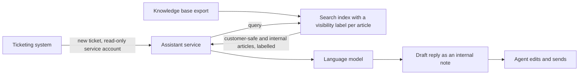

## Start with the plan that assumed access

Rothbury Telecom, a fictional broadband provider, asks for an assistant that helps its 120 support agents answer tickets. It should find the right knowledge base article and draft a reply inside the ticketing system. The head of support wants it live in six weeks. You have one other engineer.

Your first plan looks tidy. Week one, discovery. Weeks two to four, build. Week five, pilot. Week six, hand over. Every line after week one assumes you can read the ticketing system's API and export the knowledge base on day three.

On day three neither is possible. Ticketing API access needs a service account, and Rothbury's security team takes ten working days to approve one. Call this **the borrowed-access plan**: a schedule that depends on access someone else must grant, with no date or owner for the grant.

> **What you'll learn**
>
> - Plan six weeks of work for two engineers around the access you do not yet have.
> - Design an assistant that respects which articles agents and customers may see.
> - Build an evaluation set before the build, from tickets already resolved.
> - Recover a plan when access and permissions slip in week three.
> - Defend what you shipped and what you deferred at the end.

## Discover: the work, the data and who grants access

Spend the first three days on four questions.

- **What does success mean?** The head of support measures average handling time and tickets reopened within seven days. Take a baseline from the last three months: 14 minutes per ticket and 11% reopened.
- **What is the work?** Sort a month of tickets by intent. Five intents, including router setup and billing date changes, make up 45% of volume. Start there.
- **What is the data?** The knowledge base holds 1,800 articles. 240 are internal only: engineering notes agents may read but customers must never see quoted. About 30% of articles are more than two years old.
- **Who grants what, and when?** List every access you need, its owner and the lead time. The ticketing API needs a service account (security, ten working days). The knowledge base export needs the content owner's approval (two days). Request both on day one.

That last list is the one most plans skip. Put each grant on the plan as a dated dependency with an owner.

## Design: a plan that works before access arrives

Figure 1 shows the assistant you agree with Rothbury.

*Figure 1: The support assistant. Each article carries its visibility label from export to draft, and every reply goes through an agent.*

Two design choices matter most:

- **Visibility travels with the article.** The index stores whether each article is customer-safe or internal. The draft may quote only customer-safe text. Internal articles appear to the agent as references beside the draft, never inside it.
- **The assistant writes an internal note, not a reply.** An agent reads, edits and sends. The assistant cannot post to a customer.

The plan orders work so that each week has something to do even if access is late.

| Week | Engineer 1 | Engineer 2 | Depends on |
| --- | --- | --- | --- |
| 1 | Discovery, baselines, access requests | Evaluation set: 200 resolved tickets from an approved CSV export | Nothing new |
| 2 | Index the knowledge base with visibility labels | Retrieval tests against the evaluation set | Knowledge base export |
| 3 | Drafting with the model, citations | Ticketing integration, read-only | Service account |
| 4 | Fix the top failures from evaluation | Internal-note write-back, logging | Service account |
| 5 | Pilot with 10 agents on the five intents | Measure handling time and reopens | Pilot agents named |
| 6 | Fixes, runbook | Handover, decision on roll-out | Support operations owner |

*Table 1: The six-week plan. The right-hand column turns each access grant into a visible dependency.*

The evaluation set comes first because it needs no new access and decides every later choice. Each of the 200 tickets has the intent, the article an expert would cite and the reply that resolved it.

## A constraint changes: week three

At the start of week three, three things have slipped.

- **The service account is not approved.** Security has questions about the scope requested: write access to all tickets.
- **The knowledge base export is withdrawn.** A security reviewer finds that the export file includes the 240 internal articles with no label, and stops its use until labels are added.
- **Engineer 2 is pulled away for three days** to help with a network outage.

At this point the original plan has lost a week, and week five's pilot is at risk.

## Recover: re-plan around what you control

Work on the causes, not the dates.

**Shrink the access you ask for.** The service account request asked for write access to every ticket. Re-scope it to read on new tickets in the five pilot intents and write to internal notes only. Security approves the narrower request in four days instead of re-reviewing the broad one. Least privilege shortened the wait.

**Fix the export at its source.** Ask the content owner to add the visibility field to the export job, then re-export. Add a check to indexing that rejects any article with no label. The withdrawn export was a correct call by security. It caught the leak you designed against.

**Re-plan with the sponsor in writing.** Show the head of support three options. Keep the date and pilot with 10 agents on three intents instead of five. Keep five intents and move the pilot one week, to week six. Or keep both and drop the runbook, which you advise against. She chooses three intents on the original date, with the other two in a follow-on fortnight.

**Keep both engineers busy without access.** While the account is pending, run retrieval and drafting against the 200 evaluation tickets offline. By the time access lands, the pipeline has been tested on real resolved tickets.

Follow the Rothbury engagement through its five phases. Each step shows the goal, what you do and the evidence you leave behind.

<button type="button" data-step="0" aria-pressed="false" aria-controls="support-step-0">1. Discover</button><button type="button" data-step="1" aria-pressed="false" aria-controls="support-step-1">2. Design</button><button type="button" data-step="2" aria-pressed="false" aria-controls="support-step-2">3. Constraint</button><button type="button" data-step="3" aria-pressed="false" aria-controls="support-step-3">4. Recover</button><button type="button" data-step="4" aria-pressed="false" aria-controls="support-step-4">5. Defend</button>

<section id="support-step-0" class="step-panel" aria-labelledby="support-heading-0"><h4 id="support-heading-0">1. Discover (days 1 to 3)</h4><dl><dt>Goal</dt><dd>Know the measure, the work, the data and every access grant.</dd><dt>You do</dt><dd>Baseline handling time and reopens, sort tickets by intent, list access with owners and lead times.</dd><dt>Evidence</dt><dd>14 minutes, 11% reopened, five intents at 45%, two dated access requests.</dd></dl></section><section id="support-step-1" class="step-panel" aria-labelledby="support-heading-1"><h4 id="support-heading-1">2. Design (weeks 1 and 2)</h4><dl><dt>Goal</dt><dd>A plan that keeps moving while access is pending.</dd><dt>You do</dt><dd>Build the 200-ticket evaluation set, design labels per article and the internal-note write-back.</dd><dt>Evidence</dt><dd>The week-by-week plan with dependencies, the evaluation set.</dd></dl></section><section id="support-step-2" class="step-panel" aria-labelledby="support-heading-2"><h4 id="support-heading-2">3. Week three slips</h4><dl><dt>Goal</dt><dd>See the slip and its causes before changing dates.</dd><dt>You do</dt><dd>Read why security paused the account and the export.</dd><dt>Evidence</dt><dd>A broad write scope, 240 unlabelled internal articles, three lost engineer days.</dd></dl></section><section id="support-step-3" class="step-panel" aria-labelledby="support-heading-3"><h4 id="support-heading-3">4. Recover</h4><dl><dt>Goal</dt><dd>Fix causes and agree a new plan.</dd><dt>You do</dt><dd>Narrow the account scope, label the export at source, offer the sponsor three options.</dd><dt>Evidence</dt><dd>Approval in four days, a label check in indexing, a signed choice of three intents.</dd></dl></section><section id="support-step-4" class="step-panel" aria-labelledby="support-heading-4"><h4 id="support-heading-4">5. Defend (week 6)</h4><dl><dt>Goal</dt><dd>Show what shipped, what it did and what comes next.</dd><dt>You do</dt><dd>Report pilot results against the baseline and the leak tests.</dd><dt>Evidence</dt><dd>Pilot figures, zero internal text in 200 test drafts, a dated follow-on.</dd></dl></section>

<button type="button" data-walk="previous">Previous</button>

<button type="button" data-walk="next">Next step</button>

The walkthrough is a scripted illustration.

## Defend: what shipped, and why it is enough

In week six you present to the head of support and security together. Report against the baseline you took in week one, not against the original plan.

- **Results on three intents.** Pilot agents handled those tickets in 10 minutes against 14 before, and reopens on them fell from 11% to 9%, over two weeks and 10 agents. Say plainly that two weeks is short and the reopen figure may move.
- **Safety evidence.** In 200 evaluation drafts, none quoted an internal article. Every draft went through an agent.
- **What is deferred.** Two intents and the wider roll-out, with dates and the access each needs.
- **What Rothbury owns now.** The runbook, the label check and the evaluation set, so their team can test any change.

If asked why the plan slipped, give the causes and what you changed. The narrower service account and the labelled export are improvements Rothbury keeps.

## Limits of this lesson

- **Scope.** Retrieval quality, permission-aware search and pilot design are taught in their own lessons, linked below.
- **Short pilots.** Two weeks of data shows direction, not a settled effect.
- **Composite engagement.** Rothbury Telecom and every figure here are illustrative, not a real customer.

## Interview angle

Each answer is an outline to say in about two minutes. The last question is timed: set a clock and talk it through before opening it.

Interview question 1. You have six weeks and one other engineer to build a support assistant over a knowledge base and a ticketing system. Plan it.

- **Answer:** Week one: baseline the support measures, sort tickets by intent and pick the top few, list every access grant with its owner and lead time, and build an evaluation set from resolved tickets. Weeks two to four: index articles with visibility labels, draft replies as internal notes, fix failures found in evaluation. Week five: pilot with a small group. Week six: measure, hand over a runbook and decide on roll-out.
- **Trade-off:** Narrowing to a few intents limits the first impact. Covering everything in six weeks covers nothing well.
- **Follow-up to expect:** "Why build the evaluation set first?" It needs no new access and decides every later choice.
- **Go deeper:** [Permissions, deletions and citations](../../fde-building-in-the-estate/ai-delivery-in-customer-estates/03_Permissions_Deletions_and_Citations.md).

Interview question 2. In week three, the ticketing access is still not approved and security has withdrawn the knowledge base export. What do you do?

- **Answer:** Find why each was blocked before moving dates. Narrow the access request to the least the pilot needs, which often speeds approval. Fix the export at its source so permissions travel with it, and add a check that rejects unlabelled content. Keep working offline on the evaluation set. Then give the sponsor options in writing: fewer intents on the same date, or the same scope later.
- **Trade-off:** Cutting scope keeps the date but delays part of the value. Holding scope keeps the value but loses trust in the date.
- **Follow-up to expect:** "Security is being slow on purpose." Assume a reason and ask for it. Here, it was right.
- **Go deeper:** [Service accounts and least privilege](../../fde-deploying-in-the-estate/networks-and-identity/03_Service_Accounts_and_Least_Privilege.md).

Interview question 3. Timed drill (20 minutes): a telecom wants a support assistant live in six weeks with two engineers, and in week three the access you planned on has not arrived. Run the engagement.

- **Answer:** Minutes 0 to 4: discovery on the support measures, the top intents by volume, the knowledge base and which articles customers must never see. Minutes 4 to 7: list every access grant with its owner and lead time, and request each on day one. Minutes 7 to 11: the design, with visibility labels on every article, drafts written as internal notes and an evaluation set from resolved tickets. Minutes 11 to 15: week three, with the causes of each slip, a narrower service account and a label check at indexing. Minutes 15 to 18: options for the sponsor in writing, fewer intents on the date or full scope later. Minutes 18 to 20: what shipped, what is deferred and what the customer owns.
- **Trade-off:** Time spent on access and labels leaves less for retrieval design. Interviewers mark the plan that survives the slip, not the architecture.
- **Follow-up to expect:** "Why not wait for access before planning?" The evaluation set and the design need no access, so waiting wastes two weeks.

## References

1. OWASP, [Top 10 for Large Language Model Applications](https://genai.owasp.org/llm-top-10/), accessed 17 November 2026. Sensitive information disclosure, the risk the visibility labels address.
2. OWASP Cheat Sheet Series, [Authorization cheat sheet](https://cheatsheetseries.owasp.org/cheatsheets/Authorization_Cheat_Sheet.html), accessed 17 November 2026. Least privilege and deny by default, applied to the service account.
3. The site's [pilots that predict production](../../../../01_Concept_Tutorials/Consolidated_Lessons/T6.3_Delivery_Six_Stages_Gates_and_Two_Week_Launch/08_Pilots_That_Predict_Production.md) lesson and the [customer support automation](../../../../02_System_Design_Case_Studies/Casebook_Rewrites/customer-support-automation/casebook.md) casebook.
4. The author's own field experience, the basis for the access-first plan and the week-three recovery.

## Key takeaways

- Put every access grant on the plan as a dated dependency with an owner, and request it on day one.
- Order work so that each week has progress that needs no new access. The evaluation set comes first.
- Carry each article's visibility label from export to draft. Drafts quote only customer-safe text.
- When access slips, fix the cause: narrow the request, fix the source.
- Give the sponsor scope and date options in writing, then report against the baseline.

## Check yourself

1. Why did the narrower service account get approved faster?

Read access to new tickets in five intents and write access to internal notes only is a smaller risk to review than write access to every ticket.

2. Why was the withdrawn export a correct decision by security?

It held 240 internal articles with no label, so the assistant could not have kept them out of customer replies.

3. Why report results against the week-one baseline rather than the original plan?

The baseline measures what changed for the customer. The plan measures only your schedule.

