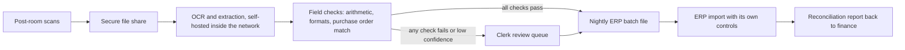

## Start with the average that hid the money

Selsey Water, a fictional water company, receives about 9,000 supplier invoices a month. Most arrive on paper and are scanned in the post room. Clerks type twelve fields from each into a legacy enterprise resource planning (ERP) system that pays suppliers. Selsey asks you to automate the typing.

After six weeks the pilot reports 97% field accuracy on a test set of 500 invoices. The finance director is ready to switch off manual entry. Then a clerk notices that an invoice from a Belgian supplier for €1.284,50 was prepared for payment as €128,450.00. She checks a few more and finds two other wrong amounts in one morning.

The 97% was true. It averaged twelve fields, and the errors were not spread evenly. Call this **the average that hid the money**: one accuracy figure across all fields that conceals where the costly errors sit.

> **What you'll learn**
>
> - Design document processing for scanned records, a legacy ERP and no outbound internet.
> - Get data into an ERP that has no API, without bypassing its controls.
> - Measure accuracy per field and weight it by the cost of an error.
> - Contain errors that cluster in payment amounts with cross-checks and review.
> - Defend a design that automates some fields fully and others never.

## Discover: the documents, the ERP and the network

Three constraints shape everything, so confirm each in the first week.

- **The documents.** Scans from two post-room machines at 200 dots per inch, some faxed copies, some with handwritten corrections. About 15% of suppliers are in Europe and write amounts with a decimal comma, such as 1.284,50.
- **The ERP.** A twenty-year-old system with no API. It imports a fixed-format batch file each night and runs its own checks, including a match of invoice to purchase order and goods receipt. Finance trusts those checks and audit relies on them.
- **The network.** No outbound internet from the finance network. Hosted model APIs are out of reach. Anything you run must be installed inside, with packages and model files brought in through Selsey's approved transfer process.

Ask the finance team one more question: which errors cost most? Their answer: a wrong amount or bank detail pays the wrong money. A wrong delivery address costs a phone call.

## Design: extract inside, import through the front door

Figure 1 shows the pipeline you agree with Selsey's IT and finance teams.

*Figure 1: Selsey's pipeline. Extraction runs inside the network, every entry goes through the ERP's normal import and checks, and failed checks go to a clerk.*

Four decisions carry the design:

- **Run extraction inside.** Optical character recognition (OCR) and a self-hosted extraction model run on servers in Selsey's data centre. You trade some accuracy against hosted models for no data leaving the network, and you plan updates through the transfer process.
- **Import through the existing batch file.** Write the same file the ERP already reads, so its purchase order match and audit trail still apply. Writing straight to the ERP's database would skip both.
- **Check fields before import.** Validate formats, arithmetic and the purchase order number against an ERP extract refreshed each night.
- **Keep a clerk in the path.** Anything that fails a check goes to a review queue with the scan beside the extracted fields.

## A constraint changes: errors cluster in payment amounts

The clerk's discovery leads you to break the 500-invoice evaluation down by field.

| Field group | Fields checked | Errors | Accuracy |
| --- | --- | --- | --- |
| Total amount | 500 | 60 | 88% |
| Other eleven fields | 5,500 | 120 | 97.8% |
| All twelve fields | 6,000 | 180 | 97% |

*Table 1: The same evaluation, split by field. The average looks safe because the amount field is one twelfth of the checks.*

Reading the 60 amount errors shows three causes:

- **Decimal commas.** 27 errors: European formats read as thousands, so 1.284,50 became 128,450.
- **Net, tax and gross confused.** 21 errors: the model picked the net or VAT line instead of the total payable.
- **Handwritten corrections.** 12 errors: a struck-through printed amount was read instead of the handwritten one.

27, 21 and 12 add up to 60. One of every eight invoices would carry a wrong amount, about 1,080 a month at Selsey's volume. That reverses the finance director's decision.

## Recover: make amounts prove themselves

Accuracy on payment amounts needs checks that do not depend on the extraction being right.

- **Arithmetic cross-checks.** Net plus VAT must equal gross, and line items must sum to net. A misread amount rarely satisfies both.
- **Supplier locale.** Read the supplier's country from the ERP's supplier record and parse amounts in that format.
- **Purchase order tolerance.** Compare the total with the purchase order value. Outside an agreed tolerance, such as 2%, the invoice goes to review.
- **Correction markers.** When the scan shows strike-through or handwriting near an amount, send it to review.
- **No straight-through amounts above a limit.** Finance sets a value, such as £10,000, above which a clerk confirms every amount.

Then re-run the evaluation. In the illustrative re-run, cross-checks and review routing catch 57 of the 60 amount errors before import. The ERP's own purchase order match catches 2 of the remaining 3. One wrong amount within tolerance reaches the batch file, which the reconciliation report flags. About 18% of invoices now go to review, against 100% typed by hand before.

Follow the Selsey engagement through its five phases. Each step shows the goal, what you do and the evidence you leave behind.

<button type="button" data-step="0" aria-pressed="false" aria-controls="documents-step-0">1. Discover</button><button type="button" data-step="1" aria-pressed="false" aria-controls="documents-step-1">2. Design</button><button type="button" data-step="2" aria-pressed="false" aria-controls="documents-step-2">3. Constraint</button><button type="button" data-step="3" aria-pressed="false" aria-controls="documents-step-3">4. Recover</button><button type="button" data-step="4" aria-pressed="false" aria-controls="documents-step-4">5. Defend</button>

<section id="documents-step-0" class="step-panel" aria-labelledby="documents-heading-0"><h4 id="documents-heading-0">1. Discover the estate</h4><dl><dt>Goal</dt><dd>Know the documents, the ERP's import path and the network rules.</dd><dt>You do</dt><dd>Sample scans, read the batch file format, confirm outbound access and ask which errors cost most.</dd><dt>Evidence</dt><dd>A scan sample, the import specification, a written network constraint.</dd></dl></section><section id="documents-step-1" class="step-panel" aria-labelledby="documents-heading-1"><h4 id="documents-heading-1">2. Design inside the walls</h4><dl><dt>Goal</dt><dd>Extract without data leaving and import without bypassing controls.</dd><dt>You do</dt><dd>Self-host extraction, write the existing batch file, add field checks and a review queue.</dd><dt>Evidence</dt><dd>A design record approved by IT and finance.</dd></dl></section><section id="documents-step-2" class="step-panel" aria-labelledby="documents-heading-2"><h4 id="documents-heading-2">3. Errors cluster</h4><dl><dt>Goal</dt><dd>See where the 3% of errors sit.</dd><dt>You do</dt><dd>Split the evaluation by field and read every amount error.</dd><dt>Evidence</dt><dd>88% on amounts, three causes: 27, 21 and 12 errors.</dd></dl></section><section id="documents-step-3" class="step-panel" aria-labelledby="documents-heading-3"><h4 id="documents-heading-3">4. Make amounts prove themselves</h4><dl><dt>Goal</dt><dd>Catch amount errors without trusting extraction.</dd><dt>You do</dt><dd>Add arithmetic checks, supplier locale, purchase order tolerance, correction markers and a value limit.</dd><dt>Evidence</dt><dd>57 of 60 caught before import, 2 by the ERP, 1 flagged in reconciliation.</dd></dl></section><section id="documents-step-4" class="step-panel" aria-labelledby="documents-heading-4"><h4 id="documents-heading-4">5. Defend the split</h4><dl><dt>Goal</dt><dd>Agree which fields run straight through and which never do.</dd><dt>You do</dt><dd>Report accuracy per field, weighted by the cost of an error.</dd><dt>Evidence</dt><dd>18% of invoices to review, a signed value limit, a per-field dashboard.</dd></dl></section>

<button type="button" data-walk="previous">Previous</button>

<button type="button" data-walk="next">Next step</button>

The walkthrough is a scripted illustration.

## Defend: some fields never run alone

The finance director asks why 18% of invoices still need a clerk when the model is "97% accurate". Answer with the per-field table and the cost of each error.

- **Accuracy is reported per field.** Payment amounts and bank details have their own figures and their own thresholds. The average is not used to make decisions.
- **Errors are weighted by cost.** A wrong address costs a call. A wrong amount pays the wrong money. The review rate follows the cost, not the average.
- **The ERP's controls still run.** Nothing bypasses the purchase order match or the audit trail.
- **The review rate can fall with evidence.** If amount accuracy after checks holds for three months, finance can raise the value limit.

The clerks' work changes from typing every field to checking the invoices that fail a check. That is the gain, and it is large.

## Limits of this lesson

- **Scope.** Input quality, extraction design and evaluation on the customer's work are taught in their own lessons, linked below.
- **Model choice.** Whether a self-hosted model is accurate enough depends on the documents. Test before committing.
- **Composite engagement.** Selsey Water and every figure here, including the re-run results, are illustrative, not a real customer.

## Interview angle

Each answer is an outline to say in about two minutes. The last question is timed: set a clock and talk it through before opening it.

Interview question 1. A utility wants scanned supplier invoices entered into a legacy ERP with no API, and its network blocks outbound internet. Design it.

- **Answer:** Confirm the documents, the ERP's import path and the network rule first. Run OCR and extraction inside the network, with models brought in through the approved transfer process. Write the batch file the ERP already imports, so its purchase order match and audit trail still apply. Check formats, arithmetic and purchase orders before import, and send failures to a clerk queue with the scan beside the fields.
- **Trade-off:** A self-hosted model may be less accurate than a hosted one. Data stays inside and approval is simpler.
- **Follow-up to expect:** "Why not write to the ERP's database?" It skips the controls finance and audit rely on.
- **Go deeper:** [Extraction you can trust](../../fde-building-in-the-estate/ai-delivery-in-customer-estates/02_Extraction_You_Can_Trust.md).

Interview question 2. Extraction scores 97% field accuracy, but the errors cluster in payment amounts. What do you do?

- **Answer:** Stop reporting the average. Split accuracy by field, read every amount error and group the causes. Add checks that do not trust extraction: net plus tax equals gross, line items sum, supplier locale for number formats, purchase order tolerance. Route failures and high-value invoices to review, then re-run the evaluation and report per field, weighted by the cost of an error.
- **Trade-off:** More review lowers the automation rate. A wrong payment costs more than the review time.
- **Follow-up to expect:** "When can review drop?" When per-field accuracy after checks holds over an agreed period.
- **Go deeper:** [Evaluating on the customer's work](../../fde-building-in-the-estate/ai-delivery-in-customer-estates/05_Evaluating_on_the_Customers_Work.md).

Interview question 3. Timed drill (20 minutes): a utility wants scanned invoices entered into an ERP with no API, inside a network with no outbound internet, and the pilot's errors turn out to cluster in payment amounts. Run the engagement.

- **Answer:** Minutes 0 to 4: discovery on the documents, the ERP's import path, the network rule and which errors cost most. Minutes 4 to 8: the design, with self-hosted extraction, the existing batch file and checks before import. Minutes 8 to 12: the evaluation split by field, with the amount accuracy and its causes. Minutes 12 to 16: checks that do not trust extraction (arithmetic, supplier locale, purchase order tolerance, correction markers, a value limit) and the re-run. Minutes 16 to 20: defend the review rate with per-field accuracy weighted by cost, and say when it can fall.
- **Trade-off:** Reading every amount error takes time in a short round. Reporting only the average is the mistake the drill tests.
- **Follow-up to expect:** "What review rate is acceptable?" The one finance signs against the cost of a wrong payment, lowered as per-field accuracy holds.

## References

1. Google for Developers, [Accuracy, recall, precision and related metrics](https://developers.google.com/machine-learning/crash-course/classification/accuracy-precision-recall), accessed 17 November 2026. Why a single accuracy figure can mislead on uneven data.
2. Tesseract OCR, [Improving the quality of the output](https://tesseract-ocr.github.io/tessdoc/ImproveQuality.html), accessed 17 November 2026. Scan resolution and preprocessing for OCR, relevant to Selsey's 200 dots per inch scans.
3. The site's [inputs as they really arrive](../../fde-building-in-the-estate/ai-delivery-in-customer-estates/01_Inputs_as_They_Really_Arrive.md), [hosted or open weight](../../fde-building-in-the-estate/choosing-the-ai-approach/03_Hosted_or_Open_Weight.md) and [disconnected and hybrid installs](../../fde-deploying-in-the-estate/deployment-models-and-environments/03_Disconnected_and_Hybrid_Installs.md) lessons, and the [document review copilot](../../../../02_System_Design_Case_Studies/Casebook_Rewrites/document-review-copilot/casebook.md) casebook.
4. The author's own field experience, the basis for the amount checks and the import-through-the-front-door rule.

## Key takeaways

- Confirm the documents, the import path and the network rule before choosing tools.
- Import through the interface the ERP already trusts, so its controls still apply.
- Report accuracy per field and weight errors by what they cost.
- Make payment amounts prove themselves with checks that do not trust extraction.
- Automation means clerks check exceptions instead of typing everything.

## Check yourself

1. How can 97% field accuracy hide a 12% error rate on amounts?

The amount is one of twelve fields. Its 60 errors are averaged with 5,500 mostly correct values from the other fields.

2. Why does the arithmetic check catch misread amounts so well?

A misread total rarely still equals net plus tax and the sum of the lines, so a single error breaks the equation.

3. Why write the ERP's batch file instead of its database tables?

The batch import runs the ERP's own purchase order match and audit trail. Direct writes would skip controls finance and audit depend on.

