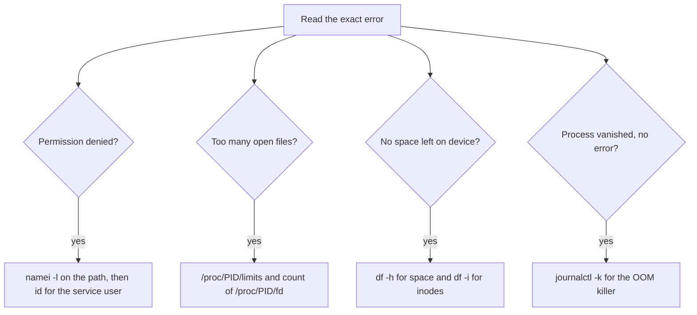

## Start with the month-end ceiling

Alston Telecom, a fictional mobile operator, ran a billing-reconciliation service on two of its own Linux servers. Priya, the vendor's forward deployed engineer, had installed it as a systemd service under a dedicated user, `recon`, and for three weeks it handled the daily call-record files. On the last day of the month the monthly run opened 1,600 batch files in parallel, plus its database and network connections, and within minutes the log filled with "Too many open files". Priya ran `ulimit -n` in her own shell, saw 65,536 and ruled the limit out. Her shell and the service were different processes: the service ran with a limit of 1,024 open files, which the daily run never came near. Call this **the invisible ceiling**.

> **What you'll learn**
>
> - Find a process, its owner, its parent and its resources.
> - Read file permissions and trace a "permission denied" along the whole path.
> - Check open-file, memory and disk limits for the process that failed, not your shell.
> - Diagnose from the exact error, then request a precise change from the customer.

## Processes and the user they run as

A **process** is a running program. Each has a process ID (PID), a parent, a user and group it runs as, and its own limits and open files. On customer servers your service usually runs under **systemd**, the service manager, as a dedicated non-root user.

The commands that answer "what is running and as whom" are few:

| Question | Command | What to read |
| --- | --- | --- |
| Is the service running, and since when? | `systemctl status recon` | State, main PID, recent log lines |
| What did it log? | `journalctl -u recon --since "1 hour ago"` | Errors with timestamps |
| Which user runs it, and how much memory does it use? | `ps -o pid,ppid,user,rss,cmd -p <PID>` | User and resident memory |
| Which files and sockets does it hold? | `lsof -p <PID>` or `ls /proc/<PID>/fd` | Open files, one per line |
| Which user and groups is that? | `id recon` | User ID, group IDs |

*Table 1: Commands for the first five minutes on a customer's Linux server.*

Every answer is about one process. That is the lesson Priya learned: run the checks against the PID that failed, not against your login shell.

## File permissions along the whole path

Each file and directory has an owner, a group and permission bits for three classes: the owner, members of the group, and everyone else. Each class can have read (r), write (w) and execute (x). `ls -l` shows them as, for example, `drwxr-x---`, and `chmod` sets them, often written in octal such as 750.

For directories the bits mean something slightly different, and that is where most surprises come from:

| Bit | On a file | On a directory |
| --- | --- | --- |
| r | Read the contents | List the names inside |
| w | Change the contents | Create, rename or delete entries |
| x | Run it as a program | Pass through it to reach anything inside |

*Table 2: Permission bits on files and directories.*

To write `/var/lib/recon/out/batch.csv`, the `recon` user needs x on `/`, `/var`, `/var/lib`, `/var/lib/recon` and `/var/lib/recon/out`, plus w on `out` to create the file. One missing x anywhere returns "Permission denied", even when the final directory looks fine.

`namei -l /var/lib/recon/out/batch.csv` prints the owner and permissions of every component of the path in one go. Compare each line with `id recon`. If every bit looks right and the write still fails, the next suspects are a mandatory access control system such as SELinux (check with `ls -Z` and the audit log), a read-only mount, or a full disk.

Two fixes are almost always wrong: running the service as root, and setting 777 on the directory. Both make the error disappear and give every process on the server the power the service needed. The right fix is ownership: the customer's administrator makes `recon` the owner of its data directory, through their change process.

## Limits: open files, memory and disk

Linux caps what each process may use. Three caps cause most field failures.

**Open files.** Every file, socket and pipe a process holds uses a file descriptor. The limit has a soft value, enforced, and a hard value, the most the soft value may be raised to. The error is "Too many open files". For a systemd service, the limit comes from the unit's `LimitNOFILE` setting, not from `/etc/security/limits.conf`, which applies to login sessions. Read the real values in `/proc/<PID>/limits`.

**Memory.** A service may be capped by a control group (cgroup) memory limit, and the whole server by its RAM. When either runs out, the kernel's out-of-memory (OOM) killer ends a process. The service does not log its own death. Look in the kernel log with `journalctl -k` or `dmesg` for "Out of memory: Killed process".

**Disk space and inodes.** "No space left on device" comes from a full file system or from running out of inodes, the entries that track files. `df -h` shows space, and `df -i` shows inodes. A service that writes millions of small files can use every inode with gigabytes still free.

Figure 1 maps the common errors to the check that confirms each.

*Figure 1: From the error message to the check that confirms its cause. Each check runs against the failing process or its path.*

## Diagnosing the month-end failure

The walkthrough follows Priya's second attempt, this time against the service rather than her shell.

Alston's monthly run fails with "Too many open files". Each step shows the check, what it found and what it rules in or out.

<button type="button" data-step="0" aria-pressed="false" aria-controls="lim-step-0">1. Process</button><button type="button" data-step="1" aria-pressed="false" aria-controls="lim-step-1">2. Limit</button><button type="button" data-step="2" aria-pressed="false" aria-controls="lim-step-2">3. Usage</button><button type="button" data-step="3" aria-pressed="false" aria-controls="lim-step-3">4. Source</button><button type="button" data-step="4" aria-pressed="false" aria-controls="lim-step-4">5. Fix</button>

<section id="lim-step-0" class="step-panel" aria-labelledby="lim-heading-0"><h4 id="lim-heading-0">1. Find the process</h4><dl><dt>Check</dt><dd><code>systemctl status recon</code> gives the main PID, 4182.</dd><dt>Found</dt><dd>The service runs as <code>recon</code>, started by systemd, not from a login shell.</dd><dt>Means</dt><dd>Shell limits do not apply to it.</dd></dl></section><section id="lim-step-1" class="step-panel" aria-labelledby="lim-heading-1"><h4 id="lim-heading-1">2. Read its real limit</h4><dl><dt>Check</dt><dd><code>grep "open files" /proc/4182/limits</code></dd><dt>Found</dt><dd>Soft limit 1,024, hard limit 524,288.</dd><dt>Means</dt><dd>The service, unlike Priya's shell, is capped at 1,024.</dd></dl></section><section id="lim-step-2" class="step-panel" aria-labelledby="lim-heading-2"><h4 id="lim-heading-2">3. Count what it holds</h4><dl><dt>Check</dt><dd><code>ls /proc/4182/fd | wc -l</code> during the run.</dd><dt>Found</dt><dd>1,024, the ceiling.</dd><dt>Means</dt><dd>The limit is reached. The error is not a bug in file handling elsewhere.</dd></dl></section><section id="lim-step-3" class="step-panel" aria-labelledby="lim-heading-3"><h4 id="lim-heading-3">4. Find why it needs so many</h4><dl><dt>Check</dt><dd><code>lsof -p 4182</code>, grouped by path.</dd><dt>Found</dt><dd>Batch files opened all at once, plus about 40 sockets. The monthly run starts 1,600 batches in parallel.</dd><dt>Means</dt><dd>Two causes: a low limit and unbounded parallelism.</dd></dl></section><section id="lim-step-4" class="step-panel" aria-labelledby="lim-heading-4"><h4 id="lim-heading-4">5. Fix both and verify</h4><dl><dt>Check</dt><dd>Cap parallel batches at 200 in the service's config. Ask Alston to set <code>LimitNOFILE=8192</code> in a systemd drop-in for the unit.</dd><dt>Found</dt><dd>After a restart, <code>/proc</code> shows 8,192, and the rerun peaks at about 260 open files.</dd><dt>Means</dt><dd>Wide headroom, and the run no longer depends on the limit alone.</dd></dl></section>

<button type="button" data-walk="previous">Previous</button>

<button type="button" data-walk="next">Next step</button>

The diagnosis is a scripted illustration. Note the order: confirm the cause with numbers before asking the customer for a change, then fix the code path too. Raising the limit alone would have moved the ceiling to the next larger month.

## Asking the customer for the change

On a customer's server you usually lack root. That is correct, and it shapes how you work. A precise request gets approved faster than a vague one:

- **What:** "Set `LimitNOFILE=8192` for `recon.service` in a drop-in file, then restart it."
- **Why, with evidence:** the count from `/proc`, the error lines and the time of failure.
- **Risk:** the change affects one service and can be reversed by deleting the drop-in.
- **Check:** the value in `/proc/<PID>/limits` after the restart.

Requests framed this way also become part of the runbook. The next engineer at Alston will find the drop-in, the reason and the check in one place.

## Limits of this lesson

- **Distributions differ.** Defaults for limits, the location of logs and whether SELinux or AppArmor is active vary between distributions and customer hardening baselines.
- **Containers add layers.** Inside a container, cgroup limits and user IDs follow the container runtime. The next lesson covers that.
- **Composite engagement.** Alston Telecom, Priya, the PIDs and the counts are illustrative, not a real customer.

## Interview angle

Each answer is an outline to say in about two minutes. Open each question and try it aloud before reading.

Interview question 1. What do you check about processes, permissions and limits when a service misbehaves on a customer's Linux server?

- **Answer:** Start from the exact error and the failing process. Find its PID and user with `systemctl status` and `ps`, and its logs with `journalctl`. For permissions, run `namei -l` on the path and compare with `id` for the service user, remembering directories need x to pass through. For limits, read `/proc/<PID>/limits` and count `/proc/<PID>/fd`. Check the kernel log for OOM kills, and `df -h` and `df -i` for space and inodes.
- **Trade-off:** Checking the process takes a few minutes longer than guessing. Guessing from your own shell gives wrong answers.
- **Follow-up to expect:** "Why not raise every limit?" Limits protect the server, and a raised limit can hide a leak.

Interview question 2. Your service runs as a non-root user and fails with "Permission denied" writing its output. How do you fix it?

- **Answer:** Confirm the user with `ps`, then run `namei -l` on the full output path. Look for a directory without x for that user, or the target directory without w. If the bits look right, check SELinux labels with `ls -Z` and the audit log, a read-only mount and free space. The fix is to make the service user own its data directory, through the customer's change process. Never run it as root or set 777.
- **Trade-off:** A change request takes a day. Running as root fixes it in a minute and fails the next security review.
- **Follow-up to expect:** "It worked yesterday." Ask what changed: a hardening script, a new mount or a new deploy user.

## References

1. Linux man-pages project, [getrlimit(2)](https://man7.org/linux/man-pages/man2/getrlimit.2.html), accessed 17 November 2026. Soft and hard limits, including the open-file limit.
2. Linux man-pages project, [proc(5)](https://man7.org/linux/man-pages/man5/proc.5.html), accessed 17 November 2026. The per-process limits file and file-descriptor directory.
3. Linux man-pages project, [chmod(1)](https://man7.org/linux/man-pages/man1/chmod.1.html), accessed 17 November 2026. Permission bits and their octal form.
4. Linux kernel documentation, [Control group v2](https://docs.kernel.org/admin-guide/cgroup-v2.html), accessed 17 November 2026. Memory limits and the OOM killer.

## Key takeaways

- Check the failing process, not your shell: its user, its limits, its open files.
- Directories need x on every component of the path, and w where the file is created.
- Systemd services take limits from their unit, not from login settings.
- Read the exact error and match it to one check before changing anything.
- Ask for a precise, reversible change with evidence, then fix the code path that hit the limit.

## Check yourself

1. Why did Priya's `ulimit -n` show 65,536 when the service was capped at 1,024?

`ulimit` reports the limits of the shell that runs it. The service was started by systemd with its own limits, readable only in `/proc/<PID>/limits`.

2. The output directory has write permission for the service user, yet writes fail. What else can block them?

A directory higher up the path without x for that user, a mandatory access control label such as SELinux, a read-only mount or a full disk.

3. Why fix the parallelism as well as raising the limit?

A larger month would hit the new limit. Capping parallel batches bounds how many files the service needs, so the limit becomes headroom rather than the only defence.

