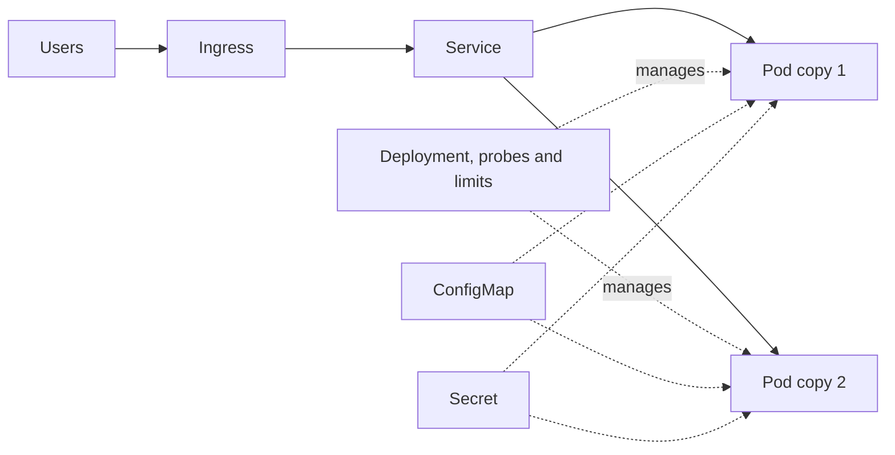

## Start with the quiet default

Wardle Bank, a fictional retail bank, ran a vendor's payments-status service that read its settings from environment variables. One of them, the address of the bank's payments API, defaulted in the code to the vendor's sandbox, so developers could run the service without setting anything. Monday evening's production deploy used a new template that missed that one variable. The service started, passed its health check and for three hours reported statuses from the sandbox, which answers "settled" to everything. Branch staff told 140 customers their payments had cleared, and eleven had not. Marek, the vendor's forward deployed engineer, traced it to one missing value that had been allowed to look like a valid one. Call this **the quiet default**.

> **What you'll learn**
>
> - Keep one image across environments and vary only configuration and secrets.
> - Validate configuration at startup so a bad deploy fails before it serves traffic.
> - Size compute, storage and database connections from measured workload numbers.
> - Name the Kubernetes objects a small service needs, and decide whether it needs Kubernetes at all.

## One image, configuration per environment

Build the image once and promote the same image through test, staging and production. What changes between environments is **configuration**: addresses, feature switches, sizes, log levels. **Secrets** are configuration that grants access, such as database passwords and API keys, and they need stricter handling.

| Item | Where it lives | Differs per environment? | Example |
| --- | --- | --- | --- |
| Code and dependencies | The image | No | The service itself |
| Plain settings | Environment variables or a config file from the deploy | Yes | Payments API address, log level |
| Secrets | A secret store, injected at start | Yes, always | Database password, API key |
| Sizes | The deploy definition | Yes | Instance count, memory limit |

*Table 1: What lives in the image and what the environment supplies.*

The Twelve-Factor App names the rule: strict separation of configuration from code. The site's [package the service and keep secrets out](../../../../01_Concept_Tutorials/Consolidated_Lessons/T1.4_Cloud_Containers_and_Deployment/01_Package_the_Service_and_Keep_Secrets_Out.md) lesson shows how to load settings into one typed class and give each environment its own secrets. In a customer's estate, add two habits: list every setting with its owner (you or the customer's platform team), and keep the production values in the customer's secret store, never in your repository.

## Validate configuration at startup

Defaults are useful for values that are safe everywhere, such as a timeout. They are dangerous for anything that points somewhere: an address, a bucket, a key. Those must be required, and their absence must stop the service.

Startup validation runs before the service accepts any request:

1. **Every required setting is present.** No defaults for environment-specific values.
2. **Every value has the right shape.** A URL parses, a number is in range, an enum is one of its allowed values.
3. **Values agree with the environment.** Production must not point at a sandbox host. Check a short deny-list of known non-production addresses.
4. **Dependencies answer.** The database accepts a connection, and the payments API answers a cheap call.
5. **Report and exit.** On failure, log every problem at once, without secret values, and exit with an error. The platform keeps the old version running.

The readiness check, which tells the platform the instance may receive traffic, should pass only after these steps. The switcher replays Wardle's Monday deploy both ways.

The production template omits the payments API address. Choose how the service treats a missing setting.

<button type="button" data-mode="default" aria-pressed="false" aria-controls="default-result">Fall back to a default</button>
<button type="button" data-mode="failfast" aria-pressed="false" aria-controls="failfast-result">Validate and exit</button>

<section id="default-result" class="mode-panel" data-announcement="Fall back to a default selected. Wrong answers for three hours."><h4>Fall back to a default</h4><ul><li>The service starts with the sandbox address and passes its health check.</li><li>Traffic moves to the new version. Every status reads "settled".</li><li>A branch manager notices at 21:10, three hours later.</li></ul>
Eleven customers were told uncleared payments had cleared. The error was silent because it looked like success.
</section>
<section id="failfast-result" class="mode-panel" data-announcement="Validate and exit selected. Deploy stops in under a minute."><h4>Validate and exit</h4><ul><li>The new instance logs "PAYMENTS_API_URL is required" and exits.</li><li>The readiness check never passes, so the platform keeps the old version serving.</li><li>The deploy pipeline fails within a minute and pages the engineer who ran it.</li></ul>
No customer sees a wrong answer. The fix is a one-line template change.
</section>

The figures are illustrative. A rolling deploy with readiness checks only protects you if the checks test something real. [Safe rollouts](../releases-cutover-and-recovery/02_Safe_Rollouts.md) covers the rollout itself.

## Sizing compute, storage and databases from measurements

Size from three numbers per workload: the peak arrival rate, the resources one unit of work uses, and how long data is kept. Measure the second number with a [load test](../reliability-performance-and-cost/02_Latency_Queues_and_Load_Tests.md) of the real service, not a guess. A worked example for Wardle's document service:

- **Compute.** Peak 40 requests a second, each using 120 ms of CPU. That is 4.8 CPU-seconds every second: 4.8 cores busy. Run CPUs at about 60% at peak to absorb bursts: 4.8 ÷ 0.6 = 8 cores, as four instances of 2 vCPUs.
- **Memory.** Each instance peaked at 1.2 GiB in the load test. Set the limit at 1.6 GiB, about a third above the measured peak.
- **Object storage.** 15,000 documents a day at 2 MB each is 30 GB a day. With 90 days kept, about 2.7 TB.
- **Database rows.** 15,000 rows a day at about 4 KB each, indexes included, is 60 MB a day, about 5.4 GB over 90 days. At that size, connections set the database's limit, not storage.
- **Database connections.** Four instances with a pool of 10 hold 40 connections. A rolling deploy briefly runs old and new instances together, up to 80. The database allows 100. Scale to ten instances and the deploy needs 200, so add a connection pooler or shrink each pool before scaling.

The connection check is the one teams forget. The site's [choose a runtime and scale it](../../../../01_Concept_Tutorials/Consolidated_Lessons/T1.4_Cloud_Containers_and_Deployment/02_Choose_a_Runtime_and_Scale_It.md) lesson covers scaling signals and runtimes in depth.

## Kubernetes objects and when it is worth it

**Kubernetes** runs containers across a cluster of machines, restarts them when they fail and rolls out new versions. A small web service needs only a handful of its objects:

| Object | What it does for the service |
| --- | --- |
| Deployment | Runs N copies of the container, replaces failed ones, rolls out new versions. Holds probes and resource requests and limits |
| Service | A stable internal name and address in front of the copies |
| Ingress | Routes outside HTTP traffic to the Service, often with TLS |
| ConfigMap | Plain settings, mounted as files or variables |
| Secret | Sensitive settings. Encoded, not encrypted, unless the cluster encrypts it at rest |
| PersistentVolumeClaim | A request for storage that outlives a container, only if needed |

*Table 2: The minimal Kubernetes objects for one web service.*

Figure 1 shows how they connect.

*Figure 1: The minimal objects for one web service. The Deployment manages the pods, and the Service and Ingress route traffic to them.*

Whether to use Kubernetes is a separate question from whether you can. It is worth it when:

- **The customer already runs it,** with a platform team that operates the cluster, upgrades it and is on call. You deploy onto their platform.
- **There are many services** that share scaling, rollout and discovery needs.
- **Self-healing at scale matters** more than the learning and operating cost.

It is rarely worth it for one small service at a customer with no cluster. A cluster brings its own upgrades, certificates, networking and security reviews, and someone at the customer must own them. A virtual machine with the container under systemd, or the cloud provider's managed container service, gives restarts and rolling deploys for far less. Propose the smaller option, and state what would change the answer.

## Limits of this lesson

- **Load tests set the numbers.** The CPU and memory per request above are illustrative. Measure your own service at its real peak.
- **Kubernetes depth lives elsewhere.** Autoscaling is in [choose a runtime and scale it](../../../../01_Concept_Tutorials/Consolidated_Lessons/T1.4_Cloud_Containers_and_Deployment/02_Choose_a_Runtime_and_Scale_It.md). Network policies and operators belong to the customer's platform team and are out of scope here.
- **Composite engagement.** Wardle Bank, Marek, the deploy and every figure above are illustrative, not a real customer.

## Interview angle

Each answer is an outline to say in about two minutes. Open each question and try it aloud before reading.

Interview question 1. How do you manage configuration and secrets across development, staging and production?

- **Answer:** Build one image and promote it unchanged. Supply plain settings from the deploy, per environment, and inject secrets at start from a secret store, never from the image or repository. Give environment-specific values no defaults, validate every setting at startup, and fail before serving traffic. In a customer's estate, list each setting with its owner and keep production values in their store.
- **Trade-off:** Required settings make local runs fussier. Defaults make a bad deploy look healthy.
- **Follow-up to expect:** "How do you rotate a secret?" Read it at start and support two valid values during a swap. [Secrets and leaks](../networks-and-identity/04_Secrets_and_Leaks.md) covers rotation.

Interview question 2. How do you size compute, storage and the database for a new deployment?

- **Answer:** Measure three things: peak arrival rate, resources per unit of work from a load test, and retention. CPU: rate times CPU per request, divided by a target utilisation such as 60%. Memory: measured peak per instance plus headroom. Storage: daily volume times retention. Database: rows and size, then connections, instances times pool size, doubled during a rolling deploy, against the database's maximum.
- **Trade-off:** Headroom costs money every day. Sizing to the exact average fails at the first busy hour.
- **Follow-up to expect:** "No traffic data yet." Estimate from business volumes, label it, and load-test before go-live.
- **Go deeper:** [Choose a runtime and scale it](../../../../01_Concept_Tutorials/Consolidated_Lessons/T1.4_Cloud_Containers_and_Deployment/02_Choose_a_Runtime_and_Scale_It.md).

Interview question 3. Which Kubernetes objects does a simple web service need, and when is Kubernetes worth it?

- **Answer:** A Deployment for the copies, with probes and resource limits. A Service for a stable address, an Ingress for outside traffic, a ConfigMap and a Secret for settings, and a PersistentVolumeClaim only if it keeps files. Kubernetes is worth it when the customer already runs a cluster with a platform team, or there are many services to run alike. Otherwise the cluster's own operating work outweighs its benefits.
- **Trade-off:** Kubernetes standardises deploys and recovery. It adds a platform someone must upgrade and secure.
- **Follow-up to expect:** "Are Secrets encrypted?" Only if the cluster encrypts them at rest. By default they are encoded.

Interview question 4. A customer with one small internal app and no cluster asks you to deploy it on Kubernetes. What do you say?

- **Answer:** Ask why first. If the reason is restarts and rolling deploys, a virtual machine running the container under systemd, or a managed container service, gives both with far less to operate. If they plan many services or a platform team, Kubernetes may be right, and they should own the cluster. Write the choice, its cost and what would change it into a decision record.
- **Trade-off:** Going along avoids an argument and leaves them a cluster nobody owns. Pushing back costs a conversation.
- **Follow-up to expect:** "Their architect insists." Agree, with the cluster's owner and on-call named in the plan.

## References

1. The Twelve-Factor App, [III. Config](https://12factor.net/config), accessed 17 November 2026. Strict separation of configuration from code.
2. Kubernetes, [Deployments](https://kubernetes.io/docs/concepts/workloads/controllers/deployment/), accessed 17 November 2026. Rolling updates and replica management.
3. Kubernetes, [Secrets](https://kubernetes.io/docs/concepts/configuration/secret/), accessed 17 November 2026. Secret objects and the default base64 encoding.
4. The site's [choose a runtime and scale it](../../../../01_Concept_Tutorials/Consolidated_Lessons/T1.4_Cloud_Containers_and_Deployment/02_Choose_a_Runtime_and_Scale_It.md) lesson, the deep dive on runtimes and scaling.

## Key takeaways

- One image through every environment. Only configuration and secrets change.
- No defaults for values that point somewhere. Validate at startup and exit on failure.
- Size from peak rate, measured cost per unit of work and retention.
- Check database connections during a rolling deploy, not only at steady state.
- Use Kubernetes when someone owns the cluster and there is enough to run on it.

## Check yourself

1. Why did Wardle's health check pass while the service gave wrong answers?

The check confirmed the process answered requests. The service had started with a valid-looking sandbox address, so nothing in the check tested where it pointed.

2. At 40 requests a second and 120 ms of CPU each, how many cores at 60% utilisation?

40 × 0.12 = 4.8 cores busy. 4.8 ÷ 0.6 = 8 cores.

3. Why can a rolling deploy exhaust database connections that steady state never does?

Old and new instances run together for a while, so the number of pools, and of connections, briefly doubles.

