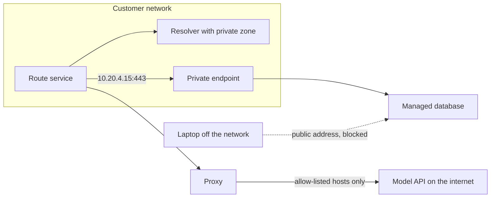

## Start with one error for three faults

Dalby Freight, a fictional logistics firm, asked for a route-planning service inside its own data centre. The service ran in Dalby's container platform. It had to call Dalby's order system at `erp.dalby.internal` and a hosted model API on the internet.

On install day the service logged one line for every call: "connection failed". Tomas, the FDE, tested both calls from his laptop over the VPN, and both worked. Two days later, with Mei from Dalby's network team, he found three separate faults:

- The container platform's DNS did not forward `dalby.internal` names to Dalby's corporate DNS servers.
- Calls to the model API ignored Dalby's proxy and were dropped silently at the firewall.
- Once the proxy was set, Dalby's proxy inspected the TLS traffic and presented a certificate signed by Dalby's own authority, which the container did not trust.

Each fault sat in a different layer, and the code reported them all the same way. Call this **the flattened error**: a failure message that hides which layer broke.

> **What you'll learn**
>
> - Trace a request through DNS, TCP, TLS and HTTP, and name each layer's failure.
> - Diagnose a hostname that fails while the IP address works.
> - Work with proxies, TLS inspection and controlled egress.
> - Reach a private endpoint and keep certificates renewed.

## Four layers, four kinds of failure

Every HTTPS call crosses four steps in order. A failure at one layer stops the call before the next starts. The first layer that fails tells you where to look.

| Layer | What it does | How a failure shows | A quick check |
| --- | --- | --- | --- |
| DNS | Turns a name into an IP address | "Name not resolved" or an unexpected address | `nslookup` or `dig` from the same host |
| TCP | Opens a connection to the address and port | Refused (fast) or timed out (slow) | `nc -vz host 443` |
| TLS | Agrees encryption and checks the server's certificate | Unknown issuer, name mismatch, expired certificate | `openssl s_client -connect host:443` |
| HTTP | Sends the request and returns a status | 401, 403, 404, 502, 503 from the server or a proxy | `curl -v` with the real headers |

*Table 1: The four layers of an HTTPS call, what their failures look like and a command to test each one.*

Tell the two TCP failures apart. **Refused** arrives at once: a host answered, but nothing listens on that port. **Timed out** takes seconds: a firewall dropped the packets or no route exists. Refused points at the server. A timeout points at the path.

Run every check from where the code runs. Your laptop on the VPN has a different resolver, routes and trust store.

The walkthrough traces one of Tomas's calls, from the container to Dalby's order system.

Trace one call from the route-planning container to the order system. Each step shows the check, what failure looks like and what Dalby's network did.

<button type="button" data-step="0" aria-pressed="false" aria-controls="req-step-0">1. DNS</button><button type="button" data-step="1" aria-pressed="false" aria-controls="req-step-1">2. TCP</button><button type="button" data-step="2" aria-pressed="false" aria-controls="req-step-2">3. TLS</button><button type="button" data-step="3" aria-pressed="false" aria-controls="req-step-3">4. HTTP</button>

<section id="req-step-0" class="step-panel" aria-labelledby="req-heading-0"><h4 id="req-heading-0">1. Resolve the name</h4><dl><dt>Check</dt><dd>Look up erp.dalby.internal from inside the container.</dd><dt>Failure looks like</dt><dd>No answer, or a public address where a private one was expected.</dd><dt>At Dalby</dt><dd>The platform's resolver had no forwarding rule for dalby.internal. Adding one fixed the order-system calls.</dd></dl></section><section id="req-step-1" class="step-panel" aria-labelledby="req-heading-1"><h4 id="req-heading-1">2. Open the connection</h4><dl><dt>Check</dt><dd>Open a TCP connection to the resolved address on port 443.</dd><dt>Failure looks like</dt><dd>Refused at once, or a timeout after many seconds.</dd><dt>At Dalby</dt><dd>Direct calls to the internet timed out, because the firewall drops traffic that does not go through the proxy.</dd></dl></section><section id="req-step-2" class="step-panel" aria-labelledby="req-heading-2"><h4 id="req-heading-2">3. Complete the handshake</h4><dl><dt>Check</dt><dd>Run a TLS handshake and read the certificate chain the client receives.</dd><dt>Failure looks like</dt><dd>Unknown issuer, a name that does not match, or an expired certificate.</dd><dt>At Dalby</dt><dd>The proxy re-signed the certificate with Dalby's internal authority. Adding that root to the image's trust store fixed it.</dd></dl></section><section id="req-step-3" class="step-panel" aria-labelledby="req-heading-3"><h4 id="req-heading-3">4. Send the request</h4><dl><dt>Check</dt><dd>Send the real request with its headers and read the status and the response body.</dd><dt>Failure looks like</dt><dd>401 or 403 from an auth layer, 404 for a wrong path, 502 or 503 from a proxy or gateway.</dd><dt>At Dalby</dt><dd>Calls returned 200 once the first three layers worked. The service now logs the layer with every failure.</dd></dl></section>

<button type="button" data-walk="previous">Previous</button>

<button type="button" data-walk="next">Next step</button>

The walkthrough is a scripted illustration. The lasting fix was in the code: log which layer failed, with the address and the error, so the next fault takes minutes instead of days.

## When the hostname fails and the IP works

If a call to the IP address succeeds and the same call by name fails, the network path is fine and name resolution is not. Common causes:

- **Split DNS.** The customer's internal names resolve only on internal resolvers. A container, a cloud function or a laptop off the VPN asks a different resolver.
- **Search domains.** A short name such as `erp` works on staff machines that append `dalby.internal`, and fails where no search domain is set.
- **A stale or local override.** A hosts-file entry or a cached answer points at an old address.
- **A private zone not linked.** In the cloud, a private DNS zone answers only for the networks it is attached to.

Do not "fix" it by putting the IP in configuration. HTTPS checks that the certificate matches the name requested, and calls by IP fail that check. Addresses also change during failover. Fix the resolver path.

## Proxies, egress and TLS inspection

Many enterprises allow outbound traffic only through a **forward proxy**. The client connects to the proxy and asks it to open a tunnel to the destination with the HTTP `CONNECT` method. The firewall drops anything else. That is **controlled egress**: the customer decides which destinations its systems may reach.

Three things go wrong in the field:

1. **The proxy is not configured where the code runs.** Command-line tools read the `HTTPS_PROXY` variable from your shell. A service started by the platform has its own environment. Some language runtimes and libraries ignore the variable altogether. The command line works and the service times out.
2. **The destination is not on the allow list.** The proxy returns 403 or closes the tunnel. Ask for the exact hostnames your service needs, not wildcards, and list them in the install guide.
3. **TLS inspection.** The proxy decrypts traffic to scan it, then re-encrypts with a certificate signed by the customer's own authority. Clients that do not trust that root fail the handshake. Add the root to the image's trust bundle, or ask for the destination to be excluded from inspection. Never switch certificate checks off.

Set `NO_PROXY` for internal names, or internal calls will try to leave through the proxy too. The site's [prompt injection and egress control](../../../../01_Concept_Tutorials/Consolidated_Lessons/T4.4_Security_Tenancy_and_Prompt_Injection/03_Prompt_Injection_and_Egress_Control.md) lesson covers egress limits as a security control for AI agents.

## Private endpoints

A **private endpoint** gives a cloud service, such as a managed database or a storage account, an address inside the customer's own network. Traffic stays on the private network, and the customer can switch the public endpoint off.

*Figure 1: Dalby's paths after the fix. Internal calls resolve to private addresses and stay inside the network. Internet calls leave only through the proxy, to listed hosts.*

The usual failure is DNS again. The name must resolve to the private address from every network that uses it. A resolver that returns the public address sends the call to a closed endpoint, and it times out. Check the lookup first, then the route, then the endpoint's network rules.

## Certificates that expire

Every certificate has an expiry date. When one lapses, every client fails at TLS at the same moment, often on a weekend. Plan renewal on the first day:

- **Know every certificate.** The service's own, any internal authority it trusts, and client certificates for mutual TLS.
- **Automate renewal.** Use the ACME protocol, which many public and internal authorities support, or the customer's certificate service. Renew at about two-thirds of the lifetime.
- **Reload without a restart,** or with a rolling restart, so renewal causes no outage.
- **Alert on days to expiry** at 30 and 7 days, measured from outside, against what clients receive.
- **Send the full chain.** A missing intermediate certificate works in one browser and fails in a container.

## Limits of this lesson

- **Simplified layers.** Real paths add load balancers, service meshes and network address translation. The same order of checks still applies.
- **Commands vary.** Tools differ by platform, and locked-down images may lack them. Ask for a debug image the customer approves.
- **Fictional data.** Dalby Freight, its people and addresses are illustrative.

## Interview angle

Each answer is an outline to say in about two minutes. Open each question and try it aloud before reading.

Interview question 1. Walk me through what happens between a service calling a hostname over HTTPS and getting a response.

- **Answer:** The resolver turns the name into an address, checking caches, then the configured DNS servers. The client opens a TCP connection to that address on port 443, or to a proxy that tunnels it. TLS agrees keys and the client checks the certificate's issuer, name and expiry. The client sends the HTTP request and reads the status and body. Each step can fail on its own terms.
- **Trade-off:** Going layer by layer is slower than guessing. It stops you fixing the wrong layer.
- **Follow-up to expect:** "Where would a load balancer sit?" Between TCP and HTTP, often ending TLS itself.

Interview question 2. How do proxies and egress controls change how you deploy into a customer's network?

- **Answer:** Assume outbound traffic must go through a proxy to an allow list. Ask early for the proxy address, the inspection policy and the approval process for new hosts. List every external hostname the service needs. Configure the proxy in the service's own environment, with internal names excluded, and add the customer's root certificate if they inspect TLS.
- **Trade-off:** Controlled egress slows setup and each new dependency needs approval. It stops data leaving to places nobody approved.
- **Follow-up to expect:** "The vendor's API changes its hostnames." Ask the vendor for a stable list, or route through a gateway the customer controls.

Interview question 3. What is a private endpoint, and what breaks most often when you use one?

- **Answer:** It gives a cloud service an address inside the customer's network, so traffic never crosses the internet and the public endpoint can be closed. DNS breaks most often: the name must resolve to the private address from every network that calls it. A network with the wrong resolver gets the public address and times out.
- **Trade-off:** Private endpoints shrink the attack surface. They add DNS zones, routes and rules to maintain per network.
- **Follow-up to expect:** "How do you test it?" Look up the name from each calling network and compare the answer.

Interview question 4. A service "cannot connect". How do you tell which kind of network failure it is?

- **Answer:** Read the exact error, then test each layer from the workload's own host. No resolution means DNS. A fast refusal means nothing listens on that port. A slow timeout means a firewall or route drops packets. A handshake error means certificates or inspection. An HTTP status means the network worked and the server or proxy said no.
- **Trade-off:** Testing from the workload needs access the customer may restrict. Testing from your laptop is easy and often misleading.
- **Follow-up to expect:** "The error message is generic." Change the logging to record the layer, address and error class.

Interview question 5. The service fails when it calls the hostname, but works when you use the IP address. What is happening?

- **Answer:** The route and port are fine. Name resolution is broken for that workload. Likely causes: the workload uses a resolver without the internal zone, a missing search domain, a stale cache or hosts entry, or a private zone not linked to its network. Compare a lookup from the workload with one from a working machine.
- **Trade-off:** Hard-coding the IP gets traffic flowing today. It breaks TLS name checks and fails at the next address change.
- **Follow-up to expect:** "Who fixes it?" Usually the customer's network or platform team. Bring the two lookup results.

## References

1. IETF, [RFC 9110: HTTP Semantics](https://www.rfc-editor.org/rfc/rfc9110), accessed 17 November 2026. Status codes and the `CONNECT` method used by proxies.
2. IETF, [RFC 8446: The Transport Layer Security Protocol Version 1.3](https://www.rfc-editor.org/rfc/rfc8446), accessed 17 November 2026. The handshake and certificate checks.
3. Amazon Web Services, [What is AWS PrivateLink?](https://docs.aws.amazon.com/vpc/latest/privatelink/what-is-privatelink.html), accessed 17 November 2026. One provider's private endpoints and their DNS.
4. IETF, [RFC 8555: Automatic Certificate Management Environment](https://www.rfc-editor.org/rfc/rfc8555), accessed 17 November 2026. Automated certificate issue and renewal.

## Key takeaways

- An HTTPS call crosses DNS, TCP, TLS and HTTP in order. Find the first layer that fails.
- Refused points at the server. A timeout points at the path.
- Test from the workload's own host, never only from your laptop.
- Hostname fails while IP works means resolution, not routing. Never hard-code the IP.
- Plan proxies, inspection roots, private DNS and certificate renewal before install day.

## Check yourself

1. Why did Tomas's tests from his laptop pass while the service failed?

His laptop used the VPN's resolver, the proxy settings in his shell and a trust store with Dalby's root. The container had none of them.

2. Why does calling an HTTPS service by its IP address usually fail even when the network path works?

TLS checks that the certificate matches the name requested. The certificate names the hostname, not the IP, and the check fails.

3. A call to a private endpoint times out from one network and works from another. What do you check first?

The DNS answer from each network. The failing one probably resolves the public address, which is switched off.

