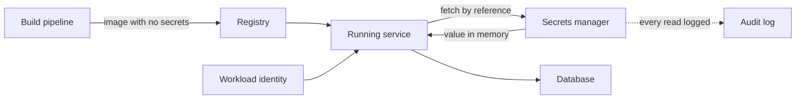

## Start with the secret with many copies

Esher Pharma, a drug maker, ran a search assistant over its lab reports. Its database password reached the service in two careless ways. The build passed it as a build argument, which wrote it into the container image's metadata, and debug logging printed the full connection string at startup. The image sat in a registry that a partner's contractors could pull from, and the logs went to Esher's central log platform, kept for 90 days and searchable by about 400 staff. A contractor noticed the password and reported it. When Lin, the forward deployed engineer, changed it, the service went down for 40 minutes: there was one database user, and its six replicas each held the old password until they were redeployed one by one. Call this **the secret with many copies**: one value spread to places nobody listed, each of which must be found before the leak is closed.

> **What you'll learn**
>
> - Keep secrets in a store and hand services a reference, not the value.
> - Deliver secrets at runtime, or avoid static secrets with workload identity.
> - Rotate a credential with no downtime.
> - Contain a secret leaked into logs and image layers, in the right order.

## Where a secret should live

A **secret** is any value that grants access: a password, an API key, a token, a private key. Each copy is another place it can leak from. The goal is one stored copy, read at runtime by the identities that need it.

| Place | Who can read it | Verdict |
| --- | --- | --- |
| Source code or Git history | Everyone with the repository, forever | Never |
| Container image or build arguments | Everyone who can pull the image | Never |
| Configuration file on a server | Anyone with access to the host or its backups | Avoid |
| CI variables | The pipeline and its administrators | For pipeline credentials only |
| Secrets manager or vault | Identities granted read access, every read logged | Default |
| Workload identity, no stored secret | The platform issues short-lived credentials | Best where supported |

*Table 1: Places a secret can live. The fewer readers and the shorter the life, the better.*

A **secrets manager** stores values encrypted, controls who can read each one, logs every read and supports rotation. The service's configuration holds a reference, such as a secret's name, not the value. The best secret is none at all: with **workload identity**, the platform proves the service's identity to the database or cloud API and receives a short-lived credential, so nothing long-lived exists to leak.

## Getting the secret to the process

The secret should reach the running process, and nothing else. Figure 1 shows Esher's corrected path.

*Figure 1: The image carries no secret. The running service proves its identity, fetches the value by reference and holds it in memory.*

Read the secret when the service starts, and fail at once if it is missing, as [validate configuration at startup](../deployment-models-and-environments/06_Config_Compute_and_Kubernetes_Choices.md#validate-configuration-at-startup) describes. Three rules for delivery:

- **Never at build time,** unless the build itself needs the secret, such as a private package registry. Then use the build tool's secret mount, which does not persist in the image. Build arguments and environment settings in a build file are stored in the image.
- **Prefer a mounted file or a direct fetch to an environment variable.** Environment variables are inherited by child processes and often appear in crash reports and debug pages.
- **Never log configuration as a whole.** Log which settings loaded, not their values, and redact anything shaped like a credential at the logger. [Telemetry the customer can use](../operating-after-go-live/01_Telemetry_the_Customer_Can_Use.md#keeping-sensitive-data-out-of-logs) covers keeping other sensitive data out of logs.

The site's [package the service and keep secrets out](../../../../01_Concept_Tutorials/Consolidated_Lessons/T1.4_Cloud_Containers_and_Deployment/01_Package_the_Service_and_Keep_Secrets_Out.md) lesson covers building the image, and [secrets and per-tenant encryption keys](../../../../01_Concept_Tutorials/Consolidated_Lessons/T4.4_Security_Tenancy_and_Prompt_Injection/02_Secrets_and_Per_Tenant_Encryption_Keys.md) covers key hierarchies.

## Rotating without downtime

**Rotation** replaces a credential with a new one. Esher's outage came from changing the only credential in place: from that moment, every replica still holding the old value failed. The fix is an overlap, where both credentials work while services move from one to the other. Cloud secrets managers call one version of this the alternating-users strategy.

The walkthrough rotates Esher's database credential with two database users.

Esher's six replicas use database user A. Rotate to a new credential without a failed request. Each step shows the action, the state afterwards and the check before moving on.

<button type="button" data-step="0" aria-pressed="false" aria-controls="rot-step-0">1. Create</button><button type="button" data-step="1" aria-pressed="false" aria-controls="rot-step-1">2. Deliver</button><button type="button" data-step="2" aria-pressed="false" aria-controls="rot-step-2">3. Verify</button><button type="button" data-step="3" aria-pressed="false" aria-controls="rot-step-3">4. Revoke</button>

<section id="rot-step-0" class="step-panel" aria-labelledby="rot-heading-0"><h4 id="rot-heading-0">1. Create the second credential</h4><dl><dt>Action</dt><dd>Create user B with the same grants as A, or set a new password on B if it already exists. Store it as the new current version.</dd><dt>State</dt><dd>A and B both work. All six replicas still use A.</dd><dt>Check</dt><dd>Sign in as B from a test client.</dd></dl></section><section id="rot-step-1" class="step-panel" aria-labelledby="rot-heading-1"><h4 id="rot-heading-1">2. Deliver it to every reader</h4><dl><dt>Action</dt><dd>Replicas fetch the current version on a schedule, or a rolling restart picks it up one replica at a time.</dd><dt>State</dt><dd>Some replicas use A, some use B. Both work, so no request fails.</dd><dt>Check</dt><dd>Watch error rates during the roll.</dd></dl></section><section id="rot-step-2" class="step-panel" aria-labelledby="rot-heading-2"><h4 id="rot-heading-2">3. Verify nothing uses the old one</h4><dl><dt>Action</dt><dd>List open database sessions by user. Look for jobs, scripts and other services that also hold A.</dd><dt>State</dt><dd>All six replicas on B. A is idle.</dd><dt>Check</dt><dd>No sessions or sign-ins as A for an agreed period, such as an hour.</dd></dl></section><section id="rot-step-3" class="step-panel" aria-labelledby="rot-heading-3"><h4 id="rot-heading-3">4. Revoke the old credential</h4><dl><dt>Action</dt><dd>Change A's password to a random value nobody stores, or disable A. Next rotation runs the same steps from B back to A.</dd><dt>State</dt><dd>Only B works.</dd><dt>Check</dt><dd>A failed sign-in as A raises an alert, which finds anything missed.</dd></dl></section>

<button type="button" data-walk="previous">Previous</button>

<button type="button" data-walk="next">Next step</button>

The walkthrough is a scripted illustration. The same overlap works for API keys: issue a second key, move callers, confirm the old key is unused, then revoke it. Rotate on a schedule, so the steps stay practised and the first rotation is not during a leak.

## Containing a leak in logs and image layers

When a secret leaks, order matters. Removing copies first feels tidy but leaves a working credential in the hands of whoever saw it.

1. **Revoke and replace now.** Treat the secret as used. Rotate it with the overlap above if you can do so within the hour, or revoke at once and accept a short outage if the exposure is wide.
2. **Check for use.** Read the database or API access logs from the time of the leak. Look for sign-ins from unknown addresses or at odd hours.
3. **Remove the copies.** Each copy needs its own step:
   - **Image layers.** A file deleted in a later layer still exists in the earlier one, and image metadata keeps build arguments. Rebuild without the secret, then delete every affected image digest from the registry, its mirrors and build caches.
   - **Logs.** Purge the entries from the log platform, its indexes, forwarders and any exports. Some platforms cannot delete single entries, so record what remains until retention removes it.
   - **Git history.** Rewrite history to remove the value and ask everyone to re-clone. Revocation is still the real fix.
4. **Prevent the next one.** Redact at the logger, use build secret mounts, and scan commits, images and logs for secret patterns.

Esher rotated the password within 30 minutes, found no use from unknown addresses, purged 90 days of matching log entries, rebuilt and replaced the image, and added scanning to the pipeline.

## Limits of this lesson

- **Products differ.** Secret stores, registries and log platforms delete and rotate in different ways. Learn the customer's before you need them.
- **Legal steps.** A leak of personal or regulated data may require notification. Involve the customer's security team at once.
- **Composite engagement.** Esher Pharma, Lin and the figures are illustrative, not a real customer.

## Interview angle

Each answer is an outline to say in about two minutes. Open each question and try it aloud before reading.

Interview question 1. How do you store, deliver, rotate and revoke secrets for a service in a customer's environment?

- **Answer:** Store each secret once, in the customer's secrets manager, with read access per service identity and every read logged. Deliver at runtime: the service fetches by reference, or the platform mounts the value as a file. Prefer workload identity, which avoids static secrets. Rotate on a schedule with two valid credentials overlapping. Revoke the old one once nothing uses it, and revoke immediately on a leak.
- **Trade-off:** A secrets manager adds a runtime dependency. Values in configuration files spread to backups and hosts.
- **Follow-up to expect:** "The secrets manager is down at startup." Start from a cached value briefly, or fail clearly.

Interview question 2. Rotate a database password used by six running replicas, with no downtime.

- **Answer:** Use two credentials that overlap. Create a second user or a new password on the idle one, and store it as the current version. Roll the replicas so each picks it up, while the old one still works. Check that no session or job still signs in with the old credential, then revoke it. Next time, rotate back the other way.
- **Trade-off:** Two credentials double what you must track. Changing one in place causes an outage until every reader updates.
- **Follow-up to expect:** "The database allows one user." Ask the database to accept two passwords during the change, or schedule a short window.

## References

1. OWASP, [Secrets Management Cheat Sheet](https://cheatsheetseries.owasp.org/cheatsheets/Secrets_Management_Cheat_Sheet.html), accessed 17 November 2026. Central storage, rotation and handling a leaked secret.
2. Docker, [Build secrets](https://docs.docker.com/build/building/secrets/), accessed 17 November 2026. Secret mounts at build time, and why build arguments are not safe for secrets.
3. Amazon Web Services, [Rotation strategies](https://docs.aws.amazon.com/secretsmanager/latest/userguide/rotation-strategy.html), accessed 17 November 2026. Single-user and alternating-users rotation.
4. GitHub, [Removing sensitive data from a repository](https://docs.github.com/en/authentication/keeping-your-account-and-data-secure/removing-sensitive-data-from-a-repository), accessed 17 November 2026. Rewriting history, and why revoking the secret comes first.

## Key takeaways

- One stored copy, read at runtime by the identities that need it. Workload identity is better still.
- Never put secrets in code, images or build arguments, and never log configuration values.
- Rotate with two overlapping credentials: create, deliver, verify, revoke.
- On a leak, revoke first, check for use, then remove every copy.
- Image layers and log platforms keep copies after you think they are gone.

## Check yourself

1. Why did changing the password cause Esher's 40-minute outage?

There was one database user. Changing its password in place broke every replica still holding the old value until each was redeployed.

2. Why does deleting a secret file in a later Dockerfile step not remove it from the image?

Each step adds a layer. The earlier layer still contains the file, and anyone who pulls the image can read that layer.

3. Why revoke a leaked secret before purging the logs?

Purging takes time and may be incomplete. Until the secret is revoked, anyone who copied it can still use it.

