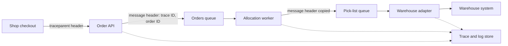

## Start with the green dashboard over an empty warehouse

Pennick Logistics, a fulfilment company, takes about 2,500 orders an hour during the day. An order API puts each order on a queue, and an allocation worker sends a pick list through an adapter to the warehouse system. At 10:40 one Tuesday the adapter's credential expired. The worker caught the error, wrote it to a debug log nobody read and marked each message done, so the API kept returning 200, the queues stayed empty and CPU sat at 35%. The operations dashboard said "updated 1 minute ago" over a reporting table whose load had stopped at 09:00. At 12:00 a warehouse supervisor phoned Gwen, the forward deployed engineer, to ask why the pick lists had stopped: about 3,300 orders had been accepted and none had reached a warehouse. Call this **the green dashboard over an empty warehouse**: every part reports healthy while the outcome the customer pays for has stopped.

> **What you'll learn**
>
> - What logs, metrics and traces each answer, and which one to reach for.
> - How to carry one ID across queues and workers, and where traces break.
> - How to measure business health beside infrastructure health.
> - How to show when data is stale, not only when the page refreshed.
> - How to keep sensitive data out of logs and contain it when it gets in.

## Three signals, three questions

Telemetry is the data a running system emits about itself. It comes in three kinds, and each answers a different question.

| Signal | Question it answers | Pennick example |
| --- | --- | --- |
| Metric | How much, how often, how fast, across everything? | Orders accepted per minute, p95 latency, queue depth |
| Log | What happened to this one thing, in detail? | "Order 88213 allocation failed: warehouse returned 401" |
| Trace | Where did the time go on this one request, across services? | API 40 ms, queue wait 2 s, allocation 300 ms, adapter error |

*Table 1: Metrics count, logs describe, traces connect.*

Metrics are cheap to keep and good for alerts and trends, but they lose the individual case. Logs keep the detail and cost more to store and search. A **trace** is a tree of timed steps, called spans, that share one trace ID. It shows the path of one request through several services.

In the field, the customer's engineers will use what you leave behind. Write logs as structured records with named fields, not free text. Use the customer's existing platform where you can, through an open standard such as OpenTelemetry, so their team can read your telemetry in tools they already know. The site's [logs, metrics and traces](../../../../01_Concept_Tutorials/Consolidated_Lessons/T4.3_Observability_and_Diagnosis/01_Logs_Metrics_and_Traces.md) lesson covers the signals in depth, and [standard tracing and customer-facing dashboards](../../../../01_Concept_Tutorials/Consolidated_Lessons/T4.3_Observability_and_Diagnosis/03_Standard_Tracing_and_Customer_Facing_Dashboards.md) covers exporting spans into the customer's tools.

## Following one order across queues and workers

A request through one web service is easy to trace. Pennick's order crosses two queues and three processes, and each hop can lose the thread. A **correlation ID** is a value created once, at the edge, and carried on every log line, span and message that belongs to the same piece of work.

*Figure 1: Pennick's order path. The trace context travels in each message's headers, and every process writes to one store under the same IDs.*

For HTTP, the W3C Trace Context standard defines a `traceparent` header that carries the trace ID between services. Queues have no such default. Three rules keep the chain intact:

- **Put the context in the message.** The producer writes the trace ID and the business key (here the order ID) into the message headers. The consumer reads them and starts its span as a child of the producer's, or linked to it.
- **Log the business key on every line.** Trace IDs change when a retry starts a new trace. The order ID does not, and it is what the customer's support team will search for.
- **Watch the places traces break.** Batch consumers that process 100 messages in one span, retries that drop headers, scheduled jobs with no incoming context and third-party queues that strip unknown headers. Test each hop by sending one tagged order and searching for it at the far end.

## Business health beside infrastructure health

Infrastructure health asks whether the machines and services are up: CPU, memory, error rates, queue depth. **Business health** asks whether the work the customer pays for is happening: orders that reached a warehouse, claims that were triaged, invoices that were sent.

The two can disagree. Pennick's failure returned no errors, because the worker swallowed them. The only signal that would have caught it was a business one: orders accepted against orders dispatched. Compare the two views of the same moment.

It is 11:30 at Pennick, 50 minutes after the warehouse credential expired. The same system, seen two ways.

<button type="button" data-mode="infra" aria-pressed="false" aria-controls="infra-result">Infrastructure view</button>
<button type="button" data-mode="business" aria-pressed="false" aria-controls="business-result">Business view</button>

<section id="infra-result" class="mode-panel" data-announcement="Infrastructure view selected. Every panel is green."><h4>Infrastructure view</h4><ul><li>API: 100% of calls return 200, p95 latency 180 ms.</li><li>Workers: six of six running, CPU at 35%.</li><li>Queues: depth near zero, consumers keeping up.</li></ul>
Verdict: healthy. Nobody is paged.
</section>
<section id="business-result" class="mode-panel" data-announcement="Business view selected. About 2,100 orders accepted and none dispatched."><h4>Business view</h4><ul><li>Orders accepted since 10:40: about 2,100.</li><li>Pick lists confirmed by the warehouse since 10:40: zero.</li><li>Oldest accepted order with no pick list: 50 minutes, against a 30-minute target.</li></ul>
Verdict: an incident, 20 minutes past the target already.
</section>

The business view needs three things the infrastructure view lacks:

1. **A count at each stage.** Accepted, allocated, sent to the warehouse, confirmed by the warehouse. A gap that grows between two stages points at the hop between them.
2. **The age of the oldest unfinished item.** A queue depth of zero looks healthy. An order that has waited 50 minutes for a pick list does not.
3. **Confirmation from the far end.** Count what the warehouse system acknowledged, not what your adapter believes it sent.

Agree these measures with the customer's operations lead, in their words. They become the inputs to the service level objectives in the next lesson.

## Dashboards that look fresh while the data is stale

Pennick's dashboard showed when the page last refreshed. It did not show when the data was last true. Those are different clocks, and only the second one matters.

- **Show "data as of", not "updated".** Each panel should display the newest event time in its data, such as the most recent order it counted. If that time is two hours old, the panel is two hours old, whatever the page refresh says.
- **Alert on freshness.** Track the age of the newest record in each table or stream the dashboard reads. Page when it passes a threshold set from the pipeline's normal lag, for example 15 minutes for a table loaded every 5.
- **Grey out stale panels.** A panel past its freshness limit should look different, so nobody reads old numbers as current.
- **Watch for zero that means missing.** A count of zero can mean nothing happened or nothing arrived. Compare against the same hour last week, or against a count from the source system.

## Keeping sensitive data out of logs

Logs leak because they are copied widely: to a central platform, to forwarders, to exports and to support tickets. Anything in them reaches everyone who can search them.

Stop it at the source:

- **Log an allow-list of fields.** Write the order ID, status and timing, not the whole request body. A field added to a request later then stays out of the logs by default.
- **Redact at the logger.** Mask values shaped like card numbers, tokens or email addresses before the line leaves the process.
- **Use references, not content.** Log a customer ID, not a name and address. Log a document ID, not the document text or the model prompt that contains it.
- **Set retention and access.** Keep detailed logs for a short period, with access limited to the people who debug. Logs are copies too: a deletion request must reach them, as [residency, retention and deletion](../security-reviews-and-compliance/03_Residency_Retention_and_Deletion.md) explains.

When sensitive data is found in logs anyway, contain it in order. Stop the source first with a configuration change or a release that removes the field. Restrict access to the affected indexes. Find every copy, including forwarders, archives and exports. Purge what the platform allows, and record what remains until retention removes it. Tell the customer's security team early, because personal data may carry [notification duties](../security-reviews-and-compliance/01_Threat_Modelling_a_Deployment.md#the-cache-that-crosses-tenants). If the data is a credential, revoke it first, as the site's [secrets and leaks](../networks-and-identity/04_Secrets_and_Leaks.md) lesson explains.

## Limits of this lesson

- **Tools differ.** Log platforms, tracing back ends and queue products each handle context and deletion differently. Learn the customer's before go-live.
- **AI-specific telemetry.** Model prompts, token counts and evaluation scores belong to [the run trace](../../../../01_Concept_Tutorials/Consolidated_Lessons/T4.3_Observability_and_Diagnosis/02_The_Run_Trace.md), not here.
- **Composite engagement.** Pennick Logistics, Gwen, its systems and figures are illustrative, not a real customer.

## Interview angle

Each answer is an outline to say in about two minutes. Open each question and try it aloud before reading.

Interview question 1. When do you reach for logs, metrics or traces while running a customer's system?

- **Answer:** Metrics first, to see whether something is wrong and how widely: rates, latency, queue age and business counts. They feed alerts and trends. Then a trace, to find where one slow or failed request spent its time across services. Then logs, for the detail of that one event, such as the error message or the record's state. In the field, emit all three into the customer's existing platform through an open standard, so their team can use them after you leave.
- **Trade-off:** Metrics are cheap and lose individual cases. Logs keep detail and cost the most to store.
- **Follow-up to expect:** "Budget allows only one." Structured logs with IDs, from which you can derive counts.
- **Go deeper:** [Logs, metrics and traces](../../../../01_Concept_Tutorials/Consolidated_Lessons/T4.3_Observability_and_Diagnosis/01_Logs_Metrics_and_Traces.md).

Interview question 2. An order passes through an API, two queues and three workers. How do you follow one order end to end?

- **Answer:** Create a trace ID and keep the order ID at the edge. Pass the trace context in HTTP headers using W3C Trace Context, and copy it into each message's headers on every queue. Each consumer starts its span from that context. Log the order ID on every line, because it survives retries that start new traces. Then test it: send one tagged order and search for it at the last hop.
- **Trade-off:** Linking spans across queues takes code in every producer and consumer. Without it, each hop is a separate island.
- **Follow-up to expect:** "A batch worker handles 100 messages at once." Give each message its own span, linked to its producer.

Interview question 3. How do you keep personal data and secrets out of logs, and what do you do when you find some there?

- **Answer:** Log an allow-list of fields, not whole requests. Redact values shaped like tokens, card numbers or emails at the logger. Log IDs, not content. Keep detailed logs briefly with tight access. When something gets through, stop the source first, restrict access to the affected indexes, find every copy in forwarders, archives and exports, purge what you can and record the rest. Tell the customer's security team early. If it is a credential, revoke it before anything else.
- **Trade-off:** Strict allow-lists slow debugging. Logging everything makes every log a data store to protect.
- **Follow-up to expect:** "Support needs the request body." Store it separately, encrypted, with access logged.

Interview question 4. How do you tell whether a customer's system is healthy for the business, not only for the servers?

- **Answer:** Agree with the customer's operations lead what a finished unit of work is, such as an order confirmed by the warehouse. Then measure it: a count at each stage, the gap between stages, the age of the oldest unfinished item and confirmation from the far system. Show these beside CPU, errors and latency, and alert on them. Infrastructure metrics say the machine is up. Business metrics say the work is getting done.
- **Trade-off:** Business metrics need the customer's definitions and access to downstream systems. Infrastructure metrics come free.
- **Follow-up to expect:** "Which would you alert on first?" The oldest unfinished item, since it catches silent stalls.

Interview question 5. Every call to the order API returns 200, yet the warehouse says no orders have arrived for an hour. What do you do?

- **Answer:** Treat it as an incident and tell the customer. A 200 only means the API accepted the order. Pick one recent order ID and follow it: was it queued, consumed, allocated, sent, acknowledged? Where it stops is where to look. Check worker logs for swallowed errors and expired credentials. Check whether messages were consumed and marked done without success. Then mitigate, re-drive the stranded orders once the cause is fixed, and add a business alert on accepted against dispatched.
- **Trade-off:** Re-driving fast clears the backlog but risks duplicates. Make the hand-off idempotent first.
- **Follow-up to expect:** "How many orders are affected?" Compare accepted and confirmed counts since the gap began.

## References

1. W3C, [Trace Context](https://www.w3.org/TR/trace-context/), accessed 17 November 2026. The `traceparent` header that carries a trace ID between services.
2. OpenTelemetry, [Context propagation](https://opentelemetry.io/docs/concepts/context-propagation/), accessed 17 November 2026. Carrying trace context across process and message boundaries.
3. OWASP, [Logging Cheat Sheet](https://cheatsheetseries.owasp.org/cheatsheets/Logging_Cheat_Sheet.html), accessed 17 November 2026. Data to exclude from logs and how to protect log data.
4. Google, [Monitoring distributed systems](https://sre.google/sre-book/monitoring-distributed-systems/), Site Reliability Engineering, accessed 17 November 2026. Monitoring symptoms the user sees, not only their causes.

## Key takeaways

- Metrics show that something is wrong, traces show where, and logs show what.
- Carry the trace context and a business key through every queue hop, and test it with one tagged order.
- Measure the work the customer pays for: stage counts, the oldest unfinished item and confirmation from the far end.
- Show when the data is from, not when the page refreshed, and alert on freshness.
- Log an allow-list of fields, redact at the logger, and contain leaks by stopping the source first.

## Check yourself

1. Why did Pennick's queues look healthy during the failure?

The worker kept consuming messages and marking them done after the warehouse call failed. Queue depth stayed near zero because nothing was left waiting, even though nothing succeeded.

2. Why log the order ID when every span already carries a trace ID?

A retry or a scheduled re-drive can start a new trace, but the order ID stays the same. It is also what the customer's support team knows and searches for.

3. A dashboard says "updated 1 minute ago". What else must you know before trusting it?

The time of the newest event in the data each panel reads. The page can refresh every minute over a table that stopped loading hours ago.

