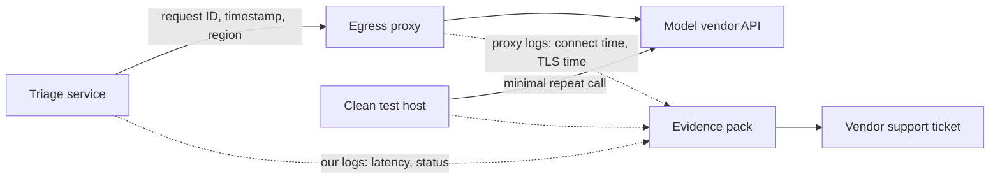

## Start with the incident nobody held

Ravensworth Insurance, a fictional insurer, triages new claims with an AI system your team built. A claims portal receives each claim. A document vendor extracts text from the attachments. A triage service sends the claim to a hosted model, run by a second vendor, which suggests a category and urgency. The claim then lands in a handler's queue.

At 09:20 one Monday, about 40% of model calls started timing out after 30 seconds. Retries piled up and triage slowed to a crawl. Three people noticed: your forward deployed engineer, a Ravensworth IT engineer and a platform engineer at your company. Each restarted something. Each assumed one of the others was telling the business.

Nobody was. At 10:30 the claims director heard from a broker that urgent claims were not being picked up. By then 1,400 claims were waiting. The model vendor's status page was green, and its support desk replied that the fault was not on its side. It confirmed a regional degradation at 13:10.

Call this **the incident nobody held**: capable people working hard, with no one declaring it, owning it or telling the customer.

> **What you'll learn**
>
> - How to set severity by customer impact and name who owns each role.
> - What to do in the first 15 minutes, in order.
> - How to write customer updates before you know the cause.
> - How to work with a vendor who disputes blame.
> - How to rehearse with tabletop exercises and learn with postmortems.

## Severity and ownership

**Severity** is a label for how badly customers are hurt right now. It decides who joins, how often you update and whether people are woken. Define it in the customer's terms before go-live, and agree it with their operations lead.

| Severity | Ravensworth definition | Response |
| --- | --- | --- |
| 1 | Claims cannot be triaged, or urgent claims are delayed past one hour | Page immediately, update every 30 minutes, inform the claims director |
| 2 | Triage is slow or partly failing, with a workaround in place | Respond within 30 minutes, update hourly |
| 3 | One feature degraded, no claim delayed | Next working day, ticket |

*Table 1: Ravensworth's severity levels. Impact sets the level, not the cause or how hard the fix looks.*

When in doubt, choose the higher severity. Downgrading later costs little. Starting low delays the right people.

Severity is half the answer. The other half is named roles, following the incident command practice that Google and PagerDuty describe:

- **Incident lead.** Holds the incident. Decides, assigns work, keeps the timeline. Does not debug.
- **Communications lead.** Writes and sends every customer update on schedule.
- **Investigators.** Debug and mitigate, and report findings to the lead before acting.

Agree in writing which organisation fills each role for which systems. At Ravensworth, your team leads incidents in the triage service. Ravensworth IT leads incidents in its network and identity systems. Each vendor is an investigator for its own service, reached through its support contract.

## The first 15 minutes

The first quarter of an hour sets the tone for the rest. The walkthrough replays Ravensworth's morning as it should have gone.

It is 09:24. An alert shows triage throughput has dropped by half. Each step shows the time box, what to do and the check before moving on.

<button type="button" data-step="0" aria-pressed="false" aria-controls="ff-step-0">1. Declare</button><button type="button" data-step="1" aria-pressed="false" aria-controls="ff-step-1">2. Scope</button><button type="button" data-step="2" aria-pressed="false" aria-controls="ff-step-2">3. Stabilise</button><button type="button" data-step="3" aria-pressed="false" aria-controls="ff-step-3">4. Tell</button>

<section id="ff-step-0" class="step-panel" aria-labelledby="ff-heading-0"><h4 id="ff-heading-0">1. Declare (minutes 0 to 2)</h4><dl><dt>Do</dt><dd>Say "this is an incident" in the agreed channel. Name the incident lead and the communications lead. Open one call and one written log.</dd><dt>Check</dt><dd>Everyone working on it knows who leads and where to report.</dd></dl></section><section id="ff-step-1" class="step-panel" aria-labelledby="ff-heading-1"><h4 id="ff-heading-1">2. Scope (minutes 2 to 5)</h4><dl><dt>Do</dt><dd>Measure impact: claims waiting, urgent claims among them, oldest wait. Ask what changed: releases, configuration, vendor notices. Note the first bad timestamp.</dd><dt>Check</dt><dd>A severity is set. Here it is 1: urgent claims will pass one hour soon.</dd></dl></section><section id="ff-step-2" class="step-panel" aria-labelledby="ff-heading-2"><h4 id="ff-heading-2">3. Stabilise (minutes 5 to 10)</h4><dl><dt>Do</dt><dd>Stop the harm before finding the cause. Cut retries to stop the pile-up, and route urgent claims to the manual triage queue. Capture logs, traces and thread dumps before any restart.</dd><dt>Check</dt><dd>Urgent claims reach handlers again, even if slower.</dd></dl></section><section id="ff-step-3" class="step-panel" aria-labelledby="ff-heading-3"><h4 id="ff-heading-3">4. Tell (minutes 10 to 15)</h4><dl><dt>Do</dt><dd>Send the first update to the claims director and Ravensworth IT: impact, workaround, what is known, next update time. Open a priority ticket with the model vendor.</dd><dt>Check</dt><dd>The customer hears it from you before a broker tells them.</dd></dl></section>

<button type="button" data-walk="previous">Previous</button>

<button type="button" data-walk="next">Next step</button>

Two habits carry the rest. First, the lead approves each change, and the log records it, so three people never restart three things at once. Second, a restart that clears the symptom buys time but is not a fix. It wipes the state that explains the fault, and the fault returns. Capture evidence first, then keep looking for the cause after service recovers.

The site's [diagnosing production incidents](../../../../01_Concept_Tutorials/Consolidated_Lessons/T4.3_Observability_and_Diagnosis/05_Diagnosing_Production_Incidents.md) lesson covers the debugging steps in depth.

## Updates before you know the cause

Customers forgive slow fixes more readily than silence. An update does not need the root cause. It needs facts, a plan and a time for the next one.

| Part | Ravensworth's 09:35 update |
| --- | --- |
| Impact | New claims are being triaged slowly. About 300 are waiting, 20 of them urgent. |
| Workaround | Urgent claims now go to the manual triage queue. Please staff it until further notice. |
| What we know | Calls to the model provider are timing out since 09:20. No change was released today. |
| What we do not know yet | Whether the cause is the provider, the network path or our service. |
| What we are doing | Testing each of the three, and raising it with the provider at priority one. |
| Next update | 10:05, or sooner if anything changes. |

*Table 2: A first update. Each line is a fact or a commitment, and none is a guess about the cause.*

Rules that keep updates trusted:

- **Send on the clock.** Keep the promised time even when nothing changed. Say that nothing changed.
- **Separate fact from hypothesis.** Write "we suspect" only when you must, and say what would confirm it.
- **Use their words.** Claims waiting, not request timeouts.
- **One sender.** The communications lead sends, so the customer gets one consistent story.

## When the vendor says it is not them

Vendors see their own aggregate metrics. Your failure may be a small slice of their traffic, below anything that turns their status page red. Arguing does not move them. Evidence does.

*Figure 1: Evidence from each side of the boundary. A clean test host rules out your own service and network.*

Build the evidence pack in this order:

1. **Request IDs and times.** The vendor's own request IDs from response headers, with UTC timestamps, region and status. They can look those up.
2. **Where the time went.** Proxy logs split connection, TLS and response time. A slow response after a fast connection points past the network.
3. **A minimal reproduction.** The same call from a clean host outside your service, with your code removed from the path.
4. **The pattern.** Failure rate by time and region, and the moment it began.

Send it through the support channel in the contract, quoting its severity terms. Ask your account contact to escalate if the response target passes. Meanwhile, mitigate without them: fall back to the manual queue, lower concurrency, or switch region if the contract allows. Settle blame in the postmortem, not during the incident. The site's [failover, graceful degradation and kill switches](../../../../01_Concept_Tutorials/Consolidated_Lessons/T4.6_Scaling_and_Reliability/05_Failover_Graceful_Degradation_and_Kill_Switches.md) lesson covers designing fallbacks in advance.

## Rehearse it, then learn from it

A **tabletop exercise** is a rehearsal around a table, with no systems touched. A facilitator describes a scenario and adds new facts every few minutes. The team says what it would do. Run one before go-live and then each quarter, for an hour, with the customer's operations staff in the room. It tests what documents cannot: whether the contact list works, whether people know their roles and whether the fallback exists.

A **postmortem** is the written review after an incident. Keep it blameless: describe what the system and process allowed, not who erred, and people report openly. A useful one holds:

- The impact in the customer's terms, with numbers.
- A timeline from first signal to recovery, including when the customer was told.
- Contributing causes, technical and organisational.
- What went well, to keep.
- Actions, each with one owner and a due date, tracked to closure.

Share it with the customer within an agreed time, such as five working days. Ravensworth's review led to a declared-incident rule for any alert lasting ten minutes, a vendor timeout of 10 seconds instead of 30, and an automatic route to manual triage when model errors pass 20%.

## Limits of this lesson

- **Contracts govern vendors.** Support tiers, response times and escalation paths differ by contract. Read them before go-live.
- **Security incidents follow other rules.** A suspected breach involves the customer's security team and may carry legal duties. See NIST SP 800-61 in the references.
- **Fictional data.** Ravensworth Insurance, its vendors and figures are illustrative.

## Interview angle

Each answer is an outline to say in about two minutes. Open each question and try it aloud before reading.

Interview question 1. How do you set incident severity and ownership for a system that spans your team, the customer's IT and two vendors?

- **Answer:** Define severity by customer impact, in their terms, such as urgent claims delayed past an hour, and agree it before go-live. Each level sets who responds, update frequency and whether people are paged. Then name roles: an incident lead who decides and does not debug, a communications lead and investigators. Write down which organisation leads for which systems, and how each vendor is reached under its contract.
- **Trade-off:** Fixed definitions speed decisions. They cannot foresee every case, so allow the lead to raise severity.
- **Follow-up to expect:** "Who leads when the fault crosses boundaries?" The team owning the customer-facing service, until the cause is clear.

Interview question 2. You do not know the cause yet. What goes in the first update to the customer, and how often do you send more?

- **Answer:** Impact in their words, any workaround, what you know, what you do not know yet, what you are doing, and a time for the next update. No guesses about cause. Send the first within about 15 minutes of declaring. Then keep a fixed cadence by severity, every 30 minutes for the worst, even when the update is "no change". One person sends every update, so the story stays consistent.
- **Trade-off:** Early updates may later be corrected. Silence costs more trust than a correction.
- **Follow-up to expect:** "The executive wants a cause now." Give the hypotheses being tested and when you expect to know.

Interview question 3. When do you escalate during an incident, and what happens afterwards?

- **Answer:** Escalate when impact grows, when the response target is about to pass, when you need a decision you cannot make, or when the fault is in someone else's system. Escalate to a named person with a specific request, through the agreed path. Afterwards, write a blameless postmortem within days: impact, timeline, contributing causes, what went well and actions with owners and dates. Share it with the customer and track the actions to closure.
- **Trade-off:** Escalating early can feel like crying wolf. Escalating late leaves the customer exposed longer.
- **Follow-up to expect:** "Actions never get done." Review them in the regular customer meeting until closed.

Interview question 4. An alert fires and the customer's triage queue is stalling. Walk me through your first 15 minutes.

- **Answer:** Minutes 0 to 2: declare an incident, name a lead and a communications lead, open one call and one log. Minutes 2 to 5: measure impact, ask what changed, set severity. Minutes 5 to 10: stabilise. Cut retries, route urgent work to a manual fallback, capture logs and traces before any restart. Minutes 10 to 15: send the first customer update and open vendor tickets if a dependency is involved.
- **Trade-off:** Stabilising before diagnosing may hide clues. Capturing evidence first limits that cost.
- **Follow-up to expect:** "Someone has already restarted the service." Record it, capture what remains, and keep investigating.

Interview question 5. The model vendor insists the fault is not on its side. Your logs say otherwise. What do you do?

- **Answer:** Bring evidence, not argument. Collect the vendor's request IDs from response headers with UTC times and region, proxy logs showing fast connections and slow responses, and a minimal call from a clean host that reproduces the failure without your code. Send it through the contract's support channel at the right severity, and escalate through the account contact if the response target passes. Mitigate in parallel with your fallback. Settle blame in the postmortem.
- **Trade-off:** Building the pack takes time from mitigation. Assign it to one investigator.
- **Follow-up to expect:** "The clean host works fine." Then the fault is likely on your side. Look at your egress path.

## References

1. Google, [Managing incidents](https://sre.google/sre-book/managing-incidents/), Site Reliability Engineering, accessed 17 November 2026. Incident command roles and a single incident lead.
2. PagerDuty, [Incident Response Guide](https://response.pagerduty.com/), accessed 17 November 2026. Incident commander, communications roles and severity levels.
3. Google, [Postmortem culture: learning from failure](https://sre.google/sre-book/postmortem-culture/), Site Reliability Engineering, accessed 17 November 2026. Blameless postmortems and tracked actions.
4. NIST CSRC, [SP 800-61 Rev. 3, Incident Response Recommendations and Considerations for Cybersecurity Risk Management](https://csrc.nist.gov/pubs/sp/800/61/r3/final), accessed 17 November 2026. Security incident handling, which follows its own rules.

## Key takeaways

- Severity comes from customer impact, agreed before go-live. When in doubt, go higher.
- One incident lead decides, one communications lead talks, investigators report before acting.
- Declare, scope, stabilise and tell within 15 minutes. Capture evidence before any restart.
- Updates hold facts, a plan and a next time. Send on the clock.
- Win vendor disputes with request IDs, timings and a clean reproduction, and mitigate meanwhile.
- Rehearse with tabletops, and close every postmortem action with an owner and date.

## Check yourself

1. Why should the incident lead not debug?

Debugging pulls attention into one thread. The lead must track every thread, approve changes and make decisions, which nobody does while heads-down in logs.

2. Why is a restart that clears the symptom not a fix?

It removes the state that explains the fault without changing the cause. The fault returns, and the evidence is gone.

3. What does a clean test host prove when a vendor disputes blame?

If the minimal call fails there too, your service and network are ruled out. If it succeeds, the fault is probably on your side.

