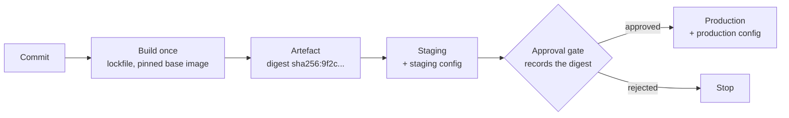

## Start with the build nobody tested

Lanark Bank runs a document service that reads loan applicants' payslips and bank statements and extracts the figures its loan officers need. Owain, the forward deployed engineer on the account, shipped a release that passed every test in staging on a Tuesday. The bank's change board approved it on Wednesday, and on Thursday the pipeline deployed it to production, where about one upload in five failed to parse. Staging and production ran the same commit. They did not run the same build: the pipeline rebuilt the image for each environment, the dependency file allowed any minor version of the PDF library, and a new minor version shipped between Tuesday and Thursday. The change board had approved one thing and the bank received another. Call this **the build nobody tested**: an artefact assembled after the tests ran, from inputs nobody pinned, carrying an approval it never earned.

> **What you'll learn**
>
> - Pin every input so the same commit gives the same artefact.
> - Build once and promote that artefact, with configuration supplied per environment.
> - Design approval gates that record what was approved.
> - Keep infrastructure as code honest about its state and drift.
> - Find why one commit behaves differently in staging and production.

## What makes a build reproducible

A build is **reproducible** when the same source and the same declared inputs give the same artefact, byte for byte or close enough that any difference is explained. The commit is only one input. Table 1 lists the others and how each drifts.

| Input | How it drifts | How to pin it |
| --- | --- | --- |
| Application dependencies | Version ranges resolve to new releases | Commit a lockfile with exact versions and hashes, and install from it |
| Base image | A tag such as `latest` or `3.12` moves | Reference the image by digest |
| System packages | The package mirror updates overnight | Pin versions, or build from a dated snapshot of the mirror |
| Build tools | A new compiler or bundler version | Pin the tool versions in the build image |
| Network fetches during the build | A download changes or disappears | Fetch through a controlled mirror, or vendor the files |

*Table 1: Build inputs beyond the commit, and how to stop each one moving.*

Pinning also needs a record. **Provenance** is signed metadata that states what was built, from which commit, by which builder, with which inputs. Supply-chain frameworks such as SLSA describe levels of provenance. For an FDE the field use is simple: when a customer's auditor asks "what is running in production and where did it come from?", you answer with the artefact's digest and its provenance record, not with a branch name.

Lanark's PDF library was a version range in the dependency file with no lockfile. A lockfile would have produced the tested version on Thursday too.

## Build once, promote the artefact

The second fix is structural. Build the artefact once, test it, then move that same artefact through each environment. The artefact is identified by its **digest**, a hash of its contents, which cannot be reused for different contents. Environments differ only in the configuration they supply at deploy time: hostnames, sizes, feature flags and references to secrets. The Twelve-Factor App calls this the separation of build, release and run.

*Figure 1: One artefact moves through every environment. The gate approves a digest, and production can only deploy a digest that passed it.*

The switcher compares Lanark's original pipeline with the promoted one, for the same Tuesday commit.

The same commit is tested on Tuesday and deployed to production on Thursday. A new minor version of the PDF library ships on Wednesday.

<button type="button" data-mode="rebuild" aria-pressed="false" aria-controls="rebuild-result">Rebuild per environment</button>
<button type="button" data-mode="promote" aria-pressed="false" aria-controls="promote-result">Build once, promote</button>

<section id="rebuild-result" class="mode-panel" data-announcement="Rebuild per environment selected. Production runs an untested build."><h4>Rebuild per environment</h4><ul><li>Tuesday's staging build contains library version 4.2.</li><li>Thursday's production build resolves the range to 4.3.</li><li>The change board approved a commit, so nothing flags the difference.</li><li>About one upload in five fails, and the cause takes a day to find.</li></ul>
The approval and the tests describe an artefact that never reached production.
</section>
<section id="promote-result" class="mode-panel" data-announcement="Build once, promote selected. Production runs the tested digest."><h4>Build once, promote</h4><ul><li>Tuesday's build produces one digest, with version 4.2 locked inside it.</li><li>Staging tests that digest. The board approves that digest.</li><li>Thursday's deploy pulls the same digest. Wednesday's library release has no effect.</li><li>Production differs from staging only in its configuration, which the deploy records.</li></ul>
Any difference left between the environments is in configuration, data or infrastructure, which narrows the search.
</section>

The scenario and its version numbers are illustrative.

## Approval gates that mean something

Banks and other regulated customers require approval before a production change. A gate is only useful if it is tied to the exact thing being released. A good gate:

- **Approves a digest, not a commit or a ticket.** The deploy step refuses any digest without a recorded approval.
- **Shows its evidence.** Test results, the security scan, the provenance record and the change summary sit beside the approval, so the approver signs something specific.
- **Separates duties.** The person who wrote the change does not approve it alone. Lanark requires one engineer and one change-board member.
- **Expires.** An approval older than an agreed window, such as five working days, needs renewing, because the risk around the change moves.
- **Has an emergency path.** A hotfix route with fewer approvers and a mandatory review afterwards, written down before it is needed.

Automate the checks and keep the human decision for the risk call. A gate that asks a person to re-read test logs adds delay and catches little.

## Infrastructure as code: state and drift

The servers, networks, databases and permissions your service runs on are infrastructure. Defining them as code means the environment is reviewed and versioned like the application. Tools such as Terraform keep a **state** file: a record that maps each resource in the code to the real resource it created. The tool compares code, state and reality to decide what to change.

Three rules keep state trustworthy:

- **Store state remotely with locking,** so two engineers cannot apply changes at once and corrupt it.
- **Protect it like a secret.** State can contain resource attributes and sometimes credentials.
- **Never edit resources by hand without telling the code.** A change made in the console is **drift**: reality no longer matches the code.

Drift appears in an FDE engagement more often than in your own systems, because the customer's operations team owns the console. Lanark's network team once widened a firewall rule by hand during an incident. The next pipeline run planned to reverse it, which would have broken a partner integration. Run a plan on a schedule to detect drift, and for each difference decide with the owner whether to adopt the change into code or revert it. The site's [infrastructure as code and the release pipeline](../../../../01_Concept_Tutorials/Consolidated_Lessons/T4.7_AgentOps/07_Infrastructure_as_Code_and_the_Release_Pipeline.md) lesson covers environment definitions and pipeline stages in depth.

## Why one commit still behaves differently

Promotion removes the build as a cause. When staging and production still disagree on the same digest, the cause is in what surrounds the artefact. Work through Table 2 from the top, because the cheaper checks come first.

| Check | Question to answer | Lanark example |
| --- | --- | --- |
| Artefact | Is the digest running in both environments identical? | The original fault |
| Configuration | Which settings differ, and which differences are intended? | Production capped uploads at 10 MB, staging at 25 MB |
| Feature flags | Is any flag on in one environment only? | A new parser was enabled only in staging |
| Secrets and permissions | Does production's identity lack a grant that staging had? | The production service account could not read one storage bucket |
| Infrastructure | Has drift changed networks, sizes or versions? | Production's database was one minor version behind |
| Data | Does production data have shapes staging never saw? | Scanned statements from one branch used an old format |
| External services | Do the environments call different versions or accounts of a dependency? | Staging called the vendor's sandbox, with looser limits |

*Table 2: Differences between environments that run the same artefact, checked in order of cost.*

Make the comparison cheap before you need it. Have the service log its digest and a hash of its effective configuration at startup, with secret values excluded. Then the first two rows take a minute. [Validate configuration at startup](../deployment-models-and-environments/06_Config_Compute_and_Kubernetes_Choices.md#validate-configuration-at-startup) makes the service refuse to start on a bad setting.

## Limits of this lesson

- **Tools differ.** Lockfile formats, registries and infrastructure tools vary. The principles hold, and the commands are the customer's.
- **Bit-for-bit reproducibility is hard.** Timestamps and file ordering break it. Aim for pinned inputs and recorded provenance first.
- **Composite engagement.** Lanark Bank, Owain, the release and its figures are illustrative, not a real customer.

## Interview angle

Each answer is an outline to say in about two minutes. Open each question and try it aloud before reading.

Interview question 1. A customer asks how you make sure the build they approve is the build that runs. What do you put in place?

- **Answer:** Pin every input: a committed lockfile with hashes, a base image by digest, pinned build tools and a controlled package mirror. Build once in CI, a continuous integration pipeline, and record provenance: the commit, the builder and the inputs, signed. Identify the artefact by its digest. Test and approve that digest, and make the production deploy refuse any digest without approval. Log the running digest at startup so anyone can check it.
- **Trade-off:** Pinning means you take security patches deliberately, through a routine update, instead of automatically.
- **Follow-up to expect:** "A critical patch lands mid-release." Rebuild, retest and re-approve the new digest through the emergency path.

Interview question 2. Design the path from commit to production for a regulated customer, including infrastructure changes and approvals.

- **Answer:** Application and infrastructure both live as code. Each change runs tests and, for infrastructure, a plan that shows what will change. The pipeline builds one artefact and deploys it to staging with staging configuration. A gate collects test results, the scan, provenance and the infrastructure plan, then a second person approves that digest and plan. Production deploys the same digest and applies the approved plan. Approvals expire after an agreed window.
- **Trade-off:** Gates slow small changes. Grouping them by risk keeps routine changes quick and holds the slow path for risky ones.
- **Follow-up to expect:** "Who can bypass the gate?" Nobody alone. The emergency path needs two people and a review afterwards.

Interview question 3. The customer's team changes resources in the cloud console. How do you keep infrastructure as code reliable when its state and reality drift?

- **Answer:** Store state remotely with locking and restricted access. Run a scheduled plan that reports drift without applying anything. For each difference, ask the owner whether the change was intended. If it was, write it into the code so the next apply keeps it. If not, revert it through the pipeline. Agree that console changes are for emergencies and must reach the code within a set time, such as one working day.
- **Trade-off:** Blocking console access stops drift and slows incident fixes. Detection and reconciliation keep both.
- **Follow-up to expect:** "The state file is lost." Rebuild it by importing existing resources, checked against a plan that shows no changes.
- **Go deeper:** [Infrastructure as code and the release pipeline](../../../../01_Concept_Tutorials/Consolidated_Lessons/T4.7_AgentOps/07_Infrastructure_as_Code_and_the_Release_Pipeline.md).

## References

1. Reproducible Builds, [Definitions](https://reproducible-builds.org/docs/definition/), accessed 17 November 2026. What it means for a build to produce bit-by-bit identical copies.
2. SLSA, [SLSA specification v1.0](https://slsa.dev/spec/v1.0/), accessed 17 November 2026. Build provenance and supply-chain levels.
3. The Twelve-Factor App, [Build, release, run](https://12factor.net/build-release-run), accessed 17 November 2026. Strict separation of the build from configuration and running.
4. HashiCorp, [Manage resource drift](https://developer.hashicorp.com/terraform/tutorials/state/resource-drift), accessed 17 November 2026. Detecting and reconciling drift between state and real resources.

## Key takeaways

- The commit is one input. Pin dependencies, base images, tools and fetches too.
- Build once, identify the artefact by digest, and promote it with configuration per environment.
- A gate approves a digest, shows its evidence, separates duties and expires.
- Keep infrastructure state remote and locked, and detect drift on a schedule.
- When one digest behaves differently, check configuration, flags, permissions, infrastructure, data and dependencies in that order.

## Check yourself

1. Why did Lanark's change-board approval not protect production?

The board approved a commit. The pipeline rebuilt the artefact after approval from unpinned inputs, so production received a build nobody had tested or approved.

2. With build-once promotion in place, staging and production still disagree. Why is that progress?

The artefact is ruled out. The cause must be in configuration, flags, permissions, infrastructure, data or external services, which is a shorter list to check.

3. Why is a hand-made firewall change dangerous for the next pipeline run?

The code still describes the old rule. The next apply sees the difference as drift and reverses the change, breaking whatever depended on it.

