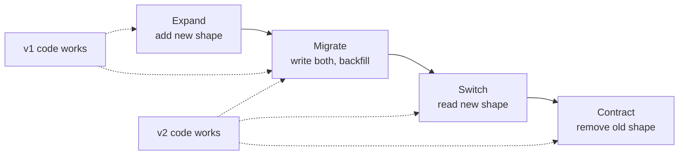

## Start with the one-way release

Thornbury Freight takes bookings for lorry collections through a system extended by a team that Bisi, the forward deployed engineer, leads. A release moved collection slots out of a text column on the bookings table into a new `slots` reference table, copied the data across and dropped the old column. It went to a canary at 10% of traffic for two hours, and error rate and latency stayed flat. The new code rejected bookings whose slot text matched no row in the new table, such as "AM, gate 3", with a polite validation message instead of an error, and completed bookings in the canary fell from 92 in every 100 attempts to 84. A dispatcher noticed. Bisi's team tried to roll back, and the old code crashed at startup because the column it read no longer existed: the release had removed its own rollback. Call this **the one-way release**: a change that is judged on the wrong signals and cannot be undone once it starts.

> **What you'll learn**
>
> - Separate deploying code from releasing behaviour with feature flags.
> - Judge a canary on business outcomes, not only on errors.
> - Know what rollback restores and what blocks it.
> - Change a schema in steps that two versions of the code can share.

## Deploy is not release

A **deploy** puts new code on servers. A **release** exposes new behaviour to users. Keeping them apart lets you deploy at any time and release on a decision. A **feature flag** is a runtime switch the code checks to choose between old and new behaviour.

Flags come in kinds, and each is managed differently:

- **Release flags** hide unfinished or risky behaviour until it is ready. Remove them within weeks of full release.
- **Operational flags,** or kill switches, turn off an expensive or failing feature during an incident. They stay.
- **Permission flags** give a feature to chosen customers or users first. Thornbury could release new booking screens to one depot.

Three rules keep flags safe. The default when the flag service is unreachable is the old, known behaviour. Every flag change is logged with who made it, because a flag change is a production change. Each release flag has an owner and a removal date, because two dozen stale flags make every bug a puzzle about combinations.

## Canaries judged on business outcomes

A **canary** sends a small share of real traffic to the new version and compares it with the rest. The comparison is only as good as its metrics. Error rates and latency catch crashes. They miss a change that works, technically, and does the wrong thing for the business.

For each canary, pick one business metric that the change could hurt, and compare canary against control over the same period:

| Signal | Thornbury measure | What it catches |
| --- | --- | --- |
| Errors | 5xx responses per minute | Crashes and dependency failures |
| Latency | 95th-percentile response time | Slow queries, timeouts |
| Business outcome | Completed bookings per 100 attempts | Rejected input, broken steps, confusing screens |
| Downstream effect | Collections dispatched per 100 bookings | Data that downstream systems cannot use |

*Table 1: Canary signals for a booking change. The outcome rows caught the fault that the first two missed.*

Size the canary so the business metric means something. Thornbury's 10% canary saw about 600 booking attempts an hour. Completion normally varies by about 2 points hour to hour, so a fall of 8 points within the first hour is a clear signal, and a fall of 1 point is noise. Run the canary long enough to cover a full workflow, including any step that happens hours later, and halt it automatically when a guardrail is crossed.

The site's [roll out changes gradually](../../../../01_Concept_Tutorials/Consolidated_Lessons/T1.4_Cloud_Containers_and_Deployment/04_Roll_Out_Changes_Gradually.md) lesson covers canary stages and automated canary decisions in depth.

## What rollback restores, and what blocks it

Rolling back redeploys the previous code. It does not undo anything the new code did to data or to other systems. Four things block or spoil a rollback:

- **Destructive schema changes.** A dropped or renamed column, or a tightened constraint, that the old code needs.
- **Data written in a new shape.** Rows or files the old code cannot read, such as a new enumeration value.
- **Messages in flight.** Events on a queue in a format the old consumers reject.
- **External side effects.** Emails sent, carriers booked and payments taken stay done.

The test is simple: before the release, ask "if we roll back one hour in, does the old code run correctly on the data that hour created?" If the answer is no, change the plan until it is yes, or decide in advance to fix forward and say so to the customer.

## Expand and contract

The way to keep rollback open through a schema change is **expand and contract**, also called parallel change. You expand the schema so old and new code both work, move the data and the code across, and contract only when nothing needs the old shape. Figure 1 shows the overlap.

*Figure 1: Each step keeps at least the previous code version working. Rollback stays possible until the contract step.*

The walkthrough applies it to a new required field. Thornbury needs a customs reference on every cross-border booking.

Add a required customs reference to bookings while old and new code both serve traffic. Each step shows the change, which versions still work and the check before moving on.

<button type="button" data-step="0" aria-pressed="false" aria-controls="rf-step-0">1. Expand</button><button type="button" data-step="1" aria-pressed="false" aria-controls="rf-step-1">2. Write</button><button type="button" data-step="2" aria-pressed="false" aria-controls="rf-step-2">3. Backfill</button><button type="button" data-step="3" aria-pressed="false" aria-controls="rf-step-3">4. Enforce</button><button type="button" data-step="4" aria-pressed="false" aria-controls="rf-step-4">5. Contract</button>

<section id="rf-step-0" class="step-panel" aria-labelledby="rf-heading-0"><h4 id="rf-heading-0">1. Expand the schema</h4><dl><dt>Change</dt><dd>Add a nullable customs reference column. No default that rewrites the whole table.</dd><dt>Versions</dt><dd>Old code ignores the column. Rollback is free.</dd><dt>Check</dt><dd>The migration finishes without long locks on the bookings table.</dd></dl></section><section id="rf-step-1" class="step-panel" aria-labelledby="rf-heading-1"><h4 id="rf-heading-1">2. Write it from new code</h4><dl><dt>Change</dt><dd>Deploy code that asks for the reference on new cross-border bookings and stores it, behind a flag.</dd><dt>Versions</dt><dd>Old and new code both run. Bookings from old code have no reference yet.</dd><dt>Check</dt><dd>Completed bookings per 100 attempts hold steady in the canary.</dd></dl></section><section id="rf-step-2" class="step-panel" aria-labelledby="rf-heading-2"><h4 id="rf-heading-2">3. Backfill existing rows</h4><dl><dt>Change</dt><dd>Fill references for open bookings from the customs system, in small batches. Mark rows that cannot be filled for the operations team.</dd><dt>Versions</dt><dd>All traffic is on new code. Old code would still run.</dd><dt>Check</dt><dd>Count of open cross-border bookings with no reference reaches zero, or a known list.</dd></dl></section><section id="rf-step-3" class="step-panel" aria-labelledby="rf-heading-3"><h4 id="rf-heading-3">4. Enforce the rule</h4><dl><dt>Change</dt><dd>Make the application require the field, then add the database constraint, validated against existing rows without blocking writes.</dd><dt>Versions</dt><dd>Old code would now fail on cross-border bookings. Rollback needs the constraint dropped first.</dd><dt>Check</dt><dd>A week with no rejected writes and no support tickets about the field.</dd></dl></section><section id="rf-step-4" class="step-panel" aria-labelledby="rf-heading-4"><h4 id="rf-heading-4">5. Contract</h4><dl><dt>Change</dt><dd>Remove the flag and any code path for bookings without a reference.</dd><dt>Versions</dt><dd>Only new code remains.</dd><dt>Check</dt><dd>No reads of the old path in logs for an agreed period.</dd></dl></section>

<button type="button" data-walk="previous">Previous</button>

<button type="button" data-walk="next">Next step</button>

The same steps would have saved the slot release. Create the `slots` table, write both the text column and the slot reference, backfill references and list the free-text slots that match nothing, switch reads, and drop the text column weeks later, in its own release.

## Changes that survive a rolling deploy

A **rolling deploy** replaces instances a few at a time, so for minutes or hours two versions serve together against one database and one queue. Every change must be safe for both.

| Change | Safe while two versions run? | Safe way |
| --- | --- | --- |
| Add a nullable column or a new table | Yes | Ship it before the code that uses it |
| Add a required column | No | Expand and contract, as above |
| Rename or drop a column | No | Add the new one, write both, switch reads, drop later |
| Add a value to an enumeration | No, if old code rejects unknown values | Teach old code to tolerate it first |
| Add a field to an event message | Yes, if readers ignore unknown fields | Make readers tolerant before writers change |

*Table 2: Schema and message changes during a rolling deploy.*

Readiness checks decide when each new instance takes traffic during the roll. [Config, compute and Kubernetes choices](../deployment-models-and-environments/06_Config_Compute_and_Kubernetes_Choices.md) covers what they should test.

## Limits of this lesson

- **Database specifics matter.** Which changes lock a table differs between databases and versions. Check the customer's before you plan.
- **Flags are not free.** Each one adds a code path to test.
- **Composite engagement.** Thornbury Freight, Bisi, the release and its figures are illustrative, not a real customer.

## Interview angle

Each answer is an outline to say in about two minutes. Open each question and try it aloud before reading.

Interview question 1. How do feature flags, canaries and rollback fit together in a release to a customer's production system?

- **Answer:** Deploy the code dark behind a flag, so deploy and release are separate decisions. Release to a canary slice and compare it with control on errors, latency and one business outcome the change could hurt. Halt automatically on a guardrail. If something goes wrong, turn the flag off first, which takes seconds, and roll back code only if the flag cannot contain it. Plan the release so the old code still works on new data.
- **Trade-off:** Flags and canaries slow a release by hours. A single switch is faster and puts everyone at risk at once.
- **Follow-up to expect:** "What if the flag service is down?" The code defaults to the old behaviour.

Interview question 2. What makes a change compatible with a rolling deploy, where old and new code serve together?

- **Answer:** Both versions must work against the same database, cache and queues. So add before you use, and remove only after nothing uses it. New columns start nullable. Renames become add, write both, switch, drop. Readers of messages and enumerations tolerate unknown values before any writer sends them. Cache keys and session formats stay readable by both versions. Ship the schema change and the code change in separate releases.
- **Trade-off:** One logical change becomes three or four releases. That is slower and keeps every step reversible.
- **Follow-up to expect:** "Can you skip it for a small table?" Only if a short outage is agreed.

Interview question 3. You must change a customer's schema while two versions of the service serve live traffic. Walk through how you do it without downtime.

- **Answer:** Expand first: add the new column or table so the old code is unaffected. Deploy code that writes both shapes, then backfill old rows in small batches, watching locks and replica lag. Switch reads to the new shape behind a flag and compare results. Once all instances run new code and nothing reads the old shape for an agreed period, contract by removing it in a separate release. Rollback stays possible until that last step.
- **Trade-off:** Writing both shapes adds code and a window where they can disagree. A reconciliation check closes it.
- **Follow-up to expect:** "The backfill slows production." Throttle it and run off-peak.

Interview question 4. A free-text field must become a reference to a new lookup table, online. How do you migrate it?

- **Answer:** Create the lookup table and load the known values. Add a nullable reference column beside the text. New code writes both and resolves the text to a reference. Backfill existing rows by matching text to lookup values, and put rows that match nothing on a list for the business to map, not a guess. Switch reads to the reference once the list is clear. Add the foreign key, then drop the text column in a later release.
- **Trade-off:** Strict matching leaves a manual list. Fuzzy matching clears it faster and risks wrong links.
- **Follow-up to expect:** "Users keep typing new values." Add them to the lookup through a reviewed path.

## References

1. Martin Fowler, [Parallel Change](https://martinfowler.com/bliki/ParallelChange.html), accessed 17 November 2026. The expand, migrate and contract pattern for breaking changes.
2. Pete Hodgson on martinfowler.com, [Feature Toggles (aka Feature Flags)](https://martinfowler.com/articles/feature-toggles.html), accessed 17 November 2026. Kinds of toggles and how long each should live.
3. Google, [Canarying Releases](https://sre.google/workbook/canarying-releases/), Site Reliability Workbook, accessed 17 November 2026. Canary population, duration and metric selection.
4. The site lesson [Roll out changes gradually](../../../../01_Concept_Tutorials/Consolidated_Lessons/T1.4_Cloud_Containers_and_Deployment/04_Roll_Out_Changes_Gradually.md), the deep dive on canary stages.

## Key takeaways

- Deploy dark, release behind a flag, and default to old behaviour when the flag service fails.
- Judge a canary on one business outcome the change could hurt, sized to show a real difference.
- Rollback restores code, not data, messages or side effects.
- Expand and contract keeps old and new code working until the last step.
- Every change must work while two versions serve together.

## Check yourself

1. Why did Thornbury's canary look healthy?

The new code rejected unmatched slot text with a validation message, not an error. Errors and latency stayed flat, and only completed bookings fell.

2. Why did the rollback fail?

The release dropped the column the old code read. Redeploying the old code could not restore the column or its data.

3. At which step of expand and contract does rollback stop being free, and why?

At enforcement. Once the constraint is on, old code that omits the field fails on cross-border bookings until the constraint is removed.

