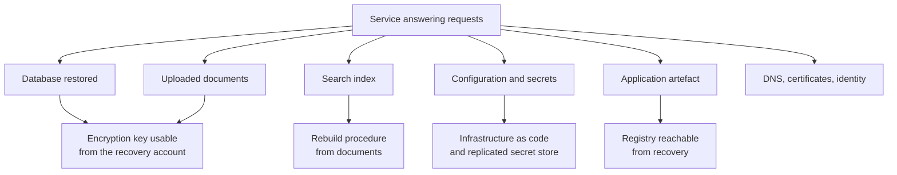

## Start with the backup that was not a restore

Lanark Bank, a fictional bank, runs your document service for its loan officers. The bank's recovery policy gives the service a four-hour recovery target. Its database backups had reported success every night for 14 months.

The bank's first restore drill for the service started at 09:00 in a clean recovery account. The database came back by 10:00. Then the problems queued up. The database was encrypted with a key held in the production account's key management service, and the recovery account had no permission to use it. Uploaded documents lived in object storage that no backup covered. The service's configuration and secret references existed only in the production deploy settings. The search index had no rebuild procedure. The service answered its first request at 04:00 the next morning, 19 hours after the start.

Every backup had worked. The restore did not.

Call this **the backup that was not a restore**: copies of the data with nothing else a recovery needs, never tested end to end.

> **What you'll learn**
>
> - Set RTO and RPO with the business, per process.
> - Choose a recovery design that meets them at a known cost.
> - List everything a restore needs beyond the data.
> - Run restore drills that measure real recovery times.
> - Recover when the backup itself cannot be used.

## RTO and RPO

Two numbers define what recovery must achieve:

- **Recovery time objective** (RTO): the longest the service may be down after a disaster, measured until users can work again.
- **Recovery point objective** (RPO): the most data, measured in time, the business accepts losing. An RPO of 15 minutes means a restore may lose at most the last 15 minutes of changes.

The business sets these, per process, because they trade money against harm. Lanark's loan service has an RTO of 4 hours and an RPO of 15 minutes. Its internal reporting has 24 hours for both. Your job is to say what each target costs, design to meet it and prove the design works. Lower numbers cost more: shorter RPOs need continuous copying, and shorter RTOs need standby capacity that sits idle.

## Choosing a recovery design

The switcher compares three designs for Lanark's 800 GB database against the targets. The timings assume the restore throughput Lanark measured in its drill, about 400 GB an hour.

Lanark's targets: RTO 4 hours, RPO 15 minutes. Database size 800 GB. Restore throughput about 400 GB an hour.

<button type="button" data-mode="nightly" aria-pressed="false" aria-controls="nightly-result">Nightly backups</button>
<button type="button" data-mode="pitr" aria-pressed="false" aria-controls="pitr-result">Backups plus log archiving</button>
<button type="button" data-mode="standby" aria-pressed="false" aria-controls="standby-result">Warm standby</button>

<section id="nightly-result" class="mode-panel" data-announcement="Nightly backups selected. RPO up to 24 hours, fails the target."><h4>Nightly backups</h4><ul><li>Worst-case data loss: almost 24 hours, if the disaster comes just before the next backup.</li><li>Recovery: about 2 hours to restore, plus about 1 hour to start and check the service. About 3 hours.</li><li>Cost: backup storage only.</li></ul>
Meets the RTO. Fails the RPO by a wide margin.
</section>
<section id="pitr-result" class="mode-panel" data-announcement="Backups plus log archiving selected. Meets both targets."><h4>Backups plus log archiving</h4><ul><li>The database's change log is archived every 5 minutes, so worst-case loss is about 5 minutes.</li><li>Recovery: 2 hours to restore the last full backup, up to 30 minutes to replay a day of log, and 1 hour to start and check. About 3.5 hours.</li><li>Cost: backup and log storage.</li></ul>
Meets both targets, with 30 minutes of margin on the RTO that only drills can confirm.
</section>
<section id="standby-result" class="mode-panel" data-announcement="Warm standby selected. Meets both with margin, at a higher running cost."><h4>Warm standby</h4><ul><li>A replica in a second region receives changes within seconds. Worst-case loss is about a minute.</li><li>Recovery: promote the replica and start the service there. About 30 minutes.</li><li>Cost: a second database running all the time, plus the network between regions.</li></ul>
Meets both with large margins. Worth it only if a 4-hour outage is too costly after all.
</section>

The figures are illustrative. Measure your own restore throughput, because it decides every RTO calculation and vendors' numbers rarely match a customer's network. Note too that a replica copies mistakes: a bad delete reaches the standby within seconds, so a standby never replaces backups. A replica or backup copy in another region is also a copy of the customer's data there, so check the agreed regions first, as [residency, retention and deletion](../security-reviews-and-compliance/03_Residency_Retention_and_Deletion.md) explains.

## What a restore needs beyond the data

A restore rebuilds a working service, not a database. Figure 1 shows what Lanark's restore depended on.

*Figure 1: A restore's dependency tree. Lanark's backups covered one box. The drill found the rest.*

Turn the tree into a **recovery kit** list, and check each item at every drill:

| Item | What to back up or arrange | Lanark's gap |
| --- | --- | --- |
| Databases | Full backups plus archived change logs, in another account | None |
| Files and object storage | Versioned, replicated copies | Not backed up |
| Derived data, such as search indexes | A tested rebuild procedure and its duration, or a backup | No procedure |
| Encryption keys | Keys usable from the recovery account, or replicated under the customer's key policy | No permission |
| Configuration and secrets | Infrastructure as code, and a secret store replicated to the recovery region | Only in production settings |
| Artefacts | Image digests in a registry the recovery account can pull from | Worked by chance |
| Network, certificates and identity | DNS changes, certificates and sign-in configuration for the recovery site | Took 3 hours by hand |

*Table 1: The recovery kit for one service, with the gaps Lanark's drill found.*

Keys deserve special care. Losing an encryption key makes every backup it protects unreadable for good. Treat key availability in the recovery account as part of the backup.

## Restore drills

A **restore drill** rebuilds the service from backups in an isolated environment, on a schedule, and measures the result. It is the only evidence that the RTO and RPO are real.

- **Restore everything,** into a clean account or region, using only the recovery kit and the written runbook.
- **Time each step** and compare the total with the RTO. Note the backup time used and compare the data lost with the RPO.
- **Verify like a user.** An officer signs in, opens a recent application and its documents, and a search returns them.
- **Record gaps as work,** with owners, and fix them before the next drill.
- **Rotate the people.** Someone who did not write the runbook runs it at least once a year.

Lanark now drills quarterly. The second drill took 6 hours, with object storage and keys fixed. The third took 3 hours 40 minutes, inside the target.

## When the backup itself is unusable

Sometimes the newest backups are the problem: corrupted, encrypted by ransomware, or empty for months because a job failed quietly. Defences come before the disaster:

- **Keep generations,** several days and weeks back, so a bad copy has good ones behind it.
- **Make copies immutable,** with storage locks or an offline copy that an attacker with production credentials cannot delete.
- **Test-restore automatically,** for example every night into a scratch environment, with a check that the data is current.
- **Alert on anomalies,** such as a backup much smaller or quicker than usual.

When it happens anyway, find the newest copy that verifies, restore it, replay archived logs past it if they are intact, and rebuild the rest from source systems, partner records and staff knowledge. Write down exactly what was lost, and give the business owner that list early.

## Limits of this lesson

- **Products differ.** Snapshot, log archiving and replication features vary by database and provider. Check the customer's.
- **Regulation.** Banks may have regulator-set recovery targets and drill reporting duties.
- **Fictional data.** Lanark Bank, its people and figures are illustrative.

## Interview angle

Each answer is an outline to say in about two minutes. Open each question and try it aloud before reading.

Interview question 1. What do RTO and RPO mean, and how do they shape a recovery design?

- **Answer:** RTO is the longest acceptable outage, RPO the most data, in time, the business accepts losing. The business sets both per process. RPO decides how continuously you copy: nightly backups give up to a day of loss, archived change logs minutes, replication seconds. RTO decides how much stands ready: restoring from backup takes hours, a warm standby minutes. Calculate recovery time from measured restore throughput, then prove it in drills.
- **Trade-off:** Lower targets cost more in standing capacity and complexity.
- **Follow-up to expect:** "Why keep backups with a replica?" A replica copies deletes and corruption within seconds.

Interview question 2. A restore drill brings the database back, but the service cannot start: keys and configuration are missing. What went wrong, and what do you change?

- **Answer:** The backups covered data, not the service. The restore needs encryption keys usable from the recovery account, configuration and secret references, artefacts, files, derived indexes, DNS and certificates. Write a recovery kit list from the service's dependency tree. Give the recovery account access to the keys under the customer's policy, keep configuration in infrastructure as code, and replicate the secret store. Drill again with only the kit and runbook.
- **Trade-off:** Making keys usable elsewhere widens who can decrypt. Tight, logged grants limit it.
- **Follow-up to expect:** "How do you know the kit is complete?" A clean drill by someone new.

## References

1. Amazon Web Services, [Business continuity plan](https://docs.aws.amazon.com/whitepapers/latest/disaster-recovery-workloads-on-aws/business-continuity-plan-bcp.html), accessed 17 November 2026. Definitions of recovery time objective and recovery point objective.
2. Amazon Web Services, [Disaster recovery options in the cloud](https://docs.aws.amazon.com/whitepapers/latest/disaster-recovery-workloads-on-aws/disaster-recovery-options-in-the-cloud.html), accessed 17 November 2026. Backup and restore, pilot light, warm standby and active designs.
3. Google, [Data Integrity: What You Read Is What You Wrote](https://sre.google/sre-book/data-integrity/), Site Reliability Engineering, accessed 17 November 2026. Why restores, not backups, are the goal, and testing them.
4. PostgreSQL, [Continuous archiving and point-in-time recovery](https://www.postgresql.org/docs/current/continuous-archiving.html), accessed 17 November 2026. Base backups plus archived write-ahead log.

## Key takeaways

- The business sets RTO and RPO per process. You price, design and prove them.
- Calculate recovery time from measured restore throughput.
- A replica is not a backup, because it copies mistakes.
- Back up the recovery kit: keys, configuration, files, artefacts and rebuild procedures.
- Drill on a schedule, time it, verify like a user and fix the gaps.

## Check yourself

1. Lanark's backups succeeded for 14 months. Why did recovery take 19 hours?

The backups covered the database only. Keys, files, configuration and the search index were missing or unusable from the recovery account, and nobody had tested a full restore.

2. Why does nightly backup fail Lanark's RPO while meeting its RTO?

Restoring takes about three hours, inside four. But a disaster just before the next backup loses nearly a day of changes, far beyond 15 minutes.

3. Why can a warm standby not replace backups?

It receives every change within seconds, including accidental deletes and corruption. Only older, separate copies let you go back before the mistake.

