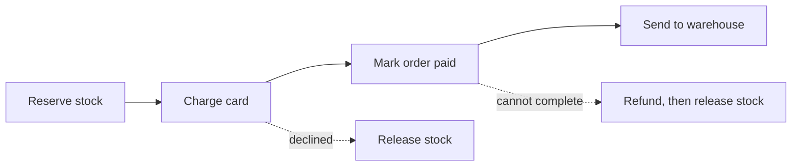

## Start with the paid-but-pending order

Mossgiel Retail, a clothing chain, takes online orders through three services: stock, payments and orders. Checkout reserves stock, charges the card, then marks the order paid. On a busy Saturday the orders database stalled for 40 seconds. The payment provider charged 312 customers, but the step that marks orders paid timed out, so those orders stayed "pending" with their stock still reserved. Customers saw a charge and no confirmation, and many pressed "Pay" again. The web app, the API gateway and the order service each retried, and some customers were charged twice. On Monday Ceri, the forward deployed engineer, got the finance team's list of complaints and had to work out, order by order, how far each checkout had got. Call this **the paid-but-pending order**: work that finished in one system and not the next, with no record of which steps ran.

> **What you'll learn**
>
> - Find where a multi-step workflow can stop halfway, and what a timeout means.
> - Make consumers safe against duplicate and out-of-order events.
> - Decide which failures to retry, how often, and at which layer.
> - Use circuit breakers and dead-letter queues without making things worse.
> - Finish or undo half-finished work with compensating actions.

## Where a workflow can stop halfway

A **partial failure** leaves some steps done and others not. In a single database you would wrap the steps in one transaction. Across three services and a payment provider, there is no shared transaction. Each step commits on its own.

*Figure 1: Mossgiel's checkout. Each step commits on its own. Each failure point needs its own way forward or back.*

The hardest case is a **timeout**. A timeout does not mean the call failed. It means you do not know. The payment provider may have charged the card and the reply was lost. Before you retry or undo anything, find out what happened, by asking the other system for the result under a known key.

Record each step's state in the order record (reserved, charged, paid, shipped) with the provider's reference. Then a reconciliation job can find orders stuck between states and finish them. The T1.5 lesson on [recoverable data syncs](../../../../01_Concept_Tutorials/Consolidated_Lessons/T1.5_Distributed_Systems_Essentials/04_Recoverable_Data_Syncs.md) covers reconciliation in depth.

## Duplicates and events out of order

Most queues and webhook senders deliver **at least once**. A message can arrive twice, and two messages can arrive in the wrong order. Your consumer must tolerate both.

- **Duplicates.** Give each operation an **idempotency key**, such as the order ID plus the step. The consumer stores keys it has processed and skips a repeat. Payment providers accept the same key on a charge request and return the first result instead of charging twice.
- **Out of order.** Each event carries a version or a sequence number for its record. The consumer applies an event only if its version is newer than the stored one. A "stock updated, version 7" event that arrives after version 9 is logged and dropped.
- **Missing context.** If an event refers to a record you have not seen yet, park it briefly and retry, or fetch the current state from the source.

When the event carries a full snapshot of the record, the newest version wins and older ones can be dropped. When events carry changes ("add 5 units"), you cannot drop one. Apply them in sequence and hold any that arrive early.

The T1.5 lesson on [duplicates in both directions](../../../../01_Concept_Tutorials/Consolidated_Lessons/T1.5_Distributed_Systems_Essentials/02_Duplicates_in_Both_Directions.md) covers deduplication stores in depth, and [the webhook receiver](../../enterprise-integration/receiving-webhooks-safely/01_The_Webhook_Receiver.md) applies both rules at a partner's front door.

## Retries that help and retries that hurt

A retry is worth it when the failure is **transient** and the operation is **safe to repeat**. Retry timeouts, connection resets, 429 and 503 responses. Do not retry a 400 or a declined card, because the next attempt fails the same way.

Three controls keep retries safe:

| Control | What it does | Mossgiel's setting |
| --- | --- | --- |
| Exponential backoff | Each wait doubles, so a struggling service gets room | 200 ms, 400 ms, 800 ms, 1.6 s, capped at 5 s |
| Jitter | Each wait is a random time up to the backoff, so clients do not retry in step | Full jitter on every wait |
| Retry budget | Retries may be at most a share of traffic | At most 10 per cent of requests |

*Table 1: Retry controls and the values Mossgiel chose.*

**Retry at one layer.** Mossgiel's web app, gateway and order service each made 4 attempts. One click could become 4 × 4 × 4 = 64 calls to a database that was already struggling. This is a **retry storm**. Retry at the layer closest to the failing call, and have the others fail fast. The T16.11 lesson on [retries, circuit breakers and bulkheads](../../../../01_Concept_Tutorials/Consolidated_Lessons/T4.6_Scaling_and_Reliability/04_Retries_Circuit_Breakers_and_Bulkheads.md) covers the mechanics in depth.

## Circuit breakers and dead-letter queues

A **circuit breaker** stops calls to a dependency that keeps failing. After a threshold of failures it opens, and calls fail at once. After a cool-down it lets one trial call through, the half-open state. If that call succeeds it closes.

A breaker that reopens again and again is telling you the dependency is not healthy yet, or the trial lets full traffic back too quickly. Lengthen the cool-down, let a small share of traffic through before closing, and check the dependency's own health signal.

A **dead-letter queue** holds messages that failed after their retries. It stops one bad message from blocking the queue. Replaying it needs care:

1. Group the messages by error and fix the cause first.
2. Check each message is still valid. A stock update from yesterday may be stale.
3. Replay through the normal, idempotent consumer at a limited rate.
4. Count what succeeded and what failed again, and record both.

A replay tool with filters, a rate cap and an audit trail is built in [keeping a message pipeline healthy](../../../../01_Concept_Tutorials/Consolidated_Lessons/T1.5_Distributed_Systems_Essentials/03_Keeping_a_Message_Pipeline_Healthy.md).

## Finishing or undoing the work

When a step cannot complete, earlier steps need a **compensating action**: a new action that undoes the business effect. A refund compensates a charge. Releasing stock compensates a reservation. You cannot delete a charge, and an email already sent stays sent.

The walkthrough recovers Mossgiel's 312 stuck orders.

312 orders are charged at the provider and pending in Mossgiel's database. Each step shows the action, the result and the check before moving on. Scripted illustration.

<button type="button" data-step="0" aria-pressed="false" aria-controls="rec-step-0">1. Contain</button><button type="button" data-step="1" aria-pressed="false" aria-controls="rec-step-1">2. Find</button><button type="button" data-step="2" aria-pressed="false" aria-controls="rec-step-2">3. Decide</button><button type="button" data-step="3" aria-pressed="false" aria-controls="rec-step-3">4. Repair</button>

<section id="rec-step-0" class="step-panel" aria-labelledby="rec-heading-0"><h4 id="rec-heading-0">1. Contain</h4><dl><dt>Action</dt><dd>Turn off retries in the web app and gateway. Send charge requests with an idempotency key per order.</dd><dt>Result</dt><dd>A second click returns the first charge instead of a new one.</dd><dt>Check</dt><dd>No new double charges in the provider's report.</dd></dl></section><section id="rec-step-1" class="step-panel" aria-labelledby="rec-heading-1"><h4 id="rec-heading-1">2. Find</h4><dl><dt>Action</dt><dd>Match the provider's charges for the window against orders by order ID.</dd><dt>Result</dt><dd>312 charged and pending. 19 charged twice.</dd><dt>Check</dt><dd>Totals agree with the provider's settlement report.</dd></dl></section><section id="rec-step-2" class="step-panel" aria-labelledby="rec-heading-2"><h4 id="rec-heading-2">3. Decide</h4><dl><dt>Action</dt><dd>For each order, check the stock reservation still holds.</dd><dt>Result</dt><dd>298 can be completed. 14 lost their stock and need a refund.</dd><dt>Check</dt><dd>The retail team agrees the rule before anything runs.</dd></dl></section><section id="rec-step-3" class="step-panel" aria-labelledby="rec-heading-3"><h4 id="rec-heading-3">4. Repair</h4><dl><dt>Action</dt><dd>Mark 298 orders paid and send them to the warehouse. Refund the 14 and the 19 duplicate charges, then email each customer.</dd><dt>Result</dt><dd>No order is left between states.</dd><dt>Check</dt><dd>A nightly reconciliation job now flags any order pending for more than 15 minutes.</dd></dl></section>

<button type="button" data-walk="previous">Previous</button>

<button type="button" data-walk="next">Next step</button>

Run every repair through the same idempotent code paths as live traffic. A repair script that writes to tables directly skips the checks that keep the data consistent. For durable workflow engines that record each step, see [durability and idempotency](../../../../01_Concept_Tutorials/Consolidated_Lessons/T3.7_Agentic_Workflow_Platforms/04_Durability_and_Idempotency.md).

## Limits of this lesson

- **Provider behaviour varies.** Idempotency key lifetimes, webhook retry schedules and ordering promises differ. Read the provider's documentation before relying on them.
- **Money and regulation.** Refund and notification rules may be set by the customer's finance and legal teams. Agree the rule before running a repair.
- **Composite engagement.** Mossgiel Retail, Ceri, its orders and figures are illustrative, not a real customer.

## Interview angle

Each answer is an outline to say in about two minutes. Open each question and try it aloud before reading.

Interview question 1. A workflow spans three services with no shared transaction. How do you design for it stopping halfway?

- **Answer:** Record each step's state and the external reference on the main record. Then you always know how far it got. Treat a timeout as unknown, and look up the result under a known key before retrying or undoing. Give each step a compensating action. Run a reconciliation job that finds records stuck between states for longer than a set time, then finishes or reverses them through the normal code paths.
- **Trade-off:** Step states and reconciliation add work and storage. Without them, stuck records surface only through complaints.
- **Follow-up to expect:** "Why not a distributed transaction?" Most providers do not support one, and it locks resources across services.

Interview question 2. An event consumer receives the same event twice and older events after newer ones. How do you make it safe?

- **Answer:** Make processing idempotent. Store a key per event or operation and skip one already handled. For ordering, put a version or sequence number on each record's events and apply an event only if it is newer than the stored version, logging the rest. If events describe changes rather than full state, hold early arrivals until the gap fills, or fetch the current state from the source.
- **Trade-off:** A key store and version checks add a write per event. Trusting delivery order corrupts data silently.
- **Follow-up to expect:** "How long do you keep the keys?" Longer than the sender's longest retry window.

Interview question 3. Write a retry policy for calls to a payment provider.

- **Answer:** Retry only transient failures: timeouts, connection errors, 429 and 503. Never retry a decline or a 400. Send an idempotency key so a repeat cannot charge twice. Use exponential backoff with full jitter, capped, and stop after three or four attempts. Cap retries at about 10 per cent of traffic. Retry in one layer only, and honour any Retry-After header.
- **Trade-off:** Fewer retries surface more errors to users. More retries load a provider that may already be struggling.
- **Follow-up to expect:** "The provider has no idempotency key." Look up by your order reference before retrying.
- **Go deeper:** [Retries, circuit breakers and bulkheads](../../../../01_Concept_Tutorials/Consolidated_Lessons/T4.6_Scaling_and_Reliability/04_Retries_Circuit_Breakers_and_Bulkheads.md).

Interview question 4. When do you use a circuit breaker, and when a dead-letter queue?

- **Answer:** A circuit breaker protects callers from a dependency that keeps failing: after a threshold it fails calls at once, then tests recovery with a trial call. A dead-letter queue protects a message flow from items that keep failing: after their retries they move aside so the rest can flow. Use a breaker on synchronous calls and a dead-letter queue on asynchronous consumers. Both need alerts, or failures pile up unseen.
- **Trade-off:** A breaker turns slow failures into fast ones, which users notice. A dead-letter queue defers failures, which someone must replay.
- **Follow-up to expect:** "How do you replay safely?" Fix the cause, check staleness, then replay at a limited rate through the idempotent consumer.

Interview question 5. What is a compensating action, and how does it differ from a rollback?

- **Answer:** A rollback undoes uncommitted changes inside one transaction, as if nothing happened. A compensating action is a new, committed step that reverses the business effect of an earlier one: a refund for a charge, a release for a reservation. It leaves a record, can fail itself, and must be idempotent and retried. Some effects, such as a sent email, cannot be reversed, only followed by a correction.
- **Trade-off:** Compensation keeps services independent. It allows a window where the data is inconsistent.
- **Follow-up to expect:** "The refund fails." Retry it, and put it on a queue a person reviews.

## References

1. Amazon Web Services, [Timeouts, retries and backoff with jitter](https://aws.amazon.com/builders-library/timeouts-retries-and-backoff-with-jitter/), accessed 17 November 2026. Retrying at one layer, backoff and jitter.
2. Google, [Addressing cascading failures](https://sre.google/sre-book/addressing-cascading-failures/), Site Reliability Engineering, accessed 17 November 2026. Retries at three layers producing 64 attempts, and retry budgets.
3. Microsoft, [Compensating Transaction pattern](https://learn.microsoft.com/en-us/azure/architecture/patterns/compensating-transaction), accessed 17 November 2026. Undoing completed steps in eventually consistent operations.
4. Stripe, [Idempotent requests](https://docs.stripe.com/api/idempotent_requests), accessed 17 November 2026. Repeating a request with the same key returns the first result.

## Key takeaways

- A timeout means unknown. Look up the result under a known key before retrying or undoing.
- Record each step's state, and reconcile records stuck between states.
- Consumers skip duplicates by key and drop events older than the stored version.
- Retry transient failures only, with backoff, jitter and a budget, in one layer.
- Undo committed steps with idempotent compensating actions, run through normal code paths.

## Check yourself

1. Why did one click at Mossgiel become 64 database calls?

Three layers each made 4 attempts, and each attempt at one layer triggered 4 at the next: 4 × 4 × 4 = 64.

2. A "stock updated, version 7" event arrives after version 9 was applied. What should the consumer do?

Log and drop it. It carries older state, and applying it would overwrite newer data.

3. Why is a refund a compensating action rather than a rollback?

The charge was committed at the provider. The refund is a new transaction that reverses its effect and leaves both on record.

