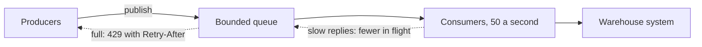

## Start with the average that hid the queue

Mossgiel Retail, the fictional clothing chain from the previous lesson, opened its winter sale at 09:00. The operations dashboard showed the order API's average response time steady at 120 ms all morning. Yet 1 in 50 customers waited over a second at checkout, and the stock-update queue held 28,500 messages by 09:05. The consumers' CPU sat at 15 per cent, so nobody added capacity.

Shop staff saw items sell out that the website still showed in stock. The dashboard said everything was fine.

Call this **the average that hid the queue**: a mean that stayed flat while the slowest requests and the backlog grew, and a CPU graph that pointed away from the real limit.

> **What you'll learn**
>
> - Read latency as percentiles, and see why a flat average can hide a bad tail.
> - Use Little's law to size workers, pools and in-flight work.
> - Work out how long a queue takes to drain, or whether it ever will.
> - Apply backpressure so overload slows the edges instead of breaking the middle.
> - Load test with bursts and an impaired dependency.

## Percentiles, not averages

A **percentile** is the latency below which a share of requests fall. The p50 is the median, and the p99 is the time that 99 in 100 requests beat. Averages blend fast and slow requests into a number nobody experienced.

| Morning | Requests | Average | p50 | p99 |
| --- | --- | --- | --- | --- |
| Before the sale | 1,000 at about 120 ms | 120 ms | 120 ms | 120 ms |
| Sale opens | 980 at 100 ms, 20 at 1,100 ms | 120 ms | 100 ms | 1,100 ms |

*Table 1: The same average, two very different experiences. Twenty slow checkouts in a thousand are invisible in the mean.*

The tail matters more than its share suggests. A page that makes 10 backend calls waits for the slowest. If each call has a 1 in 100 chance of being slow, the page is slow about 1 − 0.99¹⁰ ≈ 9.6 per cent of the time. Set targets on p95 or p99, and alert on them.

## Little's law

**Little's law** links three numbers for any stable system: the average number of items inside (L) equals the arrival rate (λ) times the average time each spends inside (W). L = λ × W.

- Mossgiel's order API takes 400 requests a second, each taking 0.25 s. On average, 400 × 0.25 = 100 requests are in flight.
- If the payment call slows by 0.5 s, each request takes 0.75 s. Now 300 must be in flight. With 200 workers, it can finish at most 200 ÷ 0.75 ≈ 267 a second, and the rest queue.
- The stock consumers run 10 at a time, and each waits 0.4 s on the warehouse system. They can finish at most 10 ÷ 0.4 = 25 messages a second. Messages arrive at 30. The queue grows by 5 a second, 18,000 an hour, while the CPU idles.

That last line explains the low CPU. The consumers were waiting, not working. Their limit was concurrency against a slow dependency. During the sale's first five minutes, 120 updates arrived each second against 25 handled, which built the 28,500 backlog: 95 × 300.

## How long the queue takes to drain

A queue grows when arrivals beat capacity and shrinks at the difference when capacity wins. Mossgiel raised the stock consumers' concurrency so they handle 50 a second, then replayed the sale morning in a test.

From 09:00 to 09:05, 120 updates arrived each second. The backlog grew by 70 a second for 300 seconds, 21,000 messages. A message arriving at 09:05 waits behind all of them: 21,000 ÷ 50 = 420 s, 7 minutes. How fast the backlog clears depends on what arrives afterwards.

A backlog of 21,000 messages. Consumers handle 50 a second. Choose the arrival rate after the burst.

<button type="button" data-mode="calm" aria-pressed="false" aria-controls="calm-result">30 a second</button>
<button type="button" data-mode="busy" aria-pressed="false" aria-controls="busy-result">45 a second</button>
<button type="button" data-mode="over" aria-pressed="false" aria-controls="over-result">55 a second</button>

<section id="calm-result" class="mode-panel" data-announcement="30 a second selected. The backlog clears in 17.5 minutes."><h4>30 a second</h4><ul><li>The backlog falls by 50 − 30 = 20 a second.</li><li>21,000 ÷ 20 = 1,050 s, about 17.5 minutes.</li></ul>
Stock is right again by about 09:23.
</section>
<section id="busy-result" class="mode-panel" data-announcement="45 a second selected. The backlog clears in 70 minutes."><h4>45 a second</h4><ul><li>The backlog falls by only 5 a second.</li><li>21,000 ÷ 5 = 4,200 s, 70 minutes.</li></ul>
Small headroom makes a long recovery. Add consumers for the morning.
</section>
<section id="over-result" class="mode-panel" data-announcement="55 a second selected. The backlog never drains."><h4>55 a second</h4><ul><li>Arrivals beat capacity by 5 a second.</li><li>The backlog grows by 18,000 an hour and never drains.</li></ul>
Add capacity or shed load. Waiting will not fix it.
</section>

Drain time is backlog ÷ (capacity − arrivals). When the bracket is small, recovery is slow. When it is zero or negative, the queue never recovers.

## Backpressure

**Backpressure** pushes overload back to the producer instead of letting it pile up inside. Without it, queues and in-memory buffers grow until latency is minutes and memory runs out.

*Figure 1: A bounded queue. When it fills, producers are told to wait. When the warehouse slows, consumers take fewer messages at once.*

The tools are bounds:

- **Bounded queues and pools.** Set a maximum depth or size. When it is reached, reject or wait, rather than grow without limit.
- **Reject early with a hint.** Return 429 or 503 with a Retry-After header, so clients back off.
- **Shed by priority.** Drop or delay low-value work, such as recommendation refreshes, before checkouts.
- **Limit concurrency per dependency.** Cap calls to a slow system so it does not take every worker. The [handling overload](https://sre.google/sre-book/handling-overload/) chapter of Google's Site Reliability Engineering book covers rejection and per-client limits.

## Load tests with bursts and a slow dependency

A load test at a steady average rate tells you little about a sale morning. Test the shapes that break systems:

| Test | Shape | What it tells you |
| --- | --- | --- |
| Baseline | Expected average rate for 30 minutes | p50, p95, p99 and errors at normal load |
| Spike | Jump to 3× in seconds, hold 5 minutes | Queue growth, rejections, drain time afterwards |
| Stress | Raise the rate until errors climb | The real capacity and what fails first |
| Impaired dependency | Normal rate with 500 ms added to one dependency | Whether pools, timeouts and breakers contain it |
| Soak | Normal rate for hours | Leaks, slow growth in latency or memory |

*Table 2: A load-test suite. Each test has a pass rule written before it runs.*

Inject the impairment with a fault proxy or a stub of the dependency, not by hoping it happens. Measure percentiles, queue depth, pool waits, error rates and the time to recover after the burst ends. Use production-shaped data, because cache hits and query plans change with it. The T1.4 lesson on [degrading gracefully and load testing](../../../../01_Concept_Tutorials/Consolidated_Lessons/T1.4_Cloud_Containers_and_Deployment/06_Degrade_Gracefully_and_Load_Test.md) shows a mock model endpoint for AI services.

## Limits of this lesson

- **Little's law needs a stable system.** It holds for long-run averages. During a burst, use the arrival and capacity arithmetic instead.
- **Real arrivals are uneven.** Queues build before average utilisation reaches 100 per cent. Keep headroom.
- **Fictional data.** Mossgiel Retail, its rates and figures are illustrative.

## Interview angle

Each answer is an outline to say in about two minutes. Open each question and try it aloud before reading.

Interview question 1. Why report p95 and p99 latency rather than the average?

- **Answer:** The average blends fast and slow requests into a time few users see. A few very slow requests barely move it. Percentiles show what share of users wait how long: the p99 is the time 99 in 100 beat. Pages that fan out to several calls wait for the slowest. The tail reaches far more users than 1 per cent. Set targets and alerts on p95 or p99, and keep the p50 for typical experience.
- **Trade-off:** High percentiles need enough samples to be stable. Averages are cheap and stable, and mislead.
- **Follow-up to expect:** "Can you average p99s across servers?" No. Merge histograms, then compute.

Interview question 2. How would you load test a checkout before a sale?

- **Answer:** Write pass rules first, such as p99 under 800 ms and errors under 0.5 per cent at 3× normal load. Run a baseline, then a spike to 3× in seconds, then a stress test to find the breaking point. Add a run with 500 ms injected into the payment provider. Soak for hours at normal load. Use production-shaped data, and watch queue depth, pool waits and recovery time, not only latency.
- **Trade-off:** A full suite takes days and a production-like environment. A single steady test misses bursts and slow dependencies.
- **Follow-up to expect:** "You cannot load the payment provider." Stub it, with its real latency and failure modes.

Interview question 3. How do queues, backpressure and connection pools relate?

- **Answer:** All three hold work waiting for capacity. A queue absorbs bursts, a pool limits concurrent calls to a resource, and backpressure stops either from growing without limit. Bound every queue and pool. When a bound is reached, reject early with a retry hint, wait briefly, or shed low-priority work. Watch depth and wait time, since a growing queue or pool wait shows demand beating capacity before errors do.
- **Trade-off:** Bounds cause visible rejections. Unbounded buffers hide overload until memory or latency fails.
- **Follow-up to expect:** "What size?" Little's law: arrival rate times time per item, plus headroom.

Interview question 4. After a release, p99 latency jumped from 120 ms to 1.1 s while the average stayed at 120 ms. What happened, and how do you find it?

- **Answer:** A small share of requests got much slower while the rest got slightly faster. The mean held. For example, 2 per cent at 1.1 s and the rest at 100 ms gives the same mean. Split the slow requests by endpoint, tenant, instance and dependency. Look for one path: a cache miss, a new query, a lock, a retry or one bad host. Compare traces of slow and fast requests from the same endpoint.
- **Trade-off:** Rolling back is fast and teaches nothing. Diagnosing first leaves users in the tail longer.
- **Follow-up to expect:** "Only one instance is slow." Check that host's resources, garbage collection and neighbours.

Interview question 5. An API takes 400 requests a second at 0.25 s each and has 200 workers. A dependency adds 0.5 s. What happens?

- **Answer:** By Little's law, in-flight work is arrival rate times time in system. Before, 400 × 0.25 = 100 requests in flight, half the workers. After, each takes 0.75 s and 300 would be needed. With 200 workers the service finishes at most 200 ÷ 0.75 ≈ 267 a second, and the other 133 a second queue or fail. Cap concurrency to the slow dependency, set its timeout and add a breaker.
- **Trade-off:** More workers absorb it briefly and push more load onto the struggling dependency.
- **Follow-up to expect:** "Why not raise workers to 400?" It moves the queue into the dependency.

## References

1. Google, [Service level objectives](https://sre.google/sre-book/service-level-objectives/), Site Reliability Engineering, accessed 17 November 2026. Percentiles instead of averages for latency.
2. Dean and Barroso, [The tail at scale](https://research.google/pubs/the-tail-at-scale/), Communications of the ACM, accessed 17 November 2026. How fan-out amplifies tail latency.
3. Google, [Handling overload](https://sre.google/sre-book/handling-overload/), Site Reliability Engineering, accessed 17 November 2026. Rejection, client limits and graceful overload.
4. Grafana Labs, [Load test types](https://grafana.com/docs/k6/latest/testing-guides/test-types/), accessed 17 November 2026. Average, spike, stress and soak tests.

## Key takeaways

- Averages hide the tail. Target and alert on p95 or p99.
- Little's law: in flight = arrival rate × time each item spends inside.
- Drain time = backlog ÷ (capacity − arrivals). Small headroom means slow recovery.
- Bound every queue and pool, and push overload back to producers.
- Load test bursts, a slow dependency and long runs, against pass rules written first.

## Check yourself

1. Why was the stock consumers' CPU low while the queue grew?

They spent their time waiting on the warehouse system. Ten at a time at 0.4 s each caps them at 25 a second, below the 30 arriving.

2. Why does the backlog take 70 minutes to clear at 45 arrivals a second but 17.5 at 30?

Drain speed is the gap between capacity and arrivals: 5 a second against 20 a second.

3. Why is "add more workers" a risky fix when a dependency slows?

The extra workers send more concurrent calls to the slow dependency, which can slow it further.

