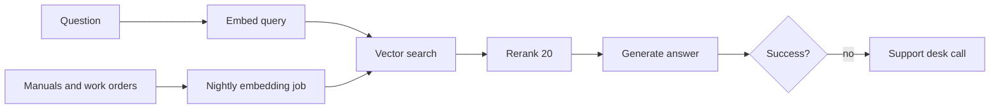

## Start with the cheaper answer that costs more

Hartfell Energy, a utility, gave its field engineers a retrieval-augmented generation (RAG) assistant over equipment manuals and past work orders, answering about 200,000 questions a month. When finance asked for the model bill to come down, the team cut the retrieved context from 12 passages to 4, and the bill fell from $6,000 to $3,600 a month. Within two weeks failed answers rose from 15 to 30 per cent, engineers phoned the support desk instead, and Hartfell reckons each failed answer costs about $4 in desk time and delay. Nkem, the forward deployed engineer, was asked why the cheaper assistant was costing more. Call this **the cheaper answer that costs more**: a saving measured per model call that raised the cost of each job done.

> **What you'll learn**
>
> - Measure cost per successful task, including what failures cost.
> - Cut context with a budget and a reranker instead of a blunt limit.
> - Route easy requests to cheaper models, and test fallback models before you need them.
> - Use streaming for speed and batch processing for cost, and know which does which.
> - Break down where a RAG system's money goes.

## Cost per successful task

**Cost per successful task** divides everything a task costs by the tasks that succeeded. For Hartfell that includes model tokens, reranking and the $4 each failure costs downstream. A cost per call ignores failures, so it rewards changes that make answers cheaper and worse.

Success needs a definition the customer agrees with. Building the graded set behind it is covered in [evaluating on the customer's work](../../fde-building-in-the-estate/ai-delivery-in-customer-estates/05_Evaluating_on_the_Customers_Work.md). Hartfell counts an answer as successful when the engineer did not escalate and a weekly graded sample confirms it was correct and cited the right manual.

The switcher compares three context settings on the same questions. Prices are illustrative: $3 per million input tokens and $15 per million output tokens, with 400 output tokens per answer.

Hartfell's assistant, 200,000 questions a month. A failed answer costs $4 downstream. Choose a context setting.

<button type="button" data-mode="twelve" aria-pressed="false" aria-controls="twelve-result">12 passages</button>
<button type="button" data-mode="four" aria-pressed="false" aria-controls="four-result">4 passages</button>
<button type="button" data-mode="rerank" aria-pressed="false" aria-controls="rerank-result">4 of 20, reranked</button>

<section id="twelve-result" class="mode-panel" data-announcement="12 passages selected. 74 cents per successful task."><h4>12 passages</h4><ul><li>8,000 input tokens. Model cost $0.030 a question, $6,000 a month.</li><li>85 per cent succeed. Failures add $0.60 a question.</li><li>Cost per successful task: $0.63 ÷ 0.85 ≈ $0.74.</li></ul></section>
<section id="four-result" class="mode-panel" data-announcement="4 passages selected. 1 dollar 74 cents per successful task."><h4>4 passages</h4><ul><li>4,000 input tokens. Model cost $0.018 a question, $3,600 a month.</li><li>70 per cent succeed. Failures add $1.20 a question.</li><li>Cost per successful task: $1.218 ÷ 0.70 = $1.74.</li></ul>
The model bill fell 40 per cent. The cost of each job done more than doubled.
</section>
<section id="rerank-result" class="mode-panel" data-announcement="4 of 20 reranked selected. 67 cents per successful task."><h4>4 of 20, reranked</h4><ul><li>Retrieve 20, rerank for $0.002, send the best 4. Model and reranker $0.020 a question, $4,000 a month.</li><li>86 per cent succeed. Failures add $0.56 a question.</li><li>Cost per successful task: $0.58 ÷ 0.86 ≈ $0.67.</li></ul>
Cheaper than the original on both measures.
</section>

Count model cost per request alone and the 4-passage setting looks best, at $0.018. That is why the metric must include failures.

## Context budgets

A **context budget** sets how many tokens each part of a prompt may use: instructions, retrieved passages, conversation history and the question. Cutting tokens cuts cost, but only cutting the right ones keeps quality.

- **Cut by relevance, not position.** Retrieve widely, rerank, and keep the best passages. A blunt limit drops whatever ranked lower in a rough first search.
- **Trim history before evidence.** Summarise earlier turns, and keep the passages the answer depends on.
- **Reuse the fixed part.** Providers discount a repeated prompt prefix, such as long instructions, through prompt caching.
- **Test every cut as an experiment.** Run the old and new budget on the same graded question set, and compare success and cost per success, not tokens.

More context is not always better either. Models can miss facts placed in the middle of a long context, so a large budget of weak passages can lower accuracy too.

## Routing and fallback quality

**Routing** sends each request to the cheapest model that handles it well. About 60 per cent of Hartfell's questions are lookups, such as a torque value or a part number. Sending those to a model at a tenth of the price brings model spend to 0.6 × 0.1 + 0.4 = 0.46 of before, if success holds on that share. Measure success per route, because a router that misjudges hard questions as easy saves money and fails tasks.

A **fallback** model takes over when the primary is down or slow. It is often a different model, with different quality. Hartfell's fallback scored 72 per cent on the graded set against 86 for the primary. Decide in advance which tasks may use it. Hartfell lets lookups fall back, but questions about isolation procedures return the manual's section and a notice instead of a weaker answer. Label fallback answers in logs, and alert when the fallback share rises. The T16.10 lesson on [model routing and prompt discipline](../../../../01_Concept_Tutorials/Consolidated_Lessons/T4.5_Cost_and_Latency/04_Model_Routing_and_Prompt_Discipline.md) covers routers and cascades. Choosing which models to compare before launch is covered in [picking a model for a customer](../../fde-building-in-the-estate/choosing-the-ai-approach/02_Picking_a_Model_for_a_Customer.md).

## Streaming and batch size

Streaming and batching are often confused. One improves how fast an answer feels. The other lowers cost for work that can wait.

| Technique | Changes | Does not change |
| --- | --- | --- |
| Streaming | First words appear in about 0.8 s instead of after the full 8.8 s | Tokens or cost |
| Batch processing | About half the price for offline jobs, such as summarising 40,000 work orders overnight | Speed. Results arrive later |
| Larger embedding batches | Fewer calls and higher throughput within rate limits | Cost per token. A failed batch must be retried whole |

*Table 1: What streaming and batching change. Hartfell's answers are about 400 tokens, generated at about 50 a second.*

Choose batch size from the provider's rate limits and the cost of retrying a failed batch, and make each item idempotent so a retry does not duplicate it. The T16.10 lesson on [latency, prefill, decode and streaming](../../../../01_Concept_Tutorials/Consolidated_Lessons/T4.5_Cost_and_Latency/03_Latency_Prefill_Decode_Streaming_and_the_Tail.md) explains where generation time goes.

## Where a RAG system's money goes

A cost breakdown starts from the request path and adds the jobs that run behind it.

*Figure 1: Hartfell's request path and the nightly job behind it. Each box has a cost, and failed answers add one more.*

| Item | Monthly cost |
| --- | --- |
| Generation and reranking (4 of 20) | $4,000 |
| Nightly re-embedding of all 2 million passages | $2,400 |
| Vector database hosting | $1,500 |
| Query embeddings | About $1 |
| Failed answers, 28,000 × $4 | $112,000 |

*Table 2: Hartfell's monthly breakdown after the reranking change. Illustrative prices: embedding at $0.10 per million tokens, 400 tokens per passage.*

The re-embedding line was a surprise. Each night the job re-embedded 800 million tokens, although only about 2 per cent of passages had changed. Storing a hash of each passage's text and embedding only new or changed ones cut that line from $2,400 to about $48. The [RAG and agent cost controls](../../../../01_Concept_Tutorials/Consolidated_Lessons/T4.5_Cost_and_Latency/06_RAG_and_Agent_Cost_Controls.md) lesson in T16.10 covers further levers.

## Limits of this lesson

- **Prices change.** Token prices, discounts and limits vary by provider and change often. Use the customer's contract prices.
- **Failure costs are estimates.** Agree the cost of a failed task with the customer, and say how you derived it.
- **Composite engagement.** Hartfell Energy, Nkem, its volumes, prices and success rates are illustrative, not a real customer.

## Interview angle

Each answer is an outline to say in about two minutes. Open each question and try it aloud before reading.

Interview question 1. How do you set and test a token budget for a RAG assistant?

- **Answer:** Split the prompt into parts: instructions, retrieved passages, history and the question, and give each a budget. Fill the passage budget by relevance, retrieving widely and reranking. Summarise old turns before dropping evidence. Cache the fixed instructions. Test each budget change on the same graded question set and compare success rate and cost per successful task, not token counts. Roll out behind a flag and watch escalations.
- **Trade-off:** Tight budgets cut cost and can drop the passage the answer needs. Loose budgets cost more and can bury key facts.
- **Follow-up to expect:** "No graded set exists." Build one from real questions with the customer's experts.

Interview question 2. How do you route requests between models, and how do you choose a fallback?

- **Answer:** Classify each request by difficulty and risk, with rules or a small classifier, and send easy, low-risk ones to a cheaper model. Measure success per route on graded samples, since misrouting hard requests saves money and fails tasks. Pick the fallback by testing it on the same graded set. Decide which tasks may use it, label its answers, alert when its share rises, and for high-risk tasks return a safe response instead.
- **Trade-off:** Routing adds a decision that can be wrong. One model for everything is simpler and costs more.
- **Follow-up to expect:** "Both providers fail." Queue or degrade to search results with sources.
- **Go deeper:** [Model routing and prompt discipline](../../../../01_Concept_Tutorials/Consolidated_Lessons/T4.5_Cost_and_Latency/04_Model_Routing_and_Prompt_Discipline.md).

Interview question 3. When do you use streaming, and when batch processing?

- **Answer:** Stream when a person waits for the answer. The first words arrive in under a second, which feels faster, but tokens and cost are unchanged. Use batch processing for work nobody waits for, such as overnight summaries or evaluation runs. Providers price it lower and return results later. For embedding jobs, choose batch size from rate limits and the cost of retrying a failed batch, and keep items idempotent.
- **Trade-off:** Streaming complicates moderation of partial output. Batch results arrive hours later.
- **Follow-up to expect:** "Can you stream and still check the answer?" Hold a short buffer, or check before showing citations.

Interview question 4. Why measure cost per successful task instead of cost per request?

- **Answer:** Cost per request rewards changes that make each call cheaper, even when more calls fail. Failures cost something: retries, escalations, staff time or lost work. Cost per successful task divides all costs, including failure handling, by tasks that succeeded under an agreed definition. It shows when a saving moves cost elsewhere. At Hartfell, cutting context lowered cost per request by 40 per cent and more than doubled cost per success.
- **Trade-off:** It needs a success definition and graded samples. Cost per request needs only the bill.
- **Follow-up to expect:** "How do you price a failure?" Agree it with the customer from escalation and time data.

Interview question 5. Cutting retrieved context lowered the model bill, and failed answers doubled. What do you do?

- **Answer:** Restore the previous setting while you investigate, since the cost per success rose. Compare failed answers before and after: usually the needed passage ranked fifth or lower and was cut. Then test a smarter cut: retrieve more, rerank and keep the best few, and trim history before evidence. Run each option on a graded set and choose by cost per successful task. Report both the bill and the failure cost to finance.
- **Trade-off:** Reverting gives up the saving for now. Keeping the cut moves cost to the support desk.
- **Follow-up to expect:** "Finance insists on the cut." Show cost per success, and offer reranking or routing.

## References

1. Anthropic, [Batch processing](https://docs.claude.com/en/docs/build-with-claude/batch-processing), accessed 17 November 2026. Asynchronous batches at half the standard price.
2. Liu and others, [Lost in the middle: how language models use long contexts](https://arxiv.org/abs/2307.03172), arXiv, accessed 17 November 2026. Accuracy falls when relevant facts sit in the middle of long contexts.
3. The site's T16.10 module, [RAG and agent cost controls](../../../../01_Concept_Tutorials/Consolidated_Lessons/T4.5_Cost_and_Latency/06_RAG_and_Agent_Cost_Controls.md). Cost levers across the RAG pipeline.
4. The author's own field experience, the basis for the cost-per-successful-task framing and the failure-cost estimate.

## Key takeaways

- Measure cost per successful task, with failure costs included.
- Cut context by relevance with a reranker, and test each cut on a graded set.
- Route easy, low-risk requests to cheaper models, and test the fallback before an outage.
- Streaming improves perceived speed. Batch processing lowers cost for work that can wait.
- Re-embed only changed content, tracked by a hash of each passage.

## Check yourself

1. Why did the 4-passage setting look best on model cost per request but worst on cost per success?

Model cost per request ignores failures. With $4 per failure included, its 30 per cent failure rate outweighed the token saving.

2. Does streaming lower the cost of an answer?

No. It shows the first words sooner. The same tokens are generated and billed.

3. How did Hartfell cut its re-embedding cost from $2,400 to about $48 a month?

It stored a hash of each passage's text and re-embedded only new or changed passages, about 2 per cent each night.

