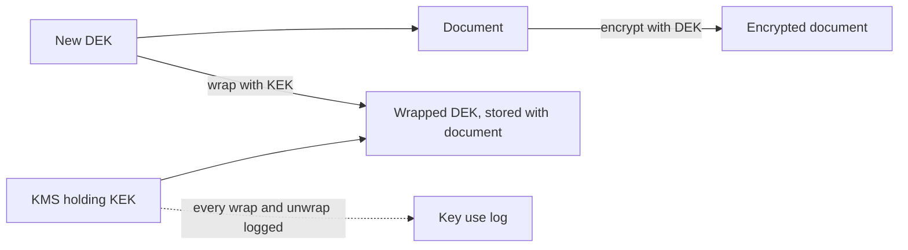

## Start with the yes that proves nothing

Sandling Pay, a fictional payments firm, was reviewing a document service before sending it chargeback evidence. One questionnaire row asked whether data was encrypted at rest. The team wrote "Yes, AES-256."

The reviewer asked three follow-up questions. Whose key is it? Who can use it to decrypt our documents? Show me the record of the last time one of your engineers read one of our documents.

The answers were awkward. The storage used the cloud provider's default key, which Sandling could not see or revoke. Any engineer with read access to the bucket could read every file, because the storage decrypted on read. The support console logged sign-ins but not which documents an engineer opened, and those logs were kept for 14 days in an account where the same engineers could delete them. The review paused for three weeks.

The first answer was true and answered nothing the reviewer cared about. Call this **the yes that proves nothing**: a control stated as a fact, with no account of what it stops or how anyone could check it.

> **What you'll learn**
>
> - State what encryption in transit, at rest and in the application each stop, and what they do not.
> - Explain envelope encryption and choose who holds the key.
> - Design an audit trail that records the right events and survives an insider.
> - Turn each security claim into evidence a reviewer can check.

## What each layer of encryption stops

Encryption protects data from anyone who gets the bytes without the key. Each layer hands the key to someone different, which decides what it stops.

| Layer | Stops | Does not stop |
| --- | --- | --- |
| In transit (TLS between every hop) | Someone reading or changing traffic on the network | Anyone at either end, including your own service |
| At rest, storage level | A stolen disk, a leaked snapshot, a discarded drive | Anyone who can read through the storage service, since it decrypts for them |
| At rest, with a key the customer controls | All of the above, plus access after the customer revokes the key | Your running service while the key is enabled |
| Application or field level | Database administrators and backup operators reading the field | The service code that holds the key and decrypts |

*Table 1: Each layer of encryption stops a different reader. None of them stops the service itself.*

Storage-level encryption was the layer Sandling's team had. It is worth having and costs nothing. It does nothing against an engineer with bucket access, which was Sandling's real question. Encrypt within the service as well, between internal components, not only at the edge. Internal traffic crosses networks that others share.

## Envelope encryption and who holds the key

Services do not encrypt every file with one master key. They use **envelope encryption**. Each object gets its own **data encryption key** (DEK). The DEK is itself encrypted by a **key encryption key** (KEK) that never leaves a key management service (KMS). The encrypted DEK is stored beside the data.

*Figure 1: Envelope encryption. Each document has its own data key. Only the key service can unwrap it, and it logs every request.*

Two properties make this the default. Reading any document needs a call to the KMS, which is logged and can be refused. And rotating the KEK means re-wrapping small DEKs, not re-encrypting every file. With a separate KEK per tenant, one customer's data can be made unreadable without touching another's. The key hierarchy itself is covered in [secrets and per-tenant encryption keys](../../../../01_Concept_Tutorials/Consolidated_Lessons/T4.4_Security_Tenancy_and_Prompt_Injection/02_Secrets_and_Per_Tenant_Encryption_Keys.md).

The question a customer cares about is who holds the KEK.

Sandling's documents are encrypted with envelope encryption. Choose who holds the key encryption key to see who can decrypt, what happens if Sandling revokes it, and what it costs.

<button type="button" data-mode="provider" aria-pressed="false" aria-controls="provider-result">Your service holds it</button>
<button type="button" data-mode="cmk" aria-pressed="false" aria-controls="cmk-result">Customer-managed key</button>
<button type="button" data-mode="external" aria-pressed="false" aria-controls="external-result">Key held outside your cloud</button>

<section id="provider-result" class="mode-panel" data-announcement="Your service holds the key. Sandling cannot revoke access."><h4>Your service holds it</h4><ul><li>The KEK sits in your KMS account. Your service and your key administrators can use it.</li><li>Sandling cannot see key use or cut off access. It relies on your controls and contract.</li><li>Cheapest and simplest. No dependency on the customer.</li></ul>
Fine for low-risk data. A payments reviewer will usually ask for more.
</section>
<section id="cmk-result" class="mode-panel" data-announcement="Customer-managed key. Sandling can see key use and revoke it."><h4>Customer-managed key</h4><ul><li>Sandling creates the KEK in its own KMS account and grants your service permission to use it.</li><li>Sandling sees every unwrap in its own logs. Disabling the key makes its data unreadable to your service once the change takes effect.</li><li>If Sandling disables the key by mistake, its part of the service fails. You need an alert and a runbook for that.</li></ul>
The usual answer for regulated customers. It needs per-tenant keys in your design.
</section>
<section id="external-result" class="mode-panel" data-announcement="Key held outside your cloud. Every decrypt depends on Sandling's system."><h4>Key held outside your cloud</h4><ul><li>The KEK stays in Sandling's own key manager. Each unwrap calls it across the network.</li><li>Sandling has full control, and your cloud provider cannot use the key either.</li><li>Every read depends on Sandling's system being up and reachable. Latency and outages are now shared.</li></ul>
For the strictest customers. Agree availability targets for their key manager before you promise yours.
</section>

Sandling chose a customer-managed key. The team added a per-tenant KEK, an alert when Sandling's key became unavailable, and a yearly rotation. When a KEK rotates, the KMS keeps old versions to unwrap existing DEKs, and new writes use the new version. NIST SP 800-57 calls the period a key may be used its **cryptoperiod**. Agree one with the customer and write it down.

## Audit trails that survive an insider

An **audit trail** records who did what, to which data, when, from where, and whether it worked. Reviewers ask for one because it answers two questions after the fact: what happened, and can anyone deny it.

Record these events at a minimum:

| Event | Example |
| --- | --- |
| Sign-in and failed sign-in | Analyst signs in through single sign-on |
| Customer data read by staff | Support engineer opens document 4812 for ticket 3307 |
| Permission and role changes | Engineer granted support console access |
| Configuration changes | Cache setting or retention period changed |
| Key use and key changes | Unwrap requests, a key disabled or rotated |
| Exports and deletions | Results exported, a tenant's data deleted |

*Table 2: Events an audit trail for a shared service should record.*

Each entry needs the actor, the action, the object, the tenant, the time from a synchronised clock, the source address and the outcome. Leave out document content, secrets and full tokens. The trail must not become a second copy of the data.

The harder part is keeping it trustworthy. Ship entries straight to a store in a separate account that your engineers cannot write to or delete from. Use the storage's write-once retention setting where it has one. Keep entries as long as the customer's policy needs, which for Sandling was 12 months. Alert on gaps, because a trail that silently stops is worse than none.

## Turning claims into evidence

A reviewer cannot test your intentions. They test artefacts. For each claim, decide what someone outside your team could inspect to confirm it.

| Claim | Evidence |
| --- | --- |
| TLS on every external endpoint | An external scan result and the load balancer's policy export, both dated |
| Data encrypted with Sandling's key | The storage configuration naming the key, and Sandling's own key use log showing unwraps |
| Only the service can use the key | The key policy listing allowed identities |
| Staff reads are recorded | An audit entry for a test read, made while the reviewer watches |
| Logs cannot be altered by engineers | The log store's retention lock and its access policy |
| Keys rotate | The key's version history |

*Table 3: Each claim and the artefact that proves it. Exports and live demonstrations beat screenshots and statements.*

Evidence has a date and a source. A configuration export from this week is stronger than a screenshot from a slide deck. A live demonstration, such as reading a test document and showing the audit entry appear, is stronger than either. Keep the pack in one folder per customer, refreshed before each review.

Sandling's review resumed with nine artefacts in place of the one-line answer. It closed in four days.

## Limits of this lesson

- **Cryptography choices.** Algorithms, modes and key lengths belong to your platform's standards and the customer's policy. Use the provider's defaults unless a standard requires otherwise.
- **Certifications.** Audits against formal standards bring their own evidence formats. This lesson covers the engineering evidence underneath them.
- **Fictional data.** Sandling Pay, its review, figures and ticket numbers are illustrative.

## Interview angle

Each answer is an outline to say in about two minutes. Open the question and try it aloud before reading.

Interview question 1. A bank's reviewer asks how you encrypt their data, who controls the keys, and how you would prove who accessed it. Answer all three.

- **Answer:** In transit, TLS on every hop, including internal ones. At rest, envelope encryption: a data key per object, wrapped by a per-tenant key in a KMS. For a bank, offer a customer-managed key in their own account, so they see every unwrap and can revoke access. For access, an audit trail of staff reads, permission changes, key use and exports, shipped to a separate store engineers cannot alter, kept as long as their policy needs. Prove it with dated exports, their own key logs and a live test read.
- **Trade-off:** A customer-managed key gives them control and means their mistake can take their tenant offline.
- **Follow-up to expect:** "Can your administrators read our data?" Only through the service's key use, which they would see.
- **Go deeper:** [Secrets and per-tenant encryption keys](../../../../01_Concept_Tutorials/Consolidated_Lessons/T4.4_Security_Tenancy_and_Prompt_Injection/02_Secrets_and_Per_Tenant_Encryption_Keys.md).

## References

1. Google Cloud, [Envelope encryption](https://cloud.google.com/kms/docs/envelope-encryption), accessed 17 November 2026. Data keys wrapped by key encryption keys held in a key service.
2. Google Cloud, [Customer-managed encryption keys](https://cloud.google.com/kms/docs/cmek), accessed 17 November 2026. Customer-controlled keys, and data becoming inaccessible when the key is disabled or destroyed.
3. NIST CSRC, [SP 800-57 Part 1 Rev. 5, Recommendation for Key Management](https://csrc.nist.gov/pubs/sp/800/57/pt1/r5/final), accessed 17 November 2026. Key management practice and cryptoperiods.
4. OWASP, [Logging Cheat Sheet](https://cheatsheetseries.owasp.org/cheatsheets/Logging_Cheat_Sheet.html), accessed 17 November 2026. Which events and fields to record, data to exclude and protecting logs from tampering.

## Key takeaways

- "Encrypted at rest" says little until you say whose key and who can decrypt.
- Each encryption layer stops a different reader. None stops the service that holds the key.
- Envelope encryption with a per-tenant key lets a customer see and revoke access.
- An audit trail records staff reads, changes, key use and exports, in a store your engineers cannot edit.
- Reviewers test artefacts. Bring dated exports and live demonstrations, not statements.

## Check yourself

1. Why did storage-level encryption not answer Sandling's question about engineers?

The storage service decrypts for anyone it allows to read. An engineer with bucket access receives plaintext, so the encryption only protects against someone who gets the raw disks.

2. Why does rotating a key encryption key not require re-encrypting every document?

Documents are encrypted with their own data keys. Rotation re-wraps those small data keys with the new key version, and old versions stay available to unwrap existing ones.

3. Why must audit logs live where your own engineers cannot delete them?

The trail exists to show what staff did. If the people it records can edit it, it proves nothing about them.

