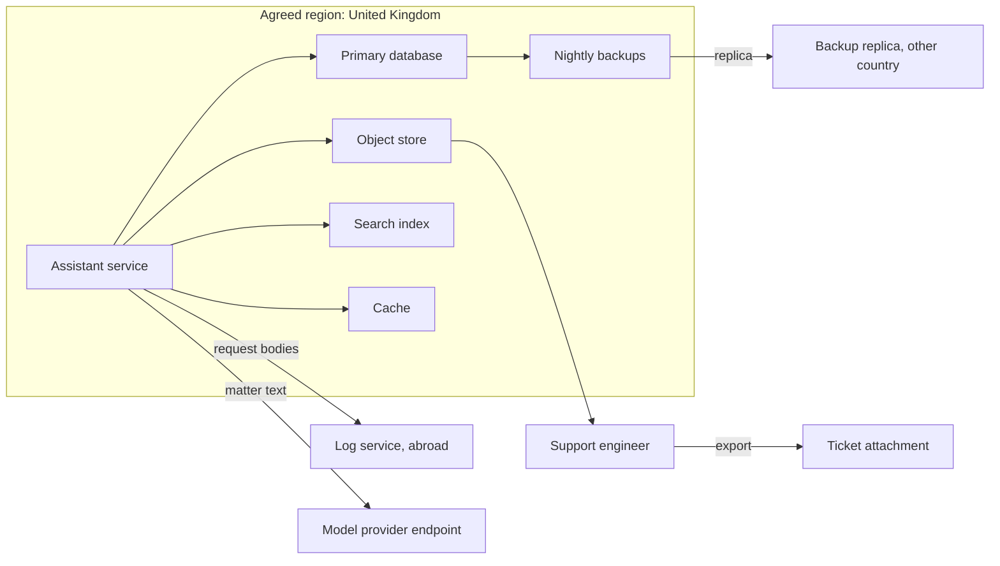

## Start with the copies the deletion forgot

Thirlby Legal, a fictional law firm, used a document assistant to search and summarise its matter files. Its contract had two data rules. Matter data stays in the United Kingdom. When Thirlby instructs deletion of a matter, every copy is gone within 30 days.

A client withdrew, and Thirlby instructed deletion of the client's matter. The vendor's team deleted the matter's rows and files from the primary database and object store on day 2 and confirmed by email.

On day 20, Thirlby's information security team checked. The search index still returned snippets from the matter. Nightly backups, kept for 35 days, held full copies, and they were replicated to a region in another country for disaster recovery. Application logs, shipped to a log service hosted abroad, held request bodies with matter text, kept for 90 days. A support engineer's export of the matter sat as an attachment on a closed ticket.

Each copy had a sensible reason to exist. Nobody had listed them. Call this **the copies the deletion forgot**: data removed from where the team looks, and left everywhere it had flowed.

> **What you'll learn**
>
> - Treat residency, retention and deletion as controls, each with a rule, a mechanism and evidence.
> - Build an inventory of every copy, including derived and operational copies.
> - Keep logs, backups, model calls and support access inside the agreed region.
> - Delete across every copy on a timeline you can prove, including backups.

## Three rules, each a control

A rule in a contract is a promise. It becomes a control when something enforces it and something shows it was enforced.

| Rule | Mechanism that enforces it | Evidence |
| --- | --- | --- |
| **Residency:** data is stored and processed only in agreed locations | Region settings on every store and service, policies that block other regions, in-region endpoints for third parties | Configuration exports per store, the organisation policy, the provider's processing locations |
| **Retention:** data is kept no longer than needed, and no shorter than required | Lifecycle rules per store, legal hold flags | Lifecycle settings, a sample of the oldest record in each store |
| **Deletion:** removed data is gone from every copy by an agreed date | A deletion job that knows every store, backup expiry or key destruction | A deletion record per request, with each store's result and date |

*Table 1: Residency, retention and deletion as controls.*

Retention has two edges. A maximum limits risk and meets privacy rules. A minimum meets legal and regulatory duties, such as keeping records for a set number of years. A **legal hold** pauses deletion for data relevant to a dispute, and it overrides a deletion request. Check for one before deleting anything.

## Build an inventory of every copy

You cannot control copies you have not listed. Start from the threat model's data flow and ask, for each element, whether it stores customer data, where and for how long.

*Figure 1: Thirlby's data before the fix. Four flows carry matter data outside the agreed region or outside any retention rule.*

Copies fall into three groups:

- **Primary copies.** Database rows and stored files. Teams always find these.
- **Derived copies.** Search indexes, embeddings, caches, summaries, analytics tables and fine-tuning sets. They hold the content in another form, and deleting the source does not touch them.
- **Operational copies.** Logs, traces, error reports, backups, replicas, queue dead-letter stores, support exports and data in a third party's systems, such as a model provider's request logs.

| Copy | Location | Kept for | How it is deleted |
| --- | --- | --- | --- |
| Primary database and object store | UK | Until deletion | Deletion job |
| Search index and cache | UK | Until deletion | Deletion job, by matter ID |
| Nightly backups | UK, replica abroad | 35 days | Expiry only |
| Application logs | Log service abroad | 90 days | Expiry only |
| Support exports | Ticket system | Indefinitely | Nobody |

*Table 2: Thirlby's inventory as first written. Every row after the first two broke a rule.*

## Keeping data in the region

Residency covers every place data is stored or processed, and Thirlby's counsel also treated access from abroad as a transfer. Take each flow in Figure 1 in turn:

- **Backups.** Replicate to a second region inside the same country, or keep an in-country copy only and accept the recovery limits. Write the choice down.
- **Logs.** Never log request or response bodies by default. Redact matter text at the logger, and run the log store in the agreed region.
- **Model provider.** Use an endpoint whose processing location is in the region. Confirm whether the provider keeps prompts and for how long, and get it in writing.
- **Support access.** Route support through the service's console with access by ticket, instead of exports. Staff outside the region may need the customer's approval to access data.

Encryption with a key held in the region helps, but it does not change where the data sits. The rules in [encryption, keys and audit evidence](02_Encryption_Keys_and_Audit_Evidence.md) answer who can read it. Residency answers where it is.

## Deleting across every copy

Deletion is a process across stores, with an end date. Backups are the hard part. They are designed to be unchanged, and editing one to remove a single matter is rarely possible. Two approaches work. Let backups expire on a schedule shorter than the promised deadline. Or encrypt each client's data with its own key and destroy the key, which makes every copy unreadable, including backups. NIST SP 800-88 calls this cryptographic erase. A revoked permission travels the same path through an assistant's index and caches, as [permissions, deletions and citations](../../fde-building-in-the-estate/ai-delivery-in-customer-estates/03_Permissions_Deletions_and_Citations.md) shows.

The walkthrough follows Thirlby's next deletion request after the fix.

Thirlby instructs deletion of a matter on day 0. The contract allows 30 days. Each step shows the action, the stores it covers and the evidence recorded.

<button type="button" data-step="0" aria-pressed="false" aria-controls="del-step-0">1. Verify</button><button type="button" data-step="1" aria-pressed="false" aria-controls="del-step-1">2. Primary</button><button type="button" data-step="2" aria-pressed="false" aria-controls="del-step-2">3. Derived</button><button type="button" data-step="3" aria-pressed="false" aria-controls="del-step-3">4. Operational</button><button type="button" data-step="4" aria-pressed="false" aria-controls="del-step-4">5. Confirm</button>

<section id="del-step-0" class="step-panel" aria-labelledby="del-heading-0"><h4 id="del-heading-0">1. Verify the request and check for holds</h4><dl><dt>Action</dt><dd>Confirm the instruction came from an authorised Thirlby contact. Check the matter for a legal hold.</dd><dt>Stores</dt><dd>None yet.</dd><dt>Evidence</dt><dd>Request ID, requester, matter ID and hold check result, day 0.</dd></dl></section><section id="del-step-1" class="step-panel" aria-labelledby="del-heading-1"><h4 id="del-heading-1">2. Delete the primary copies</h4><dl><dt>Action</dt><dd>The deletion job removes the matter's rows and files by matter ID.</dd><dt>Stores</dt><dd>Primary database and object store.</dd><dt>Evidence</dt><dd>Row and file counts before and after, day 1.</dd></dl></section><section id="del-step-2" class="step-panel" aria-labelledby="del-heading-2"><h4 id="del-heading-2">3. Purge the derived copies</h4><dl><dt>Action</dt><dd>The same job removes index entries, embeddings and cached answers for the matter ID.</dd><dt>Stores</dt><dd>Search index, embeddings, cache, analytics tables.</dd><dt>Evidence</dt><dd>A search for the matter's unique terms returns nothing, day 1.</dd></dl></section><section id="del-step-3" class="step-panel" aria-labelledby="del-heading-3"><h4 id="del-heading-3">4. Let the operational copies expire</h4><dl><dt>Action</dt><dd>Backups now expire after 28 days, both copies in the UK. The last backup holding the matter, taken on the night of day 0, expires on day 28. Logs hold no matter text.</dd><dt>Stores</dt><dd>Backups and their replica. Support exports no longer exist.</dd><dt>Evidence</dt><dd>Backup lifecycle setting and the expiry date of the last copy.</dd></dl></section><section id="del-step-4" class="step-panel" aria-labelledby="del-heading-4"><h4 id="del-heading-4">5. Confirm in writing</h4><dl><dt>Action</dt><dd>Send Thirlby a deletion record listing each store, its result and date, with the backup expiry date.</dd><dt>Stores</dt><dd>Every row in the inventory.</dd><dt>Evidence</dt><dd>The deletion record, day 1, with a final confirmation on day 28.</dd></dl></section>

<button type="button" data-walk="previous">Previous</button>

<button type="button" data-walk="next">Next step</button>

The walkthrough is a scripted illustration. The deletion record keeps the matter ID, dates and counts, never the content. An audit trail that outlives the data is fine as long as it holds no matter text.

## Limits of this lesson

- **Law varies.** What counts as a transfer, which records must be kept and for how long depend on jurisdiction and sector. The customer's counsel decides. You make the system able to follow the decision.
- **Provider behaviour.** Cloud and model providers keep their own operational copies for set periods. Read their deletion and data processing terms.
- **Fictional data.** Thirlby Legal, its contract and figures are illustrative.

## Interview angle

Each answer is an outline to say in about two minutes. Open each question and try it aloud before reading.

Interview question 1. How do you turn a customer's residency, retention and deletion requirements into controls you can show are working?

- **Answer:** For each, write the rule, the mechanism and the evidence. Residency: region settings on every store and service, a policy blocking other regions, in-region third-party endpoints, proven by configuration exports. Retention: lifecycle rules per store, with legal hold able to override, proven by settings and the oldest record. Deletion: a job that covers every store in an inventory, with backups expiring inside the deadline or keys destroyed, proven by a per-request deletion record. The inventory of copies underpins all three.
- **Trade-off:** Short backup retention meets deletion deadlines and shortens how far back you can restore.
- **Follow-up to expect:** "What about data the model provider holds?" Its terms and endpoint location are part of the inventory.

Interview question 2. A customer requires data to stay in one country. You find logs and backups are copied to another. What do you do?

- **Answer:** Tell the customer's contact promptly, with what left, since when and where it went. Then stop the flows: point backups at a second region inside the country, and stop logging content or move the log store in-country. Remove what already left: delete the foreign backup replicas once in-country ones exist, and purge or wait out the foreign log copies, recording which. Add both stores to the inventory with region checks, and a policy that blocks resources outside the agreed regions.
- **Trade-off:** An in-country second region may give weaker disaster separation than a distant one.
- **Follow-up to expect:** "The log service has no region there." Redact before shipping, or run logging in-country.

## References

1. Google Cloud, [Data deletion on Google Cloud](https://cloud.google.com/docs/security/deletion), accessed 17 November 2026. Deletion as a staged process, and copies in backup systems retired over time.
2. NIST CSRC, [SP 800-88 Rev. 2, Guidelines for Media Sanitization](https://csrc.nist.gov/pubs/sp/800/88/r2/final), accessed 17 November 2026. Media sanitisation methods, including cryptographic erase.
3. OWASP, [Logging Cheat Sheet](https://cheatsheetseries.owasp.org/cheatsheets/Logging_Cheat_Sheet.html), accessed 17 November 2026. Data to exclude from logs, and protecting log stores.
4. [Threat modelling a deployment](01_Threat_Modelling_a_Deployment.md), the data flow this inventory starts from.

## Key takeaways

- A residency, retention or deletion rule becomes a control only with a mechanism and evidence.
- List every copy: primary, derived and operational, including logs, backups, exports and third parties.
- Residency covers storage, processing and access, so check logs, backup replicas, model endpoints and support.
- Backups cannot be edited. Expire them inside the deadline, or destroy a per-client key.
- Check for a legal hold first, and send a deletion record that lists every store.

## Check yourself

1. Why did deleting the matter's rows on day 2 not meet Thirlby's 30-day rule?

Copies remained in the search index, in backups kept for 35 days, in logs kept for 90 days and in a support export with no expiry. The deletion only covered the primary stores.

2. How does destroying a per-client key delete data from backups nobody can edit?

Every copy, including backups, is encrypted under that key. Without it, the copies cannot be decrypted, which makes them unreadable everywhere at once.

3. Why must a deletion process check for a legal hold first?

A hold means the data may be needed in a dispute. Deleting it can breach a legal duty, which outranks the deletion request.

