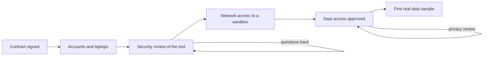

## Start with two offers for the same title

Priya, a fictional engineer, holds two offers. Both say "Forward Deployed Engineer". The first company sells a data platform to hospitals. The second sells access to a language model and wants enterprise customers to build on it.

In her first month at the platform company, she would configure the product inside one hospital's network, map their records into its data model and stay with that hospital for most of a year. At the model provider, she would help six customers in a quarter design their first application, write sample code with them and move on once they could carry on alone.

Same title, different job. Priya's mistake would be preparing for one and joining the other. Call it **title matching**: judging a role by its name instead of by what it delivers and for how long.

> **What you'll learn**
>
> - Name the four employer patterns that shape FDE work, and what each one asks of you.
> - Describe an ordinary week in the field and where the hours go.
> - List the enterprise constraints that set the pace of an engagement.
> - Read a job post for the signals that tell you which pattern it is.

## Four employer patterns

The [previous lesson](01_What_an_FDE_Owns.md) defined the role by what it owns: a working system in use, judged by the customer's outcome. Employers keep that core and change three things around it: what you deploy, how long you stay and how much of the work is selling.

Table 1 compares the four patterns you will meet most.

| Pattern | What you deploy | Typical engagement | Work mix | Signal in the job post |
| --- | --- | --- | --- | --- |
| Platform company | The company's own product, configured and extended for one customer | Months to years with one customer | Integration, data modelling, custom workflows | "Deploy our platform", named industries, travel |
| Model or API provider | Applications the customer builds on the provider's models | Weeks per customer, several at once | Architecture advice, prototypes, evaluation, enablement | "Help customers build", sample code, workshops |
| Early-stage startup | Whatever closes and keeps the first customers | Ongoing, overlapping | Building product features from field needs, some pre-sales | "Founding", "wear many hats", product input |
| Services-led company | A solution assembled from several vendors for the customer | Fixed-scope projects | Delivery to a statement of work, handover | "Client delivery", utilisation targets |

*Table 1: Four employer patterns. Real companies mix them, so treat the table as a set of questions to ask, not a set of boxes.*

The patterns pull the role in different directions:

- **Depth with one customer** at a platform company. You learn one estate thoroughly and carry the long tail of its exceptions.
- **Breadth across customers** at a model provider. You see many first builds and few production years, and enablement becomes as important as code.
- **Product influence** at a startup. Your field notes may become next month's roadmap, because there is no one else to write them.
- **Scope discipline** at a services-led company. The contract defines done, and the FDE's job includes stopping the scope from drifting while still caring whether the outcome lands.

> **Pitfall:** At a services-led company, outcome ownership competes with utilisation targets. Ask in the interview who decides when a project should stop because it will not deliver value.

## A week in the field

Most of an FDE's week is not coding. Table 2 shows a fictional, ordinary week for an FDE at a platform company, three months into an engagement with a regional hospital group.

| Day | Main work | Where the hours went |
| --- | --- | --- |
| Monday | Stand-up with the hospital's IT team, then a pipeline fix for discharge records | 2 hours meetings, 4 hours code, 1 hour access requests |
| Tuesday | Ward visit to watch nurses use the bed-management screen | 3 hours observing, 2 hours notes and tickets |
| Wednesday | Change window: release the pipeline fix with the hospital's operations team | 2 hours release, 3 hours code review and tests |
| Thursday | Steering meeting with the sponsor, then a design session on alerts | 2 hours meetings, 2 hours design, 2 hours writing |
| Friday | Write up recurring problems for the product team, plan next week | 2 hours product feedback, 2 hours planning, 2 hours code |

*Table 2: An illustrative week. Hours are rounded and show the shape of the work, not a standard.*

Roughly a third of the week is code. The rest is learning how the work runs, getting permission to change things, and telling people what changed. That ratio surprises engineers who expect a coding job with travel.

The site's [senior FDE's day](../../../../01_Concept_Tutorials/Consolidated_Lessons/T0.2_The_FDE_Role/03_A_Senior_FDEs_Day.md) lesson covers how a senior FDE orders a single day.

## Enterprise constraints set the pace

At the start of an engagement, the customer's rules decide how fast you can move, not your typing speed. Figure 1 shows the usual path from signed contract to the first real data in your hands.

*Figure 1: The path to first data. Security and privacy reviews often loop before approval, and each box can take days to weeks.*

Five constraints come up in most enterprises:

- **Access provisioning.** Accounts, laptops and VPN access go through the customer's IT queue. Ask for them before day one.
- **Security review.** Their security team assesses every new tool and data flow. Prepare the answers and evidence before they ask.
- **Data approvals.** Production data often needs a privacy or data-owner sign-off, and sometimes only masked samples are allowed.
- **Change windows.** Releases happen at agreed times with the customer's operations team present, not when your branch is ready.
- **People's calendars.** The users you need to watch have their own work. A ward nurse can give you an hour on Tuesday, not a week.

Plan the first two weeks around these constraints. Use them to read documents, map the workflow and meet people, so that when data arrives you know what to do with it.

> **Key distinction:** A slow start caused by access and review is normal. A slow start because nobody asked for access until week two is the FDE's own fault.

## Read the job post for the pattern

Job posts rarely say which pattern they are. Three questions in an interview usually settle it:

1. **"What does a successful first six months look like?"** One deployed customer suggests a platform company. Several shipped prototypes suggests a model provider.
2. **"Who decides what goes into the product from the field?"** A clear route to product says your feedback matters. "We'll see" suggests a services model.
3. **"How much of the role is before the sale?"** Pre-sales demos are real work, but a role that is mostly demos is closer to solutions engineering.

## Limits of this lesson

- **Patterns overlap.** Many companies combine two patterns, such as a model provider with a long-term deployment team for its largest customers.
- **Illustrative week.** Table 2 shows one plausible shape. Weeks with an incident or a launch look nothing like it.
- **No company claims.** This lesson describes patterns, not named employers. Check any company's current role description yourself.

## Interview angle

These questions are not tied to a specific practice set. Use them to check you can explain the role's variations aloud.

Interview question 1. How would this role differ at a company that deploys its own platform and one that provides a model API?

- **Answer:** At a platform company you stay with one customer for months, configure and extend the product, and own a long tail of exceptions. At a model provider you work with several customers for weeks each, help them design and prototype, and hand over once they can build alone.
- **Trade-off:** Depth gives you a production system you know thoroughly. Breadth gives you many first builds and fewer years of operating one.
- **Follow-up to expect:** "Which suits you?" Pick one and give a reason from your own work.

Interview question 2. What usually slows the first two weeks of an engagement, and what do you do about it?

- **Answer:** Access, security review and data approvals. Request access before day one, prepare security answers in advance, and spend the waiting time reading documents, mapping the workflow and meeting users.
- **Trade-off:** Pushing hard on access can annoy the customer's IT team, whose help you need for months. Ask early and politely, and escalate through the sponsor only when a date is at risk.
- **Follow-up to expect:** "Data access is blocked for a month." Agree a masked sample or synthetic data to keep building, and record the risk to the timeline.

## References

1. The site's [what an FDE owns](01_What_an_FDE_Owns.md) lesson, for the role definition this lesson builds on.
2. The site's [a senior FDE's day](../../../../01_Concept_Tutorials/Consolidated_Lessons/T0.2_The_FDE_Role/03_A_Senior_FDEs_Day.md) lesson, for how a senior FDE orders one day.
3. The author's own field experience across employer types, the basis for Tables 1 and 2.

## Key takeaways

- Judge an FDE role by what you deploy, how long you stay and how much is selling, not by its title.
- Platform companies ask for depth with one customer. Model providers ask for breadth across many.
- About a third of an ordinary field week is code. The rest is observing, getting permission and communicating.
- Access, security review, data approvals, change windows and people's calendars set the early pace.
- Ask before day one for what takes weeks to approve.

## Check yourself

1. A job post says "help customers build on our models" and "run workshops". Which pattern is it most likely to be?

A model or API provider. The signals are building on the provider's models and enablement through workshops, which suggest several short engagements.

2. In week one, the customer's data is not yet approved. What useful work can the FDE do?

Read the customer's documents, map the workflow, meet and observe users, and prepare the security review answers, so the team can use the data as soon as it arrives.

3. Why is "only a third of the week is code" not a sign of a badly run engagement?

Because the FDE owns the outcome, not only the build. Observing work, getting changes approved and reporting to the sponsor are what make the code land in use.

