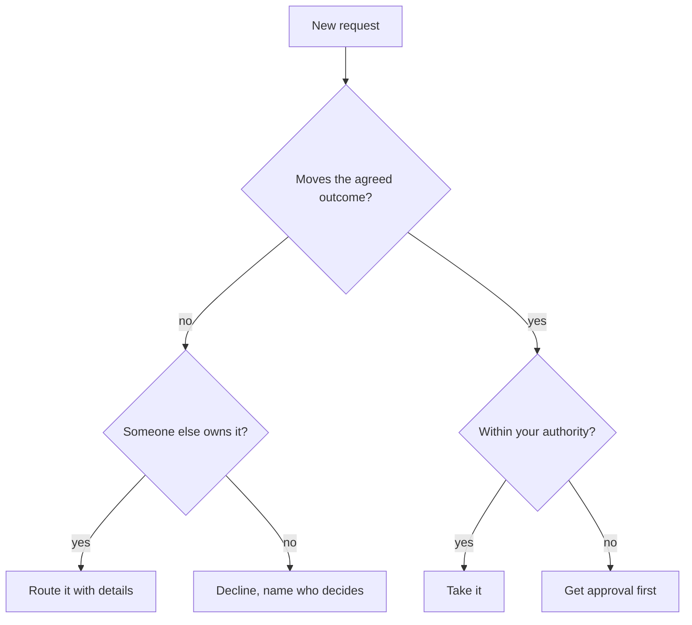

## Start with the FDE who became the help desk

Tom, a forward deployed engineer, is four months into an engagement with Calder Insurance. He fixed a broken report export in week two as a favour, and reset two passwords in week five because the IT queue was slow. By month four, Calder's staff message him first for printer faults, laptop updates and spreadsheet formulas. He is busy every day and liked by everyone, and the claims-triage system he was hired to deliver is six weeks late. Call this **help-desk drift**: small favours that each look harmless, until the FDE has become free support and the outcome nobody else owns slips.

> **What you'll learn**
>
> - Sort a customer request into take it, route it or decline it, with a reason the customer accepts.
> - Handle a sales promise the product cannot keep without breaking trust with sales or the customer.
> - Explain why an FDE should not change production without the customer's approval, even when they can.
> - Plan ownership for the day the FDE leaves.

## Three kinds of request

Owning the outcome means making sure every piece of work has an owner. It does not mean being that owner. Every request that reaches an FDE falls into one of three groups:

- **Take it.** The work moves the agreed outcome and nobody else is better placed: the pipeline, the integration, the review queue.
- **Route it.** The work matters, but someone else owns it: the customer's IT team, your company's support desk, the product team. Your job is to get it to them with enough detail that it gets done.
- **Decline it.** The work is outside the engagement and would cost the outcome, or it is not yours to approve. Say no clearly and say who can say yes.

Figure 1 shows the questions that sort a request.

*Figure 1: Sorting a request. Most help-desk drift happens at the first question, when a request that does not move the outcome gets taken anyway.*

At Calder, the report export in week two moved the outcome: claims staff needed it to test the triage flow. The password resets did not, and the IT team owned them. Tom should have routed them, with the ticket numbers, and told the sponsor the IT queue was slowing the project.

> **Pitfall:** Saying yes to small favours feels like good service. Each one teaches the customer that the FDE is the fastest route for anything, and the next request is bigger.

## When sales has promised too much

A sales team commits to a date or a feature to close a deal. The FDE arrives and finds that the product cannot do it, or not by then. This is a boundary problem in the other direction: the promise was made by someone else, and the FDE inherits it.

Two reactions both fail. Delivering the promise at any cost burns the team and often ships something fragile. Telling the customer "sales got it wrong" damages trust in your whole company.

What works is a short, honest re-plan, agreed inside your company first:

1. **Confirm the gap.** Check with product what is possible and by when. Get it in writing.
2. **Agree the message internally.** Sales, product and the FDE agree what to offer before anyone talks to the customer.
3. **Offer the closest real option.** For example, a workaround that covers 80% of the need now, with the full feature on the product roadmap.
4. **Tell the customer together.** The account lead and the FDE explain what changes, what the customer still gets and the new date.
5. **Record it.** Log the gap as a product request with the customer's name and the deal at stake.

The switcher compares how one over-promise plays out under two responses. The figures are illustrative.

Calder was promised automatic fraud scoring in the first release. The product does not include it. Compare two responses.

<button type="button" data-mode="absorb" aria-pressed="false" aria-controls="absorb-result">Absorb it quietly</button>
<button type="button" data-mode="replan" aria-pressed="false" aria-controls="replan-result">Re-plan in the open</button>

<section id="absorb-result" class="mode-panel" data-announcement="Absorb it quietly selected. A custom scorer ships late and nobody maintains it."><h4>Absorb it quietly</h4><ul><li>The FDE builds a custom fraud scorer in Calder's environment, outside the product.</li><li>The first release slips four weeks. Triage, the agreed outcome, waits.</li><li>After the FDE leaves, nobody at Calder or in product can maintain the scorer.</li></ul>
The promise is kept, the outcome is late and a fork now exists.
</section>
<section id="replan-result" class="mode-panel" data-announcement="Re-plan in the open selected. Triage ships on time with a rule-based fraud flag."><h4>Re-plan in the open</h4><ul><li>Sales, product and the FDE agree a message in two days.</li><li>The first release ships on time with a rule-based fraud flag for the three patterns Calder's investigators named.</li><li>Model-based scoring goes on the product roadmap with Calder as the design partner.</li></ul>
The outcome lands on time, and the gap becomes product work instead of a fork.
</section>

The FDE's role is to make the gap visible early and propose the closest real option. Hiding it protects nobody. When the promise is a date rather than a feature, [negotiating scope and deadlines](../stakeholder-communication/05_Negotiating_Scope_and_Deadlines.md) covers sizing the work and offering options.

## Who may change production

FDEs often get broad access to a customer's systems, because they need it to build and debug. Access is not authority. A production change made without the customer's approval breaks their control process even when it fixes a bug.

**Separation of duties** is the control principle behind this: no single person should be able to make a change and approve it alone. NIST's glossary defines it as dividing functions so that no one individual can carry out a sensitive process unchecked. Many customers' auditors check for it.

Three rules keep an FDE inside the line:

- **Use the customer's change process.** A ticket, an approval and a change window, even for one line.
- **Separate emergency from convenient.** If an outage needs an immediate fix, follow their emergency procedure, which usually means a named approver on a call and a record afterwards.
- **Give up access you no longer need.** Access granted for a migration should end when the migration does.

> **Key distinction:** "I can deploy it" answers whether it is possible. "Who approved it?" answers whether it is allowed. Auditors ask the second question.

## Ownership after the FDE leaves

The last boundary is time. The engagement ends, and the system must keep running without the FDE. An engagement that ends with no named owner has failed, however good the system is.

Plan the exit from the scoping stage onwards:

- **Name the owner early.** A person on the customer's side, not a team name, by the pilot at the latest.
- **Agree support boundaries in writing.** What the customer's team fixes, what your company's support desk handles, and how a problem moves between them.
- **Hand over gradually.** The owner runs a release and handles an incident while the FDE is still there to help.
- **Leave the evidence.** Runbook, architecture notes, open issues and the metric dashboard.

[Handover and ownership](../../../../01_Concept_Tutorials/Consolidated_Lessons/T6.3_Delivery_Six_Stages_Gates_and_Two_Week_Launch/09_Handover_and_Ownership.md), in the delivery module, covers the full handover checklist.

## Limits of this lesson

- **Boundaries vary by contract.** Some engagements include operational support. Read what was sold before deciding what is out of scope.
- **Small favours are not banned.** One quick fix that builds trust in week one can be worth it. The problem is a pattern.
- **Composite engagement.** Calder Insurance, Tom and the figures in the switcher are illustrative, not a real customer.

## Interview angle

Each answer is an outline to say in about two minutes. Open each question and try it aloud before reading.

Interview question 1. Months into an engagement, the customer's staff treat you as their IT help desk. What do you do?

- **Answer:** Sort each request by whether it moves the agreed outcome and who owns it. Route IT requests to their owners with details, tell the sponsor how much time the requests are taking, and agree a single channel for engagement work.
- **Trade-off:** Saying no risks goodwill you built through those favours. Explain the reason in terms of their outcome: every hour on printers delays the system they are paying for.
- **Follow-up to expect:** "A senior manager insists." Help once, then raise the pattern with the sponsor and agree who handles such requests.

Interview question 2. You join an engagement and find sales promised a feature the product cannot deliver. How do you handle it?

- **Answer:** Confirm the gap with product, agree the message internally, then tell the customer with the account lead: what they get now, the closest workaround, and where the full feature sits on the roadmap. Log it as a product request.
- **Trade-off:** Building it quietly keeps the promise but delays the outcome and leaves an unmaintained fork. Re-planning costs an awkward conversation and keeps trust.
- **Follow-up to expect:** "The customer threatens to cancel." Escalate to the account owner and product leadership with the cost of each option.

Interview question 3. You have production access and see a bug you could fix in five minutes. The customer's change board meets next week. What do you do?

- **Answer:** Follow their process. If the bug is causing real harm now, use their emergency change procedure with a named approver. Otherwise, raise the change, attach the fix and the test evidence, and work around the bug until the board approves.
- **Trade-off:** Waiting leaves the bug live for a week. Fixing it alone breaks their separation of duties and can fail their audit.
- **Follow-up to expect:** "What if nobody will notice?" Auditors and incident reviews notice. Trust lost there costs more than a week's delay.

## References

1. NIST CSRC, [Separation of duty](https://csrc.nist.gov/glossary/term/separation_of_duty), glossary, accessed 17 November 2026.
2. The site's [what an FDE owns](01_What_an_FDE_Owns.md) lesson, for outcome ownership.
3. The author's own field experience, the basis for the request sorting and the re-plan steps.

## Key takeaways

- Owning the outcome means every task has an owner, not that the FDE is the owner.
- Sort each request: take it, route it or decline it, and say who can decide.
- Meet an over-promise with an internal agreement first, then an honest re-plan with the customer.
- Access is not authority. Use the customer's change process, including for emergencies.
- Name the system's owner by the pilot, and hand over before you leave.

## Check yourself

1. Which question in Figure 1 most help-desk drift skips?

The first one, whether the request moves the agreed outcome. Requests that do not move it get taken because they are quick, and the pattern builds.

2. Why should sales, product and the FDE agree the message before telling the customer about an over-promise?

So the customer hears one consistent story and a real option, instead of three people contradicting each other, which damages trust in the whole company.

3. Your fix is correct and tested. Why does deploying it without approval still matter?

It breaks separation of duties: one person both made and approved a production change. The customer's control process and audit depend on that separation.

