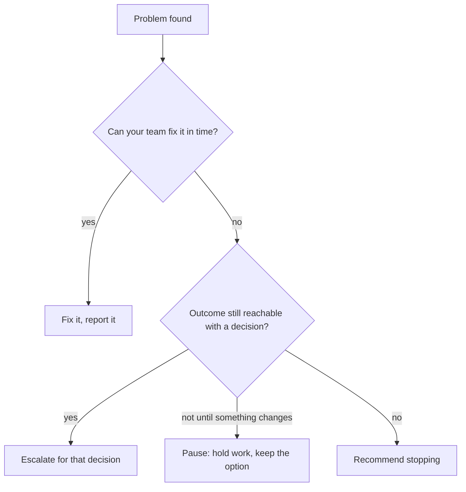

## Start with the status report that stayed green

Fenwick Energy, a fictional utility, hired an FDE team to build a meter-fault predictor. It depended on Fenwick's data platform team delivering a feed of hourly meter readings by week four.

In week four the feed was not ready. The FDE lead marked the project amber in her notes and green in the steering report, because the platform team promised it "next week". The same promise came in weeks five, six and seven. In week nine the sponsor learned that the predictor would miss the winter peak it was bought for. She asked why nobody had told her in week four, when she could still have moved the platform team's priorities.

Call this **the watermelon report**: green on the outside, red inside. Each week's optimism was small. Together they removed the sponsor's chance to act.

> **What you'll learn**
>
> - Recognise the signals that mean a problem needs someone else's decision.
> - Choose between escalating, pausing and stopping.
> - Write an escalation that gets a decision instead of sympathy.
> - Handle a dependency that cannot deliver in the middle of an engagement.

## Escalation is a request for a decision

To **escalate** is to take a problem to someone with the authority to decide what you cannot. It is not complaining and it is not blame. The sponsor at Fenwick had authority the FDE lacked: she could reprioritise the platform team. An escalation in week four would have given her that choice.

Escalate when any of these is true:

- **A date the customer depends on is at risk**, and you cannot recover it with your own team.
- **A dependency has slipped twice.** The second slip is a pattern, not bad luck.
- **The agreed outcome no longer looks reachable**, for example because the pilot data shows the approach does not work.
- **Someone asks you to do something outside your authority**, such as a production change without approval.
- **A safety, security or legal concern** appears, whatever the schedule.

> **Pitfall:** Waiting until you have a solution before raising a problem. The person who can decide often has options you do not, and every week of waiting removes some.

## Three responses: escalate, pause, stop

Not every problem means the same response. Figure 1 shows how to choose.

*Figure 1: Choosing a response. Pausing keeps an engagement alive while a blocker is resolved. Stopping is a recommendation, made with evidence, to people who own the budget.*

- **Escalate** when a decision from someone else would get the outcome back on track: more people, a reprioritised dependency, a scope cut.
- **Pause** when work cannot usefully continue until something outside your control changes, such as a data-access approval or a legal review. Pausing protects the customer's budget. Agree what happens during the pause and what restarts the work.
- **Stop** when the evidence shows the outcome is not reachable at a cost the customer would accept. Recommending a stop is part of owning the outcome. Spending the rest of the budget on a result you know will not come is not.

## How to say it

An escalation gets a decision when the reader can act on it in two minutes. Use four parts:

1. **The problem in one sentence.** "The hourly meter feed promised for week four has not arrived."
2. **The impact.** "Without it, the predictor misses the winter peak on 1 December."
3. **The options with their costs.** "Move two platform engineers for two weeks, or use daily readings and accept lower accuracy, or delay to spring."
4. **The decision you need and by when.** "We need your choice by Friday to keep 1 December."

Send it to the person who owns the decision, usually the sponsor, and copy your own manager. Say it in a meeting as well as in writing. Never send it as a surprise to a large group.

Google's SRE book makes a related point about incidents: assign clear roles and keep a single, current written record so that everyone works from the same facts. An escalation note does the same job for a project problem.

> **Key distinction:** A status report says what happened. An escalation asks someone to choose. If your message does not end with a decision and a date, it is a status report.

## When a dependency cannot deliver

The Fenwick case is the most common shape of escalation: something you depend on, owned by another team, cannot deliver what or when you need. The walkthrough shows what the FDE lead could have done from week four.

Replay Fenwick from the first missed date. Each step shows the action, who is involved and what it protects.

<button type="button" data-step="0" aria-pressed="false" aria-controls="dep-step-0">1. Confirm</button><button type="button" data-step="1" aria-pressed="false" aria-controls="dep-step-1">2. Find options</button><button type="button" data-step="2" aria-pressed="false" aria-controls="dep-step-2">3. Escalate</button><button type="button" data-step="3" aria-pressed="false" aria-controls="dep-step-3">4. Re-plan</button>

<section id="dep-step-0" class="step-panel" aria-labelledby="dep-heading-0"><h4 id="dep-heading-0">1. Confirm the real date</h4><dl><dt>Action</dt><dd>Ask the platform team what blocks the feed and what date they can commit to in writing.</dd><dt>Involved</dt><dd>The platform team lead.</dd><dt>Protects</dt><dd>A plan built on a real date instead of "next week".</dd></dl></section><section id="dep-step-1" class="step-panel" aria-labelledby="dep-heading-1"><h4 id="dep-heading-1">2. Find the options</h4><dl><dt>Action</dt><dd>Work out alternatives: daily readings already available, a temporary export, or a smaller first release for one region.</dd><dt>Involved</dt><dd>The FDE team and a Fenwick data analyst.</dd><dt>Protects</dt><dd>The sponsor gets choices, not only bad news.</dd></dl></section><section id="dep-step-2" class="step-panel" aria-labelledby="dep-heading-2"><h4 id="dep-heading-2">3. Escalate with a decision request</h4><dl><dt>Action</dt><dd>Send the four-part note and walk the sponsor through it in her weekly slot.</dd><dt>Involved</dt><dd>The sponsor, copying the FDE's manager.</dd><dt>Protects</dt><dd>Her chance to reprioritise while the winter date is still reachable.</dd></dl></section><section id="dep-step-3" class="step-panel" aria-labelledby="dep-heading-3"><h4 id="dep-heading-3">4. Re-plan and record</h4><dl><dt>Action</dt><dd>Update the plan with her decision, the new dates and the risk that remains, and report it honestly as amber.</dd><dt>Involved</dt><dd>Everyone on the steering report.</dd><dt>Protects</dt><dd>Trust in every later status report.</dd></dl></section>

<button type="button" data-walk="previous">Previous</button>

<button type="button" data-walk="next">Next step</button>

The walkthrough is a scripted illustration. In week four, every option was still open. By week nine, only the spring delay was left.

## Recommending a stop

Stopping is the hardest call because it feels like failure. It is a decision for the people who own the budget, and the FDE's job is to bring them evidence early enough to make it well.

Recommend a stop, or a fundamental redesign, when:

- the pilot shows the approach cannot reach the agreed bar, and no affordable change would close the gap;
- the problem has changed, so the outcome no longer matters to the business;
- a blocker such as data access or a legal ruling will not clear within the budget.

Bring the same four parts as an escalation, plus what has been learned and what can be kept: data pipelines, documentation, a baseline the customer did not have before. A clean stop with a clear record builds more trust than a slow drift to an empty result.

## Limits of this lesson

- **Culture varies.** Some customers punish bad news. Escalating early still protects the outcome, but agree with your manager how to do it in that culture.
- **Not every slip is an escalation.** One small delay your team can absorb is a status line, not a decision request.
- **Fictional data.** Fenwick Energy and its dates are illustrative.

## Interview angle

Each answer is an outline to say in about two minutes. Open each question and try it aloud before reading.

Interview question 1. How do you decide whether to escalate, pause or stop an engagement?

- **Answer:** Escalate when someone else's decision would put the outcome back on track. Pause when work cannot continue until an outside blocker clears, and agree what restarts it. Recommend stopping when evidence shows the outcome is not reachable at an acceptable cost.
- **Trade-off:** Escalating early can feel premature. Escalating late removes options. Err early, with options attached.
- **Follow-up to expect:** "How do you tell your sponsor?" One-sentence problem, impact, options with costs, and the decision you need by when.

Interview question 2. Midway through an engagement, another team you depend on cannot deliver what you need on time. What do you do?

- **Answer:** Confirm the real date in writing, work out alternatives such as available data or a smaller first release, then escalate to the sponsor with options and a decision deadline. Re-plan with their decision and report the remaining risk honestly.
- **Trade-off:** Escalating over another team's head can strain the relationship. Tell their lead first that you are raising it, and why.
- **Follow-up to expect:** "The other team says it is not their priority." That is exactly the decision the sponsor can make, so it belongs in the escalation.

## References

1. Google, [Managing incidents](https://sre.google/sre-book/managing-incidents/), *Site Reliability Engineering*, accessed 17 November 2026. Clear roles and a single written record during an incident.
2. The site's [judgement under uncertainty](04_Judgement_Under_Uncertainty.md) lesson, for trading speed, quality and scope.
3. The author's own field experience, the basis for the escalation note and the stop criteria.

## Key takeaways

- An escalation is a request for a decision from someone with authority you lack.
- Escalate when a date is at risk, a dependency slips twice, the outcome looks unreachable or a request exceeds your authority.
- Choose between escalating, pausing and stopping by whether a decision can still save the outcome.
- Write escalations in four parts: problem, impact, options with costs, decision needed by when.
- Recommending a stop with evidence is part of owning the outcome.

## Check yourself

1. What made the Fenwick report a watermelon report?

It was green on the outside while the project was red inside. The dependency had slipped repeatedly, but the report hid it, so the sponsor lost the chance to act.

2. What is the difference between a status report and an escalation?

A status report says what happened. An escalation asks a named person for a decision by a date, with the options and their costs.

3. When is pausing better than stopping?

When the outcome is still reachable once an outside blocker clears, such as a data-access approval. Pausing protects the budget and keeps the option open.

