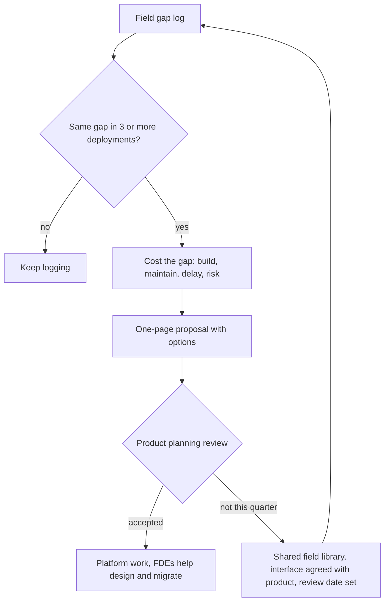

## Start with the seventh rebuild

Dunholme Systems, a fictional AI platform company, sells an assistant that answers staff questions from a customer's own documents. The assistant must show each user only the documents they may open in the source system. The platform did not do this. Each FDE team built its own job to copy permissions from the customer's document store.

By spring, six deployments had built that job, each slightly differently. Ravenglass Insurance, a fictional insurer, was the seventh. Its FDE team copied the job from an earlier deployment under deadline pressure. The copy did not handle groups nested inside other groups. For three days, claims handlers could see notes from a restricted fraud investigation.

Every FDE lead had raised the gap in their retrospective. The product team had heard about it many times, as seven separate complaints. Its roadmap that year was new connectors and a voice interface, both tied to sales commitments.

Call this **the seventh rebuild**: a gap the field patches again and again, because each patch is cheaper than the argument for fixing it once.

> **What you'll learn**
>
> - Spot a repeated platform gap from the field and record it as evidence.
> - Put a cost on the gap that a product leader can compare with feature work.
> - Write a one-page investment proposal with options.
> - Keep influence when the answer is "not this quarter".

## Spotting a repeated gap

One customer asking for something is a request. The same workaround built in several deployments is a platform gap. The difference is evidence, and the field produces it only if someone writes it down.

Keep a **field gap log**: one row each time a deployment works around something the platform does not do. Each row records the deployment, the gap, the workaround, the engineer-weeks spent and any incident it caused.

| Deployment | Workaround | Engineer-weeks | Incidents |
|---|---|---|---|
| Sedbergh Health | Custom permission sync job | 5 | None |
| Wigton Ports | Nightly permission export script | 3 | None |
| Ravenglass Insurance | Copied sync job, missed nested groups | 4 | One exposure, three days |

*Table 1: Three of seven rows for the permission gap. Across all seven deployments the workaround cost 28 engineer-weeks.*

Google's SRE book calls repetitive, manual, automatable work **toil**, and warns that toil expands to fill the time available unless it is capped. A workaround rebuilt in each deployment is toil at the level of the whole FDE practice.

At Dunholme, the staff FDE set a simple trigger: when three deployments log the same gap, it gets costed and reviewed. The permission gap passed that trigger long before Ravenglass.

## Costing the gap

Product leaders compare options in a common currency: engineering time, revenue and risk. A complaint has no price. Give the gap one.

The staff FDE worked out the cost of leaving the gap open for the next year:

- **Building it again.** Eight new deployments were planned. At four engineer-weeks each, that is 32 engineer-weeks.
- **Maintaining the copies.** Each copy needs about one engineer-day a month for source-system changes and fixes. Copies grow from 7 to 15 during the year, about 11 on average. That is 11 × 12 = 132 engineer-days, about 26 engineer-weeks.
- **Time to value.** Four weeks of each 12-week engagement go on plumbing the customer never sees.
- **Risk.** Fifteen separate copies of access-control logic, each a chance of another exposure like Ravenglass.

Total: about 58 engineer-weeks of FDE time next year, plus the risk. That is more than one full-time engineer, spent on a gap the platform could close once.

> **Pitfall:** Arguing from frustration. "Every team hates this" persuades nobody who owns a roadmap. "This costs 58 engineer-weeks a year and caused one data exposure" can be compared with a feature.

## Why product chases features, and how to be heard

Product teams are not wrong to chase features. New capabilities win deals, and sales commitments carry dates. Field complaints arrive one at a time, from different people, with different wording. They look like noise.

Treat the product manager as a customer and run discovery on them. Ask what goes into their planning, which measures they report and when the next planning cycle closes. Then present the gap in their terms:

- **Revenue:** do slow deployments delay contracts or renewals?
- **Time to value:** how many weeks earlier would customers see results?
- **Risk:** what would a second exposure cost in trust and in contract terms?
- **Engineering cost:** what does the status quo cost compared with the fix?

Find allies before the meeting. Security cares about fifteen copies of access-control logic. Support handles the tickets. Sales wants shorter deployments. You have no authority over any of them, but a proposal they have helped shape carries their weight as well as yours.

## Writing the investment proposal

Evan Bottcher, writing on Martin Fowler's site, describes a platform as a foundation of self-service APIs, tools and services that delivery teams use without raising tickets. That is the bar for the fix: an FDE team should configure permission sync, not build it.

The proposal fits on one page: the problem in one sentence, the evidence from the log, the cost of the status quo, two or three options with their costs, a recommendation, the ask and how success will be measured. Compare the options on the same figures.

Three options for the permission gap over the next year, with eight new deployments planned and seven existing copies.

<button type="button" data-mode="nothing" aria-pressed="false" aria-controls="nothing-result">Do nothing</button>
<button type="button" data-mode="library" aria-pressed="false" aria-controls="library-result">Shared field library</button>
<button type="button" data-mode="platform" aria-pressed="false" aria-controls="platform-result">Platform capability</button>

<section id="nothing-result" class="mode-panel" data-announcement="Do nothing selected. About 58 engineer-weeks of FDE time."><h4>Do nothing</h4><ul><li>FDE time: 32 engineer-weeks to build eight new copies, plus about 26 to maintain them. About 58 in total.</li><li>Product time: none.</li><li>Risk: fifteen copies of access-control logic by year end.</li></ul>
No roadmap change. The cost is real but spread across many teams, which is why it stays hidden.
</section>
<section id="library-result" class="mode-panel" data-announcement="Shared field library selected. About 31 engineer-weeks of FDE time."><h4>Shared field library</h4><ul><li>FDE time: 6 engineer-weeks to extract and harden the best copy, 1 week per new deployment (8) and per migrated copy (7), plus about 10 to maintain it. About 31 in total.</li><li>Product time: none, but product upgrades can break it without warning.</li><li>Risk: one copy to test, owned by the FDE practice.</li></ul>
Fast to start. It still lives outside the product, so every upgrade needs an FDE check.
</section>
<section id="platform-result" class="mode-panel" data-announcement="Platform capability selected. About 22 engineer-weeks across both teams."><h4>Platform capability</h4><ul><li>Product time: 12 engineer-weeks to build and own it, which moves one planned feature back by about six weeks.</li><li>FDE time: about 10 engineer-weeks to migrate the seven copies and set up eight new deployments, at two days each.</li><li>Risk: one tested implementation, maintained with the product.</li></ul>
Lowest total cost and risk. It needs product to accept a later date on one feature.
</section>

The staff FDE recommended the platform capability, with the shared library as a fallback if product could not take it on that quarter. The ask was specific: 12 engineer-weeks in the next planning cycle, and two FDEs to help design the configuration from field experience.

Figure 1 shows the path from the log to a decision.

*Figure 1: From field evidence to a decision. A deferral sends the gap back into the log with a fallback and a date, not into silence.*

## When the answer is not this quarter

Product may still say no, for reasons you cannot see: a contract with a penalty date, a board commitment, a team short of people. Respect the decision and keep the evidence alive.

- **Ask what would change the answer.** A number, a date, a second incident? Write it down and agree to bring it back.
- **Build the fallback with product's input.** If you build the shared library, agree its interface with the product team so the platform version can replace it later.
- **Keep logging.** Each new row makes the next proposal stronger.
- **Do not go around the product owner.** Escalating over their head without new evidence spends trust you will need for the next proposal.

At Dunholme, product deferred the work by one quarter. Two more deployments logged the gap, both using the shared library. The next planning cycle accepted the proposal with the updated numbers.

## Limits of this lesson

- **Estimates are estimates.** The engineer-week figures are planning numbers. Show your assumptions so others can challenge them.
- **Not every repeated gap belongs in the platform.** Some belong in a template or a partner's product. Deciding which is the subject of [configure, template or custom](../field-to-product/02_Configure_Template_or_Custom.md). For one need raised by customers, rather than a workaround rebuilt across deployments, start with [reusable need or one-off](../field-to-product/01_Reusable_Need_or_One_Off.md).
- **Fictional data.** Dunholme Systems, its customers, the exposure and all figures are illustrative.

## Interview angle

Each answer is an outline to say in about two minutes. Open each question and try it aloud before reading.

Interview question 1. Several of your deployments keep building the same missing capability, but the product team is focused on new features. What do you do?

- **Answer:** Turn complaints into evidence. Log each workaround with its cost and incidents, then price the status quo for next year: rebuilds, maintenance, delay and risk. Learn how product plans, find allies in security, support and sales, and bring a one-page proposal with options before the planning cycle closes. Recommend one option and offer a fallback.
- **Trade-off:** Pushing the platform fix delays a feature product has promised. Show both costs on the same scale and let product make the call.
- **Follow-up to expect:** "Product says no." Ask what would change the answer, build an agreed fallback and bring updated evidence next cycle.

Interview question 2. Outline the platform investment proposal you would write for a capability your deployments keep rebuilding.

- **Answer:** One page. The problem in a sentence. Evidence from the gap log: deployments affected, engineer-weeks spent, incidents. Cost of the status quo next year. Two or three options, such as doing nothing, a shared field library and a platform capability, each with time, risk and roadmap impact. A recommendation, a specific ask with a date, and a success measure, such as setup time per deployment.
- **Trade-off:** A precise cost invites challenge to the assumptions. State them openly, because a figure nobody can check will not be trusted.
- **Follow-up to expect:** "How do you measure success?" Setup time per deployment, copies retired and incidents in that area.

## References

1. Google, [Eliminating toil](https://sre.google/sre-book/eliminating-toil/), *Site Reliability Engineering*, accessed 17 November 2026. Toil as repetitive, automatable work that expands unless it is capped.
2. Evan Bottcher, [What I talk about when I talk about platforms](https://martinfowler.com/articles/talk-about-platforms.html), martinfowler.com, accessed 17 November 2026. A platform as self-service APIs, tools and services used without tickets.
3. The site's [scale beyond yourself](../../../../04_Behavioral_and_Leadership/fde_competencies/06_scale_beyond_yourself.md) worksheet, for telling a field-to-product story in an interview.
4. The author's own field experience, the basis for the gap log, the cost model and the proposal format.

## Key takeaways

- One request is a request. The same workaround in several deployments is a platform gap.
- Keep a field gap log with engineer-weeks and incidents, and review any gap that reaches three deployments.
- Price the status quo in product's terms: engineering time, time to value, revenue and risk.
- A one-page proposal compares options on the same figures and ends with a specific ask.
- When the answer is "not this quarter", ask what would change it, build an agreed fallback and keep logging.

## Check yourself

1. Why had seven complaints not moved the product roadmap?

They arrived one at a time, from different teams, as frustration without a cost. Nobody had combined them into evidence a product leader could compare with feature work.

2. Where does the 58 engineer-weeks figure come from?

Eight new copies at four engineer-weeks each (32), plus maintenance of about 11 copies on average at 12 engineer-days a year each (132 days, about 26 weeks).

3. Why agree the shared library's interface with the product team?

So the platform version can replace the library later without each deployment being rebuilt. It also keeps product involved instead of working around them.

