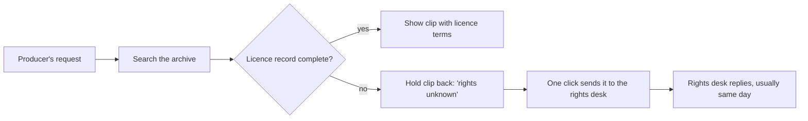

## Start with five perfect searches

Brackley Media, a fictional media firm, holds an archive of about 400,000 video clips. Producers spend hours finding usable footage, and each clip's licence lives in a separate rights database. An FDE team built a prototype assistant: a producer types a plain-language request, and it returns matching clips with their licence status.

The FDE lead demonstrated it to Brackley's chief executive with five rehearsed searches. Every result was a well-labelled clip with a clean licence. The chief executive approved a newsroom pilot that afternoon.

In the first pilot week, about 1 in 4 searches returned at least one clip whose rights record was incomplete. The prototype showed those clips as available, because it treated a missing licence as no restriction. A producer nearly put an unlicensed clip on air. About 3 in 100 clips in the archive had incomplete rights records, and none of them had appeared in the demo.

Call this **the showroom demo**: a demo that shows only the cases that work, so the audience believes the product is ready.

> **What you'll learn**
>
> - Build a demo that represents the work, including an exception and its recovery path.
> - State limits in a way that strengthens trust instead of weakening it.
> - Handle a demo that fails in front of an executive.
> - Respond when someone treats a prototype as a production promise.

## A demo is evidence

An audience watching a demo assumes what it sees is typical. Five clean searches told Brackley's chief executive that searches come back clean. That conclusion was reasonable from what she saw, and it was wrong. The demo, not the audience, was at fault.

A **representative demo** shows the work as users will meet it. It has four properties:

- **Realistic data.** Real records, or a copy with the same mess: missing fields, odd wording, duplicates.
- **Typical tasks.** The requests users make most often, chosen from logs or interviews, not the ones that look best.
- **One exception and its recovery.** A case the system cannot handle alone, and what happens next.
- **Stated limits.** What is not built yet, said aloud at the start and the end.

> **Key distinction:** A showroom demo proves the system can work. A representative demo shows how it behaves on the work it will meet. Executives fund the second, whether or not they know it.

## Show the exception and its recovery path

The exception is the most persuasive part of a demo, because it shows the system is safe when it is unsure. At Brackley, the right exception was a clip with no licence record. Figure 1 shows the path the corrected prototype took.

*Figure 1: The exception path at Brackley. A clip with an incomplete rights record is held back and routed to a person, never shown as available.*

The switcher compares the two scripts the FDE lead could have run, and what the chief executive would conclude from each.

The same prototype, the same ten minutes, the same chief executive. Only the script changes.

<button type="button" data-mode="showroom" aria-pressed="false" aria-controls="showroom-result">Showroom script</button>
<button type="button" data-mode="representative" aria-pressed="false" aria-controls="representative-result">Representative script</button>

<section id="showroom-result" class="mode-panel" data-announcement="Showroom script selected. Five clean searches, no limits stated."><h4>Showroom script</h4><ul><li>Five rehearsed searches, all on clips with complete licence records.</li><li>No mention of incomplete records or what is not built.</li><li>The chief executive concludes the assistant is ready for the newsroom.</li></ul>
The first pilot week contradicts the demo, and trust drops with it.
</section>
<section id="representative-result" class="mode-panel" data-announcement="Representative script selected. Typical searches, one held-back clip, limits stated."><h4>Representative script</h4><ul><li>Three searches taken from producers' real requests, one with vague wording.</li><li>One search returns a clip with no licence record. It is held back and sent to the rights desk in one click.</li><li>The lead ends with what is not built: sign-in with Brackley accounts and a live rights connection.</li></ul>
The chief executive concludes the assistant is promising, safe when unsure and not yet production. The pilot matches what she saw.
</section>

Stating limits feels risky in front of an executive. In practice it is what makes the rest believable. An audience that hears "here is what it cannot do yet" trusts the parts you say it can do.

## When the demo fails in front of an executive

Live demos fail. A service times out, a network blocks a call, a model gives an odd answer. Preparation reduces the damage:

- **Rehearse on the demo environment the same day**, not on your laptop the week before.
- **Keep a recording** of each scenario, ready to play.
- **Have a run sheet** with the scenarios in order. You can then skip one cleanly.
- **Ask a colleague to watch the logs** during the demo. They can tell you what happened.

When it fails, say what happened in plain words: "The search service has timed out." Do not debug in front of the room for more than a minute. Move to the recording or the next scenario. If the failure touches something the executive cares about, name it: "This is the kind of failure the pilot exists to find. I will send you the cause and the fix by tomorrow."

Then send it. Within a day, write a short note: what failed, why, what has been fixed and whether it changes the pilot plan. Inside your own team, review the failure without blame, as Google's SRE teams do with postmortems: the aim is to fix the conditions that allowed it, not to find a culprit. An executive who sees a failure handled calmly and explained the next day often trusts the team more than one who saw a flawless run.

> **Pitfall:** Pretending nothing went wrong, or blaming the customer's network in the room. Both teach the executive that your account of events cannot be relied on.

## When a prototype is read as a promise

A week after a later, representative demo, Brackley's chief executive told her board that the assistant would be live for all 300 journalists the following month. The prototype had no sign-in with Brackley accounts, read a nightly copy of the rights database instead of the live one, had never been load tested and kept no audit log.

Respond the same day, privately, to the chief executive or the sponsor, never by correcting her in front of her board. Use her goal as the starting point:

1. **Agree with the goal.** "The board is right to want this, and the pilot results support it."
2. **Name what separates the prototype from production**, in her terms. "Today anyone with the link could search, licence data can be a day old, and we do not know how it behaves with 300 people searching at once."
3. **Offer a path with dates.** "A pilot with 20 journalists in four weeks, then the newsroom in about ten to twelve weeks, once sign-in, the live rights connection and load testing pass."
4. **Give her the words for the board.** One paragraph she can forward.

The UK Government's service manual gives the same warning to its own teams: do not copy prototype code into production, because a prototype lacks the security and performance a live service needs. To prevent the misreading, label a prototype on screen, say "prototype" at the start and end of every demo, and follow each demo with a written note of what is and is not built. The stages from proof of concept to production are taught in [pilots that predict production](../../../../01_Concept_Tutorials/Consolidated_Lessons/T6.3_Delivery_Six_Stages_Gates_and_Two_Week_Launch/08_Pilots_That_Predict_Production.md).

## Limits of this lesson

- **Some demos are sales demos.** A pre-sales demo of a general product has different aims. This lesson covers demos of work built for a customer.
- **Real data needs permission.** Using customer records in a demo may need approval. A realistic copy is often the safer choice.
- **Fictional data.** Brackley Media, its archive and its figures are illustrative.

## Interview angle

Each answer is an outline to say in about two minutes. Open each question and try it aloud before reading.

Interview question 1. What makes a customer demo representative, and how do you state its limits without undermining it?

- **Answer:** Use realistic data with its usual mess, tasks users perform most often, one exception the system cannot handle alone with its recovery path, and limits said aloud at the start and end. The exception shows the system is safe when unsure, which makes the rest believable. Name limits as plans: "Sign-in with your accounts comes in the next phase."
- **Trade-off:** A representative demo looks less polished. A polished one sets an expectation the pilot will break.
- **Follow-up to expect:** "The executive only has five minutes." Show one typical case, the exception, and one sentence of limits.

Interview question 2. Your demo fails live in front of the customer's chief executive. What do you do in the room and afterwards?

- **Answer:** Say plainly what failed, do not debug for more than a minute, and move to a recording or the next scenario. If it matters to the executive, say it is the kind of failure the pilot exists to find and promise the cause by the next day. Then send a short note with the cause, the fix and any effect on the plan, and review it in the team without blame.
- **Trade-off:** Moving on quickly can look evasive. Promising a written cause, and sending it, prevents that.
- **Follow-up to expect:** "How do you prevent it?" Rehearse on the demo environment that day, keep recordings and have someone watching the logs.

Interview question 3. After a prototype demo, the customer's executive announces it will be live for every user next month. It is nowhere near production. How do you respond?

- **Answer:** Speak to the executive or sponsor privately the same day. Agree with the goal, name what separates the prototype from production in their terms, such as access control, live data and load, and offer a path: a small pilot within weeks, full rollout after named gates, with a date range. Give them a paragraph they can use with their board.
- **Trade-off:** Correcting an executive risks embarrassing them. Staying silent risks a public failure that embarrasses them more.
- **Follow-up to expect:** "They insist on the date." Offer a reduced first release by that date, and escalate the risk in writing.
- **Go deeper:** [Pilots that predict production](../../../../01_Concept_Tutorials/Consolidated_Lessons/T6.3_Delivery_Six_Stages_Gates_and_Two_Week_Launch/08_Pilots_That_Predict_Production.md).

## References

1. GOV.UK Service Manual, [Making prototypes](https://www.gov.uk/service-manual/design/making-prototypes), accessed 17 November 2026. Do not copy prototype code into production, because prototypes lack the security and performance features of a live service.
2. Google, [Postmortem culture: learning from failure](https://sre.google/sre-book/postmortem-culture/), *Site Reliability Engineering*, accessed 17 November 2026. Blameless reviews that fix conditions, not people.
3. The site's [pilots that predict production](../../../../01_Concept_Tutorials/Consolidated_Lessons/T6.3_Delivery_Six_Stages_Gates_and_Two_Week_Launch/08_Pilots_That_Predict_Production.md) lesson, for the stages from proof of concept to production.
4. The author's own field experience, the basis for the demo script and the response to a premature announcement.

## Key takeaways

- Audiences generalise from a demo. Treat it as evidence that must represent the work.
- Show realistic data, typical tasks, one exception with its recovery path, and stated limits.
- When a demo fails, say what happened, move on, and send the cause and fix within a day.
- Correct a premature promise privately and the same day, with a path and a date range.
- Label prototypes as prototypes, on screen and aloud, and follow each demo in writing.

## Check yourself

1. Why did the showroom demo mislead Brackley's chief executive, when every search shown was real?

The searches were chosen because they worked. None touched the 3 in 100 clips with incomplete rights records, so she reasonably concluded that results come back clean, which the pilot then contradicted.

2. Why does showing an exception make a demo more convincing?

It shows how the system behaves when it is unsure, which is what an executive worries about. Seeing a risky case held back and routed to a person makes the claims about normal cases more believable.

3. Why correct a premature announcement privately rather than in the board meeting?

A public correction embarrasses the executive and damages the relationship. A private one the same day gives them accurate words to use with the board. The correction then comes from them.

