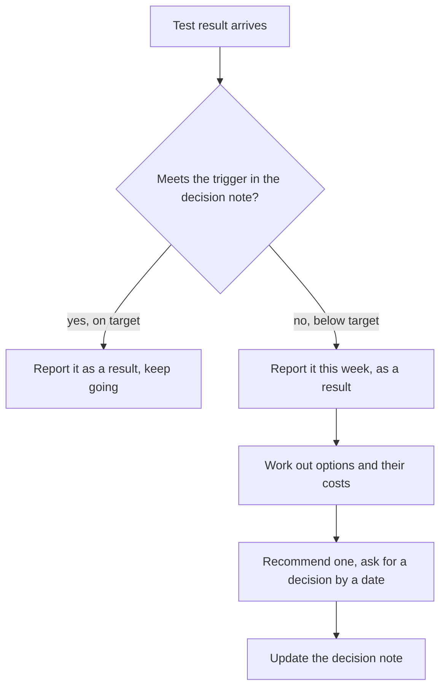

## Start with three weeks of "exploring improvements"

At Saltcote Housing, Ruth, the FDE lead on the repairs triage assistant, recommended training a small model on 20,000 past repair jobs to suggest the trade for each new report. The sponsor agreed in week 2, with a target of 85 correct trades in 100. In week 5 the first test on 600 labelled reports scored 71 in 100. The weekly updates for weeks 5, 6 and 7 each said "Model training in progress. Exploring improvements." Each was true. In week 8 a repairs planner mentioned to the sponsor that the assistant "still gets nearly a third of jobs wrong", and the sponsor asked why she was hearing it from a planner.

Call this **the activity update**: a report of what the team did, which hides what it found.

> **What you'll learn**
>
> - Write a weekly update that reports results against targets and asks for decisions.
> - Write a decision note that records when the decision should be revisited.
> - Report a delay or a failed experiment early and usefully.
> - Tell a customer that a test disproved your own recommendation.
> - Answer a demand for a guaranteed date without making a false promise.

## An update says what changed

An update has one job: let the reader know whether to act. A list of activity does not do that. Table 1 shows a shape that does, filled in with what Saltcote's week 5 update should have said.

| Part | What it holds | Saltcote, week 5 |
| --- | --- | --- |
| Status and reason | One colour and one sentence why | Amber: trade accuracy is below target |
| Results against targets | Numbers, not effort | 71 correct trades in 100 against a target of 85 |
| What changed | Since the last update | First full test run on 600 labelled reports |
| Risks | What could move the date or the outcome | The trained-model approach may not reach 85 |
| Decisions needed | From whom and by when | None yet. A recommendation follows next week |

*Table 1: A weekly update. The reader can decide in a minute whether to act.*

Write it in that order. The first two rows alone, written plainly, do most of the work. Keep the same format every week. A change of colour then stands out.

## Decision notes with a revisit trigger

A **decision note** records one decision: the context, the options considered, what was chosen, the consequences, and when to revisit it. For architecture decisions this is an architecture decision record, taught in [decision records and design reviews](../../forward-deployed/requirements-and-solution-design/05_Decision_Records_and_Design_Reviews.md). The same shape works for any decision a customer will later ask about.

The field that matters most for bad news is the **revisit trigger**: the result or date that would reopen the decision. Saltcote's week 2 note said "Revisit if the trained model scores below 85 in 100 on the week 5 test." That line turned the week 5 result from an embarrassment into a planned check. The lead did not need to argue that the decision should be reopened. The note already said so.

Figure 1 shows how a test result flows into an update when the decision note has a trigger.

*Figure 1: From test result to update. A miss is reported in the week it is found, with options to follow.*

## Delays and failed experiments

A **failed experiment** is a test whose result rules something out. It is still a result. Report it in the week you know, in three parts:

1. **The result, stated flatly.** "The trained model scored 71 in 100 against a target of 85."
2. **What it teaches.** "Past job records use inconsistent trade codes, so the model learned the inconsistency."
3. **What happens next.** The options, a new date range if the plan moves, and when you will recommend one.

A delay follows the same pattern: the new range, the cause, what you are doing about it, and what the customer could do to help. When the delay needs a decision from someone with more authority, use the four-part escalation from [escalate, pause or stop](../fde-role-and-boundaries/05_Escalate_Pause_or_Stop.md).

> **Pitfall:** Waiting for good news to pair with the bad. Saltcote's lead spent three weeks looking for a fix before reporting the miss. The sponsor would have accepted the result. She did not accept hearing it from a planner.

## When a test disproves your own recommendation

This is harder than an ordinary failed experiment, because you were the one who recommended the approach. At Saltcote, a side test in week 6 had tried a second approach: prompting a general-purpose model with Saltcote's list of trades. It scored 88 in 100 on the same 600 reports. Switching would take about a week and raise running costs from about £600 to about £2,400 a month. The switcher shows three ways the lead could report it.

Week 8, the sponsor's office. The facts are the same in each version: 71 in 100 for the recommended approach, 88 in 100 for the alternative, one week and about £1,800 a month more to switch.

<button type="button" data-mode="defend" aria-pressed="false" aria-controls="defend-result">Defend</button>
<button type="button" data-mode="bury" aria-pressed="false" aria-controls="bury-result">Bury</button>
<button type="button" data-mode="own" aria-pressed="false" aria-controls="own-result">Own and redirect</button>

<section id="defend-result" class="mode-panel" data-announcement="Defend selected. The sponsor hears excuses."><h4>Defend</h4><ul><li>"With more training data the model will get there."</li><li>No evidence for that, and no date.</li><li>The sponsor hears that the lead is protecting the recommendation, not the outcome.</li></ul>
Trust falls, and the decision is delayed again.
</section>
<section id="bury-result" class="mode-panel" data-announcement="Bury selected. The sponsor hears nothing useful."><h4>Bury</h4><ul><li>"We are exploring a range of improvements, including some alternatives."</li><li>The 71 and the 88 are not mentioned.</li><li>The sponsor cannot decide anything, because she has not been told anything.</li></ul>
She learns the numbers later, from someone else.
</section>
<section id="own-result" class="mode-panel" data-announcement="Own and redirect selected. The sponsor gets a decision to make."><h4>Own and redirect</h4><ul><li>"I recommended the trained model. The test shows 71 against 85, which rules it out for now."</li><li>"The prompted approach scored 88 on the same reports. It costs about £1,800 a month more and takes a week to switch."</li><li>"I recommend switching. I need your decision by Friday to keep the pilot date."</li></ul>
The sponsor decides in ten minutes, and the decision note is updated.
</section>

Owning the recommendation means saying "I recommended" in the first sentence. It does not mean a long apology. The customer needs the result, what it rules out and a new recommendation. Saltcote switched, and after adding examples of its own trade codes the prompted approach reached 92 in 100.

> **Key distinction:** Your recommendation was a judgement made with the evidence available at the time. The test is new evidence. Changing your recommendation when the evidence changes is the job, not a failure of it.

## When they demand a guaranteed date

Saltcote's director of operations needed a go-live date for her board, and asked the FDE lead to guarantee 1 March. The integration with the housing management system was not yet tested, and nobody knew how long Saltcote's change board would take to approve it.

Do not give a guarantee you cannot keep, and do not refuse to give a date. Separate what you control from what you do not:

- **Commit to what you control.** "Planners can use the assistant on portal reports by 1 March. That depends only on work we are doing."
- **Give a range for the rest, with what moves it.** "Phone and email reports follow between mid-March and mid-April, depending on the change board."
- **Say when the range will narrow.** "We will know after the integration test on 20 January, and I will update you that week."

Basecamp's Shape Up describes work as a hill: uphill while the team is still working out the approach and its unknowns, downhill once the remaining work is known. A date for uphill work is a guess. A date for downhill work is an estimate. Tell the sponsor which parts are which, and move them across as the unknowns resolve. How to build the range and say what moves it is taught in [estimates people can trust](../../../../01_Concept_Tutorials/Consolidated_Lessons/T6.2_Scoping_an_FDE_Project/05_Estimates_People_Can_Trust.md).

## Limits of this lesson

- **Colours vary.** Some customers use their own status scheme. Use theirs, and keep a sentence of reason beside it.
- **Not every miss needs a meeting.** A small miss your team can absorb is a line in the update, not a call to the sponsor.
- **Composite engagement.** Saltcote Housing, its tests and costs are illustrative, not a real customer.

## Interview angle

Each answer is an outline to say in about two minutes. Open each question and try it aloud before reading.

Interview question 1. What goes into a good weekly update and a good decision note for a customer?

- **Answer:** The update starts with a status and one sentence of reason, then results against targets in numbers, what changed, risks, and any decision needed with a date. The decision note holds the context, options considered, the choice, its consequences and a revisit trigger: the result or date that would reopen it. Both use the same format every time, so changes stand out.
- **Trade-off:** A fixed format feels bureaucratic. Without one, readers have to hunt for whether to act.
- **Follow-up to expect:** "What is a revisit trigger for?" It makes reopening a decision a planned check instead of an argument.
- **Go deeper:** [Decision records and design reviews](../../forward-deployed/requirements-and-solution-design/05_Decision_Records_and_Design_Reviews.md).

Interview question 2. How do you tell a customer sponsor about a delay or an experiment that failed?

- **Answer:** In the week you know, not after you have a fix. State the result flatly against its target, say what it teaches, and say what happens next: the options, a new date range if the plan moves, and when you will recommend one. If the delay needs a decision above you, escalate with options and a decision date.
- **Trade-off:** Reporting before you have a fix feels exposed. Reporting late costs the sponsor options and costs you trust.
- **Follow-up to expect:** "The sponsor reacts badly." Stay on the facts and the options. The next update shows whether early news was worth it.

Interview question 3. A test has shown that the approach you recommended will not reach the target. How do you tell the customer?

- **Answer:** Own it in the first sentence: "I recommended this, and the test rules it out for now." Give the numbers against the target, the best alternative with its evidence, cost and switching time, and a new recommendation with a decision date. Update the decision note so the history is clear.
- **Trade-off:** Owning the miss costs some credibility in the moment. Defending or hiding it costs much more when the customer finds out.
- **Follow-up to expect:** "Why should they trust your next recommendation?" Because you reported this one plainly and early, against a trigger you set yourself.

Interview question 4. The sponsor wants a guaranteed go-live date for the board, and real unknowns remain. What do you say?

- **Answer:** Commit to the part you control, such as a first release on a date that depends only on your team. Give a range for the rest, name what moves it, and say when the range will narrow, for example after an integration test. Update the sponsor as each unknown resolves.
- **Trade-off:** A range is less satisfying than a single date. A guarantee you break costs the sponsor more with her board.
- **Follow-up to expect:** "The board needs one date." Give the committed first release as that date, and the range as the plan for the rest.

## References

1. Basecamp, [Show progress](https://basecamp.com/shapeup/3.4-chapter-13), *Shape Up* by Ryan Singer, accessed 17 November 2026. Work moves uphill while the approach is being worked out and downhill once the remaining work is known.
2. ADR GitHub organisation, [Architectural decision records](https://adr.github.io/), accessed 17 November 2026. A record captures one decision and its rationale, and the idea extends to other decisions.
3. The site's [escalate, pause or stop](../fde-role-and-boundaries/05_Escalate_Pause_or_Stop.md) lesson, for the four-part escalation note.
4. The author's own field experience, the basis for the update format and the revisit trigger.

## Key takeaways

- An update reports results against targets and asks for decisions. Activity alone tells the reader nothing.
- Give every decision note a revisit trigger, so reopening it is a planned check.
- Report a failed experiment or a delay in the week you know, with what it teaches and the options.
- When a test disproves your recommendation, say "I recommended" first, then the alternative and a decision date.
- Commit to what you control, give a range for the rest, and say when it will narrow.

## Check yourself

1. Every Saltcote update in weeks 5 to 7 was true. What was wrong with them?

They reported activity, not results. The 71 in 100 against a target of 85 never appeared, so the sponsor could not act until she heard it from a planner.

2. How did the revisit trigger help when the week 5 test missed?

The decision note already said the decision would be reopened below 85 in 100. The miss became a planned check, and the lead did not need to argue for reopening it.

3. Why is committing to 1 March for portal reports acceptable when guaranteeing 1 March for everything is not?

The portal release depends only on the FDE team's work. The rest depends on an untested integration and the customer's change board, which the team does not control.

