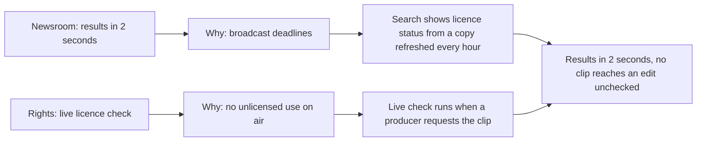

## Start with the best-efforts yes

Brackley Media, the fictional media firm from [demos that tell the truth](03_Demos_That_Tell_the_Truth.md), signed for a newsroom-wide release of its archive search assistant. To close the deal, your company's account executive promised Brackley's head of news ten features by 1 September, the start of the autumn schedule. Nobody from the FDE team had sized them.

The FDE lead learned this at kickoff, three weeks of build time before the date. She said "We'll do our best." The team worked two weekends and shipped seven features on 1 September, most of them half-tested. The feature that holds back clips with unknown rights had a fault, and the rights team asked for the release to be pulled. Within a fortnight producers had stopped using it.

Call this **the best-efforts yes**: accepting a date and a scope you have not sized, and paying for it in quality.

> **What you'll learn**
>
> - Treat date, scope and quality as one decision and negotiate on scope.
> - Turn a date someone else promised into a plan with options.
> - Sort ten requests against capacity for four, with numbers.
> - Reconcile two departments' acceptance criteria that cannot both be met.
> - Escalate a priority conflict between senior people.

## Date, scope and quality are one decision

Any plan fixes three things: when it ships, what it includes and how well it works. Fix two and the third is set. A fixed date with fixed scope sets the quality, and quality falls without anyone choosing it, as at Brackley.

So negotiate on scope. Quality is the one you should not trade, because users meet its failures in production, where they cost most to fix and do most damage to trust. The date often matters for a real reason, such as a season, a regulation or a board meeting. Scope is usually the most flexible, because a feature that misses one date can follow on the next.

Basecamp's Shape Up calls this **fixed time, variable scope**: set how much time the work deserves, then shape the scope to fit it. It suits FDE work, where the date usually comes from the customer's business.

> **Key distinction:** Negotiating the estimate ("could you do it in fewer days?") changes nothing about the work. Negotiating the scope ("which of these must exist on the first day?") changes the work to fit the date.

## A date someone else promised

Sales teams sometimes commit to dates before the delivery team has seen the work. Do not blame sales in front of the customer. To Brackley, the promise came from your company, so your company owns it. Do not accept it in the first meeting either. Say "Let me size this and come back to you by Thursday with options," and then do so.

The walkthrough shows what Brackley's FDE lead could have done from kickoff.

Replay Brackley's kickoff, three weeks of build time before 1 September. Each step shows the action, who is involved and what it protects.

<button type="button" data-step="0" aria-pressed="false" aria-controls="date-step-0">1. Purpose</button><button type="button" data-step="1" aria-pressed="false" aria-controls="date-step-1">2. Size</button><button type="button" data-step="2" aria-pressed="false" aria-controls="date-step-2">3. Options</button><button type="button" data-step="3" aria-pressed="false" aria-controls="date-step-3">4. Agree</button>

<section id="date-step-0" class="step-panel" aria-labelledby="date-heading-0"><h4 id="date-heading-0">1. Learn what the date is for</h4><dl><dt>Action</dt><dd>Ask the head of news what must exist on 1 September. Her answer: producers need to find licensed footage for the first week's programmes.</dd><dt>Involved</dt><dd>The head of news, with the account executive briefed first in private.</dd><dt>Protects</dt><dd>A plan aimed at the real need, not at the feature list.</dd></dl></section><section id="date-step-1" class="step-panel" aria-labelledby="date-heading-1"><h4 id="date-heading-1">2. Size the work</h4><dl><dt>Action</dt><dd>Estimate each feature and the team's capacity: about 55 days of work against 21 days available for features.</dd><dt>Involved</dt><dd>The FDE team.</dd><dt>Protects</dt><dd>A conversation about facts, not about effort or goodwill.</dd></dl></section><section id="date-step-2" class="step-panel" aria-labelledby="date-heading-2"><h4 id="date-heading-2">3. Build two options</h4><dl><dt>Action</dt><dd>Option A: the four features producers need on 1 September, fully tested, and the rest in two later releases. Option B: a later date of 15 September with six features.</dd><dt>Involved</dt><dd>The FDE lead and the account executive, who agrees the options before the customer sees them.</dd><dt>Protects</dt><dd>One message from your company, and quality kept out of the trade.</dd></dl></section><section id="date-step-3" class="step-panel" aria-labelledby="date-heading-3"><h4 id="date-heading-3">4. Agree in writing</h4><dl><dt>Action</dt><dd>The head of news chooses option A. Record the scope, the date and the later releases in a short note both sides accept.</dd><dt>Involved</dt><dd>The head of news, the account executive and the FDE lead.</dd><dt>Protects</dt><dd>A shared record when new requests arrive.</dd></dl></section>

<button type="button" data-walk="previous">Previous</button>

<button type="button" data-walk="next">Next step</button>

Briefing the account executive first matters. They know the customer's history and what was said in the sale, and the customer should hear one view from your company.

## Ten requests, capacity for four

Capacity first. Two engineers for fifteen working days give 30 person-days. Keeping about 30 per cent for testing, integration and fixes leaves 21 days for features. Table 1 sizes the ten.

| # | Feature | Days | Needed on 1 September? |
| --- | --- | --- | --- |
| 1 | Plain-language search across the full archive | 6 | Yes |
| 2 | Licence terms shown on each result | 5 | Yes |
| 3 | Clips with unknown rights held back | 3 | Yes |
| 4 | Sign-in with Brackley accounts | 4 | Yes |
| 5 | Search inside spoken transcripts | 6 | No |
| 6 | Automatic tags for new uploads | 8 | No |
| 7 | Clip trimming and export | 9 | No |
| 8 | Usage dashboard for editors | 4 | No |
| 9 | Searches in other languages | 7 | No |
| 10 | Results posted to the team chat tool | 3 | No |

*Table 1: Brackley's ten features. The four needed on 1 September total 18 days, inside the 21 available. All ten total 55.*

The four features producers need on the first day fit with three days to spare. The next most valuable, transcript search, needs six and does not fit. Show the table to the customer. A table of days makes the conversation about arithmetic, which is easier to agree on than goodwill.

The sorting method, must-have for the date, valuable later and not needed, is taught in [shrinking to a first release](../../../../01_Concept_Tutorials/Consolidated_Lessons/T6.2_Scoping_an_FDE_Project/04_Shrinking_to_a_First_Release.md). How to give ranges people trust is in [estimates people can trust](../../../../01_Concept_Tutorials/Consolidated_Lessons/T6.2_Scoping_an_FDE_Project/05_Estimates_People_Can_Trust.md). New requests after the agreement go through the change-impact note in [managing change and scope creep](../../forward-deployed/requirements-and-solution-design/02_Managing_Change_and_Scope_Creep.md).

> **Pitfall:** Cutting the 30 per cent reserve to fit a fifth feature. The reserve is where integration problems and test fixes go. Spending it in advance is how quality gets traded without anyone choosing to.

## Two departments, incompatible acceptance criteria

During planning, two Brackley departments gave acceptance criteria that could not both be met:

- **The newsroom:** results within 2 seconds, with every matching clip shown.
- **The rights team:** no clip shown until its licence has been checked live against the rights database. A live check takes about 4 seconds for a page of results.

Live checks on every result page break the newsroom's 2 seconds. Skipping them breaks the rights team's rule. Before choosing a side, trace each criterion to its reason, using the method from [stakeholder and workflow maps](../../../../01_Concept_Tutorials/Consolidated_Lessons/T6.1_Customer_Discovery_and_Problem_Decomposition/07_Stakeholder_and_Workflow_Maps.md). The newsroom works to broadcast deadlines. The rights team's real risk is a clip used without a licence, which happens when a producer takes a clip into an edit, not when they see it in a list. Figure 1 shows the design that met both reasons.

*Figure 1: Reconciling two criteria by their reasons. The fast path serves search. The live check moves to the point where a clip is used.*

One risk remained: a licence withdrawn within the hour would still show as available in search results, then be blocked at request. The rights team accepted that, and the sponsor recorded the decision. When no design meets both reasons, take the two criteria with their costs to the person who owns the decision.

## Conflicting priorities between senior people

Later, the head of news wanted transcript search next, and the rights director wanted an audit report of every clip requested. Both were senior and both were reasonable, and the team could build one before October.

Do not choose between two senior stakeholders yourself, and do not try to build both and do neither well. Put both requests, with their costs and benefits, in front of the person who owns the priority, usually the sponsor. Tell both stakeholders beforehand that you are doing so. Use the four-part escalation from [escalate, pause or stop](../fde-role-and-boundaries/05_Escalate_Pause_or_Stop.md): the problem, the impact, the options with costs, and the decision you need by when.

## Limits of this lesson

- **Some dates are contractual.** A date with a penalty clause may need your commercial team in the negotiation, not only the FDE lead.
- **Estimates carry error.** The table's days are estimates. Re-plan when a fact changes, and tell the customer.
- **Fictional data.** Brackley Media, its features and its figures are illustrative.

## Interview angle

Each answer is an outline to say in about two minutes. Open each question and try it aloud before reading.

Interview question 1. How do you negotiate a deadline with a customer who wants more than fits?

- **Answer:** Treat date, scope and quality as one decision. Learn what the date is for, size the work against real capacity with a reserve for testing and fixes, and offer options that vary scope or date, never quality. Recommend one, let the customer choose, and record the agreement.
- **Trade-off:** Saying "not all of this by then" disappoints early. Saying yes and shipping it broken disappoints later and costs trust.
- **Follow-up to expect:** "They ask you to cut testing." Show what an untested failure would cost them, and keep the reserve.
- **Go deeper:** [Shrinking to a first release](../../../../01_Concept_Tutorials/Consolidated_Lessons/T6.2_Scoping_an_FDE_Project/04_Shrinking_to_a_First_Release.md).

Interview question 2. Two senior customer stakeholders want different things built next, and you can only build one. What do you do?

- **Answer:** Do not choose for them and do not split the team to half-build both. Write both requests with their costs and benefits, tell both stakeholders you are taking it to the sponsor, and ask the sponsor for a decision by a date. Record it and tell both what was decided and why.
- **Trade-off:** Escalating can look like you cannot manage the relationship. Choosing yourself makes you the target of whoever loses.
- **Follow-up to expect:** "There is no single sponsor." Find who funds the work. That person owns the priority.

Interview question 3. Your company's sales team promised the customer a date before your team had seen the work. What do you do?

- **Answer:** Do not blame sales to the customer, and do not accept the date in the first meeting. Brief the account executive privately, learn from the customer what the date is for, size the work, and come back within days with options agreed with sales: the essential scope by the date, or more scope later. Record the choice.
- **Trade-off:** Reopening a sales commitment strains the relationship with sales. Missing it strains the relationship with the customer, which is worse.
- **Follow-up to expect:** "How do you stop it happening again?" Ask to size work before sales commits, and offer a quick estimate service.

Interview question 4. Two departments give acceptance criteria that cannot both be met. How do you resolve it?

- **Answer:** Trace each criterion to its reason. Often the reasons are compatible even when the criteria are not, as when a speed target and a safety check can apply at different points in the workflow. Design for both reasons, state any remaining risk, and have the decision owner accept it. If no design meets both, take the two criteria and their costs to the sponsor.
- **Trade-off:** Finding a design that serves both takes time. Picking a side quickly leaves one department working against the system.
- **Follow-up to expect:** "Neither department will move." Then it is a priority decision for the sponsor, with both costs on the page.

## References

1. Basecamp, [Set boundaries](https://basecamp.com/shapeup/1.2-chapter-03), *Shape Up* by Ryan Singer, accessed 17 November 2026. Setting an appetite, and fixed time with variable scope.
2. The site's [shrinking to a first release](../../../../01_Concept_Tutorials/Consolidated_Lessons/T6.2_Scoping_an_FDE_Project/04_Shrinking_to_a_First_Release.md) and [estimates people can trust](../../../../01_Concept_Tutorials/Consolidated_Lessons/T6.2_Scoping_an_FDE_Project/05_Estimates_People_Can_Trust.md) lessons, for sorting scope and giving ranges.
3. The site's [managing change and scope creep](../../forward-deployed/requirements-and-solution-design/02_Managing_Change_and_Scope_Creep.md) lesson, for change-impact notes after the agreement.
4. The author's own field experience, the basis for the capacity reserve and the handling of sales commitments.

## Key takeaways

- Date, scope and quality are one decision. Negotiate on scope and keep quality out of the trade.
- Never accept or reject a promised date in the first meeting. Learn its purpose, size the work and return with options.
- Present capacity as arithmetic: days needed against days available, with a reserve for testing and fixes.
- Reconcile incompatible acceptance criteria through their reasons, and have the owner accept any remaining risk.
- Take priority conflicts between senior people to the person who owns the priority.

## Check yourself

1. What did the best-efforts yes trade away, and who chose it?

It traded away quality. Nobody chose it: fixing both the date and the ten features left quality as the only thing that could give, and it gave in production.

2. Why does a table of days help in a scope negotiation?

It turns the conversation into arithmetic the customer can check: 18 days of essential features against 21 available, 55 for everything. Agreeing on arithmetic is easier than agreeing on how hard a team should try.

3. In the Brackley rights case, why did moving the live check solve the conflict?

The rights team's real risk was a clip used without a licence, which happens when a producer takes a clip, not when they see a list. Checking at that point met the rights reason without slowing search.

