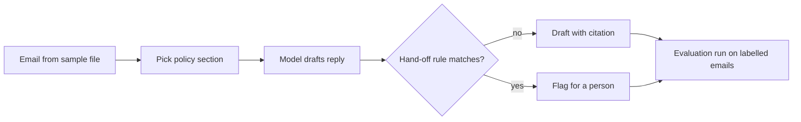

## Start with the infrastructure detour

A candidate scopes the Whitby Outdoor brief well. The slice is drafting replies with policy citations, a hand-off list and a 30-email evaluation, as in [scoping the brief](02_Scoping_the_Brief.md).

Then they open a tutorial for a vector database. Six policy pages need chunking, embedding and an index, they reason, because that is how retrieval systems are built. They add an orchestration framework they have not used before. At the two-hour mark the index works, the framework throws a version error, and no email has produced a draft. The evaluation and the README share the last 40 minutes.

Call this **the infrastructure detour**: spending the build time on parts the slice does not need, with tools you are learning on the clock, while the path from input to output never runs.

> **What you'll learn**
>
> - Get a walking skeleton running in the first hour.
> - Choose the simplest tools that meet the slice.
> - Start the evaluation in the first hour and grow it.
> - Test the deterministic parts and keep the model behind one function.
> - Decide at the two-hour checkpoint whether to push on, narrow or cut.

## Get a walking skeleton running first

A walking skeleton is the thinnest version of the whole path that runs from end to end. Every part exists, and most are crude. *The Pragmatic Programmer* calls the same idea tracer bullets: code that goes all the way to the target first, so you can see where it lands and adjust.

For Whitby, the skeleton in the first hour looks like this:

- Read one email from the sample file.
- Pick a policy section by matching a few keywords.
- Send the email and that section to the model with a short prompt.
- Print the draft and the section it cites.

None of it is good yet. All of it runs. From then on, every change improves a working path instead of building a part you hope will connect later.

*Figure 1: The Whitby skeleton. Each box starts crude and improves in place. The evaluation box exists from the first hour.*

## Choose the simplest tools that meet the slice

Use what you already know. A take-home is not the place to learn a framework, because each hour spent on its errors is an hour not spent on the slice. Then size each part to the data in the pack, not to an imagined production load.

| Part | Simplest choice for Whitby | When you would need more |
| --- | --- | --- |
| Policy lookup | Six pages, about 4,000 words, fit in one prompt. Split by heading so each draft can cite a section. | Hundreds of documents, or text too large for the prompt. |
| Model | A hosted model through its own client library. | The brief forbids sending data outside, or sets a cost limit. |
| Storage | Files: emails in, drafts and results out. | Many users at once, or state that must survive restarts. |
| Interface | A command-line tool and one endpoint. | The brief asks for a screen, or the users are not engineers. |
| Orchestration | Plain function calls. | Several steps with branches and retries you cannot follow in plain code. |

*Table 1: Size each part to the pack. The right-hand column is your answer when the follow-up asks "how would this scale?"*

Choosing the simple option is not a gap if you can say when you would switch. Write the right-hand column into the README as next steps.

## Start the evaluation in the first hour

Label ten emails as soon as the skeleton runs. For each, write down what a correct reply must contain, which policy section applies and whether the email must go to a person. Run the skeleton against them. Grow the set to 30 during the third hour.

Split the checks by what can judge them.

- **Code can check:** that a cited section exists in the policy, that a hand-off email was flagged, that the output has the fields you expect.
- **You judge by hand:** whether the draft is correct and polite. Use a short rule, such as "acceptable if an agent would send it with at most one small edit".

Record results in a table every time you change the prompt. If a change lifts one email and breaks two, you see it at once. The full method for building and sizing such a set is in [golden sets and sample size](../../../../01_Concept_Tutorials/Consolidated_Lessons/T4.2_Evaluation_and_Release_Gates/03_Golden_Sets_and_Sample_Size.md). In four hours, 30 well-chosen cases are enough to show the method and its first results.

## Test the deterministic parts

Not every part of an AI feature is uncertain. Hand-off rules, citation checks, input parsing and output validation behave the same way every time, so they get ordinary unit tests.

Keep every model call behind one function. Tests can then replace it with a fixed response and check what your code does with good output, malformed output and an empty reply. Those three cases catch a failure reviewers often meet when they run a submission: a crash on output the code did not expect.

A short test suite that runs in seconds says more than a long one that needs an API key. Mark any test that calls the real model and keep it out of the default run.

## Decide at the two-hour checkpoint

Stop at the end of the second hour and ask one question: does the path run from input to output on the labelled emails? Then decide what to do about the part that is behind.

The comparison shows three choices for a common Whitby problem. Customers write order numbers as "WO-10482", "10482" or "order #10482", and the lookup handles only the first.

At two hours, order lookup handles one format of order number in three. Choose a decision to see what the last two hours look like.

<button type="button" data-mode="push" aria-pressed="false" aria-controls="push-result">Push on</button>
<button type="button" data-mode="narrow" aria-pressed="false" aria-controls="narrow-result">Narrow it</button>
<button type="button" data-mode="cut" aria-pressed="false" aria-controls="cut-result">Cut it</button>

<section id="push-result" class="mode-panel" data-announcement="Push on selected. Lookup improves, evaluation shrinks to ten emails."><h4>Push on</h4><ul><li>50 minutes go on matching every format, and a fourth turns up in testing.</li><li>The evaluation stays at ten emails. The README is written in 20 minutes.</li><li>Lookup works for most formats. Nothing shows how good the drafts are.</li></ul>
A better feature, weaker evidence. The reviewer sees the cost in the write-up.
</section>
<section id="narrow-result" class="mode-panel" data-announcement="Narrow it selected. One format supported, others routed to a person, evaluation complete."><h4>Narrow it</h4><ul><li>Accept the one format that works. Any other format routes the email to a person.</li><li>Ten minutes spent, including a test for the routing.</li><li>The evaluation reaches 30 emails and the README names the limit and the fix.</li></ul>
A smaller feature that never gives a wrong answer, with full evidence.
</section>
<section id="cut-result" class="mode-panel" data-announcement="Cut it selected. Order emails go to a person, time returns to drafts."><h4>Cut it</h4><ul><li>All "where is my order?" emails route to a person.</li><li>The time goes on the policy drafts, the core of the brief.</li><li>The README lists order lookup as the first next step.</li></ul>
Sound when lookup is far from working. Here it throws away a part that works for one format.
</section>

Narrowing fits this case because the working part is safe and the rest has a fallback. The rule underneath all three is the same: protect the evaluation and the write-up, because they carry the evidence.

## Commit as you go

Commit at each working step with a message that says what changed and why. Small commits let you roll back a bad prompt change in seconds, and the history shows a reviewer how you worked. Some reviewers read it.

Keep secrets out from the first commit. Read keys from environment variables, include an example settings file with empty values, and add the real one to the ignore list before you create it. A key that reaches the history stays there even after you delete the file.

## Limits of this lesson

- **Language and stack.** The lesson avoids naming tools on purpose. Use the language and libraries you know best, unless the brief names others.
- **Longer take-homes.** A brief with several days allows more polish, but the order holds: skeleton, evidence, then features.
- **Composite example.** Whitby Outdoor, its order formats and the timings are illustrative, not a real customer.

## Interview angle

Each answer is an outline to say in about a minute. Open each question and try it aloud before reading.

Interview question 1. Why did you not use a vector database for retrieval?

- **Answer:** The pack had six policy pages, about 4,000 words, which fit in one prompt. I split them by heading so each draft cites a section, and checked citations in code. An index would have added setup time and a failure point with no gain at this size. I would add one when the documents no longer fit or when cost per call matters.
- **Trade-off:** Sending all the policies each time costs more tokens per call. At this volume that cost is small.
- **Follow-up to expect:** "The customer has 2,000 documents." Then retrieval is needed, with an evaluation of whether the right section is found.

Interview question 2. How did you test code that calls a model?

- **Answer:** The model sits behind one function. Unit tests replace it with fixed responses and check how my code handles a good reply, malformed output and an empty reply. Hand-off rules and citation checks have their own tests. The model's quality is measured separately, by the 30-email evaluation, not by unit tests.
- **Trade-off:** Fixed responses do not catch a change in the model's behaviour. The evaluation run catches that.
- **Follow-up to expect:** "How would you run the evaluation in a pipeline?" On every prompt or model change, with a threshold that blocks a release.

Interview question 3. You fell behind halfway through. What did you do?

- **Answer:** At the two-hour checkpoint order lookup handled one format of order number in three. I narrowed it: that format works, anything else goes to a person, and the README says so. It took ten minutes, so the evaluation reached 30 emails and the write-up got its full time.
- **Trade-off:** Some order emails go to a person that a better parser would handle. None gets a wrong answer.
- **Follow-up to expect:** "How would you finish it?" Collect the real formats from the sample, write a parser with a test per format, and measure how many emails still route to a person.

## References

1. Andrew Hunt and David Thomas, [The Pragmatic Programmer, 20th anniversary edition](https://pragprog.com/titles/tpp20/the-pragmatic-programmer-20th-anniversary-edition/), accessed 17 November 2026. Tracer bullets: build the full path first and adjust.
2. Ward Cunningham's wiki, [Walking skeleton](https://wiki.c2.com/?WalkingSkeleton), accessed 17 November 2026. The thinnest end-to-end version of a system.
3. Ham Vocke on Martin Fowler's site, [The practical test pyramid](https://martinfowler.com/articles/practical-test-pyramid.html), accessed 17 November 2026. Many fast unit tests, few slow ones, and replacing external calls in unit tests.
4. The Twelve-Factor App, [Config](https://12factor.net/config), accessed 17 November 2026. Credentials in environment variables, never in code.
5. The site's [prototype to production](../../fde-case-drills/end-to-end-engagements/08_Prototype_to_Production.md) simulation, for what a take-home's shortcuts would cost on a real engagement.

## Key takeaways

- Get a walking skeleton running in the first hour, then improve it in place.
- Use tools you know and size each part to the pack, with a stated point at which you would switch.
- Start the evaluation in the first hour and record results on every change.
- Unit-test the deterministic parts and keep the model behind one function.
- At two hours, push on, narrow or cut, and protect the evaluation and the write-up.

## Check yourself

1. What went wrong in the infrastructure detour?

The build time went on an index and a new framework the slice did not need. The path never ran, so the evaluation and README were squeezed.

2. Which parts of an AI feature get ordinary unit tests?

The deterministic ones: hand-off rules, citation checks, parsing and output validation, with the model replaced by fixed responses.

3. Why did narrowing beat cutting for the order lookup?

The working format was safe and every other format had a fallback to a person. Cutting would have thrown away a working part.

