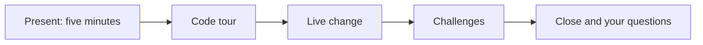

## Start with the borrowed-code stumble

A candidate's Whitby Outdoor submission scored well on paper. In the follow-up session the interviewer shares the screen, scrolls to the function that calls the model and points at the retry loop.

"Why does the wait double each time, and why the random part?"

The candidate pauses. An AI assistant wrote that function, and it worked, so they never read it closely. They say, "I think that is standard." The interviewer asks what happens if the model provider is down for a minute. The candidate does not know. The rest of the session is spent on code they cannot explain instead of decisions they made well.

Call this **the borrowed-code stumble**: submitting code you have not made your own, then losing the follow-up to it. The fix is preparation, not avoiding assistants.

> **What you'll learn**
>
> - Know what the follow-up session tests and how it usually runs.
> - Prepare in the day before: re-read, list decisions, rehearse.
> - Give a five-minute presentation and a code tour from the entry point down.
> - Make a live change by stating the plan and the check first.
> - Answer challenges about a design you made alone.

## What the follow-up session tests

The written submission shows what you built. The follow-up checks three more things: that you built it and understand it, that your choices rest on reasons, and how you work when the scope changes in front of you.

Sessions differ by team. Figure 1 shows a common shape. It is the setting of the Demo or Take-Home round.

*Figure 1: A common shape for a take-home follow-up. Any part can be skipped or reordered, so prepare for all five.*

Some teams also play the customer, as the [contract review take-home brief](../../../../01_Concept_Tutorials/Consolidated_Lessons/T8.2_Mock_Interviews_and_Scorecards/Client_Simulations/06_Contract_Review_Take_Home_Brief.md) describes. Then the challenges arrive as customer requests, and the same preparation applies.

## Prepare in the day before

The session can come days after you submitted. Your memory of the code fades faster than you expect.

- **Re-read every file.** For each function, be able to say what it does, why it is there and what breaks without it. Pay most attention to code an assistant or a library example produced.
- **List your decisions with their costs.** Take them from the README. Add the alternative you rejected for each, and what would make you switch.
- **Write down three likely challenges.** Your weakest result, your largest cut and your simplest tool choice are the usual targets.
- **Rehearse the five-minute presentation aloud,** with a timer.
- **Run it again from a clean copy,** and have one email ready that shows a failure.

## Present in five minutes, then tour the code

Use the same order as the README: the user and the need, the slice, one example from input to output, the results, the limits and the next step. Five minutes is enough. The interviewer has read the submission and wants your judgement, not a repeat.

For the code tour, start at the entry point and follow one request down through the modules. Name each part as you reach it: "This reads the email, this picks the policy section, this is the only function that calls the model." A reviewer who sees the structure from the top trusts the details more.

Name one thing you would change in the code before anyone asks. "The hand-off rules are a keyword list. I would move them to a small classifier once there are labelled examples." It shows you have looked at your own work critically.

## Make a live change

Some follow-ups ask for a small change during the session: "Make it handle emails in Welsh" or "Add a field for the customer's order value." The interviewer is watching how you work, not only whether you finish.

1. **Restate the change and ask one question.** "Detect Welsh and route it to a person, or draft in Welsh?"
2. **Say where the change goes.** Point to the module and the function.
3. **State the check first.** "I will add a Welsh email to the tests and the evaluation set, and expect it to be flagged."
4. **Make the change while talking.** Short sentences on what you are doing and why.
5. **Run the check and say what you would verify next.**

If you get stuck, say what you are trying and what you would look up. Silence for five minutes scores worse than a partial change with clear reasoning.

## Answer challenges about your choices

Challenges in a take-home follow-up target choices you made alone, with nobody to agree them with. Sort each one before you answer, using the four kinds in [defending your engagement in the interview](../../fde-case-drills/end-to-end-engagements/15_Defending_Your_Engagement_in_the_Interview.md): a new fact, a different priority, a depth probe or pressure with no new information. Then hold, concede or adapt, and say which.

Three challenges are specific to take-homes.

- **"Why not X?"** Name X as the alternative you considered, why you did not choose it in the time box and when you would. Your decision list makes this quick.
- **"Did you write this?"** Answer plainly and own it. "The retry function started from an assistant's draft. I kept it because the provider can rate-limit. Each wait doubles, with a random part so many clients do not retry at once." If the brief allowed assistants and you said so in the README, this is a depth probe, not an accusation.
- **"How does this scale?"** Use the right-hand column of your tool table from [building under the clock](03_Building_Under_the_Clock.md): the point at which each simple choice would change.

The walkthrough runs the full session for the Whitby submission.

Run the follow-up session for the Whitby Outdoor submission. Each stage shows what you do, a line you might say and the mistake to avoid.

<button type="button" data-step="0" aria-pressed="false" aria-controls="followup-step-0">1. Present</button><button type="button" data-step="1" aria-pressed="false" aria-controls="followup-step-1">2. Tour</button><button type="button" data-step="2" aria-pressed="false" aria-controls="followup-step-2">3. Change</button><button type="button" data-step="3" aria-pressed="false" aria-controls="followup-step-3">4. Challenge</button><button type="button" data-step="4" aria-pressed="false" aria-controls="followup-step-4">5. Close</button>

<section id="followup-step-0" class="step-panel" aria-labelledby="followup-heading-0"><h4 id="followup-heading-0">1. Present in five minutes</h4><dl><dt>You do</dt><dd>User, slice, one example, results, limits and next step.</dd><dt>You might say</dt><dd>"19 of 25 drafts were acceptable. Four of the six failures mixed two questions."</dd><dt>Avoid</dt><dd>Reading the README aloud.</dd></dl></section><section id="followup-step-1" class="step-panel" aria-labelledby="followup-heading-1"><h4 id="followup-heading-1">2. Tour the code</h4><dl><dt>You do</dt><dd>Follow one email from the entry point down and name each part.</dd><dt>You might say</dt><dd>"This is the only function that calls the model, so tests replace it here."</dd><dt>Avoid</dt><dd>Jumping between files in the order you wrote them.</dd></dl></section><section id="followup-step-2" class="step-panel" aria-labelledby="followup-heading-2"><h4 id="followup-heading-2">3. Make the live change</h4><dl><dt>You do</dt><dd>Restate, place the change, state the check, then code.</dd><dt>You might say</dt><dd>"I will add a Welsh email to the tests and expect it to be flagged."</dd><dt>Avoid</dt><dd>Typing in silence until it works.</dd></dl></section><section id="followup-step-3" class="step-panel" aria-labelledby="followup-heading-3"><h4 id="followup-heading-3">4. Answer the challenges</h4><dl><dt>You do</dt><dd>Sort each challenge, then hold, concede or adapt.</dd><dt>You might say</dt><dd>"No index because six pages fit. I would add one past a few hundred documents."</dd><dt>Avoid</dt><dd>Defending a function you cannot explain.</dd></dl></section><section id="followup-step-4" class="step-panel" aria-labelledby="followup-heading-4"><h4 id="followup-heading-4">5. Close</h4><dl><dt>You do</dt><dd>State what you would do next and what changed in the session.</dd><dt>You might say</dt><dd>"Next: split mixed questions. After today I would also add Welsh to the hand-off list."</dd><dt>Avoid</dt><dd>Ending on the last challenge with no summary.</dd></dl></section>

<button type="button" data-walk="previous">Previous</button>

<button type="button" data-walk="next">Next step</button>

The walkthrough is a scripted illustration. The lines are examples, not a script to learn by heart.

## Limits of this lesson

- **Telling the story of a larger build.** Presenting a longer project, such as a capstone, is taught in [the timed deep dive](../../../../01_Concept_Tutorials/Consolidated_Lessons/T7.1_Telling_the_Build_Story/04_The_Timed_Deep_Dive.md).
- **Session formats vary.** Some teams skip the live change, others make it the main event. Ask the recruiter what to expect.
- **Composite example.** Whitby Outdoor and the session are illustrative, not a real customer.

## Interview angle

Each answer is an outline to say in about a minute. Open each question and try it aloud before reading.

Interview question 1. Parts of this look AI-generated. Did you write it?

- **Answer:** The brief allowed assistants and the README says how I used them: scaffolding and test cases. I reviewed and changed everything I kept, and I can explain each part. For example, the retry function waits longer after each failure with a random part, so many clients do not retry at once. Pick any function and I will walk through it.
- **Trade-off:** Assistants saved time on scaffolding. The cost is the review time to make the code mine, which I budgeted.
- **Follow-up to expect:** "What did you change from the assistant's version?" Name one concrete change and why.

Interview question 2. Add handling for emails with photos attached, now.

- **Answer:** First a question: should the tool read the photo, or flag the email? For a first change I would flag it, because damage photos usually mean a warranty claim, which already goes to a person. I add a test with an attachment and expect a flag, then add the check in the email reader, run the tests and add one such email to the evaluation set.
- **Trade-off:** Flagging is quick and safe but sends more emails to people. Reading photos needs a model that handles images and its own evaluation.
- **Follow-up to expect:** "The customer wants photos read." Measure first how many emails carry photos and what they show.

Interview question 3. Looking back, what would you do differently?

- **Answer:** I would label the evaluation emails before writing the prompt, not alongside it. Two of my early prompt changes were tuned to emails I later used for scoring, which flatters the results a little. With the labels first, I would hold back half for scoring only. I would also start the README in the first hour instead of the last.
- **Trade-off:** Labelling first delays the first draft by about 20 minutes. It makes the results more trustworthy.
- **Follow-up to expect:** "Does that change your numbers?" Possibly by one or two drafts. I would rerun on held-back emails to check.

Interview question 4. Whitby now gets 50,000 emails a day. What changes?

- **Answer:** That is about 0.6 emails a second on average, with peaks higher, so the design changes in three places. A queue in front of drafting so peaks do not fail. A cost check, because sending all six policy pages with every email adds up, so I would measure whether retrieving one section keeps quality. And a larger, refreshed evaluation set with a weekly sample reviewed by agents.
- **Trade-off:** Retrieval cuts tokens but can pick the wrong section. The evaluation must show it does not lower quality.
- **Follow-up to expect:** "Which would you do first?" The queue, because peaks fail before cost hurts.

## References

1. AWS Architecture Blog, [Exponential backoff and jitter](https://aws.amazon.com/blogs/architecture/exponential-backoff-and-jitter/), accessed 17 November 2026. Why retries wait longer each time with a random part.
2. Michael Nygard, [Documenting architecture decisions](https://cognitect.com/blog/2011/11/15/documenting-architecture-decisions), accessed 17 November 2026. Recording each decision with its context and consequences, the basis of the decision list.
3. The site's [proof versus knowledge](../../../../01_Concept_Tutorials/Consolidated_Lessons/T7.1_Telling_the_Build_Story/02_Proof_versus_Knowledge.md) lesson and the [capstone build](../../../../01_Concept_Tutorials/Consolidated_Lessons/T9.1_Capstone_Build/01_Choose_a_Capstone_Project.md) module, where the same defence applies to a longer project.
4. The author's own interviewing experience on both sides of the table, the basis for the session shape and the three take-home challenges.

## Key takeaways

- The follow-up checks that you built and understand the work, that your choices have reasons, and how you handle a change.
- Re-read every file and list each decision with its cost and alternative before the session.
- Present in five minutes, then tour the code from the entry point down.
- For a live change: restate, place it, state the check, then code while talking.
- Own AI-assisted code by explaining it, and sort each challenge before you answer.

## Check yourself

1. What should the candidate have done before the session to avoid the borrowed-code stumble?

Re-read every file, especially code an assistant produced, and be able to say what each function does, why it is there and what breaks without it.

2. Why state the check before making a live change?

It shows how you will know the change works, and it gives the interviewer your plan even if you do not finish.

3. Where do answers to "how does this scale?" come from?

From the point at which each simple tool choice would change, which you recorded while building.

