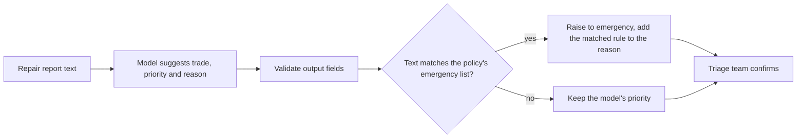

## How to use this practice

This is a full take-home brief of the kind an FDE team might send. Use it in one of two ways.

1. **Full run.** Set a four-hour timer and build it, using the [scoping](02_Scoping_the_Brief.md), [building](03_Building_Under_the_Clock.md) and [delivery](04_Delivering_the_Submission.md) lessons. Then answer the defence questions aloud, as in the Demo or Take-Home round.
2. **Paper run.** Spend 30 minutes writing your scope, build plan and README outline without code, then compare them with the outlines below.

Open each outline only after you have written your own. They are one sound answer, not the only one. Lynmouth Housing is a composite: it, its data and every figure below are illustrative, not a real customer.

> **What you'll practise**
>
> - Finding the hidden test in a classification brief.
> - Planning a build where one kind of error costs far more than others.
> - Reporting results that put that error first.
> - Defending the design when the customer pushes on false alarms.

## The brief

Lynmouth Housing is a housing association that manages 9,000 homes. Tenants report repairs through a web form or by email, in their own words. A triage team of six reads each report and sets two things: the trade (plumbing, heating, electrical, roofing, damp and mould, joinery or other) and the priority. Priorities come from the repairs policy: emergency means attend within 24 hours, urgent within 5 working days, routine within 28 days. About 1,200 reports arrive each month.

The head of repairs writes:

> "Triage takes too long and the team is stretched. Build us a service that reads a repair report and suggests the trade and priority with a short reason, so the team can confirm instead of starting from scratch. Show us how well it works."

The pack contains:

- 400 past reports, each labelled by the team with trade and priority.
- The two-page repairs policy. Its emergency list includes a smell of gas, no heating or hot water where the household has a vulnerable member, an uncontained water leak, exposed live wiring and a front door that will not lock.
- A model API key with a spending cap.

Time box: four hours. Use any language. Submit a repository link with a README.

## Scope the brief

Taught in [scoping the brief](02_Scoping_the_Brief.md).

Scope: what is the hidden test, what do you assume and what is in the slice?

- **The ask.** Faster triage, with the team confirming suggestions instead of reading cold.
- **The hidden test.** The errors are not equal. A routine leak marked urgent costs a little contractor time. A gas smell marked routine can kill someone. The design and the results must put emergency recall first: of the real emergencies, how many did the service mark as emergencies?
- **The second trap.** The policy makes "no heating" an emergency only for a vulnerable household, and the report text often does not say who lives there. The service cannot know from the text alone.
- **Assumptions to log.** The team confirms every suggestion and nothing is dispatched automatically. Vulnerability is held on the tenant record, which the service cannot see, so a "no heating" report without a stated vulnerable person is suggested as urgent and flagged "check vulnerability". Reports are in English.
- **In the slice.** One endpoint and a batch command over a file of reports. The model returns trade, priority and a one-line reason. A rules step raises the priority to emergency when the text matches the policy's emergency list. Output validation. An evaluation on held-back labelled reports.
- **Next steps, not built.** A screen for the team, tenant-record lookup, contractor booking and learning from the team's corrections.

## Plan the build

Taught in [building under the clock](03_Building_Under_the_Clock.md).

Build plan: how do you spend the four hours, and how does a report flow through the service?

- **First 20 minutes.** Read the brief three times, write the assumption log, split the 400 reports: 100 for writing the prompt, 300 held back for scoring only. Count the emergencies in the held-back set before building. Say there are 24.
- **First hour.** A walking skeleton: read one report, send it with the policy text to the model, ask for trade, priority and reason as structured output, print the result.
- **Second hour.** The emergency rules step, output validation (an unknown trade becomes "other" and is flagged), and unit tests for both with the model replaced by fixed responses.
- **Checkpoint at two hours.** The batch command runs over the 100 development reports from file to results.
- **Third hour.** Run the 300 held-back reports once the prompt is settled. Read every missed emergency and every wrong trade group.
- **Last 40 minutes.** README, a four-minute recording, a clean-copy setup test.

Compare your own flow with Figure 1.

*Figure 1: Lynmouth's triage service. The rules step can raise a priority but never lower one, so it can only remove misses, never add them.*

## Deliver the submission

Taught in [delivering the submission](04_Delivering_the_Submission.md).

What to submit: what goes in the README, the tests and the results?

- **README decisions.** The team confirms every suggestion. The rules step only raises priority. The policy goes into the prompt in full because two pages fit. Vulnerability cannot be read from text, so such reports are flagged. Each with its cost.
- **Tests.** "Smell of gas" with a model reply of routine comes out as emergency. An invalid trade becomes "other" with a flag. Malformed model output gives a clear error, not a crash. A report with no text is rejected.
- **Results, put emergencies first.** An illustrative set: emergencies caught 22 of 24 by the model alone and 24 of 24 with the rules step. Non-emergencies raised to emergency: 9 of 276. Trade correct: 261 of 300. Show priority as a three-by-three table of labelled against suggested.
- **Failure patterns.** The two emergencies the model missed described a gas smell as "a funny eggy smell" and a leak as "water coming through the light". The rules step caught the second through its rule for water near electrics. It caught the first only after "eggy smell" was added to the list, which you declare. Most trade errors were heating against plumbing for boiler leaks.
- **Known limits.** The rules list catches only phrasings it contains. Vulnerability is not known. English only.
- **Recording.** One routine report, one gas report raised by the rules step, one missed trade, then the results and the first next step.

## Defend the submission

Taught in [defending your take-home](05_Defending_Your_Take_Home.md). Answer each question aloud before opening it.

Practice question 1. Why can the rules step raise a priority but never lower it?

- **Answer:** Because the errors are not equal. A missed emergency is the costly error, so the rules step exists to remove misses. If it could also lower priorities, a gap in the rules list could turn a correct emergency into a routine job. Raising only means the rules step can add false alarms but never a new miss, and the results show both counts.
- **Trade-off:** Raise-only rules add false alarms, here 9 of 276 non-emergencies. A two-way rules step would cut those but could hide a gas leak.
- **Follow-up to expect:** "Who maintains the rules list?" The head of repairs, with each change tested against the labelled reports.

Practice question 2. The triage lead says nine false emergencies a batch will send contractors out at night for nothing. What do you do?

- **Answer:** Look at the nine first. If most come from one broad rule, such as "water" matching a dripping tap, narrow that rule and rerun the evaluation to check no real emergency is lost. Also remember the team confirms every suggestion, so a false emergency costs a few seconds of reading, not a night call-out. I would show both numbers side by side and let the head of repairs choose the balance.
- **Trade-off:** Every narrowed rule risks a missed emergency. Fewer false alarms are worth little if one gas leak waits 28 days.
- **Follow-up to expect:** "What if they want zero false alarms?" Then the rules step must go, and they must accept the misses the model makes on its own. Show that cost as a count.

Practice question 3. How do you know the team's labels are right?

- **Answer:** I do not, fully, and the README says so. In the time box I can read the reports where the service and the label disagree, which often shows label errors. On a real engagement I would ask two team members to relabel a sample of 50 reports on their own and measure how often they agree. If they agree on 90% of priorities, the service cannot be judged more finely than that.
- **Trade-off:** Relabelling costs team time. Without it, a disagreement can be blamed on the service when the label was wrong.
- **Follow-up to expect:** "What did you find in the disagreements?" Name one example where the label looked wrong against the policy.

Practice question 4. Why not train a classifier on the 400 labelled reports instead of calling a model?

- **Answer:** 400 reports across seven trades and three priorities leaves few examples for rare pairs, such as electrical emergencies. A prompted model reads the policy text and works with no training, which fits four hours. A trained classifier is a good next step once the team's confirmations have built a few thousand labelled reports, because it is cheaper per call and easier to test. I would compare the two on the same held-back set.
- **Trade-off:** The model costs more per report and its behaviour can change with a new version. A classifier is cheap but needs data the pack does not have.
- **Follow-up to expect:** "How many labels would you need?" Enough that each trade and priority pair has examples in the test set, which you check from the counts.

Practice question 5. The head of repairs asks whether emergencies could go straight to the out-of-hours contractor without the team.

- **Answer:** Not in the first release. The service has caught 24 of 24 emergencies on one held-back set of 300, which is a small sample with one rules change already made for it. I would run it beside the team for a month, compare its emergency calls with theirs and measure false call-outs. If it matches the team, propose automatic dispatch for the clearest rules, such as a gas smell, with the team still told at once.
- **Trade-off:** Automatic dispatch saves minutes on true emergencies. A false call-out costs money, and a wrong dispatch with no person in the loop is hard to explain to a tenant.
- **Follow-up to expect:** "What evidence would convince you?" A month of matched decisions and an agreed limit on false call-outs.

## References

1. scikit-learn, [Metrics and scoring](https://scikit-learn.org/stable/modules/model_evaluation.html), accessed 17 November 2026. Recall and the confusion matrix, used to report emergencies caught and the priority table.
2. Hamel Husain, [Your AI product needs evals](https://hamel.dev/blog/posts/evals/), accessed 17 November 2026. Reading failures one by one before changing the prompt.
3. The site's [golden sets and sample size](../../../../01_Concept_Tutorials/Consolidated_Lessons/T4.2_Evaluation_and_Release_Gates/03_Golden_Sets_and_Sample_Size.md) lesson, for building the held-back set, and the [capstone build](../../../../01_Concept_Tutorials/Consolidated_Lessons/T9.1_Capstone_Build/01_Choose_a_Capstone_Project.md) module, for growing this brief into a portfolio project.

## Key takeaways

- When one error costs far more than the others, put that error first in the design, the tests and the results.
- A rules step that can only raise a priority removes misses without adding new ones.
- Hold back most of the labelled data for scoring and count the rare class before you build.
- Some facts the policy needs, such as vulnerability, are not in the input. Flag them rather than guess.
- Automatic action waits for evidence gathered beside the people who do the job today.

## Check yourself

1. What is the hidden test in the Lynmouth brief?

The errors are not equal. Under-prioritising an emergency is far worse than a false alarm, so emergency recall comes first.

2. Why is "no heating" hard for the service?

The policy makes it an emergency only for a vulnerable household, and that fact sits on the tenant record, not in the report text.

3. Why declare that "eggy smell" was added to the rules after seeing a miss?

The change was made using the held-back set, so that set now flatters the rules step. Saying so keeps the result honest.

