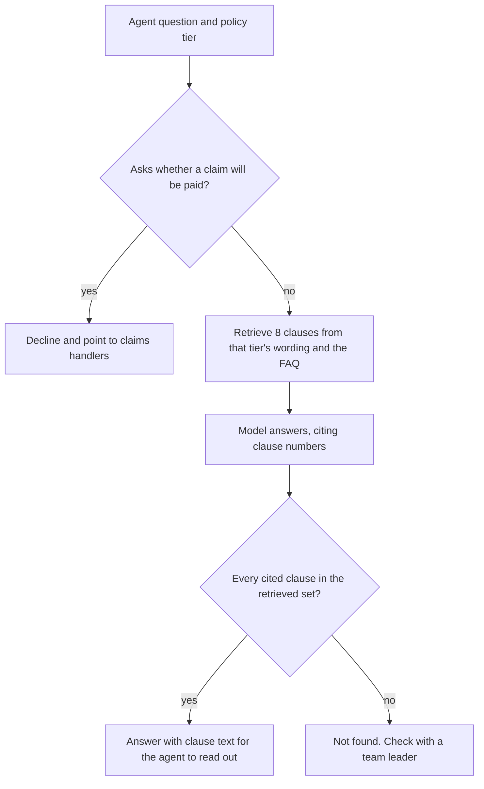

## How to use this practice

This brief is longer than [brief 1](06_Practise_Take_Home_Brief_1.md) and its traps are different: retrieval, citations and a line the assistant must not cross. Use it the same way.

1. **Full run.** Set a five-hour timer and build it. Then answer the defence questions aloud, as in the Demo or Take-Home round.
2. **Paper run.** Spend 30 minutes writing your scope, build plan and README outline without code, then compare them with the outlines below.

Open each outline only after you have written your own. They are one sound answer, not the only one. Brora Mutual, its documents and every figure below are fictional.

> **What you'll practise**
>
> - Spotting the boundaries a question-answering brief hides.
> - Choosing between retrieval and putting whole documents in the prompt.
> - Checking citations in code instead of trusting the model.
> - Defending the design when the customer wants it rolled out to everyone.

## The brief

Brora Mutual sells home insurance in three tiers: Essentials, Standard and Plus. Forty contact-centre agents answer policyholders' questions about cover. To answer, an agent searches three policy wordings, one per tier and about 20 pages each, plus a 12-page claims FAQ. Long holds while agents search are the top complaint in customer surveys.

The head of customer operations writes:

> "I want an assistant my agents can ask about cover. It should answer with the exact clause so agents can read it out, and stop customers waiting on hold."

The pack contains:

- The three policy wordings and the claims FAQ, as PDFs with selectable text. Clauses are numbered, such as "4.2 Escape of water".
- 30 sample agent questions, each with a reference answer and clause written by a senior agent.
- A note from the compliance team: "Agents must not tell a customer whether a particular claim will be paid. Only claims handlers decide that."
- A model API key with a spending cap.

Time box: five hours. Submit a repository link with a README.

## Scope the brief

Taught in [scoping the brief](02_Scoping_the_Brief.md).

Scope: what are the hidden tests, what do you assume and what is in the slice?

- **The ask.** Agents find the right clause faster and read it out with confidence.
- **Hidden test 1: tiers.** The same question has different answers per tier. Accidental damage, for example, may be covered on Plus and excluded on Essentials. The assistant must know the tier, so it takes the tier as an input or asks for it.
- **Hidden test 2: the compliance line.** "Is my flood claim covered?" is a cover question. "Will my claim for this flood be paid?" is a claim decision. The assistant must answer the first with clauses and decline the second, pointing the agent to claims handlers.
- **Hidden test 3: citations.** Models can invent clause numbers that look real. An agent reading out an invented clause is worse than no answer.
- **Hidden test 4: gaps.** Some questions are not answered by any document. The assistant must say "not found" instead of answering from general knowledge.
- **Assumptions to log.** The agent always knows the customer's tier. All wordings in the pack are current. Questions are in English.
- **In the slice.** One endpoint or command taking a question and a tier. Clauses split by number. Retrieval over that tier's wording and the FAQ. Answers with clause citations checked in code. Declining claim decisions and unanswerable questions. An evaluation on 40 questions.
- **Next steps, not built.** A screen inside the agents' desktop, follow-up questions in a conversation, older wordings for policies still in force.

## Plan the build

Taught in [building under the clock](03_Building_Under_the_Clock.md).

Build plan: how do you spend the five hours, and which retrieval choice do you make?

- **Retrieval choice.** One tier's wording plus the FAQ is about 32 pages, which many current models can take whole. Splitting by clause and retrieving the eight best matches with an in-memory keyword ranking is still the better start here. The model sees a short set, so a citation is easy to check against it, and each question costs less. No database: the clauses fit in memory.
- **First 30 minutes.** Read three times, log assumptions, extract the text and split it into clauses with their numbers. Write ten extra test questions: five claim decisions and five questions no document answers, making 40.
- **First hour after that.** A walking skeleton: question and tier in, eight clauses retrieved, the model answers citing clause numbers, print it.
- **Second and third hours.** The claim-decision check, the citation check (every cited clause must be in the retrieved set, or the answer is replaced with "not found"), unit tests for both, and the evaluation script.
- **Checkpoint at three hours.** All 40 questions run end to end and results save to a file.
- **Fourth hour.** Read every wrong answer, fix the largest pattern once, rerun.
- **Last 45 minutes.** README, a four-minute recording, a clean-copy setup test.

Compare your own flow with Figure 1.

*Figure 1: Brora's assistant. Two checks in code sit around the model: one before it for the compliance line, one after it for citations.*

## Deliver the submission

Taught in [delivering the submission](04_Delivering_the_Submission.md).

What to submit: what goes in the README, the tests and the results?

- **README decisions.** Tier is a required input. Retrieval of eight clauses over whole-document prompts, with the cost and when to switch. Citations checked in code. Claim decisions declined by a check before the model. Each with its cost.
- **Tests.** A model reply citing a clause outside the retrieved set becomes "not found". "Will my claim be paid" phrasings are declined. A missing tier is rejected. Clause splitting keeps "4.2" and "4.2.1" apart.
- **Results.** An illustrative set over 40 questions. Of the 30 sample questions: 24 correct with the right clause, 3 replaced with "not found" by the citation check, 3 wrong. Claim decisions declined: 5 of 5. Unanswerable questions answered "not found": 4 of 5.
- **Failure patterns.** Two wrong answers missed an exclusion stated in a different clause from the cover, such as escape-of-water cover limited by an unoccupied-home exclusion. One misread an FAQ answer. The unanswerable question that got an answer was about car insurance, which the model answered from general knowledge.
- **Known limits.** Exclusions in other clauses can be missed. Only current wordings. Tables in the PDFs lose their layout when extracted.
- **Recording.** One covered question on two tiers with different answers, one declined claim decision, one answer the citation check replaced, then results and the first next step.

## Defend the submission

Taught in [defending your take-home](05_Defending_Your_Take_Home.md). Answer each question aloud before opening it.

Practice question 1. One tier's wording fits in the model's context. Why retrieve clauses at all?

- **Answer:** Two reasons. With eight clauses in front of it, the model's citations can be checked against a short known set, and it is easier to see why an answer went wrong. Each question also sends about a tenth of the text, so it costs less and returns faster. The cost is that retrieval can miss a clause, which is the source of my two exclusion errors.
- **Trade-off:** Whole-document prompts never miss a clause but cost more per question and make citations harder to check. Retrieval is cheaper and checkable but can miss linked clauses.
- **Follow-up to expect:** "How would you fix the missed exclusions?" Store which exclusions apply to each cover clause and always retrieve them together, then rerun the evaluation.

Practice question 2. How do you stop the assistant inventing clause numbers?

- **Answer:** I do not trust the model to stop itself. After it answers, code checks that every clause number it cites is in the set retrieved for that question. If any is not, the answer is replaced with "not found, check with a team leader". The agent also sees the clause text, not only the number, so they can confirm it before reading it out. On the sample, the check replaced 3 answers of 30.
- **Trade-off:** The check turns some correct answers that cite a real clause outside the set into "not found". A missing answer costs a hold, an invented clause costs trust and possibly a complaint.
- **Follow-up to expect:** "Could the model cite a real clause that does not say what it claims?" Yes. The check catches invented numbers, not misreadings, which is why the evaluation is judged by hand.

Practice question 3. An agent asks, "My customer's kitchen flooded from a burst pipe. Will we pay?" What does the assistant do, and why?

- **Answer:** It answers the cover part and declines the decision. It can show the escape-of-water clause for the customer's tier and any exclusions, because that is cover information agents already give. It must not say whether this claim will be paid, because the compliance note reserves that for claims handlers. It says so and points the agent to start a claim.
- **Trade-off:** A strict check sometimes declines a pure cover question that sounds like a claim. A loose one risks the assistant making a decision the business has not delegated.
- **Follow-up to expect:** "How do you test that line?" Five claim-decision questions in the evaluation, and more phrasings added from real agent questions in a pilot.

Practice question 4. Wordings change every year, and customers on older policies keep the wording they bought. What changes?

- **Answer:** The tier is not enough, so the assistant needs the wording version too. I would store each wording with its effective dates and take the policy start or renewal date as an input, then retrieve only from the wording in force on that date. The evaluation set gains questions whose answers differ between versions, so a regression shows up.
- **Trade-off:** Agents must enter one more field, or it must come from the policy system. Without it, an agent can read out cover the customer does not have.
- **Follow-up to expect:** "Where does the date come from?" Ideally the policy system, which makes integration the first next step.

Practice question 5. The head of customer operations wants all 40 agents using it next week. What do you say?

- **Answer:** Start with a pilot. 24 of 30 is a promising first result on a small set, and the three wrong answers were confident. I would give it to five agents for two weeks, with the clause text always shown and a one-click "wrong answer" button. Every flagged answer joins the evaluation set. If the pilot shows the wrong-answer rate is low and holds fall, roll out to the rest.
- **Trade-off:** A pilot delays the hold-time gain for 35 agents. A full rollout with confident wrong answers can create complaints that cost more than the holds.
- **Follow-up to expect:** "What number would you watch?" Wrong answers flagged per hundred questions, beside average hold time.

## References

1. OpenAI, [Evaluation best practices](https://platform.openai.com/docs/guides/evaluation-best-practices), accessed 17 November 2026. Building a task-specific evaluation set and reviewing failures before changing the system.
2. Hamel Husain, [Your AI product needs evals](https://hamel.dev/blog/posts/evals/), accessed 17 November 2026. Separating checks code can make from judgements a person makes.
3. The site's [contract review take-home brief](../../../../01_Concept_Tutorials/Consolidated_Lessons/T8.2_Mock_Interviews_and_Scorecards/Client_Simulations/06_Contract_Review_Take_Home_Brief.md), a written take-home on another document-heavy domain, and the [capstone build](../../../../01_Concept_Tutorials/Consolidated_Lessons/T9.1_Capstone_Build/01_Choose_a_Capstone_Project.md) module, for growing this brief into a portfolio project.

## Key takeaways

- Question-answering briefs hide boundaries: which version applies, what the assistant must not decide, and what no document answers.
- Choose retrieval or whole-document prompts by what you need to check, not by habit, and state the cost.
- Check citations in code against what the model was given.
- Put a check for forbidden questions before the model, and test it with your own questions.
- Answer a request for full rollout with a measured pilot.

## Check yourself

1. Why must the policy tier be an input?

The same question has different answers per tier. Without the tier, the assistant could read out cover the customer does not have.

2. What does the citation check catch, and what does it miss?

It catches clause numbers not in the retrieved set, including invented ones. It misses a real clause cited for something it does not say.

3. Why add ten questions of your own to the 30 in the pack?

The 30 samples are all answerable cover questions. The extra ten test the claim-decision line and the "not found" behaviour, which the brief's traps depend on.

