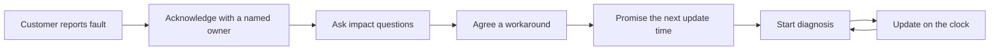
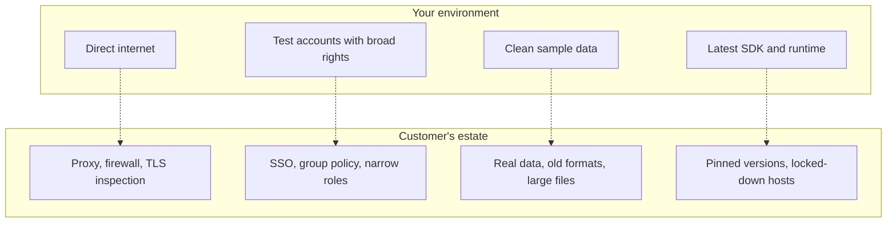

## Start with the defensive first reply

Selwood Pharmacy, a fictional chain of 120 pharmacies, uses an assistant your team built. It reads a patient's repeat prescriptions and drafts a short summary for the pharmacist. It passed every test in your staging environment, and it ran cleanly on your engineer's laptop against a copy of the service.

On the first Monday after go-live, pharmacists in 40 branches saw "Summary unavailable" on every patient. Selwood's IT manager emailed at 08:50. Your engineer checked your dashboards, saw green, and replied at 09:05: "Our service is healthy. This looks like a problem on your network." Then he went quiet and started debugging.

Nobody at Selwood heard anything for three hours. Pharmacists fell back to reading the full record, and queues formed at the counters. At 12:10 Selwood's operations director phoned your vice president. The cause turned out to be a proxy rule in the customer's branch network, so the engineer was half right. It did not matter. The customer remembered the reply, not the root cause.

Call this **the defensive first reply**: the first message argued about whose fault it was, before anyone knew, and promised nothing.

> **What you'll learn**
>
> - How to acknowledge a fault without accepting or assigning blame.
> - Which business-impact questions to ask in the first conversation.
> - Why the first promise is a time for the next update, not a fix.
> - How to contain harm while the cause is still unknown.
> - Why software that works in your environment fails in the customer's, and where to look first.

## Acknowledge before you diagnose

The customer's first message tells you something hurts. Your first reply has one job: show that a named person has it and is working on it. It does not need a cause, and it must not guess one.

Three things go wrong in first replies. The engineer defends the system ("our service is healthy"), which tells the customer their report is doubted. The engineer blames the estate ("your network"), which starts an argument nobody can settle yet. Or the engineer says nothing until there is an answer, which leaves the customer to fill the silence with the worst story.

Ownership of the cause is a question for later. Ownership of the problem starts now, and it is yours, because the customer brought it to you. You can own the problem while the cause sits in their proxy, a vendor's API or your own code.

The switcher compares Selwood's real first reply with one that would have stabilised the morning.

It is 08:55. Selwood's IT manager reports "Summary unavailable" in 40 branches. Your dashboards show no errors.

<button type="button" data-mode="defensive" aria-pressed="false" aria-controls="defensive-result">Defensive reply</button>
<button type="button" data-mode="stabilising" aria-pressed="false" aria-controls="stabilising-result">Stabilising reply</button>

<section id="defensive-result" class="mode-panel" data-announcement="Defensive reply selected. The customer escalates three hours later."><h4>Defensive reply</h4><ul><li>"Our service is healthy. This looks like your network."</li><li>No named owner, no impact questions, no next update time.</li><li>Pharmacists improvise for three hours. The operations director phones your vice president.</li></ul>
The engineer was half right about the cause and still lost the morning.
</section>
<section id="stabilising-result" class="mode-panel" data-announcement="Stabilising reply selected. The customer has a workaround and a next update by 09:30."><h4>Stabilising reply</h4><ul><li>"Thank you. I'm leading this. Which branches, since when, and can pharmacists still dispense?"</li><li>Agrees a workaround: pharmacists read the full record for now.</li><li>"Next update at 09:30, whatever we know by then."</li></ul>
The cause is still unknown. The customer knows who owns it, what to do meanwhile and when they will hear next.
</section>

Green dashboards are evidence, but only about what our dashboards measure. Selwood's requests never reached the service, so nothing was there to turn red. Treat a green dashboard during a customer report as a question: what would the customer see that we cannot?

## Ask about the business impact

Before you open a log, find out how bad it is in the customer's terms. Impact decides severity, who joins and how often you update. It also tells you where to look, because the shape of the impact is the first clue.

| Question | Why you ask it | Selwood's answer |
| --- | --- | --- |
| Who is affected, and who is not? | Splits the estate. A partial failure points at what differs. | 40 of 120 branches. Head office works. |
| Since when, and how did you notice? | Gives the first failure time to bracket. | Since opening at 08:30. Pharmacists phoned IT. |
| What can people still do? | Tells you whether harm is growing. | Dispensing continues, but slower. |
| Is there a deadline or a safety risk? | Raises severity before the business does. | Busiest hour is 12:00 to 13:00. |
| What changed on your side recently? | Opens the timeline without accusing. | "Nothing that we know of." |

*Table 1: Impact questions for the first conversation. The answers set severity and narrow the search.*

The answer to the first question did most of the work at Selwood. Forty branches failing and 80 working meant the service could not be down. Something those 40 branches shared was different. A later lesson in this module, [isolate the failing boundary](03_Isolate_the_Failing_Boundary.md), turns that clue into experiments.

Write the answers down where everyone working the problem can see them. The person on the call will forget the numbers once the debugging starts.

## Promise the next update, not the fix

A fix time is a guess. A next-update time is a promise you can keep. Customers judge you on promises kept far more than on how fast the fault clears.

Pick a time close enough that the customer does not need to chase. Thirty minutes suits a fault stopping work. Two hours suits one with a workaround in place. Then keep it, even when nothing has changed. "No change yet. We have ruled out our service and are now testing the branch network path with your IT team. Next update 10:00" is a good update. It shows progress, narrows the cause and keeps the customer's trust.

*Figure 1: The first hour. Diagnosis starts after the customer knows who owns the problem and when they will hear next.*

The order matters. The steps before diagnosis take ten or fifteen minutes. Skipping them saves those minutes and costs the customer's confidence for the rest of the incident. The [incidents with a customer watching](../../fde-deploying-in-the-estate/operating-after-go-live/03_Incidents_With_a_Customer_Watching.md) lesson covers severity, roles and update cadence for a declared incident.

## Contain the harm while you look

Stabilising means making the customer's day survivable before the cause is known. At Selwood, the workaround was already happening: pharmacists read the full record. Your job was to make it official, so branch staff stopped retrying and phoning IT.

Good containment is reversible and inside the rules you agreed. Options, roughly in order of preference:

- **A manual fallback** the business already knows, such as reading the full record.
- **Turning the feature off** behind a flag, so users see a clear message instead of an error.
- **Routing affected users** to a path that works, if one exists and is approved.
- **Reducing load** or retries, if retries are making things worse.

Containment that breaks the customer's security rules is not containment. Bypassing their proxy, turning off certificate checks or sharing an admin account may restore service and create a worse incident. The [collect evidence and escalate](04_Collect_Evidence_and_Escalate.md) lesson deals with those tempting shortcuts.

## Works for us, fails for them

"It works on my machine" is true more often than not. It is also the least useful thing to say, because the customer does not run your machine. Your laptop and your staging environment differ from their estate in predictable places, and those places are where to look first.

*Figure 2: Four gaps between your environment and the customer's. Each dotted line is a place a working build can fail.*

| Gap | What fails in their estate | First check |
| --- | --- | --- |
| Network | Proxy blocks a host, TLS inspection breaks certificate checks, DNS resolves differently | Call the same endpoint from one of their hosts |
| Identity | Token lacks a scope, group policy blocks a call, clock skew rejects tokens | Compare the claims in a working and a failing token |
| Data | A field is empty, a file is larger, a date or encoding differs | Run one real record, with permission, through a test path |
| Versions and configuration | Older runtime, different SDK, a setting missing or different | Compare versions and configuration hashes side by side |

*Table 2: Where a working build breaks in a customer's estate, and the cheapest check for each.*

Selwood's 40 failing branches sat behind a newer branch proxy that blocked the assistant's API host. Head office used the old proxy. The first check in the network row, one call from a failing branch, would have shown it within minutes. The [following a request through the network](../../fde-deploying-in-the-estate/networks-and-identity/01_Following_a_Request_Through_the_Network.md) lesson covers proxies, DNS and TLS in depth.

## Limits of this lesson

- **Contracts set response duties.** Your support agreement may fix response times and who leads. Read it before go-live.
- **Regulated harm changes the order.** Where a fault could hurt a patient, follow the customer's safety process first.
- **Fictional data.** Selwood Pharmacy, its branches and figures are illustrative.

## Interview angle

Each answer is an outline to say in about two minutes. Open the question and try it aloud before reading.

Interview question 1. Your integration passes every test in your environment. In the customer's environment it fails for some users. How do you approach it?

- **Answer:** First stabilise: acknowledge, ask who is affected and who is not, agree a workaround and promise a next update time. Then treat the difference between environments as the search space. Compare network path (proxy, DNS, TLS inspection), identity (token scopes, policy, clock), data (real records, sizes, encodings) and versions and configuration. Use the split between working and failing users to pick the first check, and run it from one of their failing hosts, not yours.
- **Trade-off:** Testing from their hosts needs their staff and their approval, which is slower. It is the only test that runs where the fault lives.
- **Follow-up to expect:** "They say their environment is standard." Ask for a comparison of one working and one failing user, which shows the difference without arguing.
- **Go deeper:** [Following a request through the network](../../fde-deploying-in-the-estate/networks-and-identity/01_Following_a_Request_Through_the_Network.md).

## References

1. Google, [Effective troubleshooting](https://sre.google/sre-book/effective-troubleshooting/), Site Reliability Engineering, accessed 17 November 2026. Triage before diagnosis, and asking what touched the system last.
2. Google, [Managing incidents](https://sre.google/sre-book/managing-incidents/), Site Reliability Engineering, accessed 17 November 2026. A single owner and regular updates during an incident.
3. The Twelve-Factor App, [Dev/prod parity](https://12factor.net/dev-prod-parity), accessed 17 November 2026. The gaps between development and production environments.
4. The author's own field experience, the basis for the first-reply comparison and the impact questions.

## Key takeaways

- Own the problem at once. Leave ownership of the cause until the evidence settles it.
- Ask who is affected and who is not before opening a log. The split is the first clue.
- Promise a time for the next update, then keep it even when nothing has changed.
- Contain harm with reversible steps inside the customer's rules.
- When it works for you and fails for them, search the gaps: network, identity, data, versions and configuration.

## Check yourself

1. Why was "our service is healthy" a poor first reply at Selwood, even though it was true?

It argued about the cause before anyone knew it and told the customer their report was doubted. It also said nothing about who owned the problem or when they would hear next. The service was healthy because the failing requests never reached it.

2. Why is a next-update time a better first promise than a fix time?

You control whether you send an update on time. You do not yet control when the fault clears. A kept promise builds trust, and a missed fix estimate spends it.

3. Forty branches fail and 80 work. What does that tell you before you look at any log?

The service as a whole is not down. Something the 40 branches share and the 80 do not, such as a network path, a version or a policy, is the place to look.

