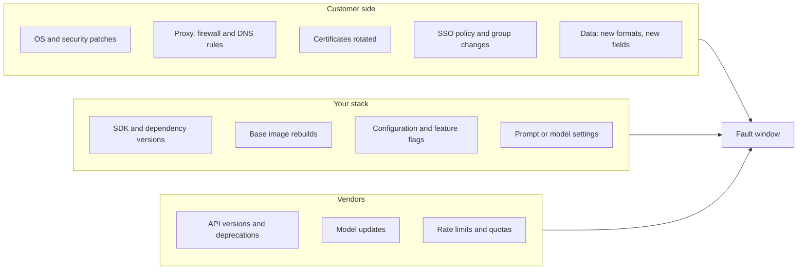

## Start with the dead end of "nothing changed"

Coniston Housing, a housing association with 18,000 homes, runs an assistant its FDE built to sort tenants' repair requests by trade and urgency. After two clean months it began, one Tuesday, sending every request to the "general" queue, and supervisors sorted requests by hand. The FDE asked Coniston's IT team what had changed. "Nothing," they said, and they believed it. The FDE's own release log showed no deployment that week either, so two days went on reading code that had worked for two months. On the third day the FDE noticed that a routine security rebuild of the container image had pulled a new minor version of an SDK, which parsed one field of the model's response differently. Nobody had released anything, and something had still changed. Call this **the dead end of "nothing changed"**: two honest teams, each sure of their side, and no timeline to test the claim against.

> **What you'll learn**
>
> - How to bracket a fault between the last known success and the first known failure.
> - How to line up timestamps from systems in different time zones.
> - Where changes hide on the customer's side, in your stack and at vendors.
> - Why "we changed nothing" is a hypothesis to test, not a fact to accept.
> - How environment and configuration drift creates changes nobody released.

## Bracket the fault

Every fault has a window: the last time the system worked and the first time it did not. The change that caused it almost always sits inside that window. Narrowing the window is the cheapest way to narrow the cause.

Find both edges from evidence, not memory. The last success is the timestamp of the last request that produced a correct result. The first failure is the timestamp of the first wrong one. At Coniston, the classifier's own output gave both: the last request sent to a trade queue was at 06:41 on Tuesday, and the next request, at 06:58, went to "general". The window was 17 minutes wide.

A user's report is a poor edge. "Since this morning" usually means "since I noticed". Use it to start the search, then find the real edges in logs or data. A wide window is still useful. A window of two days rules out every change made before it.

## Line up the clocks

A timeline mixes timestamps from many systems, and they rarely agree on the time zone. The customer's servers may log local time. Your service may log UTC. A vendor's support portal may show its own head office time. A one-hour gap between two clocks can put a change on the wrong side of the window.

| Source | What it recorded | Clock | In UTC |
| --- | --- | --- | --- |
| Coniston ticket | "Started at 7am" | UK local, British Summer Time | 06:00 (approximate) |
| Image rebuild | Rebuilt for security patch | UTC | 05:52 |
| Your classifier log | Last trade-queue result | UTC | 06:41 |
| Your classifier log | First "general" result | UTC | 06:58 |
| Coniston proxy | Certificate rotated | UK local, BST | 08:15 |

*Table 1: Coniston's timeline converted to UTC. The certificate rotation, a tempting suspect, happened after the first failure.*

Three rules keep a timeline honest:

- **Convert everything to UTC** and keep the original value beside it, with its source.
- **Record the offset**, not only the zone name. Summer time changes the offset twice a year.
- **Mark approximate times** as approximate. A user's "about seven" is a range, not a point.

Converting Coniston's times cleared one suspect at once. The proxy certificate rotation looked like a cause until its 08:15 local time became 07:15 UTC, after the first failure at 06:58.

## Where changes hide

Most changes that break a working system were not releases of that system. List candidates from every side, including the ones nobody thinks of as changes.

*Figure 1: Change sources on three sides. Each candidate goes on the timeline, then in or out of the fault window.*

For each candidate, ask one question: did it happen inside the window? Place it on the timeline with its UTC time and its source. Anything outside the window drops out. The walkthrough builds Coniston's timeline step by step.

Coniston's assistant sends every repair request to "general" from Tuesday morning. Each step shows what to do and what it found.

<button type="button" data-step="0" aria-pressed="false" aria-controls="tl-step-0">1. Bracket</button><button type="button" data-step="1" aria-pressed="false" aria-controls="tl-step-1">2. Align</button><button type="button" data-step="2" aria-pressed="false" aria-controls="tl-step-2">3. Collect</button><button type="button" data-step="3" aria-pressed="false" aria-controls="tl-step-3">4. Test</button>

<section id="tl-step-0" class="step-panel" aria-labelledby="tl-heading-0"><h4 id="tl-heading-0">1. Bracket the window</h4><dl><dt>Do</dt><dd>Find the last correct result and the first wrong one in the classifier's own output.</dd><dt>Found</dt><dd>Last success 06:41 UTC, first failure 06:58 UTC. A 17-minute window.</dd></dl></section><section id="tl-step-1" class="step-panel" aria-labelledby="tl-heading-1"><h4 id="tl-heading-1">2. Align the clocks</h4><dl><dt>Do</dt><dd>Convert every source to UTC, keeping the original and its offset.</dd><dt>Found</dt><dd>The certificate rotation at 08:15 BST is 07:15 UTC, after the first failure. It drops out.</dd></dl></section><section id="tl-step-2" class="step-panel" aria-labelledby="tl-heading-2"><h4 id="tl-heading-2">3. Collect changes from every side</h4><dl><dt>Do</dt><dd>Ask the customer for patch, network and identity changes. Check your image builds, dependency lock files and flags. Check vendor change logs.</dd><dt>Found</dt><dd>An image rebuild at 05:52 UTC, deployed by the scheduler at 06:50 UTC. Inside the window.</dd></dl></section><section id="tl-step-3" class="step-panel" aria-labelledby="tl-heading-3"><h4 id="tl-heading-3">4. Test one candidate</h4><dl><dt>Do</dt><dd>Diff the dependency versions between the old and new image. Run the old image against one request.</dd><dt>Found</dt><dd>One SDK moved from 3.4 to 3.5. The old image classifies correctly. The change is confirmed.</dd></dl></section>

<button type="button" data-walk="previous">Previous</button>

<button type="button" data-walk="next">Next step</button>

The rebuild sat outside the window, at 05:52. Its deployment, at 06:50, sat inside. Record when a change took effect, not only when someone made it.

## "We changed nothing" is a hypothesis

When the customer says nothing changed, they mean nothing they know of changed, through the processes they watch. Patches, policy pushes, other teams' work and automatic updates all happen outside those processes. The same is true of your own team.

Treat the claim as a hypothesis and test it with evidence both sides can see:

- **Version lists.** Compare the dependency lock file or package list of the running build against the last known good one.
- **Image digests.** A container tag such as "latest" can point at a new image. The digest, a hash of the image's content, cannot.
- **Configuration hashes.** Hash the effective configuration on each host and compare them over time.
- **Certificates.** Compare fingerprints and expiry dates, not names.
- **Change records.** Ask the customer for their change calendar for the window, not a yes or no.

Phrase the request so it does not accuse. "Could we look at your change calendar for Tuesday 05:00 to 07:00 UTC together? I'm doing the same on our side" gets a calendar. "Did you change something?" gets a defensive no.

The same discipline applies to every explanation. Form one hypothesis, predict what you would see if it were true, test that prediction, then keep or drop it. At Coniston, "the certificate rotation broke it" predicted failures starting at 07:15 UTC. They started at 06:58. It dropped out without anyone touching the proxy.

## Drift: the change nobody released

**Drift** is the gap that grows between what an environment should be and what it is. Nobody releases it. It arrives through rebuilds that pull newer packages, hotfixes made by hand on one host, settings changed in a console, and scheduled updates that skip one machine.

Drift explains two kinds of fault. Over time, an environment drifts from the state it was tested in, as Coniston's did. Across environments, staging drifts from production, or one host drifts from the others. Then a fault appears in one place only.

Three habits keep drift visible:

1. **Pin and record.** Pin dependency versions in a lock file and deploy images by digest. Record both with each deployment.
2. **Compare on a schedule.** Diff each environment's versions and configuration hash against its declared state, and alert on differences.
3. **Rebuild from source.** Make a fix by changing the declared state and redeploying, never by editing one host.

The [maintenance and drift](../../fde-deploying-in-the-estate/operating-after-go-live/04_Maintenance_and_Drift.md) lesson covers drift in data and models. This lesson's concern is drift in the environment itself.

## Limits of this lesson

- **Timelines need logs.** If a system keeps no timestamps, you can only bracket from the systems around it.
- **Customer change calendars vary.** Some organisations record every change, others very few. Ask early, before you need it.
- **Composite engagement.** Coniston Housing, its systems and times are illustrative, not a real customer.

## Interview angle

Each answer is an outline to say in about two minutes. Open each question and try it aloud before reading.

Interview question 1. An integration that worked for months starts failing. You have three plausible explanations. How do you decide which to work on?

- **Answer:** Write each down as a hypothesis with a prediction: if it is the certificate, failures start when it rotated and only on calls through that proxy. Bracket the fault with the last success and first failure in UTC. Drop any hypothesis whose change sits outside the window. Rank the rest by how cheap the test is and how well it fits the evidence. Test one at a time, change one thing per test, and record the result before moving on.
- **Trade-off:** Testing one at a time is slower when you guess right first. It avoids fixes nobody can explain.
- **Follow-up to expect:** "All three fit the window." Pick the test that splits them, such as one call that bypasses one suspect.

Interview question 2. Staging works and production fails with the same release. How do you find and prevent environment drift?

- **Answer:** Compare what is running, not what was meant to run. Diff the image digests, the dependency lists, the effective configuration on each host, feature flags, runtime versions, certificates and the identity roles each uses. The difference that matches the failure is the lead. Then prevent recurrence: pin versions, deploy by digest, keep configuration in version control, compare each environment against its declared state on a schedule and fix by redeploying, never by editing a host.
- **Trade-off:** Strict pinning delays security patches. Rebuild and retest on a schedule, so patches arrive as tested changes.
- **Follow-up to expect:** "Production differs on purpose, such as bigger data." List the intended differences, so you only chase the unintended ones.

## References

1. Google, [Effective troubleshooting](https://sre.google/sre-book/effective-troubleshooting/), Site Reliability Engineering, accessed 17 November 2026. Forming and testing hypotheses, and asking what touched the system last.
2. IETF, [RFC 3339: Date and Time on the Internet: Timestamps](https://www.rfc-editor.org/rfc/rfc3339), accessed 17 November 2026. Timestamps with explicit UTC offsets.
3. The Twelve-Factor App, [Config](https://12factor.net/config), accessed 17 November 2026. Keeping configuration separate from code and per environment.
4. Git, [git-bisect documentation](https://git-scm.com/docs/git-bisect), accessed 17 November 2026. Binary search between a known good and a known bad version.

## Key takeaways

- Bracket every fault between the last success and the first failure, taken from data, not memory.
- Convert every timestamp to UTC, keeping the original and its offset.
- List changes from the customer, your stack and vendors, including patches and rebuilds.
- Record when a change took effect, not only when it was made.
- Test "we changed nothing" with version lists, digests, hashes and change calendars.
- Prevent drift by pinning, comparing on a schedule and fixing by redeploying.

## Check yourself

1. Why did the certificate rotation drop out of Coniston's suspects?

In UTC it happened at 07:15, after the first failure at 06:58. A change after the first failure cannot have caused it.

2. Why deploy by image digest rather than by tag?

A tag can be moved to a new image without anyone noticing. A digest is a hash of the image's content, so the same digest always means the same image.

3. The customer says nothing changed. What do you ask for instead of arguing?

Their change calendar for the fault window, while you check your own builds, dependency versions and configuration for the same window.

