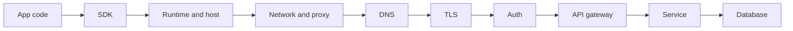

## Start with the three-change fix

Brancaster Freight, a freight forwarder, runs a service its FDE built to extract fields from customs documents. Six workers sit behind a load balancer in Brancaster's private cloud, and each calls a hosted extraction API through Brancaster's outbound proxy. One week about one document in six began failing with "connection reset", apparently at random. Under pressure the FDE shipped three changes in one release, a longer timeout, a newer SDK and three attempts instead of one, and failures fell to about one in 200. Nobody knew which change had helped. Two weeks later, at the month-end peak, the retries tripled traffic to the proxy and failures climbed again. The cause was one worker built by hand without the proxy's certificate, and retries had hidden it by landing on other workers. Call this **the three-change fix**: several changes at once, a symptom that fades and a cause that stays.

> **What you'll learn**
>
> - How to walk the request path and test each boundary.
> - Why each experiment changes one variable.
> - How to compare healthy and failing requests in a matrix.
> - How to read one-in-N failures, one bad instance and one slow environment.
> - Why "cannot reproduce" is a clue about the environment.

## The path a request takes

A request in a customer's estate crosses many boundaries, and each can fail on its own. Name them before you guess. A fault lives at one boundary, and the test is to find which.

*Figure 1: The boundaries one request crosses. Testing on either side of a boundary shows whether the fault is before it or after it.*

Two techniques narrow the path quickly:

- **Split it in half.** Test from the middle. If a call from the worker's host to the API works without your code, the fault is in your app, SDK or runtime. If it fails, the fault is further along. Repeat on the failing half.
- **Read the error for its layer.** A name that does not resolve is DNS. A certificate error is TLS. A 401 or 403 is auth. A reset connection is often a proxy or a TLS failure. A 500 is the service. The [following a request through the network](../../fde-deploying-in-the-estate/networks-and-identity/01_Following_a_Request_Through_the_Network.md) lesson matches errors to layers in depth.

At Brancaster, "connection reset" pointed at the network, proxy or TLS boundary. That ruled out the SDK and the timeout, two of the three changes the team made.

## One variable per experiment

An **experiment** here is a change you make to learn something, with a prediction written before you run it. If you change two things and the result changes, you cannot say which one did it. You also cannot undo the one that did nothing, so it stays in the system as an unexplained change.

Write each experiment as a line in the incident log:

| Field | Brancaster example |
| --- | --- |
| Hypothesis | The fault is on one worker, not all six. |
| Change | Send 60 test documents to each worker directly, bypassing the load balancer. |
| Prediction if true | One worker fails all 60, the others none. |
| Result | Worker 4 failed 60 of 60. Workers 1 to 3, 5 and 6 failed none. |
| Decision | Keep the hypothesis. Compare worker 4 with worker 1. |

*Table 1: One experiment, written before it runs. The prediction makes the result mean something.*

One variable at a time feels slow when the customer is waiting. It is faster than a fix nobody can explain, which returns at the worst moment. When you must mitigate fast, do it as a separate, reversible step, such as taking worker 4 out of the pool, and record it as mitigation, not as a fix.

## Compare healthy and failing requests

An intermittent fault is one that some requests hit and others do not. The cause is a property the failing requests share. To find it, put healthy and failing requests side by side and compare their attributes.

| Attribute | 200 healthy requests | 60 failing requests | Reading |
| --- | --- | --- | --- |
| Worker instance | Spread across workers 1 to 3, 5 and 6 | All on worker 4 | The lead |
| Document size | 0.2 to 9 MB | 0.3 to 8 MB | Same spread, rules it out |
| Time of day | 07:00 to 19:00 | 07:00 to 19:00 | Same spread, rules it out |
| Customs region | All regions | All regions | Rules it out |
| SDK version | 2.8 | 2.8 | Same, rules it out |

*Table 2: A comparison matrix. The attribute where the two columns differ is the lead. The others are ruled out.*

The matrix needs each request to carry its attributes. Log a request ID, the instance, version, payload size, region and timing on every call, so you can group by any of them later. The [telemetry the customer can use](../../fde-deploying-in-the-estate/operating-after-go-live/01_Telemetry_the_Customer_Can_Use.md) lesson covers correlation IDs and structured logs.

Once the matrix points at worker 4, compare it with a healthy worker the same way: image digest, packages, configuration, certificates. At Brancaster, worker 4 lacked the root certificate Brancaster's proxy uses to re-sign outbound TLS. Its handshakes failed, and the proxy reset the connection.

## Read the pattern before the logs

The shape of a failure often says where to look before any single log line does. The switcher shows three common shapes.

Each pattern is a different shape of the same complaint: "it fails sometimes". Pick one to see what it suggests and the first test.

<button type="button" data-mode="one-in-n" aria-pressed="false" aria-controls="one-in-n-result">One in N</button>
<button type="button" data-mode="bad-instance" aria-pressed="false" aria-controls="bad-instance-result">One bad instance</button>
<button type="button" data-mode="slow-env" aria-pressed="false" aria-controls="slow-env-result">One slow environment</button>

<section id="one-in-n-result" class="mode-panel" data-announcement="One in N selected. Look for a steady ratio and what the failing requests share."><h4>One in N</h4><ul><li>A steady fraction fails, such as one in 500, across hours and days.</li><li>Suggests something the failing requests share: a rare input, a pool member, a token near expiry, a cache key.</li><li>First test: group failures by every logged attribute and look for one that differs.</li></ul>
A ratio that tracks the number of instances, such as one in six with six workers, points at one instance.
</section>
<section id="bad-instance-result" class="mode-panel" data-announcement="One bad instance selected. Compare the failing instance with a healthy one."><h4>One bad instance</h4><ul><li>All failures come from one host, pod or worker. The rest are clean.</li><li>Suggests drift: a manual change, a stale image, a missing certificate, a full disk.</li><li>First test: take it out of the pool, then diff it against a healthy instance.</li></ul>
Removing it restores service. Diffing it finds the cause, so do both.
</section>
<section id="slow-env-result" class="mode-panel" data-announcement="One slow environment selected. Compare where the time goes in each environment."><h4>One slow environment</h4><ul><li>The same release is fast in one environment and slow in another.</li><li>Suggests a difference in path or capacity: a proxy, DNS lookups, a smaller database, a noisy neighbour, a far-away region.</li><li>First test: break one request's time into DNS, connect, TLS, wait and transfer in each environment.</li></ul>
The stage that differs is where the environments differ.
</section>

Retries and load balancers turn one bad instance into a one-in-N pattern. At Brancaster, one bad worker out of six gave one in six at first. Three attempts per request made it about one in 216, which looked like random noise. When a ratio changes after a change to retries or pool size, suspect a single instance.

## "Cannot reproduce" narrows the environment

When you cannot reproduce a fault in your own environment, you have learned something. The fault depends on something your environment lacks. Write the gaps down and test them one at a time:

- **The customer's network path.** Run the same call from one of their hosts.
- **Their identity.** Use a test account with the same roles and policies as an affected user.
- **Their data.** With permission, use one real failing input, or a synthetic one with the same size, encoding and fields.
- **Their versions and scale.** Match runtime, SDK and concurrency.

Each gap you close either reproduces the fault or rules out that gap. Either result moves you forward. At Brancaster, the fault would not reproduce on your laptop because your laptop did not go through their proxy. It reproduced at once from worker 4. The site's [diagnosing production incidents](../../../../01_Concept_Tutorials/Consolidated_Lessons/T4.3_Observability_and_Diagnosis/05_Diagnosing_Production_Incidents.md) lesson covers reading traces once you can see the failing request. When the gap turns out to be the customer's configuration or data inside your own product, [reproduce, isolate, fix](../../fde-building-in-the-estate/working-in-customer-code/03_Reproduce_Isolate_Fix.md) shrinks it to a minimal reproduction.

## Limits of this lesson

- **Access decides the method.** In some estates you cannot run commands on their hosts. Then you design experiments their staff can run, with clear steps.
- **Some faults need load.** A race or pool exhaustion may only appear under real concurrency, which needs a load test.
- **Composite engagement.** Brancaster Freight, its workers and figures are illustrative, not a real customer.

## Interview angle

Each answer is an outline to say in about two minutes. Open each question and try it aloud before reading.

Interview question 1. A customer reports that your integration "fails sometimes". You cannot see a pattern. How do you investigate an intermittent fault?

- **Answer:** Make every request carry its attributes: request ID, instance, version, payload size, region, user type and timings. Count failures over time to get the rate and its trend. Then compare a sample of failing requests with healthy ones, attribute by attribute. The attribute where they differ is the lead. Form one hypothesis from it, predict a result, and run one experiment that changes one thing. Avoid changing retries or timeouts until you know the cause, because they hide the pattern.
- **Trade-off:** Logging attributes on every request adds cost and storage. Sample healthy requests, and keep every failure.
- **Follow-up to expect:** "There are too few failures to compare." Widen the time range, or raise logging detail for a fixed period.

Interview question 2. You have one request that worked and one that failed, minutes apart. How do you compare them?

- **Answer:** Pull both by request ID and line them up field by field: instance, versions, headers, token claims and expiry, payload size and shape, the address the name resolved to, and time spent in each stage. Ignore fields that always differ, such as IDs and timestamps. Then replay each: the failing input on a healthy path and the healthy input on the failing path. The swap that moves the failure shows whether the input or the path is at fault.
- **Trade-off:** Replaying real requests may need customer data. Use a redacted copy, with permission.
- **Follow-up to expect:** "They look identical." Then compare what they passed through: instance, proxy and resolved address.
- **Go deeper:** [Diagnosing production incidents](../../../../01_Concept_Tutorials/Consolidated_Lessons/T4.3_Observability_and_Diagnosis/05_Diagnosing_Production_Incidents.md).

Interview question 3. All failures come from one of eight instances of the same service. What do you do?

- **Answer:** Take the instance out of the pool to stop the harm, and keep it running for diagnosis rather than destroying it. Then diff it against a healthy instance: image digest, packages, configuration hash, environment variables, certificates, disk, memory, clock and network route. The difference is the lead. Fix it by redeploying from the declared state, not by patching the host. Then find how it drifted, such as a manual change, so it cannot happen again.
- **Trade-off:** Keeping a bad instance for diagnosis costs capacity. Agree a time limit before you replace it.
- **Follow-up to expect:** "Replacing it fixed it, so why keep looking?" Because the next rebuild may drift the same way.

## References

1. Google, [Effective troubleshooting](https://sre.google/sre-book/effective-troubleshooting/), Site Reliability Engineering, accessed 17 November 2026. Splitting the system in half and testing hypotheses one at a time.
2. Brendan Gregg, [The USE Method](https://www.brendangregg.com/usemethod.html), accessed 17 November 2026. Checking utilisation, saturation and errors per resource to find a slow component.
3. W3C, [Trace Context](https://www.w3.org/TR/trace-context/), accessed 17 November 2026. Carrying a request's identity across services so healthy and failing requests can be compared.
4. The author's own field experience, the basis for the comparison matrix and the failure patterns.

## Key takeaways

- Name every boundary on the request path, then test on either side of one.
- Change one variable per experiment, and write the prediction first.
- Compare healthy and failing requests attribute by attribute. The difference is the lead.
- A ratio that matches the instance count points at one instance. Retries can disguise it.
- Take a bad instance out of the pool, diff it, then fix by redeploying.
- "Cannot reproduce" means your environment lacks something theirs has. Close the gaps one at a time.

## Check yourself

1. Why did three attempts per request make Brancaster's fault look like random noise?

Each retry usually landed on a healthy worker. A request only failed when all three attempts hit worker 4, a chance of one in 216, which looked too rare to have a single cause.

2. What does a comparison matrix rule out, as well as point to?

Every attribute with the same spread in healthy and failing requests is ruled out as a cause. That shortens the list of suspects even before the lead is confirmed.

3. The same release is slow in one environment only. What is your first measurement?

Break one request's time into stages, such as DNS, connect, TLS, waiting and transfer, in both environments. The stage that differs shows where the environments differ.

