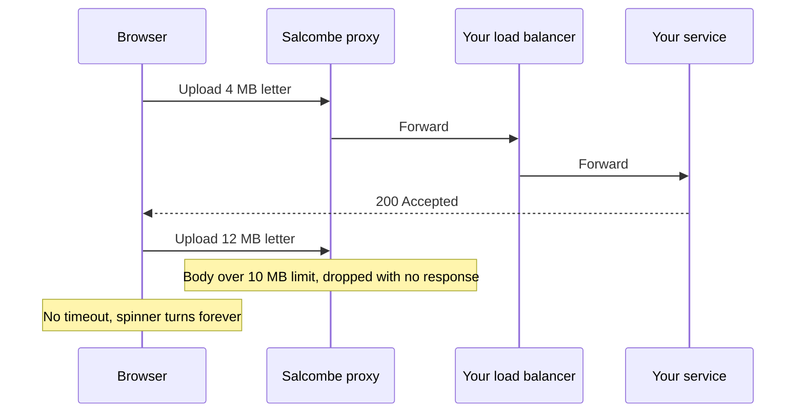

## Start with the escalation that bounced

Salcombe Clinics, a fictional group of outpatient clinics, uses an assistant your team built to read scanned referral letters and draft appointment requests. Staff upload each letter as a PDF. One week, some uploads started to hang. The progress bar reached the end and the spinner kept turning. No error appeared, in the browser or in your service's logs.

Your engineer wanted to see it for himself. He asked Salcombe's IT team for a browser network capture of a failing upload, a copy of a patient's letter and the password of a staff account, "so I can log in and try". He also suggested they switch off their proxy's TLS inspection for an hour to rule it out.

Salcombe's information governance lead refused all four. The capture would hold session cookies and patient details. The letter was health data. The password was not his to share. The proxy setting was a security control. Meanwhile your engineer escalated to your product team with one line: "Uploads hanging at Salcombe, please look." The product team replied with eleven questions. It took two days to answer them.

Call this **the escalation that bounced**: evidence asked for in ways the customer could not allow, and an escalation that carried none of it.

> **What you'll learn**
>
> - How to plan the investigation of an upload that hangs without an error.
> - What a privacy-safe evidence packet holds, and what never goes in it.
> - Which workarounds to refuse, and what to offer instead.
> - How to work through a failed partner API call from its request ID.
> - How to write an escalation that the next team can act on at once.
> - What goes in the first customer update.

## The upload that hangs without an error

A hang with no error is a request that left one place and never arrived anywhere that could answer it. Something on the path is holding it, dropping it or waiting for it. The plan is to find where the bytes stop.

Some PDF uploads at Salcombe hang at 100% with no error. Each step shows what to do and what it found.

<button type="button" data-step="0" aria-pressed="false" aria-controls="up-step-0">1. Characterise</button><button type="button" data-step="1" aria-pressed="false" aria-controls="up-step-1">2. Locate</button><button type="button" data-step="2" aria-pressed="false" aria-controls="up-step-2">3. Check limits</button><button type="button" data-step="3" aria-pressed="false" aria-controls="up-step-3">4. Confirm</button><button type="button" data-step="4" aria-pressed="false" aria-controls="up-step-4">5. Fix both sides</button>

<section id="up-step-0" class="step-panel" aria-labelledby="up-heading-0"><h4 id="up-heading-0">1. Characterise which uploads hang</h4><dl><dt>Do</dt><dd>Ask for file size, page count, clinic, browser and time of each failing upload. No file contents.</dd><dt>Found</dt><dd>All hanging files are over 10 MB. Every file under 10 MB succeeds, at every clinic.</dd></dl></section><section id="up-step-1" class="step-panel" aria-labelledby="up-heading-1"><h4 id="up-heading-1">2. Locate where the bytes stop</h4><dl><dt>Do</dt><dd>Check each hop for the upload's arrival: your service logs, your load balancer logs, then Salcombe's proxy logs, which their IT team searches by time and size.</dd><dt>Found</dt><dd>Your load balancer never sees the large uploads. Salcombe's proxy logs each one.</dd></dl></section><section id="up-step-2" class="step-panel" aria-labelledby="up-heading-2"><h4 id="up-heading-2">3. Check the limits on the path</h4><dl><dt>Do</dt><dd>List every size and time limit: the proxy's maximum request body, idle timeouts, your load balancer and service limits, the browser code's timeout.</dd><dt>Found</dt><dd>A proxy policy update set a 10 MB body limit. Above it, the proxy drops the request without a response. The upload code has no timeout.</dd></dl></section><section id="up-step-3" class="step-panel" aria-labelledby="up-heading-3"><h4 id="up-heading-3">4. Confirm with a test file</h4><dl><dt>Do</dt><dd>Upload two synthetic PDFs with no patient data, 9.5 MB and 10.5 MB, through the proxy.</dd><dt>Found</dt><dd>The 9.5 MB file succeeds. The 10.5 MB file hangs. The hypothesis holds.</dd></dl></section><section id="up-step-4" class="step-panel" aria-labelledby="up-heading-4"><h4 id="up-heading-4">5. Fix both sides</h4><dl><dt>Do</dt><dd>Your side: add a client timeout and a clear error, and split uploads into 5 MB parts. Their side: raise a change request if they choose to lift the limit.</dd><dt>Found</dt><dd>Uploads of any size succeed in parts. A future drop shows an error, not a spinner.</dd></dl></section>

<button type="button" data-walk="previous">Previous</button>

<button type="button" data-walk="next">Next step</button>

*Figure 1: Where the bytes stopped. The large upload never reached your side, so your logs had nothing to show.*

Two lessons generalise. First, silence in your logs is evidence: the request did not reach you, so look upstream. Second, a hang is partly your bug even when the limit is theirs. Code that waits forever turns any fault on the path into a mystery. Every network call needs a timeout and an error the user can read.

## A privacy-safe evidence packet

You need evidence from an estate you do not control, holding data you may not see. Ask for metadata that locates the fault, not content that shows it.

| Ask for | Never ask for |
| --- | --- |
| Request IDs and UTC timestamps of failing actions | Passwords, API keys, tokens or session cookies |
| File sizes, types and page counts | The files themselves, if they hold personal data |
| Browser, app and SDK versions | Screen sharing of real patient or customer records |
| Error text and screenshots with personal details covered | Raw browser network captures, which carry cookies and content |
| Their proxy or firewall log entries, searched by their staff | Access to their admin consoles under someone else's account |
| A synthetic input that fails the same way | Copies of production data on your laptop |

*Table 1: What a privacy-safe evidence packet holds. Metadata locates most faults without exposing anyone's data.*

If a capture or log is needed, ask the customer's staff to produce it and to redact it before it leaves their estate, or to read it with you on a call. If a secret was shared by mistake, say so at once and ask them to rotate it. The [secrets and leaks](../../fde-deploying-in-the-estate/networks-and-identity/04_Secrets_and_Leaks.md) lesson covers what to do when a credential lands in the wrong place.

## Workarounds you must refuse

Under pressure, someone will suggest a shortcut that restores service and breaks a rule. The customer's staff may even offer it. Refuse politely, and offer a safe alternative in the same breath.

| Tempting workaround | Why it is forbidden | Safe alternative |
| --- | --- | --- |
| Switch off TLS inspection or certificate checks | Removes a security control, and may breach their policy | Ask their network team to test one call with a named exception, through their change process |
| Bypass the proxy from one host | Creates an unmonitored path out of their network | Reproduce through the proxy, and read its logs together |
| Log in with a staff member's account | Breaks their access policy and the audit trail | Ask for a test account with the same roles |
| Copy production data to reproduce locally | Moves personal data outside agreed controls | Build a synthetic input with the same shape |
| Turn on full debug logging in production | Can write personal data and secrets to logs | Add the specific fields you need, for a fixed period |

*Table 2: Shortcuts that create a second incident. Each has a safe alternative that answers the same question.*

Work inside the customer's controls, even when it is slower. A fix that breaks a control becomes a security incident, and you own it.

## A failed partner call, from the request ID

Many faults are one failed call to a partner's API. A **request ID** identifies one call, set by your service, the partner or both. It joins your logs, traces and the partner's logs while holding no personal data.

When Salcombe's bookings through a partner's scheduling API began failing, the screen showed "Booking failed (ref 9c41e2)". Work from that reference in this order.

1. **Find the call.** Search your logs and traces for the request ID. Note the UTC time, endpoint, attempt number and the partner's own ID.
2. **Read what came back.** Status, the partner's error code and any retry-after header. No response points at a timeout or the network path, covered in [isolate the failing boundary](03_Isolate_the_Failing_Boundary.md).
3. **Check the credential.** Did the token expire, and do its granted scopes cover this endpoint? A 401 or 403 usually ends here.
4. **Check what you sent.** Compare it with a successful call: payload shape, API version, field formats.
5. **Check limits and the partner's status.** A 429, exhausted rate-limit headers or a partner incident.
6. **Check what happened next.** Was it retried, could a retry have duplicated it, and did it land in a dead-letter queue?
7. **Escalate with both IDs.** Send the partner your request ID, theirs, the UTC time, the endpoint, the response and what you ruled out.

Salcombe's call stopped at step 3: a 403 with the code `scope_missing`, after the partner split booking into a new scope. The trade-off is what you keep. Logging IDs and codes for every partner call is cheap. Full bodies would find faults faster but put patient data in your logs, so record only their shape.

## The escalation packet

Sooner or later you need another team: your product engineers, a vendor or the customer's network team. What you send decides whether they start work or start asking questions. Write it so a stranger could act on it without replying.

1. **Summary.** One sentence: what fails, for whom, since when.
2. **Impact.** In the customer's terms, with numbers and any deadline.
3. **Timeline.** Last success and first failure in UTC, and the changes in the window.
4. **Environment.** Versions, region, network path and anything unusual about this customer.
5. **Reproduction.** The smallest steps that show it, with a synthetic input.
6. **Evidence.** Request IDs, log excerpts with personal data removed, the comparison of healthy and failing cases.
7. **Ruled out.** What you tested and how, so nobody repeats it.
8. **The ask.** One specific request, the severity and when you need an answer.

Salcombe's second escalation followed this shape. The product team approved split uploads the same afternoon. The [incidents with a customer watching](../../fde-deploying-in-the-estate/operating-after-go-live/03_Incidents_With_a_Customer_Watching.md) lesson shows the same discipline applied to a vendor who disputes blame.

## The first customer update

The customer needs to hear from you before the cause is known. The first update after the evidence request says what you need, why you need it and what you will not ask for.

| Part | Salcombe's first update |
| --- | --- |
| Impact | Referral letters over about 10 MB fail to upload. Smaller ones work. |
| Workaround | Split large letters into two files, or scan at a lower resolution, until further notice. |
| What we need | File sizes and times of failing uploads, and a search of your proxy logs for those times. No letters, passwords or captures. |
| What we know | The large uploads do not reach our service. |
| Next update | 15:00 today. |

*Table 3: A first update that asks for evidence safely and gives staff something to do meanwhile.*

Naming what you will not ask for builds trust with the customer's security and governance staff. They will help faster when they know you respect their rules.

## Limits of this lesson

- **Regulated data has its own rules.** Health, payment and government data may carry legal limits on who sees what. The customer's governance team decides.
- **Contracts set escalation paths.** Vendor support tiers and response times differ. Follow the contract.
- **Fictional data.** Salcombe Clinics, its systems and figures are illustrative.

## Interview angle

Each answer is an outline to say in about two minutes. Open the question and try it aloud before reading.

Interview question 1. Users say uploads sometimes hang forever with no error. Plan the investigation.

- **Answer:** Stabilise first: a workaround and a next update time. Then characterise which uploads hang by size, type, user, location and time, with no file contents. Locate where the bytes stop by checking each hop for the upload's arrival: your service, your load balancer, then the customer's proxy logs, searched by their staff. List every size and time limit on the path. Confirm with synthetic files either side of a suspected limit. Fix both sides: a client timeout with a clear error, and chunked uploads or a limit change.
- **Trade-off:** Chunked uploads add complexity and resume logic. They work under limits you do not control.
- **Follow-up to expect:** "Your logs show nothing." That is the clue: the request never reached you.

Interview question 2. A user's screen says "Booking failed" with a reference number. The booking goes through a partner's API. Walk me through your first fifteen minutes.

- **Answer:** The reference should be the request ID. Find the call: UTC time, endpoint, attempt and the partner's own ID. Read the response: status, error code, retry-after. No response points at a timeout or the network. Then check the credential's scopes, compare with a successful request, check rate limits and partner status, and whether a retry duplicated anything. Escalate with both IDs, the time, the response and what you ruled out.
- **Trade-off:** Logging only IDs and codes keeps personal data out of logs, but you may need the partner's logs to see the body.
- **Follow-up to expect:** "The screen showed no reference." Then the first fix is to show one on every failure.

## References

1. OWASP, [Logging Cheat Sheet](https://cheatsheetseries.owasp.org/cheatsheets/Logging_Cheat_Sheet.html), accessed 17 November 2026. Data that should never be logged, such as session identifiers and passwords.
2. nginx, [Module ngx_http_core_module](https://nginx.org/en/docs/http/ngx_http_core_module.html), accessed 17 November 2026. Request body size limits and body timeouts on a proxy, such as client_max_body_size and client_body_timeout.
3. Google, [Effective troubleshooting](https://sre.google/sre-book/effective-troubleshooting/), Site Reliability Engineering, accessed 17 November 2026. Reporting problems with the observed and expected behaviour and steps to reproduce.
4. W3C, [Trace Context](https://www.w3.org/TR/trace-context/), accessed 18 November 2026. Propagating one trace identifier across services, including to a partner.
5. The author's own field experience, the basis for the evidence packet, the partner-call checklist and the escalation packet.

## Key takeaways

- A hang with no error means the request stopped somewhere. Find the hop where the bytes stop.
- Silence in your logs is evidence that the request never reached you.
- Every network call needs a timeout and an error a user can read.
- Ask for metadata that locates the fault. Never ask for secrets, sessions or personal data.
- Refuse workarounds that break the customer's controls, and offer a safe alternative at once.
- Debug a failed partner call from its request ID: find it, read the response, then check credential, payload, limits and retries.
- Escalate with summary, impact, timeline, environment, reproduction, evidence, what you ruled out and one ask.

## Check yourself

1. Why is a raw browser network capture a risky thing to ask for?

It can carry session cookies, tokens and the content of requests, including personal data. Anyone holding it could replay the session or read the data.

2. The proxy's limit caused Salcombe's hang. Why is the hang still partly your bug?

The upload code waited forever. With a timeout and a clear error, users would have seen a failure at once, and the investigation would have started from a message instead of a spinner.

3. What does the "ruled out" section of an escalation save?

It stops the next team repeating tests you already ran, and shows them where not to look, so they start from your progress rather than from zero.

