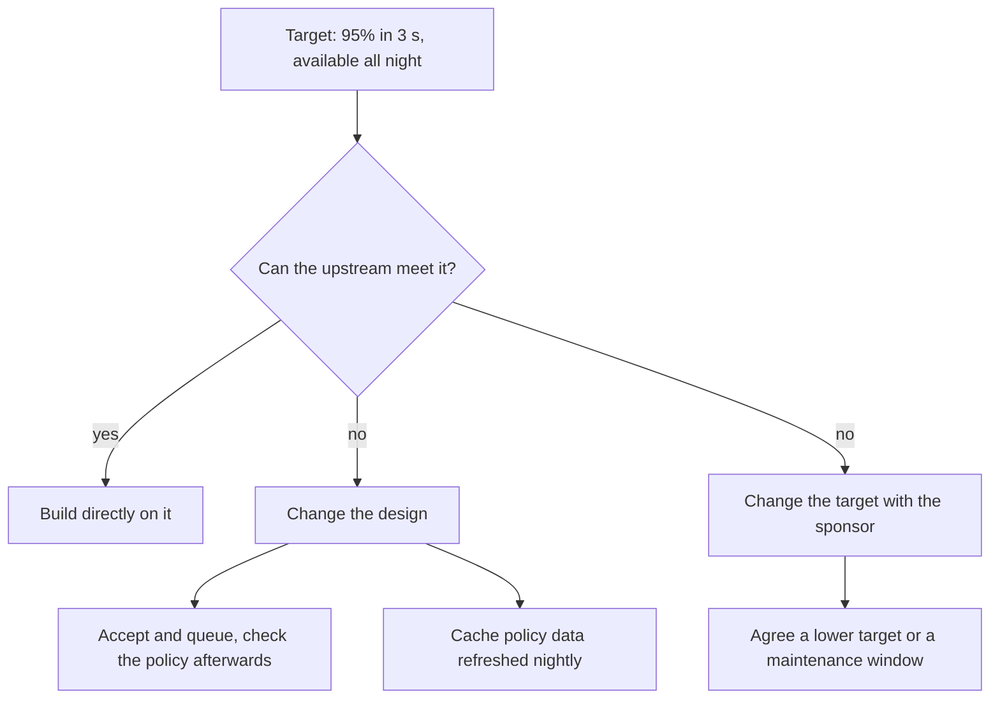

## Start with three words nobody could test

Corran Insurance asked its FDE for a new online claims form. The requirements document had one line on quality: the form must be "fast, secure and always available". The FDE built to that line, and the arguments started at the first demo. The claims director timed a submission at four seconds and called it slow. Security asked whether claim photos were scanned for malware, which nobody had planned. Operations asked why the form failed every night between 01:00 and 03:00. The form did exactly what the document said, and the document said nothing anyone could check. Call this **the untestable adjective**: a word that sounds like a requirement and settles nothing.

> **What you'll learn**
>
> - Separate functional from non-functional requirements.
> - Write user stories with acceptance criteria, including partial failures and duplicates.
> - Turn quality words into numbers someone can measure.
> - Handle a target that an upstream system cannot meet.

## Two kinds of requirement

A **functional requirement** says what the system does: "a policyholder can submit a claim with up to ten photos". A **non-functional requirement** says how well it does it: how fast, how available, how secure, at what scale.

Functional requirements usually come from users and the process owner. Non-functional ones come from operations, security, legal and the sponsor's tolerance for failure, and they are the ones teams forget to ask about. They also shape the architecture more: a form that must work during the policy system's nightly downtime needs a queue, whatever its fields are.

A requirement is ready when someone other than its author could check it and agree whether it passed. That is the test for every line in this lesson.

## User stories and acceptance criteria

A **user story** names who needs something, what they need and why: "As a policyholder with a damaged car, I want to submit my claim online with photos, so that I do not have to phone during working hours." The why matters, because it tells the team which trade-offs the user would accept.

A story on its own is a conversation starter. **Acceptance criteria** make it testable. Write them as concrete cases with a starting state, an action and an expected result. Most teams write the happy path and stop. The cases that cause incidents are the others:

- **Partial failure.** Seven of ten photos upload, then the connection drops.
- **Duplicates.** The policyholder presses submit twice, or retries after a timeout.
- **Invalid or missing input.** A policy number that does not exist, a photo over the size limit.
- **Downstream failure.** The policy system is down when the claim arrives.

Table 1 shows criteria for Corran's story, covering each case.

| Case | Given | When | Then |
| --- | --- | --- | --- |
| Happy path | A valid policy and ten photos | The user submits | A claim reference appears within 3 seconds and an email follows |
| Partial upload | Seven of ten photos uploaded | The connection drops | The draft keeps the seven photos for 7 days and the user can resume |
| Duplicate | A claim was submitted for this policy and incident date | The user submits again within 24 hours | No second claim is created, and the user sees the first reference |
| Downstream down | The policy system is unavailable | The user submits | The claim is accepted and queued, and the user is told checks will follow |
| Invalid policy | The policy number does not exist | The user submits | The form explains the problem and no claim is created |

*Table 1: Acceptance criteria for one story. Four of the five rows describe things going wrong.*

The duplicate rule needs a definition the business agrees with. Same policy and incident date within 24 hours is a business decision, not a technical one. In the system it becomes an **idempotency key**, a value that lets the system recognise a repeated request and return the original result.

> **Pitfall:** Acceptance criteria that repeat the story. "The user can submit a claim" is the story again. A criterion names a state, an action and a result someone can observe.

## Turning quality words into numbers

Each quality word needs a measure, a target, a load and a way to check it. Google's SRE book frames this as **service level indicators**, the thing you measure, and **service level objectives**, the target for it over a period. The same discipline works for any requirement.

| Word | Measured as | Corran target | Checked by |
| --- | --- | --- | --- |
| Fast | Time from submit to claim reference | 95% within 3 seconds at 200 submissions an hour | Load test before launch, monitoring after |
| Always available | Successful submissions over attempts | 99.5% each month, including the nightly window | Monitoring of failed submissions |
| Secure | Named controls | Photos malware-scanned, data encrypted in transit and at rest, access logged | Security review checklist |
| Scalable | Peak load handled | 2,000 submissions an hour after a storm, for 6 hours | Load test at the peak |

*Table 2: Quality words with measures. Each row names how it will be checked. Passing is not a matter of opinion.*

Three habits make the numbers useful:

- **Use percentiles, not averages.** "95% within 3 seconds" says what most users feel. An average hides the slow tail.
- **State the load.** A response time without a load is meaningless.
- **Ask what failure costs.** 99.9% availability allows about 43 minutes of failure a month. 99.5% allows about 3.6 hours. Each extra nine costs more. Let the sponsor choose with the cost in front of them.

"Secure" rarely becomes one number. Turn it into named controls the security team agrees to, each one checkable.

## When the upstream cannot meet the target

Some targets are impossible because of a system you do not control. Corran's policy system answered lookups in 2.5 seconds at the 95th percentile and was offline for maintenance from 01:00 to 03:00 every night. A 3-second submission with a live policy check, available all night, could not be built on top of it.

Figure 1 shows the two ways out: change the design or change the target.

*Figure 1: Options when an upstream system cannot meet a requirement. Either the design stops depending on the live call, or the target changes by agreement.*

Corran chose to accept every claim at once, give the reference immediately and run the policy check from a queue. Claims that failed the check went to a handler within the hour. The target held, and the dependency moved off the user's path.

Whatever you choose, write the dependency into the requirement: "the target assumes policy checks run after submission". A target that silently depends on another team's system will be missed and argued about later.

## Checking a requirement before you accept it

Run every requirement through four questions before it enters the plan:

1. **Can someone else test it?** If two people would disagree on whether it passed, rewrite it.
2. **Does it state the conditions?** Load, time of day, user type, data size.
3. **Who asked for it, and why?** The reason decides how much the target can flex.
4. **What does it depend on?** Other systems, teams or data. Record each one.

The next lesson, on [managing change and scope creep](02_Managing_Change_and_Scope_Creep.md), covers what to do when requirements move after they are agreed.

## Limits of this lesson

- **Not every requirement needs a number on day one.** Early discovery can use ranges. Fix the numbers before the build plan depends on them.
- **Targets cost money.** Higher availability and lower latency need more engineering and more infrastructure. The sponsor must see that cost.
- **Composite engagement.** Corran Insurance and its figures are illustrative, not a real customer.

## Interview angle

Each answer is an outline to say in about two minutes. Open each question and try it aloud before reading.

Interview question 1. What is the difference between functional and non-functional requirements, and why do the second kind matter more for design?

- **Answer:** Functional requirements say what the system does. Non-functional ones say how well: latency, availability, scale, security. They shape the architecture more, because a need such as working through an upstream outage forces a queue whatever the features are. Customers also forget to state them. I ask operations, security and the sponsor for them directly.
- **Trade-off:** Gathering non-functional requirements takes extra meetings. Finding them at go-live costs a redesign.
- **Follow-up to expect:** "Which one is most often missed?" Behaviour when a dependency is down.

Interview question 2. How do you write a user story and acceptance criteria a team can build and test?

- **Answer:** The story names the user, the need and the reason. The criteria are concrete cases with a starting state, an action and an observable result. I cover the happy path, then partial failure, duplicates, invalid input and downstream failure, because those cause the incidents.
- **Trade-off:** Detailed criteria take longer to write. Missing ones become arguments in the demo.
- **Follow-up to expect:** "Who decides what counts as a duplicate?" The business owner. The system then implements it with an idempotency key.

Interview question 3. How do you make latency, availability, scale and security requirements measurable?

- **Answer:** For each, name the measure, the target, the load and how it is checked. Latency as a percentile at a stated load. Availability as successful requests over attempts per month. Scale as the peak load to sustain and for how long. Security as named controls the security team agrees to.
- **Trade-off:** Strict targets cost engineering and infrastructure. I show the sponsor the cost of each extra nine before they choose.
- **Follow-up to expect:** "Why percentiles?" An average hides the slow tail that users complain about.

Interview question 4. The customer says the system must be "fast, secure and always available". What do you do?

- **Answer:** Ask what each word means for their users and business: how fast for which action at what load, available during which hours and what an outage costs, secure against which threats and which controls they need. Write a number or a named control for each, with how it will be checked, and get the sponsor to sign them.
- **Trade-off:** Pinning numbers early can feel premature. Leaving the words vague guarantees a dispute at acceptance.
- **Follow-up to expect:** "They want 100% availability." Show what each extra nine costs and allows, and agree one they will pay for.

Interview question 5. Your latency target cannot be met because an upstream system is too slow. What do you do?

- **Answer:** Measure the upstream first to make the gap a fact. Then offer two routes: change the design so the user does not wait on it, such as accepting and queueing or caching, or change the target with the sponsor's agreement. Write the dependency into the requirement either way.
- **Trade-off:** Queueing moves failures out of the user's sight, so someone must handle them later. A lower target is simpler but may disappoint.
- **Follow-up to expect:** "Can the upstream team speed up?" Ask, with the numbers, but do not plan on it.

## References

1. Google, [Service level objectives](https://sre.google/sre-book/service-level-objectives/), *Site Reliability Engineering*, accessed 17 November 2026. Indicators, objectives and percentiles.
2. Atlassian, [User stories with examples and a template](https://www.atlassian.com/agile/project-management/user-stories), accessed 17 November 2026. Story format and acceptance criteria.
3. The site's [problem, goal and definition of done](../../../../01_Concept_Tutorials/Consolidated_Lessons/T6.2_Scoping_an_FDE_Project/01_Problem_Goal_and_Definition_of_Done.md) lesson, for the outcome a requirement serves.
4. The author's own field experience, the basis for the failure-case criteria and the upstream options.

## Key takeaways

- A requirement is ready when someone else could test it and agree whether it passed.
- Non-functional requirements shape the architecture most and are asked about least.
- Write acceptance criteria for partial failures, duplicates, invalid input and downstream failure.
- Give each quality word a measure, a target, a load and a check.
- When an upstream cannot meet a target, change the design or the target, and record the dependency.

## Check yourself

1. Why did Corran's form "do exactly what the document said" and still fail the demo?

The document's quality words had no measures. Every stakeholder judged the form against their own unstated expectation.

2. Why is "the user can submit a claim" not an acceptance criterion?

It restates the story. A criterion names a starting state, an action and a result someone can observe.

3. How did Corran keep its 3-second target despite the slow policy system?

It accepted the claim at once and ran the policy check from a queue afterwards. The user no longer waited on the slow call.

