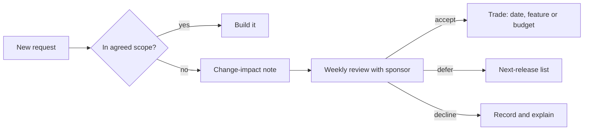

## Start with nine small requests

Ellery Logistics, a fictional parcel carrier, agreed a six-week build of a route-planning dashboard for its depot managers. In week two, a manager asked for a column showing driver breaks. In week three, another asked to export the plan to a spreadsheet. Then a mobile view, a print layout, two more filters, a colour for late routes, a second depot's time zone and a weekly summary email.

Each request took between half a day and two days. Each was reasonable, and each was agreed in a corridor. By week five the team had added about three weeks of work, the six-week date had gone, and the sponsor asked why nobody had told her.

Nobody had decided to grow the project. It grew one small yes at a time. Call this **death by small must-haves**.

> **What you'll learn**
>
> - Keep assumption, dependency and exclusion logs, and validate assumptions early.
> - Write a change-impact note for every request that moves scope.
> - Handle a request the customer says was "always implied".
> - Agree go and no-go criteria before the date arrives.

## Three logs that protect the scope

A scope document says what will be built. Three short logs say what it rests on. Keep them in one shared place the sponsor can read.

| Log | What goes in it | Ellery example |
| --- | --- | --- |
| Assumptions | Things believed true but not yet checked, with an owner and a date to check by | Depot data arrives by 05:00 each day |
| Dependencies | Things another team or system must deliver, with the date needed | IT grants read access to the vehicle tracking feed by week 1 |
| Exclusions | Things deliberately left out, agreed with the sponsor | No mobile view, no second depot, no driver-facing screens |

*Table 1: The three logs. An unlogged assumption becomes a surprise. An unlogged exclusion becomes "always implied".*

Each assumption needs a check, not only a record. Give it an owner and a date, and test the riskiest first: if depot data arrives at 06:30 instead of 05:00, every plan is late and the dashboard is useless for morning dispatch. A one-day check in week one costs far less than finding out in week five.

The exclusions log does the most work against scope creep. A request that matches a logged exclusion is plainly a change, and nobody has to argue about it.

## A change-impact note for every change

Every request that is not in the agreed scope gets a short **change-impact note** before anyone says yes. It takes ten minutes to write and answers five questions:

1. **What is asked, and by whom?**
2. **Why do they need it?** The reason helps find a cheaper version.
3. **What does it cost?** Effort in days, and any new dependency or risk.
4. **What does it move?** The date, another feature, or the budget.
5. **Who decides, and by when?** Usually the sponsor.

The note is not a way to say no. Many changes are worth doing. It makes the trade visible so that the person who owns the budget chooses it.

The switcher replays Ellery's week three under two habits.

A depot manager asks for a spreadsheet export in week three. Compare saying yes in the corridor with writing a change-impact note.

<button type="button" data-mode="corridor" aria-pressed="false" aria-controls="corridor-result">Corridor yes</button>
<button type="button" data-mode="note" aria-pressed="false" aria-controls="note-result">Change-impact note</button>

<section id="corridor-result" class="mode-panel" data-announcement="Corridor yes selected. Nine requests add three weeks unseen."><h4>Corridor yes</h4><ul><li>The developer agrees and builds the export in two days.</li><li>Eight more requests follow the same way.</li><li>In week five, the sponsor learns the date has slipped three weeks.</li></ul>
Every request was reasonable. Nobody decided the trade.
</section>
<section id="note-result" class="mode-panel" data-announcement="Change-impact note selected. The sponsor ranks the requests and keeps the date."><h4>Change-impact note</h4><ul><li>The export gets a note: 2 days, moves the date by 2 days or replaces the print layout.</li><li>The sponsor reviews all requests weekly and ranks them.</li><li>Three go in, six go to a second release, and the six-week date holds.</li></ul>
The managers get the three features they valued most, on time.
</section>

Batching helps. Review all open change notes in one weekly slot with the sponsor, instead of deciding each one in the moment. Small requests are easier to judge side by side.

> **Pitfall:** Absorbing small changes to look helpful. Each one is cheap, but the total is not, and the sponsor loses the chance to choose.

## "It was always implied"

Some requests arrive as corrections: "Of course it has to work on a phone. That was always implied." The customer is not lying. They assumed something they never said, and the scope document did not exclude it.

Handle it in three steps:

1. **Check the record.** Look at the requirements, exclusions log and meeting notes. If the exclusion is logged and agreed, show it calmly.
2. **Ask about the need, not the history.** Who needs the phone view, when, for what? Often a smaller version covers it, such as one read-only page.
3. **Treat it as a change.** Write a change-impact note, even if your company absorbs the cost as goodwill. The record keeps the next request honest.

If the record is silent, share the cost. Arguing about who should have written it down wastes more time than the feature. Add the missing exclusions to the log so the same gap cannot recur.

## Small must-haves that add up

Death by small must-haves is hard to spot from inside, because no single request looks like a problem. Watch the totals instead:

- **Track added effort weekly.** Sum the days added by all accepted changes, and show it on the status report.
- **Set a change budget.** For example, 10% of the build effort for small changes. Once it is spent, every further request trades against something already planned.
- **Watch the trend.** If added effort grows each week, the discovery missed something. Stop and ask what.

Figure 1 shows how requests move from arrival to decision.

*Figure 1: Every out-of-scope request gets a note and a decision. Nothing reaches the build without passing the sponsor.*

## Go and no-go criteria

A go-live decision made on the day is made under pressure. Agree the criteria at the start, when everyone is calm, and write them as checks someone can pass or fail:

- **Must pass:** the acceptance criteria for the core stories, the agreed performance targets at peak load, the security review, a tested rollback.
- **Must exist:** a named owner, a runbook, monitoring with alerts, trained users.
- **Can wait:** features on the next-release list, cosmetic issues with a workaround.

On the day, walk the list. If a must-pass item fails, the answer is no-go or a smaller go, such as one depot instead of five. A smaller go keeps momentum without shipping a known failure. The [role-gated stage gates](../../../../01_Concept_Tutorials/Consolidated_Lessons/T6.3_Delivery_Six_Stages_Gates_and_Two_Week_Launch/03_Role_Gated_Stage_Gates.md) lesson covers the gates across a whole engagement.

## Limits of this lesson

- **Process can feel bureaucratic.** On a two-week prototype, one shared list and a daily check with the sponsor may be enough. Scale the logs to the engagement.
- **Contracts vary.** Fixed-price and time-and-materials engagements treat changes differently. Know which you are in.
- **Fictional data.** Ellery Logistics and its figures are illustrative.

## Interview angle

Each answer is an outline to say in about two minutes. Open each question and try it aloud before reading.

Interview question 1. How do you keep track of assumptions, and validate them?

- **Answer:** Keep an assumption log with each item's owner and a date to check it by. Rank them by what breaks if they are wrong, and test the riskiest in the first week with a small, cheap check, such as watching when the data actually arrives. Move confirmed ones to facts and turn failed ones into changes or risks.
- **Trade-off:** Checking takes time early, when the team wants to build. An unchecked assumption fails late, when changing course costs most.
- **Follow-up to expect:** "Give an example." Data arriving by 05:00 for a morning dashboard, checked by logging arrival times for a week.

Interview question 2. What do you track besides the scope itself?

- **Answer:** Three logs: assumptions, dependencies with the date each is needed, and exclusions agreed with the sponsor. Plus a change log with a short impact note per request. The exclusions log prevents the most arguments, because it shows a request is a change without debate.
- **Trade-off:** Logs take a little time each week. Without them, every disagreement becomes one person's memory against another's.
- **Follow-up to expect:** "Who reads them?" The sponsor, weekly, as part of the status review.

Interview question 3. How do you handle scope creep and decide go or no-go?

- **Answer:** Every out-of-scope request gets a change-impact note: what, why, cost, what it moves, who decides. The sponsor reviews them weekly and trades each against date, features or budget. For go-live, I agree must-pass checks at the start. On the day, a failed check means no-go or a smaller go.
- **Trade-off:** Saying no to small requests can strain goodwill. Accepting all of them quietly moves the date without anyone choosing it.
- **Follow-up to expect:** "The sponsor wants everything and the date." Show the total added effort and ask which to defer.

Interview question 4. The customer says a feature you did not build was "always implied". What do you do?

- **Answer:** Check the record first: requirements, exclusions and notes. Then ask about the need behind it, because a smaller version often covers it. Treat it as a change with an impact note, even if we absorb the cost. If the record is silent, share the cost and add the gap to the exclusions log.
- **Trade-off:** Holding the line protects the plan but risks the relationship. Absorbing everything invites the next "implied" request.
- **Follow-up to expect:** "They threaten to escalate." Escalate it yourself first, with the record and options.

Interview question 5. Many small must-have requests are piling up. How do you stop them sinking the date?

- **Answer:** Track the total they add each week and show it on the status report. Set a change budget, such as 10% of build effort, and once it is spent every request trades against planned work. Review them together with the sponsor weekly so small items can be ranked side by side.
- **Trade-off:** A budget can feel rigid. Without one, each request looks too small to refuse.
- **Follow-up to expect:** "The requests keep growing." Stop and ask what discovery missed, because a rising trend means the scope was wrong.

## References

1. The site's [requirements you can test](01_Requirements_You_Can_Test.md) lesson, for the requirements the scope rests on.
2. The site's [estimates people can trust](../../../../01_Concept_Tutorials/Consolidated_Lessons/T6.2_Scoping_an_FDE_Project/05_Estimates_People_Can_Trust.md) lesson, for re-estimating when facts change.
3. The author's own field experience, the basis for the three logs, the change-impact note and the change budget.

## Key takeaways

- Keep assumption, dependency and exclusion logs, and test the riskiest assumptions in week one.
- Write a change-impact note for every out-of-scope request, and let the sponsor decide.
- Treat "always implied" requests as changes, and add the gap to the exclusions log.
- Watch the total added effort, not each request, and set a change budget.
- Agree must-pass go-live checks at the start. A failed check means no-go or a smaller go.

## Check yourself

1. Why did Ellery's sponsor not know the date had slipped until week five?

Each request was agreed informally with no note, so the total added effort was never reported or decided.

2. Which log most often settles a scope argument, and why?

The exclusions log. A request that matches an agreed exclusion is plainly a change, with no debate about memory.

3. What is a smaller go?

Going live with part of the scope, such as one site, when a must-pass check fails for the rest. It keeps momentum without shipping a known failure.

