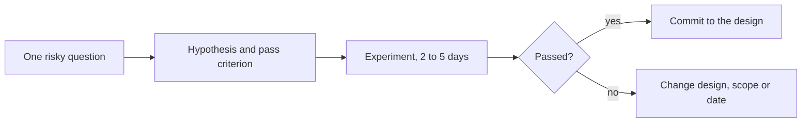

## Start with the sandbox that lied

Bramwell Manufacturing, a pump maker, wanted a tool that predicted which machines would need repair, built on its maintenance work orders. Its FDE was given a sandbox of 5,000 work orders, each with a machine ID, a fault code and a closing date, and had a working prototype in two weeks. Then production access arrived: 410,000 work orders over twelve years. A third had no fault code, because technicians typed the fault into a free-text note. Machine IDs had changed format in 2019. The legacy work-order system allowed one export a night, and its only administrator worked there two days a week. The prototype's design survived, but the date did not: the data work alone took six more weeks. Someone had picked clean records to make the demo easy. Call this **the clean sample**.

> **What you'll learn**
>
> - Audit the applications, data, APIs and infrastructure an engagement depends on.
> - Profile data for availability, quality and representativeness.
> - Confirm credentials, permissions, network paths and platform limits early.
> - Handle legacy systems and undocumented scripts.
> - Design short, time-boxed experiments for the riskiest unknowns.

## What a readiness audit covers

A **readiness audit** checks, before any date is promised, whether what the design depends on exists and works as assumed. It covers four areas:

| Area | Questions to answer | Evidence to collect |
| --- | --- | --- |
| Applications | Which systems are involved, who owns each, how are they changed? | System list with owners, change process, release windows |
| Data | Where is it, how much, how good, who may use it? | A profile of a real extract, data owner sign-off |
| Interfaces | Which APIs, exports or files exist? Their limits and formats? | Documentation, a test call, rate limits, export schedules |
| Infrastructure | Where will it run, what network paths, what platform limits? | Network diagram, firewall rules, quotas, environments |

*Table 1: The four areas of a readiness audit. Each row ends in evidence, not a verbal assurance.*

The audit also finds **dependencies** and the **source of truth** for each fact the design uses. At Bramwell, machine details lived in both the work-order system and the asset register. The asset register was the system of record. The tool joined to it instead of trusting the copy in work orders. The lesson on [stakeholder and workflow maps](../../../../01_Concept_Tutorials/Consolidated_Lessons/T6.1_Customer_Discovery_and_Problem_Decomposition/07_Stakeholder_and_Workflow_Maps.md) covers choosing the source of truth.

## Data readiness: profile the real thing

**Data profiling** means measuring a dataset before trusting it. Profile a real production extract, not a sample someone chose. Three questions decide whether data is ready:

- **Is it available?** Can you get it, how often, how far back, with whose approval?
- **Is it good enough?** Missing values, duplicates, inconsistent formats, impossible values such as a repair closed before it opened.
- **Is it representative?** Does it cover all sites, years, product types and the rare cases the tool must handle?

The switcher compares Bramwell's sandbox profile with its production profile.

The same profiling queries, run on the sandbox and on a production extract. The figures are illustrative.

<button type="button" data-mode="sandbox" aria-pressed="false" aria-controls="sandbox-result">Sandbox</button>
<button type="button" data-mode="production" aria-pressed="false" aria-controls="production-result">Production extract</button>

<section id="sandbox-result" class="mode-panel" data-announcement="Sandbox selected. Clean, small, two years."><h4>Sandbox</h4><ul><li>5,000 work orders from one plant, 2023 to 2024.</li><li>Fault code present on 100% of records.</li><li>One machine ID format.</li></ul>
Looks ready. It was picked to look ready.
</section>
<section id="production-result" class="mode-panel" data-announcement="Production extract selected. Large, gappy, two ID formats."><h4>Production extract</h4><ul><li>410,000 work orders from four plants, 2013 to 2024.</li><li>Fault code missing on 34%, written in free text instead.</li><li>Machine IDs changed format in 2019. 2% close before they open.</li></ul>
Usable after six weeks of cleaning and a text-extraction step.
</section>

Ask for the production extract, or a random sample of it, in week one. If the data owner refuses, profile it inside their environment with them, and record the delay as a risk to the date.

> **Pitfall:** Building on a curated sample. Ask who chose the sample and how. The answer is often "the good ones".

## Access, permissions and limits

Access often stalls FDE work, because it needs approvals from several teams. Confirm every item in week one, with a working test, not a promise:

- **Credentials and accounts** for each system, including service accounts for automated jobs.
- **Permissions** at the right level: read only where possible, and the specific tables or APIs needed.
- **Network paths** from where your code runs to each system, through firewalls and proxies.
- **Platform limits**: API rate limits, export schedules, storage and compute quotas, maximum file sizes.
- **Environments**: whether a sandbox exists, how it differs from production, and how code moves between them.

**Sandbox versus production** deserves its own check. Sandboxes often have older software versions, fewer records, no rate limits and different permissions. Run at least one read against production early, even a small one, to find the differences while there is time.

While access is pending, keep moving: build against synthetic data shaped like the real schema, write the tests, and prepare the deployment. Report the dependency and its date to the sponsor every week.

## Legacy systems and undocumented scripts

Old systems carry knowledge nobody wrote down. At Bramwell, the work-order system's administrator knew which fields were reliable and which nightly job rebuilt the summary tables. Two patterns need care:

- **A scarce expert.** Book their time early and use it for questions only they can answer. Record every session and turn it into documentation the customer keeps. Ask their manager to protect those hours.
- **Undocumented scripts.** Nightly jobs that change data nobody remembers. Before integrating, list scheduled jobs on the server, read what each one touches, and watch one night's run. A script that rewrites a table at 02:00 will break anything that reads it at 02:05.

When replacing parts of an old system, change it gradually. Martin Fowler's patterns for legacy displacement describe moving one capability at a time while the old system keeps running.

## Time-boxed experiments

Some unknowns cannot be settled by reading documents. Run a short **feasibility experiment**: a fixed number of days, one question, and a decision at the end. Figure 1 shows the shape.

*Figure 1: A time-boxed experiment. The pass criterion is written before the work starts, so the result cannot be argued afterwards.*

Two experiments Bramwell ran:

- **Incremental sync on a legacy API.** Question: can we fetch only work orders changed since the last run? Pass criterion: a "modified since" query returns all and only changed records over three nights, checked against a full export. Result: it missed records edited by the nightly script, so the team added a weekly full reconciliation.
- **Events or periodic exports.** Question: does the system emit change events we can subscribe to, or must we read exports? Pass criterion: events arrive within five minutes for 99% of changes over a week. Result: no events existed. The design used nightly exports, which met the next-morning requirement.

Test usability alongside feasibility where you can. Show the experiment's output to two technicians. A feasible feature they would not use is not worth building.

## Limits of this lesson

- **Readiness costs time.** One to two weeks of audit and experiments can feel slow to a sponsor who wants a date. Show what each check protects.
- **You will still miss things.** An audit lowers the risk. It does not remove it. Keep contingency in the plan.
- **Composite engagement.** Bramwell Manufacturing and its figures are illustrative, not a real customer.

## Interview angle

Each answer is an outline to say in about two minutes. Open each question and try it aloud before reading.

Interview question 1. Before committing to a delivery date, what do you audit in the customer's environment?

- **Answer:** Four areas: the applications involved and their owners and change rules, the data and its quality, the interfaces and their limits, and the infrastructure, network and environments. For each I want evidence, such as a test call or a profiled extract, not an assurance. I also note which system is the source of truth for each fact.
- **Trade-off:** An audit delays the date by a week or two. Skipping it moves the delay to the middle of the build.
- **Follow-up to expect:** "What do you check first?" Access and real data, because those stall projects most often.

Interview question 2. How do you run an architecture and integration audit?

- **Answer:** List every system the design touches with its owner. For each, confirm how we connect, what format and limits apply, how changes are released, and what runs on it at night. Draw the data flows and mark the source of truth for each fact. Then make one real call or export per interface to confirm.
- **Trade-off:** Testing every interface takes days. Untested ones fail when the deadline is close.
- **Follow-up to expect:** "Documentation exists." Test it anyway. Documentation drifts from the system.

Interview question 3. How do you judge whether the customer's data is ready?

- **Answer:** Profile a real production extract for availability, quality and representativeness: can we get it and how often, how many values are missing or inconsistent, and does it cover every site, period and rare case. Compare with what the design assumes, and size the cleaning work before giving a date.
- **Trade-off:** Profiling the full extract takes access and time. A curated sample is faster and usually misleading.
- **Follow-up to expect:** "They only give you a sample." Ask how it was chosen, and request a random one.

Interview question 4. What access, permission and platform checks do you do in the first week?

- **Answer:** Credentials and service accounts for each system, least-privilege permissions on exactly what we need, network paths from where the code will run, platform limits such as API rates and quotas, and how sandbox differs from production. Each one confirmed with a working test, not an email saying it is done.
- **Trade-off:** Chasing access is slow and dull. Every week of delay here is a week off the build.
- **Follow-up to expect:** "Access will take three weeks." Build on synthetic data meanwhile and report the dependency weekly.

Interview question 5. How do you use feasibility experiments?

- **Answer:** For each unknown that documents cannot settle, run a time-boxed experiment of two to five days with one question and a pass criterion written first. At the end, commit to the design or change the design, scope or date. Where possible, show the output to users too. That tests feasibility and usefulness together.
- **Trade-off:** Experiments delay building. They are cheaper than discovering the same answer in week six.
- **Follow-up to expect:** "Give an example." Testing whether a legacy API's "modified since" query returns every changed record.

## References

1. Martin Fowler and others, [Patterns of legacy displacement](https://martinfowler.com/articles/patterns-legacy-displacement/), accessed 17 November 2026. Replacing old systems one capability at a time.
2. The site's [stakeholder and workflow maps](../../../../01_Concept_Tutorials/Consolidated_Lessons/T6.1_Customer_Discovery_and_Problem_Decomposition/07_Stakeholder_and_Workflow_Maps.md) lesson, for choosing the source of truth.
3. The site's [managing change and scope creep](02_Managing_Change_and_Scope_Creep.md) lesson, for the assumption and dependency logs.
4. The author's own field experience, the basis for the audit areas, the access checks and the experiment format.

## Key takeaways

- Audit applications, data, interfaces and infrastructure, with evidence, before giving a date.
- Profile a real production extract for availability, quality and representativeness.
- Confirm access, permissions, network paths and limits with working tests in week one.
- Protect scarce experts' time and read undocumented scripts before integrating.
- Settle risky unknowns with time-boxed experiments and pass criteria written first.

## Check yourself

1. Why did Bramwell's prototype work in the sandbox and slip in production?

The sandbox was a curated, clean sample. The production data had missing fault codes, changed ID formats and twelve years of history.

2. Why read the scheduled jobs on a legacy server before integrating?

Undocumented scripts can change data on a schedule, such as rewriting a table at night, and break anything that reads it at the wrong time.

3. Why write the pass criterion before the experiment starts?

So the result settles the question. A criterion written afterwards can be bent to fit whatever happened.

