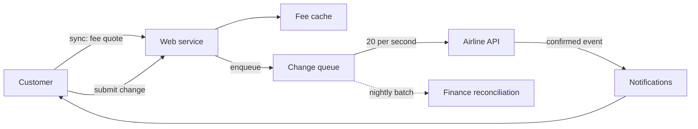

## Start with nine o'clock

Ansel Travel, a travel agency, had its FDE build a service that let customers change flight bookings online. Each change called an airline's booking API, and in testing, at a few requests a second, it worked. On the first Monday the agency's 09:00 email went out, and requests jumped from about 5 a second to 50 a second for ten minutes. The airline's API allowed 20 a second and rejected the rest. About 18,000 changes failed in ten minutes, retries made it worse, and the call centre took the overflow. The requirements had said "handle peak load". Nobody had written down the peak, the airline's limit, or what should happen to a request the airline could not take yet. Call this **the unsized peak**.

> **What you'll learn**
>
> - Choose synchronous, queued, batch or event integration for each need.
> - Compare an upstream rate limit with the throughput you need.
> - Estimate capacity with Little's law.
> - Design for a daily spike instead of the daily average.

## One pattern per need, not per system

Requirements describe needs: a customer waiting for an answer, a request that must not be lost, a nightly total, a change other systems should hear about. Each need suits a different **integration pattern**:

| Pattern | How it works | Fits when | Ansel example |
| --- | --- | --- | --- |
| Synchronous | Caller waits for the answer | A user needs the result now, and the call is fast and reliable | Showing the fee for a change |
| Queued | Request is stored and processed when capacity allows | It must not be lost, and a short delay is acceptable | Submitting the booking change |
| Batch | Records are collected and processed on a schedule | Large volumes, no urgency, a daily or hourly result | Nightly reconciliation with finance |
| Event | A system announces a change and others subscribe | Several systems react to the same change, and the sender should not know them all | Notifying the customer when the airline confirms |

*Table 1: Four integration patterns. One system often uses several, one per need.*

The book *Enterprise Integration Patterns* by Gregor Hohpe and Bobby Woolf catalogues these and many variants. The main choice is simpler than the catalogue: does someone wait for the answer, and can the request be lost?

Synchronous calls are simplest to build and debug, but they tie the caller's speed and availability to the slowest system in the chain. Queues add moving parts, yet they let each side run at its own pace and survive the other side being down for a while.

## Rate limits against throughput

A **rate limit** is the most requests an upstream system will accept in a period. Before choosing a pattern, compare it with the throughput you need at peak, not on average:

- **Required throughput at peak:** 50 requests a second for 10 minutes at Ansel.
- **Upstream limit:** 20 requests a second.
- **Gap:** 30 requests a second that cannot be served when they arrive.

There are four ways to close a gap like that, and most designs use more than one:

1. **Queue and smooth.** Accept requests at once, store them, and send them upstream at 20 a second.
2. **Reduce calls.** Cache answers that do not change often, and combine requests where the API allows.
3. **Raise the limit.** Ask the upstream owner, with numbers. Sometimes a higher tier costs money.
4. **Shape the demand.** Stagger the 09:00 email over an hour, which flattens the spike at its source.

Respect the limit with **backoff**: when the upstream signals overload, wait longer before each retry, and add some randomness so all clients do not retry together. Google's guidance on rate limiting describes these techniques.

The switcher compares Ansel's 09:00 spike with direct calls and with a queue in front of the airline.

From 09:00 to 09:10, 50 change requests arrive each second. The airline accepts 20 a second. Normal traffic is 5 a second.

<button type="button" data-mode="direct" aria-pressed="false" aria-controls="direct-result">Direct calls</button>
<button type="button" data-mode="queued" aria-pressed="false" aria-controls="queued-result">Queue in front</button>

<section id="direct-result" class="mode-panel" data-announcement="Direct calls selected. About 18,000 requests fail."><h4>Direct calls</h4><ul><li>20 requests a second succeed. 30 a second are rejected.</li><li>About 18,000 changes fail in ten minutes, and retries add load.</li><li>Customers see errors and phone the call centre.</li></ul>
No change is lost by the system, because none was accepted. They are lost to the customer.
</section>
<section id="queued-result" class="mode-panel" data-announcement="Queue in front selected. Backlog of 18,000 clears by about 09:30."><h4>Queue in front</h4><ul><li>Every request is accepted and confirmed as received.</li><li>The backlog peaks at about 18,000 at 09:10, then drains at 15 a second.</li><li>It clears by about 09:30. The longest wait is about 15 minutes, with an email when confirmed.</li></ul>
Nothing fails. Some customers wait, and they are told so.
</section>

The queue numbers come from simple arithmetic. During the spike, 30 extra requests a second build up for 600 seconds, which is 18,000. Afterwards, the airline takes 20 a second while 5 new ones arrive, so the backlog falls by 15 a second and clears in 1,200 seconds, 20 minutes.

## Sizing capacity with Little's law

**Little's law** links three quantities for any stable system: the average number of items in the system equals the arrival rate multiplied by the average time each item spends there.

> L = λ × W, where L is items in the system, λ is the arrival rate and W is the time each item spends inside.

It answers capacity questions without a simulation:

- **Concurrent calls to the airline.** Ansel sends 20 calls a second, and each takes 0.5 seconds. L = 20 × 0.5 = 10 calls in flight. The worker pool needs at least 10 concurrent connections, plus headroom.
- **Concurrent fee lookups.** Customers request 100 fee quotes a second at peak, each taking 0.8 seconds. L = 100 × 0.8 = 80 requests in progress, which sizes the web servers and the connection pool.

The law holds for averages over a stable period. For a spike, apply it to the spike's rate, as above, and add headroom for variation. A pool sized to the exact average runs out of capacity on the first busy second.

## Designing for the daily spike

Daily averages hide the hours that matter. Ansel averaged about 5 requests a second over the day. Sizing for that would have failed every morning. Ask for traffic by hour, find the peak, and design for it:

- **Find the ratio.** Ansel's peak was about ten times the daily average. Peaks like this follow a scheduled email or the start of a working day.
- **Decide what may be slow.** Fee lookups must stay fast. Submitted changes can wait minutes if the customer is told.
- **Scale what must be fast.** Web servers and caches for the synchronous path, scaled ahead of 09:00 on a schedule if auto-scaling reacts too slowly.
- **Queue what can wait.** The queue absorbs the spike for the rate-limited path.

Figure 1 shows Ansel's resulting design.

*Figure 1: Ansel's design after the first Monday. Each need uses its own pattern: synchronous quotes from a cache, a queue in front of the rate-limited airline, events for confirmation and a nightly batch for finance.*

The deeper treatment of queues, back-pressure and retries sits in the site's system design modules. This lesson covers the field decision: which pattern each requirement needs, and whether the numbers fit.

## Limits of this lesson

- **Little's law needs a stable system.** If arrivals exceed capacity for long, the queue grows without limit and averages stop meaning anything.
- **Queues move problems.** Messages can fail after acceptance. Plan dead-letter handling and tell users the real status.
- **Composite engagement.** Ansel Travel and its figures are illustrative, not a real customer.

## Interview angle

Each answer is an outline to say in about two minutes. Open each question and try it aloud before reading.

Interview question 1. How do you go from a set of requirements to an architecture?

- **Answer:** Take each need and ask two questions: does someone wait for the answer, and can the request be lost? That picks synchronous, queued, batch or event for each one. Then check the numbers: peak throughput against upstream limits, and capacity with Little's law. Draw it, and trace one request of each kind through.
- **Trade-off:** One pattern everywhere is simpler to build. Mixing patterns fits each need but adds parts to operate.
- **Follow-up to expect:** "Where do you start?" With the non-functional requirements, because they drive the pattern choices.

Interview question 2. How do you plan capacity before real traffic arrives?

- **Answer:** Get traffic by hour from the closest existing system and find the peak. Use Little's law for concurrency: arrival rate times time per request gives requests in flight, which sizes worker pools and connections. Add headroom, then load-test at the peak before launch.
- **Trade-off:** Sizing for the peak costs more infrastructure. Sizing for the average fails at the busiest hour.
- **Follow-up to expect:** "No traffic data exists." Estimate from business volumes and the timing of whatever triggers use, and say it is an estimate.

Interview question 3. The upstream API allows 20 requests a second and you need 50 at peak. What do you do?

- **Answer:** Put a queue in front and send at the limit, with backoff on errors. Reduce calls with caching where answers are stable. Ask the owner for a higher limit, with numbers. Look at shaping demand, such as staggering what triggers the spike. Then tell users the request is received and when to expect confirmation.
- **Trade-off:** A queue means some users wait. Direct calls mean some users fail.
- **Follow-up to expect:** "How long is the worst wait?" Backlog divided by the drain rate. Work it out aloud.

Interview question 4. When do you choose synchronous over asynchronous integration?

- **Answer:** Synchronous when a user needs the answer now and the downstream call is fast and reliable, such as a price lookup. Asynchronous when the work is slow, the downstream is rate-limited or unreliable, or the request must survive an outage, such as submitting an order.
- **Trade-off:** Synchronous is simpler to build and debug. Asynchronous is more resilient but needs status tracking and failure handling.
- **Follow-up to expect:** "The business wants instant confirmation." Confirm receipt instantly, and the outcome when it is known.

Interview question 5. Traffic is ten times higher for half an hour every morning. How do you design for it?

- **Answer:** Separate what must stay fast from what can wait. Scale the fast path ahead of the spike, on a schedule if auto-scaling is too slow, and cache what you can. Put a queue in front of rate-limited or slow work so it drains after the peak. Load-test at the spike rate, not the average.
- **Trade-off:** Pre-scaling costs money for capacity idle the rest of the day. Under-scaling fails at the hour that matters most.
- **Follow-up to expect:** "Can you flatten the spike instead?" Often yes, if the trigger is something the customer controls, such as an email send.

## References

1. Gregor Hohpe and Bobby Woolf, [Enterprise Integration Patterns](https://www.enterpriseintegrationpatterns.com/), accessed 17 November 2026. Messaging and integration patterns.
2. Google Cloud, [Rate-limiting strategies and techniques](https://cloud.google.com/architecture/rate-limiting-strategies-techniques), accessed 17 November 2026. Limits, backoff and retries.
3. Wikipedia, [Little's law](https://en.wikipedia.org/wiki/Little%27s_law), accessed 17 November 2026. Statement and conditions of the law.
4. The site's [requirements you can test](01_Requirements_You_Can_Test.md) lesson, for writing the peak and latency targets.

## Key takeaways

- Choose a pattern per need: does someone wait, and can the request be lost?
- Compare upstream rate limits with peak throughput, not the average.
- Close a rate gap by queueing, reducing calls, raising the limit or shaping demand.
- Use Little's law, L = λ × W, to size concurrency, and add headroom.
- Design for the daily spike: scale the fast path, queue what can wait.

## Check yourself

1. Why did Ansel's service pass testing and fail on the first Monday?

Testing used a few requests a second. The 09:00 spike reached 50 a second against an airline limit of 20, which nobody had written down.

2. Using Little's law, how many calls are in flight at 20 calls a second taking 0.5 seconds each?

L = 20 × 0.5 = 10 calls in flight on average.

3. After the spike, why does Ansel's backlog fall by 15 a second and not 20?

New requests keep arriving at 5 a second while the airline takes 20, so the net fall is 15.

