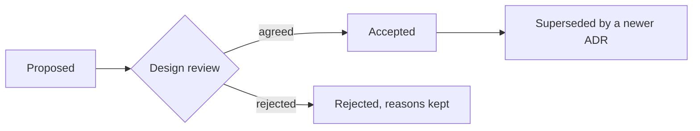

## Start with the design the sponsor approved

Merrow Housing, a fictional housing association, wanted tenant repair requests sent automatically to its contractors' job system. The FDE team proposed a small integration service on a virtual machine: quick to build, and the team knew the tools. The sponsor approved it in a steering meeting in week two.

In week four, the design went to Merrow's platform engineering team for a security review. They rejected it. Every integration at Merrow ran on a managed integration platform the team supported. A standalone virtual machine meant patching, monitoring and on-call duty that nobody had agreed to take. The team had to rebuild on the platform, and two weeks were lost.

The design was sound and the approval was real. The people who would run it had not been asked. Call this **approval from the wrong room**.

> **What you'll learn**
>
> - Write an architecture decision record and keep it current.
> - Compare lower build effort against lower running effort.
> - Explain one design to sponsors, engineers and operations in their own terms.
> - Run a design review, and respond when engineers reject a design the sponsor approved.

## What a decision record holds

An **architecture decision record**, or ADR, is a short document that captures one significant design decision. Michael Nygard proposed the format in 2011: a numbered record per decision, kept with the code, in plain language. A typical ADR has six parts:

| Part | What it says | Merrow example |
| --- | --- | --- |
| Title and number | The decision in a phrase | ADR 004: Run the repairs integration on the managed platform |
| Status | Proposed, accepted, superseded or rejected | Accepted, superseding ADR 002 |
| Context | The forces: requirements, constraints, facts | All integrations must be supported by platform engineering |
| Options | The real alternatives considered | Virtual machine service; managed platform; contractor's own connector |
| Decision | What was chosen | Managed platform |
| Consequences | What follows, good and bad | Eight days to build instead of three; no new on-call duty |

*Table 1: The parts of an ADR. Options and consequences are the parts readers need most a year later.*

Write an ADR when a decision is hard to reverse, affects other teams, or will puzzle someone later. Keep it to a page. Never edit an accepted ADR to change its decision: write a new one that supersedes it, so the history stays readable. Figure 1 shows the lifecycle.

*Figure 1: An ADR's lifecycle. A rejected or superseded record stays in place. The reasoning behind every change is kept.*

For an FDE, ADRs serve a second purpose: they are part of the handover. When the engagement ends, the customer's engineers inherit the reasons, not only the system.

## Lower build effort or lower running effort

Many decisions trade effort now against effort later. Building fast on familiar tools is cheap this month. Running it can cost more every month after. Compare the total over the period the customer will run it.

| Option | Build effort | Running effort | Total over two years |
| --- | --- | --- | --- |
| Integration service on a virtual machine | 3 days | 2 days a month: patching, monitoring, on-call | 3 + 48 = 51 days |
| Managed integration platform | 8 days | About 2 hours a month, inside the platform team's support | 8 + 6 = 14 days |

*Table 2: Merrow's two options over two years. The figures are illustrative.*

The cheaper build was the more expensive system. The running effort also lands on a different team: the FDE builds it, and the customer runs it. That is the reason to count it, and the reason the customer's engineers must be in the decision.

Ask three questions about running effort: who will patch and monitor it, who is woken when it fails, and what skills does that need? If the answers are "nobody yet", the option is not finished.

## One decision, three audiences

The same decision means different things to different readers. Explaining it the same way to everyone loses most of them. The switcher shows the Merrow decision explained three ways.

One decision, the managed integration platform, explained to three audiences. The facts are the same. The emphasis changes.

<button type="button" data-mode="sponsor" aria-pressed="false" aria-controls="sponsor-result">Sponsor</button>
<button type="button" data-mode="engineers" aria-pressed="false" aria-controls="engineers-result">Engineers</button>
<button type="button" data-mode="operations" aria-pressed="false" aria-controls="operations-result">Operations</button>

<section id="sponsor-result" class="mode-panel" data-announcement="Sponsor selected. Cost, risk and date."><h4>For the sponsor</h4><ul><li>Five more days to build, about 42 fewer days of running effort over two years.</li><li>Supported by your platform team, so no new contract or on-call cost.</li><li>Go-live moves by one week.</li></ul>
Cost, risk and the date, in a minute.
</section>
<section id="engineers-result" class="mode-panel" data-announcement="Engineers selected. Components and failure handling."><h4>For the platform engineers</h4><ul><li>Two flows on the managed platform, using its standard connector for the contractor API.</li><li>Retries with backoff, and failed messages to the platform's dead-letter queue.</li><li>Secrets in the platform vault, deployed through your existing pipeline.</li></ul>
Components, failure handling and how it fits their standards.
</section>
<section id="operations-result" class="mode-panel" data-announcement="Operations selected. Alerts, runbook and ownership."><h4>For operations and support</h4><ul><li>An alert fires when more than ten requests fail in an hour.</li><li>The runbook covers replaying failed requests and contractor outages.</li><li>Platform engineering owns the flows. The repairs team owns the data.</li></ul>
What wakes them up, what they do and who owns what.
</section>

The ADR holds all three views in one record. In meetings, lead with the view the audience needs and keep the rest for questions.

## Running a design review

A **design review** is a meeting where the people who will build, secure and run a system examine the design before it is built. Run one before the sponsor approves, not after:

1. **Invite the right rooms.** The customer's platform, security and operations engineers, plus the sponsor's delegate.
2. **Send the ADR ahead.** Two days before, with the options and consequences.
3. **Walk one request through.** Including a failure, so reviewers see the behaviour, not a box diagram.
4. **Collect objections as questions.** For each: is it a standard, a constraint, a preference or a missing fact?
5. **Record the outcome in the ADR.** Accepted, or the changes needed and who owns them.

## When the engineers reject what the sponsor approved

If the review comes after approval, as at Merrow, a rejection puts the FDE between two parts of the customer. Handle it in order:

- **Listen for the reason.** A platform standard, a skills gap, a support burden or a security rule. Each needs a different response.
- **Check whether it is a constraint.** A published standard or a support model is a constraint. A preference can be discussed.
- **Revise the options.** Often a third option meets both needs, such as the contractor's own connector running on the platform.
- **Take any remaining conflict to the sponsor** with both views and the cost of each, and let them decide.
- **Fix the process.** Put the engineering review before approval from now on.

Never route around the engineers by escalating to get the original design forced through. They will run the system after you leave.

## Limits of this lesson

- **Not every decision needs an ADR.** Reserve them for choices that are hard to reverse, cross teams or will puzzle someone later.
- **Reviews can stall.** Set a decision date for each review, and take open points to the sponsor when it passes.
- **Fictional data.** Merrow Housing and its figures are illustrative.

## Interview angle

Each answer is an outline to say in about two minutes. Open each question and try it aloud before reading.

Interview question 1. What goes in an architecture decision record, and how do you present one design to technical and business audiences?

- **Answer:** Title, status, context, the options considered, the decision and its consequences, on one page, kept with the code. For business readers I lead with cost, risk and date. For engineers, with components, failure handling and fit with their standards. For operations, with alerts, runbook and ownership. The record holds all three views.
- **Trade-off:** Writing ADRs takes time during a busy build. Without them, the next team re-argues every decision.
- **Follow-up to expect:** "How do you change a decision?" Write a new ADR that supersedes the old one.

Interview question 2. One option is cheaper to build and the other is cheaper to run. How do you choose?

- **Answer:** Total both over the period the customer will run it, usually two or three years, and say who carries the running effort. Usually that is the customer's team, not mine. Ask who patches it, who is woken when it fails and what skills that needs. Choose with the customer's engineers in the room.
- **Trade-off:** The lower-running option often delays go-live. A quick build that nobody wants to run is a liability.
- **Follow-up to expect:** "The sponsor wants the faster go-live." Show the two-year totals and let them choose knowingly.

Interview question 3. The sponsor approved your design, and the customer's engineers reject it. What do you do?

- **Answer:** Find out why: a standard, a skills gap, a support burden or a security rule. Check whether it is a real constraint. Revise the options, looking for one that meets both needs, and take any remaining conflict to the sponsor with both views and costs. Then move engineering review before approval.
- **Trade-off:** Reworking costs time. Forcing the design through leaves a system its operators resist.
- **Follow-up to expect:** "The sponsor says overrule them." Explain who runs it after handover, and ask the sponsor to decide with that in view.

Interview question 4. Write the outline of an ADR choosing between a direct API call and a queue.

- **Answer:** Title: "Submit orders to the supplier through a queue". Context: the supplier API allows 20 requests a second and is down nightly, and orders must not be lost. Options: direct synchronous call, or queue with workers. Decision: the queue. Consequences: survives outages and peaks, but needs status tracking, dead-letter handling and an alert on backlog age.
- **Trade-off:** The direct call is simpler and gives instant results. The queue is more resilient and adds parts.
- **Follow-up to expect:** "When would you reverse it?" If the supplier offered a high-limit, highly available API and instant confirmation mattered more.

## References

1. Michael Nygard, [Documenting architecture decisions](https://www.cognitect.com/blog/2011/11/15/documenting-architecture-decisions), Cognitect, 2011, accessed 17 November 2026. The original ADR format.
2. ADR GitHub organisation, [Architectural decision records](https://adr.github.io/), accessed 17 November 2026. Templates and tooling.
3. The site's [from requirements to architecture](04_From_Requirements_to_Architecture.md) lesson, for the queue-or-direct choice.
4. The author's own field experience, the basis for the review steps and the response to a rejection.

## Key takeaways

- Write an ADR for decisions that are hard to reverse, cross teams or will puzzle someone later.
- Keep options and consequences in every ADR, and supersede rather than edit.
- Compare build effort and running effort over the system's life, and name who carries each.
- Explain one design to each audience in their terms, from one record.
- Review designs with the engineers who will run them before the sponsor approves.

## Check yourself

1. Why did Merrow lose two weeks despite a sound design and a real approval?

The people who would run the system were not asked before approval, and their platform standard ruled the design out.

2. Why is an accepted ADR superseded instead of edited?

So the history stays readable. Readers can see what was decided, when, and why it changed.

3. In Table 2, why was the cheaper build the more expensive system?

The virtual machine needed about two days of running effort a month. Over two years it cost 51 days against 14 for the managed platform.

