# FDE AI System Design: Rapid Revision Guide

> Purpose: Last-day revision for an AI/Agentic FDE problem-decomposition interview.
>
> Practise the decisions you need to make during the interview.

---

# 1. The Master Interview Flow

Whenever you get a vague prompt:

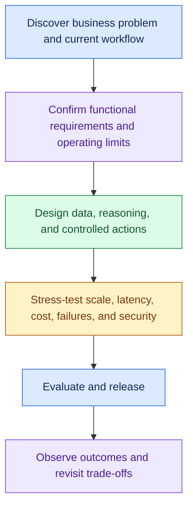

### Opening Line

- “What outcome matters, and how does the work happen today?”
- “Who uses it, at what volume, and which data and systems does it need?”
- “Should it answer, recommend, or act? What counts as success, and what limits must it respect?”

---

# 2. Discovery: What Should I Ask?

Remember:

- Why
- Today
- Who
- Scale
- Data
- Action
- Success
- Boundaries

### WHY

> What business problem are we solving and what outcome matters?

### TODAY

> How does this process work today and where are the biggest pain points?

### WHO + SCALE

> Who uses the system, how many users do we expect, and what are peak volume and concurrency?

### DATA

> What data does the system need, where does it live, and how fresh must it be?

### ACTION

> Does AI only answer/recommend, or can it take actions?

> Which actions require human approval?

### SUCCESS

> How will we measure success?

Think:

- Business KPI
- AI quality
- Task success
- Latency
- Reliability
- Cost

### BOUNDARIES

Ask about:

- Security
- Privacy
- Compliance
- Latency
- Availability
- Cost
- Integrations

---

# 3. Functional Requirements

Think:

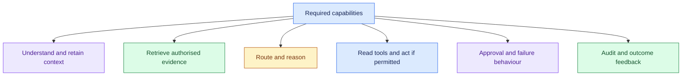

Typical requirements:

- Accept and understand requests
- Maintain relevant context
- Retrieve enterprise knowledge
- Respect user permissions
- Route to correct capability
- Call enterprise tools/APIs
- Execute approved actions
- Escalate risky/uncertain cases
- Handle failures
- Maintain audit trail
- Capture feedback

---

# 4. Non-Functional Requirements

Remember:

- Scale
- Latency
- Reliability
- Quality
- Security
- Safety
- Cost
- Observability
- Audit

- Confirm targets with the customer; label provisional assumptions.

- Define each service-level objective (SLO) with a metric, target, workload, and measurement window.

Example (the 5 seconds is a placeholder; confirm the real number with the customer):

- Vague request: “The system must be fast.”
- Measurable example: “P95 response latency below five seconds for interactive requests.”
- Confirm the target, workload, and measurement window with the customer.

---

# 5. Core Architecture Components

## API Gateway

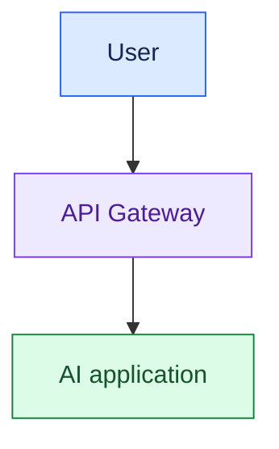

Handles:

- Authentication
- Authorisation
- Tenant Context
- User Rate Limits
- Quota
- Request Validation

Think:

> User → Application control

---

## Model Gateway

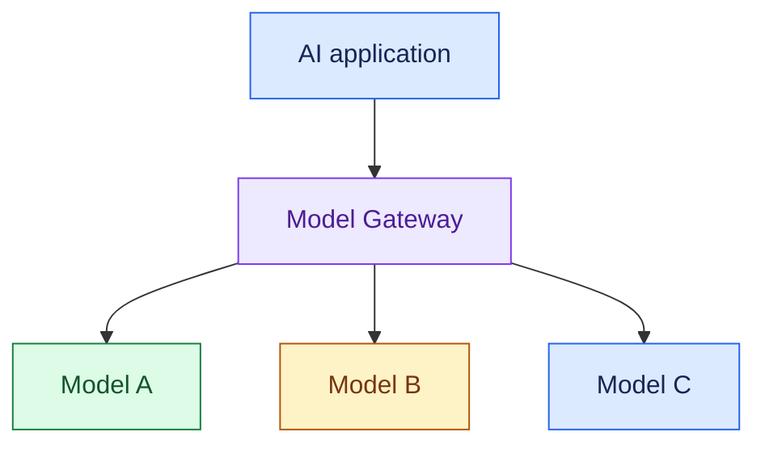

Handles:

- Model Routing
- Provider Abstraction
- Fallback
- Retry
- Provider Limits
- Tokens
- Cost

Think:

> Application → Model control

---

## Router

Determines:

- What capability should handle this request?

- Use deterministic rules/classifiers where possible.

---

## Orchestrator

Controls:

- Workflow
- State
- Branching
- Agents
- Tools
- Retries
- Checkpoints

---

## State Store

Stores durable:

- Session
- Workflow
- Agent
- Approval State

---

## Queue

Use when:

- Long-running work
- Traffic bursts
- Async processing
- Background jobs

---

## Cache

- Use for repeated safe work.

Remember:

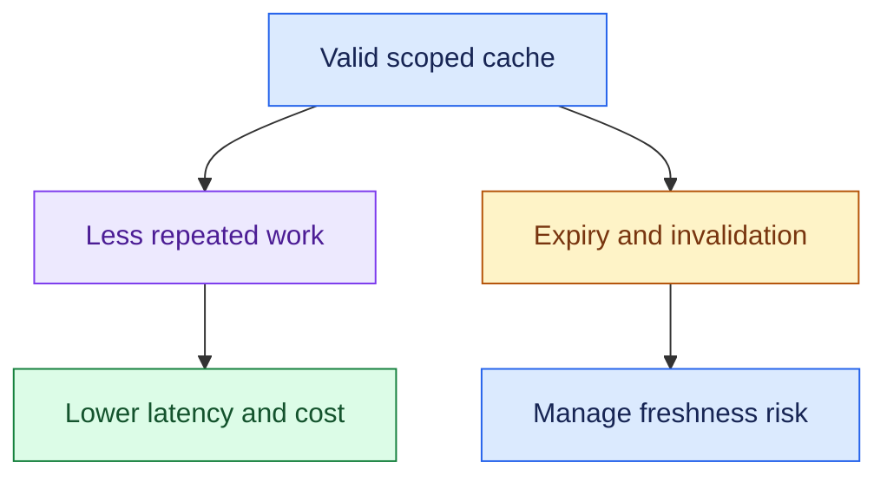

---

# 6. RAG: Rapid Version

## Ingestion

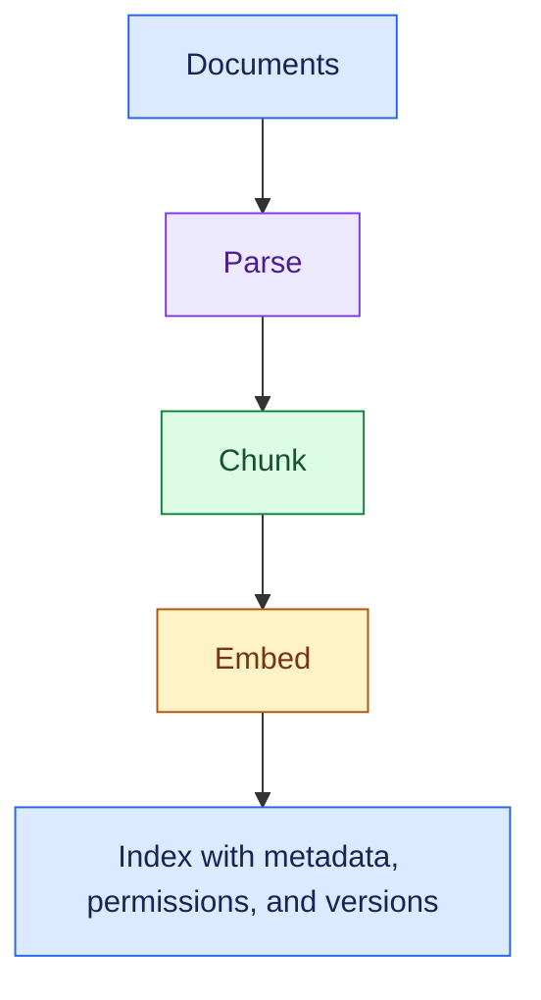

## Query

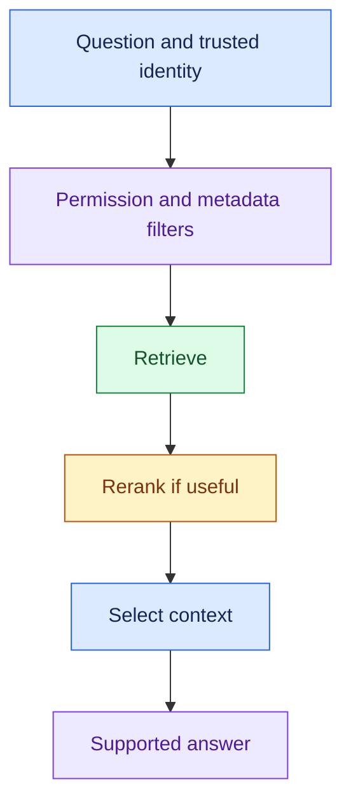

Remember:

### Recall

> Did I retrieve the relevant information?

### Precision

> How much retrieved information is relevant?

### Groundedness

> Is the answer supported by retrieved evidence?

### Static vs Live

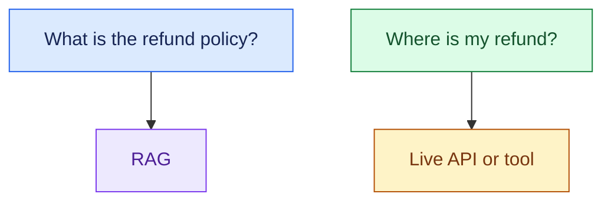

### Security rule

> Apply permissions during retrieval. Don't retrieve everything and ask the LLM not to expose unauthorised information.

---

# 7. Agentic Systems: Rapid Version

First ask:

> Do I need an agent?

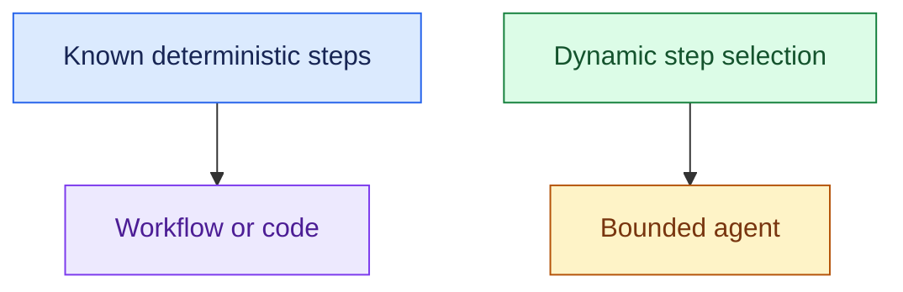

Then ask:

> Do I need multiple agents?

- Don't create multi-agent architecture without a reason.

### Agent loop

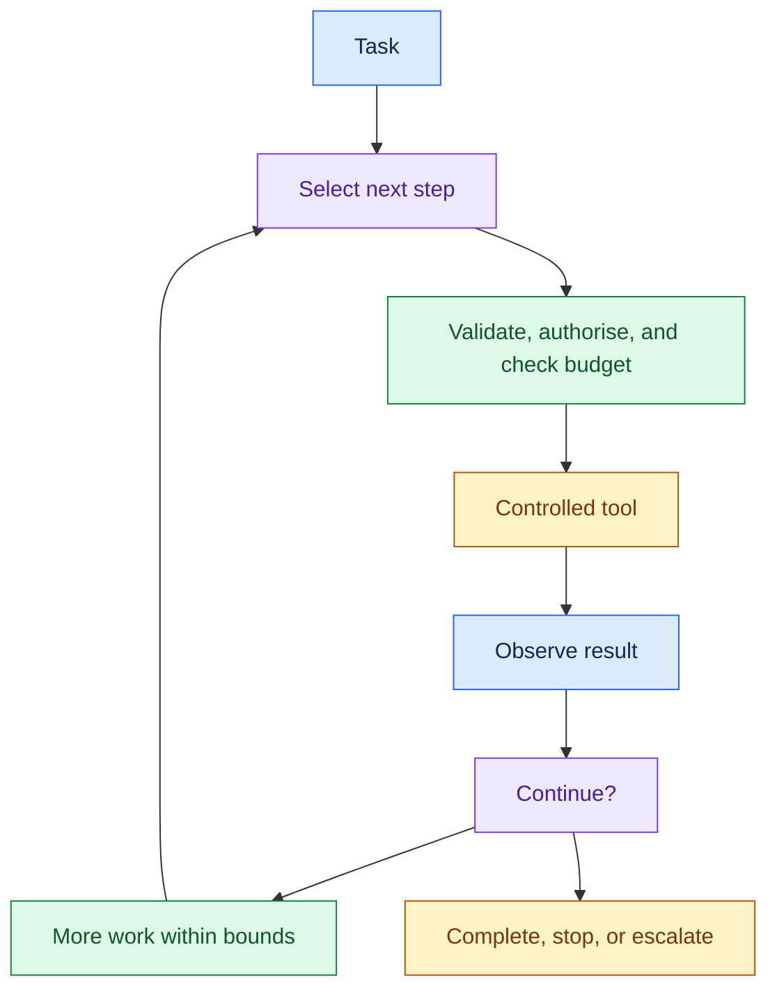

### Always bound agents

- Maximum steps
- Maximum tool calls
- Maximum tokens
- Maximum retries
- Maximum elapsed time
- Maximum cost

---

# 8. Tools & Actions

Prefer:

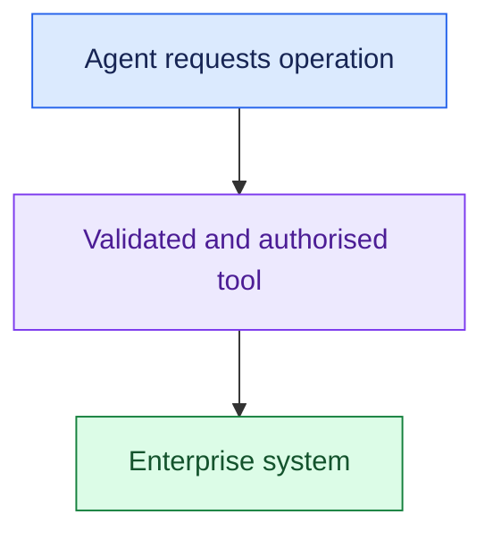

- Expose only approved operations with validated arguments and scoped access.

For business actions:

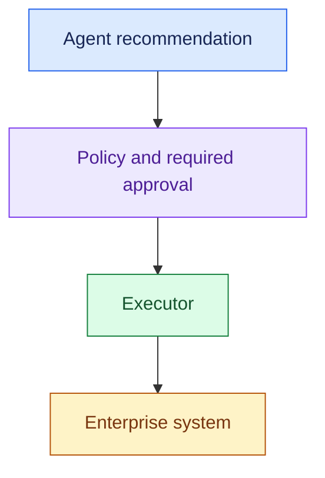

### Critical term: Idempotency

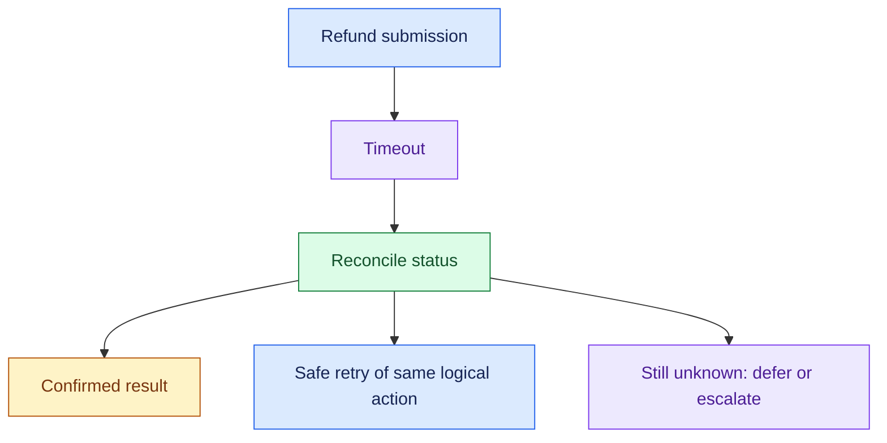

- Use an idempotency key that the execution path actually honours.

---

# 9. Guardrails & Human Approval

Remember:

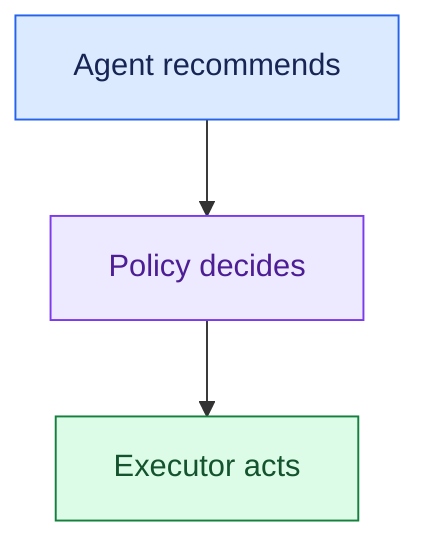

- Do not use the LLM as the final authority for deterministic business rules.

Example (illustrative thresholds; the customer sets the real ones, including the middle band):

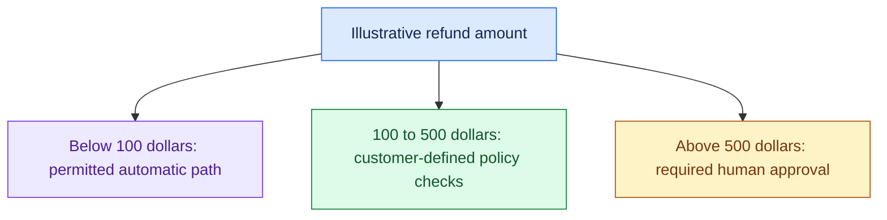

Other terms:

- Least Privilege
- Fail-Closed
- Kill Switch
- Defence in Depth

---

# 10. Scaling: Rapid Version

Interviewer says:

> "Now scale this to 100K users."

Think:

- Stateless Workers
- Horizontal Scaling
- Rate Limits
- Admission Control
- Queue
- Backpressure
- Fairness
- Tenant Isolation
- Caching
- Autoscaling

### Rate Limit

> May this user/tenant send this much traffic?

### Admission Control

> Does the system currently have capacity to accept this work?

### Backpressure

> How do we slow or stop upstream work when downstream capacity is full?

### Fair Queue

Prevent:

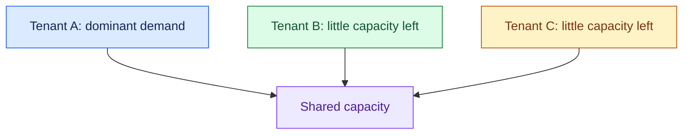

### Noisy Neighbour

- One tenant consumes shared resources and hurts others.

---

# 11. Latency: Rapid Version

First decompose:

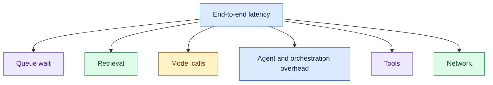

- Then optimise.

Remember:

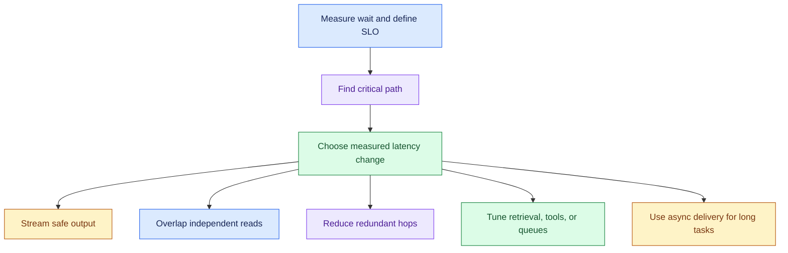

Track:

- P50
- P95
- P99
- TTFT

- Don't optimise only average latency.

---

# 12. Cost: Rapid Version

Break cost down:

- Model cost, including input and output tokens.
- Retrieval, tools, and compute.
- Retries and relevant review or rework.

Then:

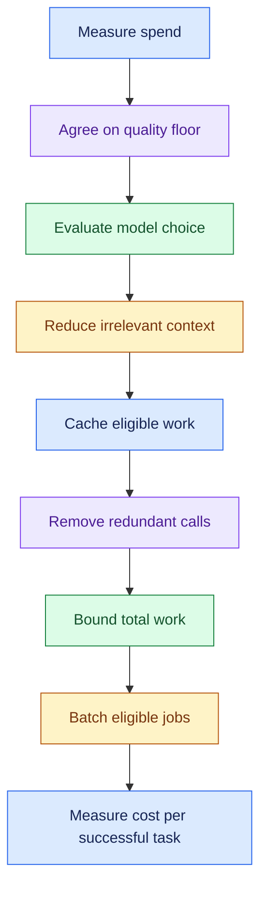

### Questions to ask

- Can a smaller model meet the quality requirement?
- Which context is irrelevant or duplicated?
- Can fresh, permission-safe results be reused?
- What does each model call contribute?
- Can code handle a known rule or validation?
- Is the agent repeating work without progress?

### Best metric

- Cost per successful task = total cost across attempts ÷ successful tasks.

> Cost per successful task: the one I'd lead with, because it counts retries and failed attempts.

---

# 13. Reliability: Rapid Version

When something fails:

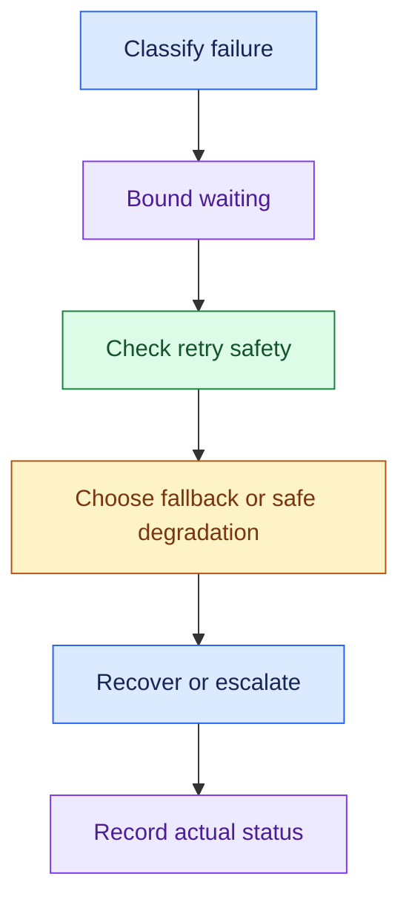

Know these:

### Timeout

- Set a dependency deadline within the task budget. A write timeout leaves the remote outcome uncertain.

### Retry

- Retry transient failures, and only when the call is safe to repeat.

### Exponential Backoff + Jitter

- Increase retry delays, add jitter, honour dependency guidance, and stop within the task budget.

### Circuit Breaker

```mermaid
flowchart TD
    N0["Repeated dependency failures"]
    N1["Stop normal calls temporarily"]
    N2["Probe recovery"]
    N0 --> N1
    N1 --> N2
    classDef c0 fill:#dbeafe,stroke:#2563eb,color:#172554
    class N0 c0
    classDef c1 fill:#ede9fe,stroke:#7c3aed,color:#4c1d95
    class N1 c1
    classDef c2 fill:#dcfce7,stroke:#15803d,color:#14532d
    class N2 c2
    classDef c3 fill:#fef3c7,stroke:#b45309,color:#78350f
```

### Graceful Degradation

- One non-critical service failing shouldn't necessarily kill everything.

### DLQ

```mermaid
flowchart TD
    N0["Processing failure"]
    N1["Bounded safe retries"]
    N2["Dead-letter queue"]
    N3["Owner investigates and prepares safe replay"]
    N0 --> N1
    N1 --> N2
    N2 --> N3
    classDef c0 fill:#dbeafe,stroke:#2563eb,color:#172554
    class N0 c0
    classDef c1 fill:#ede9fe,stroke:#7c3aed,color:#4c1d95
    class N1 c1
    classDef c2 fill:#dcfce7,stroke:#15803d,color:#14532d
    class N2 c2
    classDef c3 fill:#fef3c7,stroke:#b45309,color:#78350f
    class N3 c3
```

### Checkpoint

- Resume long-running workflows after failure.

- A checkpoint doesn't make an external action happen exactly once.
- If a write may have gone through, reconcile its status first.

### Blast Radius

> If this fails, how much of the system is affected?

---

# 14. Evaluation: Rapid Version

## RAG

Evaluate:

- Retrieval
- Groundedness
- Answer Quality

## Agents

Evaluate:

- Routing
- Tool Selection
- Tool Arguments
- Trajectory
- Task success

### Deterministic

- Correct schema?
- Correct tool?
- Correct arguments?
- Latency threshold?
- Required citation?

### Non-Deterministic

- Helpful?
- Relevant?
- Grounded?
- High-quality?

- Use a clear rubric and calibrate human or model judges against expert labels.

### Offline

- Use held-out cases to compare candidates before release.

### Online

- Track production traces, actual outcomes, and feedback after release.

Remember:

- Verify actual task completion even when the response sounds good.

---

# 15. Release: Rapid Version

Avoid:

```mermaid
flowchart TD
    N0["New prompt"]
    N1["Immediate full production exposure"]
    N2["Risk of untested regressions"]
    N0 --> N1
    N1 --> N2
    classDef c0 fill:#dbeafe,stroke:#2563eb,color:#172554
    class N0 c0
    classDef c1 fill:#ede9fe,stroke:#7c3aed,color:#4c1d95
    class N1 c1
    classDef c2 fill:#dcfce7,stroke:#15803d,color:#14532d
    class N2 c2
    classDef c3 fill:#fef3c7,stroke:#b45309,color:#78350f
```

Prefer:

```mermaid
flowchart TD
    N0["Version candidate"]
    N1["Offline evaluation"]
    N2["Release gate"]
    N3["Shadow and/or scoped canary"]
    N4["Observe"]
    N5["Expand if criteria pass"]
    N6["Stop or roll back if criteria fail"]
    N0 --> N1
    N1 --> N2
    N2 --> N3
    N3 --> N4
    N4 --> N5
    N4 --> N6
    classDef c0 fill:#dbeafe,stroke:#2563eb,color:#172554
    class N0,N4 c0
    classDef c1 fill:#ede9fe,stroke:#7c3aed,color:#4c1d95
    class N1,N5 c1
    classDef c2 fill:#dcfce7,stroke:#15803d,color:#14532d
    class N2,N6 c2
    classDef c3 fill:#fef3c7,stroke:#b45309,color:#78350f
    class N3 c3
```

### Shadow

```mermaid
flowchart TD
    N0["Request"]
    N1["Current path"]
    N2["User and real execution"]
    N3["Shadow candidate"]
    N4["Evaluation only: no production writes"]
    N0 --> N1
    N1 --> N2
    N0 --> N3
    N3 --> N4
    classDef c0 fill:#dbeafe,stroke:#2563eb,color:#172554
    class N0,N4 c0
    classDef c1 fill:#ede9fe,stroke:#7c3aed,color:#4c1d95
    class N1 c1
    classDef c2 fill:#dcfce7,stroke:#15803d,color:#14532d
    class N2 c2
    classDef c3 fill:#fef3c7,stroke:#b45309,color:#78350f
    class N3 c3
```

### Canary

```mermaid
flowchart TD
    N0["Candidate"]
    N1["Small eligible user cohort"]
    N2["Observe"]
    N3["Expand if criteria pass"]
    N4["Stop or roll back if criteria fail"]
    N0 --> N1
    N1 --> N2
    N2 --> N3
    N2 --> N4
    classDef c0 fill:#dbeafe,stroke:#2563eb,color:#172554
    class N0,N4 c0
    classDef c1 fill:#ede9fe,stroke:#7c3aed,color:#4c1d95
    class N1 c1
    classDef c2 fill:#dcfce7,stroke:#15803d,color:#14532d
    class N2 c2
    classDef c3 fill:#fef3c7,stroke:#b45309,color:#78350f
    class N3 c3
```

Also know:

- Versioning
- Feature Flags
- Rollback
- Kill Switch

---

# 16. Observability: Rapid Version

Trace the entire request:

```mermaid
flowchart TD
    N0["Request"]
    N1["Router"]
    N2["Workflow or agent"]
    N3["Retrieval"]
    N4["Model calls"]
    N5["Tool calls"]
    N6["Response and actual outcome"]
    N0 --> N1
    N1 --> N2
    N2 --> N3
    N2 --> N4
    N2 --> N5
    N3 --> N6
    N4 --> N6
    N5 --> N6
    classDef c0 fill:#dbeafe,stroke:#2563eb,color:#172554
    class N0,N4 c0
    classDef c1 fill:#ede9fe,stroke:#7c3aed,color:#4c1d95
    class N1,N5 c1
    classDef c2 fill:#dcfce7,stroke:#15803d,color:#14532d
    class N2,N6 c2
    classDef c3 fill:#fef3c7,stroke:#b45309,color:#78350f
    class N3 c3
```

Capture:

- Latency
- Tokens
- Cost
- Model
- Agent Steps
- Retrieved Docs
- Tool Calls
- Errors
- Outcome

### Observability vs Audit

- Observability

> Why is my system behaving badly?

- Audit

> Why did my system take this business action?

---

# 17. Security: Rapid Version

### Authentication

> Who are you?

### Authorisation

> What are you allowed to do?

Then:

```mermaid
flowchart TD
    N0["Authenticate identity"]
    N1["Resolve trusted tenant and scope"]
    N2["Authorise data and tools"]
    N3["Check business policy"]
    N4["Approval if required"]
    N5["Execute permitted action"]
    N6["Audit"]
    N0 --> N1
    N1 --> N2
    N2 --> N3
    N3 --> N4
    N4 --> N5
    N5 --> N6
    classDef c0 fill:#dbeafe,stroke:#2563eb,color:#172554
    class N0,N4 c0
    classDef c1 fill:#ede9fe,stroke:#7c3aed,color:#4c1d95
    class N1,N5 c1
    classDef c2 fill:#dcfce7,stroke:#15803d,color:#14532d
    class N2,N6 c2
    classDef c3 fill:#fef3c7,stroke:#b45309,color:#78350f
    class N3 c3
```

Remember:

- Least Privilege
- Tenant Isolation
- Permission-Aware RAG
- Secrets Management
- PII
- Data Residency
- Defence in Depth

---

# 18. Trade-Offs: Rapid Version

Almost every decision should have:

```mermaid
flowchart TD
    N0["Decision"]
    N1["Customer requirement"]
    N2["Trade-off and verification"]
    N0 --> N1
    N1 --> N2
    classDef c0 fill:#dbeafe,stroke:#2563eb,color:#172554
    class N0 c0
    classDef c1 fill:#ede9fe,stroke:#7c3aed,color:#4c1d95
    class N1 c1
    classDef c2 fill:#dcfce7,stroke:#15803d,color:#14532d
    class N2 c2
    classDef c3 fill:#fef3c7,stroke:#b45309,color:#78350f
```

### Main triangle

```mermaid
flowchart TD
    N0["Quality"]
    N1["Cost"]
    N2["Latency"]
    N0 --- N1
    N1 --- N2
    N2 --- N0
    classDef c0 fill:#dbeafe,stroke:#2563eb,color:#172554
    class N0 c0
    classDef c1 fill:#ede9fe,stroke:#7c3aed,color:#4c1d95
    class N1 c1
    classDef c2 fill:#dcfce7,stroke:#15803d,color:#14532d
    class N2 c2
    classDef c3 fill:#fef3c7,stroke:#b45309,color:#78350f
```

- Required security, safety, and correctness constraints still apply.

Examples:

```mermaid
flowchart TD
    N0["Stronger model"]
    N1["Possible quality gain"]
    N2["Cost and latency may increase"]
    N0 --> N1
    N0 --> N2
    classDef c0 fill:#dbeafe,stroke:#2563eb,color:#172554
    class N0 c0
    classDef c1 fill:#ede9fe,stroke:#7c3aed,color:#4c1d95
    class N1 c1
    classDef c2 fill:#dcfce7,stroke:#15803d,color:#14532d
    class N2 c2
    classDef c3 fill:#fef3c7,stroke:#b45309,color:#78350f
```

```mermaid
flowchart TD
    N0["More retrieval"]
    N1["Recall may improve"]
    N2["Tokens, cost, latency, and noise may increase"]
    N0 --> N1
    N0 --> N2
    classDef c0 fill:#dbeafe,stroke:#2563eb,color:#172554
    class N0 c0
    classDef c1 fill:#ede9fe,stroke:#7c3aed,color:#4c1d95
    class N1 c1
    classDef c2 fill:#dcfce7,stroke:#15803d,color:#14532d
    class N2 c2
    classDef c3 fill:#fef3c7,stroke:#b45309,color:#78350f
```

```mermaid
flowchart TD
    N0["Valid scoped cache"]
    N1["Lower repeated cost and latency"]
    N2["Manage freshness and permissions"]
    N0 --> N1
    N0 --> N2
    classDef c0 fill:#dbeafe,stroke:#2563eb,color:#172554
    class N0 c0
    classDef c1 fill:#ede9fe,stroke:#7c3aed,color:#4c1d95
    class N1 c1
    classDef c2 fill:#dcfce7,stroke:#15803d,color:#14532d
    class N2 c2
    classDef c3 fill:#fef3c7,stroke:#b45309,color:#78350f
```

```mermaid
flowchart TD
    N0["More agents"]
    N1["Possible capability or parallel-work benefit"]
    N2["More calls, coordination, complexity, and failure paths"]
    N0 --> N1
    N0 --> N2
    classDef c0 fill:#dbeafe,stroke:#2563eb,color:#172554
    class N0 c0
    classDef c1 fill:#ede9fe,stroke:#7c3aed,color:#4c1d95
    class N1 c1
    classDef c2 fill:#dcfce7,stroke:#15803d,color:#14532d
    class N2 c2
    classDef c3 fill:#fef3c7,stroke:#b45309,color:#78350f
```

### Strong interview sentence

> "I'm choosing X because of requirement Y. The trade-off is Z."

---

# Trigger → Concept Cheat Sheet

- Revise this section immediately before the interview.

| Interviewer Says                      | Think                                         |
| ------------------------------------- | --------------------------------------------- |
| 100K users | Clarify active users, peak rates, concurrency, and task duration |
| Traffic spike               | Queue, admission control, backpressure        |
| One tenant dominates        | Noisy neighbour, quota, fair queue             |
| Overloaded system           | Admission control, load shedding              |
| Multiple customers          | Multi-tenancy, isolation                      |
| Slow requests               | P95/P99 + trace stages                        |
| Slow chat experience        | TTFT + streaming                              |
| Independent APIs            | Parallelise                                   |
| Slow dependency             | Timeout, cache, async                         |
| Flaky dependency            | Retry, backoff, circuit breaker               |
| Action happened twice       | Idempotency                                   |
| Duplicate event             | Idempotent consumer                           |
| Repeated job failure        | DLQ                                           |
| 10-minute agent             | Async + queue + durable state                 |
| Agent crashes halfway       | Checkpoint + reconcile uncertain actions      |
| Approval tomorrow           | Durable state + HITL                          |
| Conversation history        | Session state                                 |
| Long-term preferences       | Memory                                        |
| Growing prompt              | Bounded context + summary                     |
| Repeated requests           | Cache                                         |
| Freshness concern           | TTL                                           |
| Company documents           | RAG                                           |
| Current order status        | Tool/API                                      |
| Can't find document         | Retrieval recall                              |
| Too many irrelevant docs    | Precision + reranking                         |
| Document permissions        | ACL-aware retrieval                           |
| Unsupported claims          | Grounding                                     |
| Different request types     | Router                                        |
| Multi-step workflow         | Orchestrator                                  |
| Simple routing              | Rules/code                                    |
| Runaway agent               | Execution bounds                              |
| Production actions          | Controlled tools                              |
| Sensitive action            | Policy + executor                             |
| High-risk action            | HITL                                          |
| Policy unavailable | Block or defer sensitive writes; keep safe unaffected functions available |
| Agent misbehaving           | Kill switch                                   |
| Multiple LLMs               | Model gateway                                 |
| Provider outage | Compatible fallback within quality, capability, and data restrictions |
| AI bill high                | Model + context + calls + cache               |
| Tenant cost                 | Cost attribution                              |
| New prompt/model            | Offline eval + release gate                   |
| Real traffic without impact | Shadow                                        |
| Gradual rollout             | Canary                                        |
| Selected tenants only       | Feature flag                                  |
| Bad deployment              | Rollback                                      |
| Measure agent quality       | Offline + online eval                         |
| Good answer, failed action  | Task success                                  |
| Wrong tool                  | Trajectory evaluation                         |
| Exact pass/fail             | Deterministic eval                            |
| Semantic quality            | LLM/human judge                               |
| Why slow/failing?           | Observability                                 |
| Why did AI act?             | Audit                                         |
| Reliability target          | SLI/SLO/SLA                                   |
| Worker dies                 | Stateless + durable state                     |
| Limit failure impact        | Blast radius                                  |
| Sensitive data              | AuthN/AuthZ + least privilege                 |
| Safe action-taking AI       | Defence in depth                              |

---

# 60-Second Architecture Pressure Test

After drawing your architecture, quickly ask yourself:

- Scale: What happens at 100K users?
- Latency: Where is the critical path?
- Cost: Where are model calls/tokens growing?
- Failure: What happens if model/rag/tool fails?
- State: What happens if a worker dies?
- Security: Can users access unauthorised data/actions?
- Safety: Can the agent take dangerous actions?
- Quality: How do I know the AI works?
- Release: How do I safely change it?
- Operations: How do I debug it?

---

# 10 Rapid Practice Questions

- Try answering each in 1–2 minutes, not 20 minutes.

### 1.

> "Build an AI customer-support agent."

- What are your first discovery questions?

### 2.

> "Now it needs to issue refunds."

- What changes architecturally?

### 3.

> "We now have 100K users."

- What changes?

### 4.

> "P99 latency is 20 seconds."

- How do you investigate and optimise it?

### 5.

> "The AI bill increased 3×."

- How do you investigate and reduce it?

### 6.

> "The refund API is unreliable."

- How do you design around it?

### 7.

> "Employees have different document permissions."

- How does your RAG architecture change?

### 8.

> "We changed the prompt."

- How do you safely release it?

### 9.

> "The agent gives good responses but sometimes chooses the wrong tool."

- How do you evaluate this?

### 10.

> "One enterprise tenant consumes most model capacity."

- How do you protect other tenants?

---

# Final Interview Checklist

Before finishing:

- Business problem clear?
- Current workflow understood?
- Functional requirements defined?
- NFRs measurable?
- Every architecture box justified?
- RAG vs live API clear?
- Agent actually required?
- Actions protected by policy?
- High-risk actions HITL?
- Scale addressed?
- Latency addressed?
- Cost addressed?
- Failure handling addressed?
- Security addressed?
- Evaluation defined?
- Release strategy defined?
- Observability defined?
- Major trade-offs explained?

---

# The One Framework to Remember

Use these stages to organise the answer:

```mermaid
flowchart TD
    N0["Discover business problem and current workflow"]
    N1["Confirm functional requirements and operating limits"]
    N2["Design data, reasoning, and controlled actions"]
    N3["Stress-test scale, latency, cost, failures, and security"]
    N4["Evaluate and release"]
    N5["Observe outcomes and revisit trade-offs"]
    N0 --> N1
    N1 --> N2
    N2 --> N3
    N3 --> N4
    N4 --> N5
    classDef c0 fill:#dbeafe,stroke:#2563eb,color:#172554
    class N0,N4 c0
    classDef c1 fill:#ede9fe,stroke:#7c3aed,color:#4c1d95
    class N1,N5 c1
    classDef c2 fill:#dcfce7,stroke:#15803d,color:#14532d
    class N2 c2
    classDef c3 fill:#fef3c7,stroke:#b45309,color:#78350f
    class N3 c3
```

And use this reasoning pattern repeatedly:

```mermaid
flowchart TD
    N0["Customer statement"]
    N1["Requirement"]
    N2["Constraint"]
    N3["Component or pattern"]
    N4["Trade-off"]
    N0 --> N1
    N1 --> N2
    N2 --> N3
    N3 --> N4
    classDef c0 fill:#dbeafe,stroke:#2563eb,color:#172554
    class N0,N4 c0
    classDef c1 fill:#ede9fe,stroke:#7c3aed,color:#4c1d95
    class N1 c1
    classDef c2 fill:#dcfce7,stroke:#15803d,color:#14532d
    class N2 c2
    classDef c3 fill:#fef3c7,stroke:#b45309,color:#78350f
    class N3 c3
```


---


## Sources (checked 27 Sep 2026)

- [Google SRE Book - Service Level Objectives](https://sre.google/sre-book/service-level-objectives/): SLI, SLO and SLA definitions
- [Google SRE Workbook - Canarying Releases](https://sre.google/workbook/canarying-releases/): canary as a partial, time-limited rollout that is evaluated
- [AWS Builders' Library - Timeouts, retries and backoff with jitter](https://builder.aws.com/content/3EumjoZascWd1oZiEgL8ORlv3qE/timeouts-retries-and-backoff-with-jitter): backoff and jitter; retry only when safe to repeat
- [Azure Architecture Center - Circuit Breaker pattern](https://learn.microsoft.com/en-us/azure/architecture/patterns/circuit-breaker): stop calling a failing dependency for a while
- [Amazon SQS Developer Guide - Dead-letter queues](https://docs.aws.amazon.com/AWSSimpleQueueService/latest/SQSDeveloperGuide/sqs-dead-letter-queues.html): retry, then move to a DLQ
- [Stripe API reference - Idempotent requests](https://docs.stripe.com/api/idempotent_requests): idempotency key honoured on retry
- [Temporal blog - Idempotency and durable execution](https://temporal.io/blog/idempotency-and-durable-execution): checkpoints don't stop duplicate side effects; idempotent consumers
- [OWASP GenAI LLM08:2025 Vector and Embedding Weaknesses](https://genai.owasp.org/llmrisk/llm082025-vector-and-embedding-weaknesses/): apply permissions during retrieval
- [OWASP GenAI LLM07:2025 System Prompt Leakage](https://genai.owasp.org/llmrisk/llm072025-system-prompt-leakage/): don't rely on the prompt to hide unauthorised data
