# Review 1: FDE Problem Decomposition

## Interview Review

### 1. What the Interviewer Is Testing

- Can you turn a vague customer request into a clear engineering problem?
- Can you find the business outcome and current bottleneck before choosing technology?
- Can you connect customer answers to requirements, risks, and design decisions?
- Can you lead a natural conversation, then summarise what you learned?

### 2. Core Mental Model

- Use six buckets to cover the ten discovery questions below.

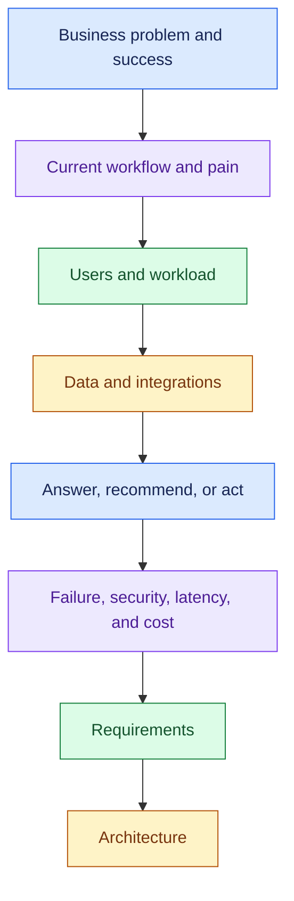

- Use this as a coverage checklist.
- The customer's answer decides the next question.

### 3. Essential Concepts: Ten Questions to Memorise

#### 1. Business: Why does the customer need this?

- “We need an AI agent” tells you their proposed solution.
- Find the problem it should solve.

> “What problem are we solving, and what business outcome matters most?”

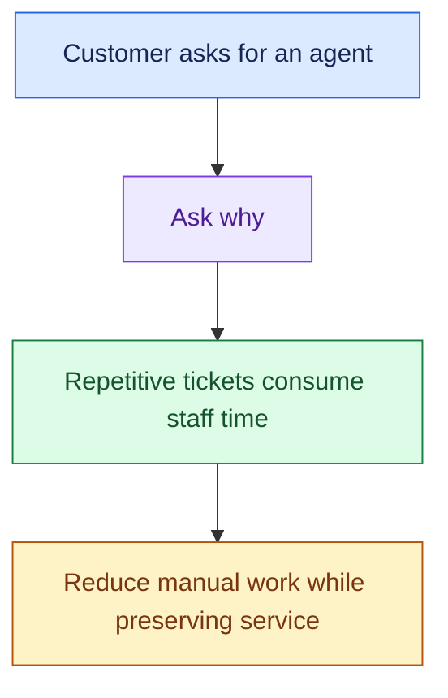

#### 2. Current Workflow: Where does the work get stuck?

- Map the human steps and existing systems. Find where the work gets stuck.

> “Can you walk me through how this works today and where the biggest pain points are?”

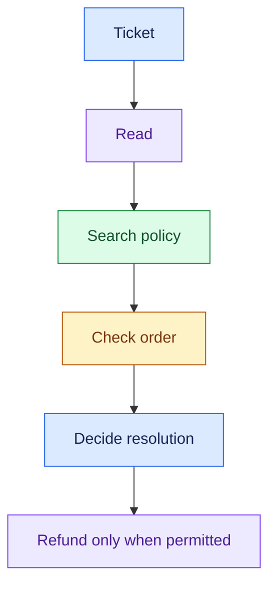

- Follow up: “Which step takes the most time or causes the most mistakes?”

#### 3. Users and Scale: Who uses it, and how much work arrives?

- Identify customers, employees, managers, and administrators.
- Ask about normal traffic, peaks, concurrent work, and growth; user count alone does not describe load.

> “Who will use it, and what volume, peak concurrency, and growth should we design for?”

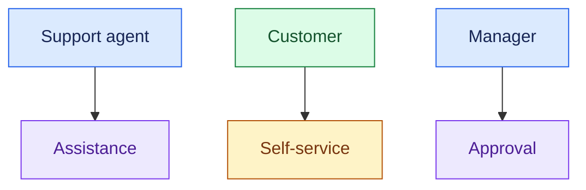

#### 4. Data: What information is needed, and how fresh?

- Find the sources, formats, freshness needs, and access permissions.
- Separate reference knowledge from live system state.

> “What data does the system need, where does it live, and how fresh must it be?”

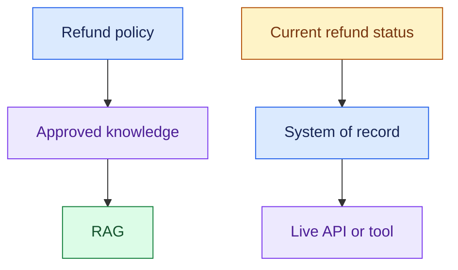

- RAG means retrieval-augmented generation: retrieve relevant knowledge to support the model's answer.

#### 5. Autonomy: What is the AI allowed to do?

- Answering, recommending, and executing create different requirements.
- Clarify permitted actions and approval rules before designing an agent.

> “Should AI only answer or recommend, or can it take actions? Which actions need human approval?”

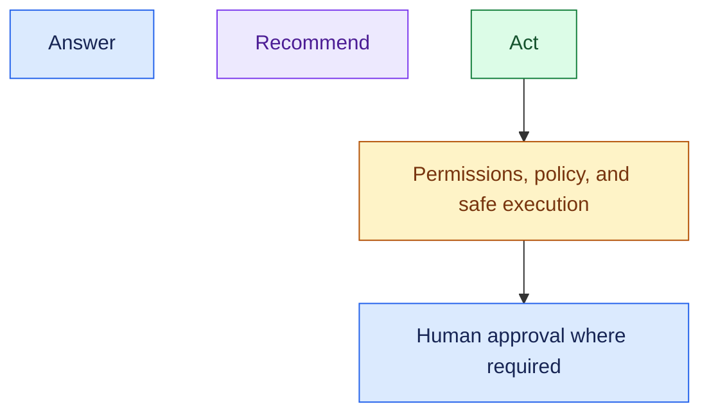

- Human-in-the-loop (HITL) means a human participates in the decision or approval workflow.
- Risk depends on the actual action and customer policy.

#### 6. Success: What measurable result matters?

- Agree on a baseline and target across business outcome, AI quality, system performance, and cost.
- Confirm the customer's numbers; examples are not universal targets.

> “How will we measure success, and what must stay within acceptable limits?”

- Business: manual workload / resolution time
- AI:       correctness / groundedness / task success
- System:   latency / availability / errors
- Cost:     cost per successfully resolved case

- Reducing human-handled tickets is useful only if resolution quality and customer satisfaction remain acceptable.

#### 7. Failure: What should happen when it cannot complete safely?

- Ask about missing evidence, ambiguous requests, dependency failure, and unavailable approvers.
- Define a safe fallback rather than letting the model guess.

> “What should happen if the AI lacks evidence, a tool fails, or an action cannot be approved?”

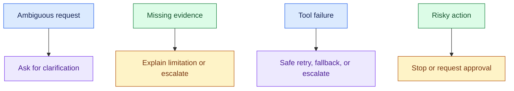

- A timeout after an action does not prove the action failed.
- Check its status before retrying; duplicate refunds must be prevented.

#### 8. Security: What boundaries must the system respect?

- Clarify access control, tenant isolation, personally identifiable information (PII), retention, approved providers, and data residency where relevant.

> “Who can access which data and actions, and are there restrictions on where data and models can run?”

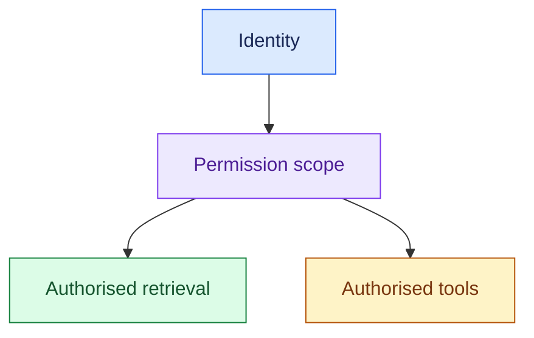

- Enforce access before restricted information enters the model's context.
- A prompt is not an access-control boundary.

#### 9. Integrations: Which systems must it read or change?

- Check whether APIs exist, which operations are read-only or write-capable, and whether dependencies are slow, unreliable, or asynchronous.

> “Which existing systems must this integrate with, and how reliable are their APIs?”

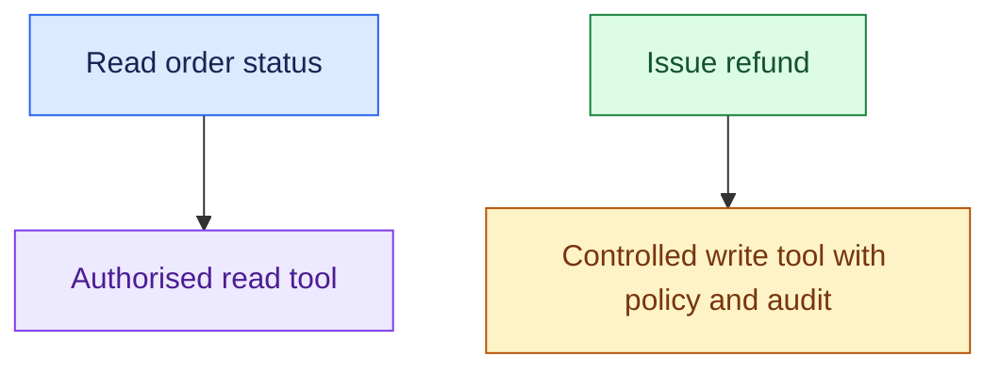

- Check integration constraints early, even when the reasoning step is straightforward.

#### 10. Operating Envelope: How well must it work?

- Non-functional requirements (NFRs) describe how well the system must work.
- Clarify latency, availability, throughput, and cost by workload.

> “What latency, availability, and cost limits matter, and do different workloads need different targets?”

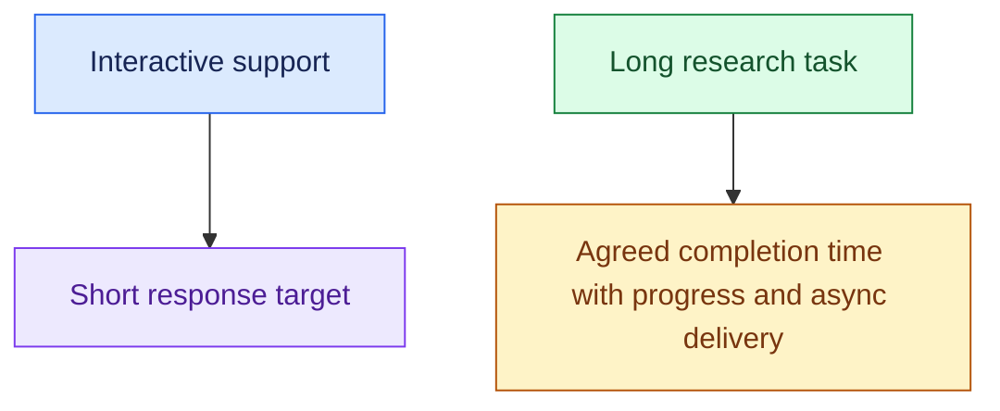

- Agree on service-level objectives (SLOs), such as a percentile latency target, after understanding the user experience.

#### How to Ask These Naturally

- You: “What outcome matters most?”
- Customer: “Less time on repetitive support tickets.”
- You: “What does an agent do with one of those tickets?”
- Customer: “Search policy, then check the order system.”
- You: “So we need policy knowledge and live order data. Are we assisting the agent or taking actions too?”
- Customer: “Eventually refunds, with manager approval.”
- You: “Which refunds need approval? What happens when approval or the order API is unavailable?”

- Then cover remaining gaps in scale, success, security, and operating limits.
- Summarise your understanding and let the customer correct it.

### 4. Requirement → Component Reasoning

- These are possible design consequences of discovery.
- Confirm the requirement before adding the component.

| Customer need / requirement | Component or pattern | Why it follows | Main trade-off |
|---|---|---|---|
| Answer from approved policies | RAG | Ground answers in maintained knowledge | Freshness and retrieval quality |
| Check current order state | Order API/tool | Query the system of record | Dependency latency and failure |
| Different users have different access | Authorisation + permission-aware retrieval/tools | Enforce access at the data and action boundaries | More integration work |
| Enforce user/tenant request limits | API Gateway | Control traffic entering the application | Limits may reject valid bursts |
| Use multiple model providers with fallback | Model Gateway | Control application calls to models | Fallback may change quality or behaviour |
| Execute refunds with approval rules | Policy + executor + HITL where required | Separate recommendation from permitted execution | Approval adds delay |
| Long work or traffic bursts | Queue + durable workflow state, if needed | Process accepted work outside the immediate response | Queue wait and more state to manage |

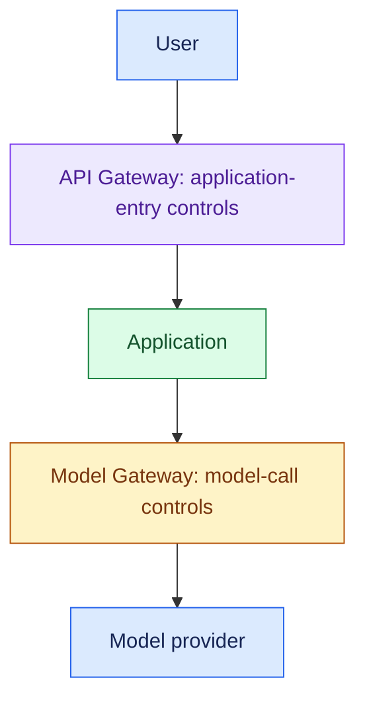

- **Transition into Review 2:**

> “Based on discovery, I’ll summarise what the system must do and how well it must do it before choosing components.”

- Problem / outcome: __________________________
- Users / current pain: _______________________
- Must do: answer ___, read ___, act ___
- Data / integrations: ________________________
- Allowed actions / approval: _________________
- Failure behaviour: ___________________________
- Scale / latency / availability / cost: _______
- Security boundaries: ________________________
- Success baseline / target: __________________
- Open questions / assumptions: _______________

### 5. Important Distinctions and Gotchas

1. **Business problem vs solution:** “Build an agent” does not explain the pain. Ask why and what changes if it works.
2. **RAG vs live tool:** policy knowledge can come from retrieval; current refund status should come from the live system. Indexed data is only acceptable when its freshness meets the requirement.
3. **Recommend vs act:** “Eligible for a refund” is a proposal. Issuing the refund is a side effect that needs explicit controls.

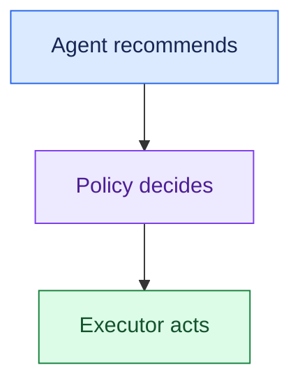

4. **Success vs constraint:** “Reduce resolution time” is an outcome; “meet an agreed latency target” constrains the solution. Capture both.
5. **Coverage checklist vs fixed script:** follow the customer's answers, then check for missing buckets. State unresolved assumptions instead of inventing traffic, targets, or approval rules.

### 6. Trigger → Concept Table

| If the interviewer says… | Think… | Then discuss… |
|---|---|---|
| “We want an AI agent” | Problem vs proposed solution | Business pain, outcome, current workflow |
| “Agents spend time searching policies” | Knowledge retrieval | Sources, freshness, permissions |
| “Where is my order right now?” | Live data | System of record, API availability |
| “It should issue refunds” | Action and risk | Allowed writes, policy, approval, duplicate prevention |
| “Managers must approve” | HITL | Approval rules, context, wait/failure behaviour |
| “100K users” | Workload discovery | Active users, request rate, peaks, concurrency |
| “Different companies use it” | Tenant boundaries | Data isolation, permissions, fair resource use |
| “It should be fast and cheap” | Measurable NFRs | Workload-specific latency and cost targets |
| “What if the API is down?” | Safe failure | Fallback, safe retries, escalation |

### 7. Interview Phrases

> “Before choosing components, I’d understand the business outcome and how the work happens today.”

> “Is the answer in maintained reference material, or does it depend on current system state?”

> “Are we assisting a human, recommending an action, or executing it? That changes the controls we need.”

> “When you say 100K users, what peak request volume and concurrent work should we expect?”

> “Let me summarise the requirements and open questions so we can confirm I’m solving the right problem.”

### 8. Practice Questions

1. A customer says, “Build an AI support agent.” What are your first five questions, and how would each answer guide the next?
2. Agents search policies, check order status, and sometimes issue refunds. Separate the data needs and autonomy decisions before naming components.
3. The customer asks for a multi-agent architecture. What would you ask to determine whether the workflow requires it?
4. The goal is 30% fewer manually handled tickets. What baseline, quality checks, and operating constraints would you clarify?
5. Refunds need manager approval, and the order API sometimes times out. What failure and integration requirements would you capture before drawing the architecture?

---

## One-Page Memory Card: FDE Problem Decomposition

- **Core question:** How do I turn a vague customer request into clear requirements?

### Recall Flow

- Why: business problem and measurable success.
- What: data and integrations.
- Boundaries: failure, security, latency, availability, and cost.

### Ten Questions

| # | Ask |
|---|---|
| 1. Business | What problem are we solving, and what outcome matters? |
| 2. Today | How does it work today, and where is the biggest pain? |
| 3. Users + scale | Who uses it? What volume, peaks, concurrency, and growth? |
| 4. Data | What data, where, how fresh, and who can access it? |
| 5. Autonomy | Answer, recommend, or act? Which actions need approval? |
| 6. Success | What baseline and business, AI, system, and cost targets? |
| 7. Failure | What if evidence is missing, a tool fails, or approval is unavailable? |
| 8. Security | What access, tenant, privacy, and residency boundaries? |
| 9. Integration | Which APIs/systems? Read or write? Reliable or slow? |
| 10. NFRs | What latency, availability, throughput, and cost limits by workload? |

- Use answers to guide the next question.
- Then check what you missed.

### Trigger → Concept

| Hear… | Think / clarify… |
|---|---|
| “Need an agent” | Actual business problem and current bottleneck |
| “Policy documents” | RAG; sources, freshness, permissions |
| “Current order status” | Live API/tool; system of record |
| “Issue refunds” | Allowed actions, policy, approval, safe execution |
| “100K users” | Peak workload and concurrency, not user count alone |
| “Fast and cheap” | Measurable latency and cost envelope |
| “API unavailable” | Safe fallback, retry conditions, escalation |

### Do Not Confuse

1. **Agent request ≠ business problem.** Ask why the customer wants it.
2. **Reference knowledge ≠ live state.** Policy → RAG; current refund status → API/tool.
3. **Recommend ≠ execute.** Agent recommends → Policy decides → Executor acts.
4. **Outcome ≠ operating limit.** Reduce manual work while meeting quality, security, latency, and cost constraints.

### Requirement → Component Reminders

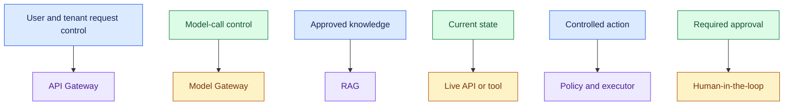

- Confirm each design consequence before adding the box.

### Handoff to Requirements

- State the outcome, users, and required capabilities.
- List data, integrations, permitted actions, and approval rules.
- Confirm safe failure behaviour, workload, and operating and security limits.
- Record success targets and unresolved assumptions.

- Do not invent numbers.
- Confirm a baseline and target.
- A timeout after a write needs status checking and duplicate prevention before a retry.

### 30-Second Opening

Practise these points as one spoken answer:

- “I’d start with the business outcome and current workflow.”
- “Then I’d clarify users, workload, data, integrations, and whether AI should answer, recommend, or act.”
- “I’d agree on measurable success and boundaries around security, failures, latency, availability, and cost.”
- “Then I’d summarise the requirements before choosing components.”
- “What problem matters most, and how is it handled today?”

## Sources (checked 27 Sep 2026)

- [OWASP GenAI LLM07:2025 System Prompt Leakage](https://genai.owasp.org/llmrisk/llm072025-system-prompt-leakage/): access control before model context
- [OWASP GenAI LLM06:2025 Excessive Agency](https://genai.owasp.org/llmrisk/llm062025-excessive-agency/): access control before model context
