# Review 2: Functional Requirements

## Interview Review

### 1. What the Interviewer Is Testing

- Can you turn discovery answers into clear system capabilities?
- Can you separate knowledge retrieval, live data access, recommendations, and actions?
- Can you include permissions, human approval, failures, and traceability?
- Can you justify components through requirements instead of naming tools first?

### 2. Core Mental Model

- **Functional requirements (FRs) answer: “What must the system DO?”**

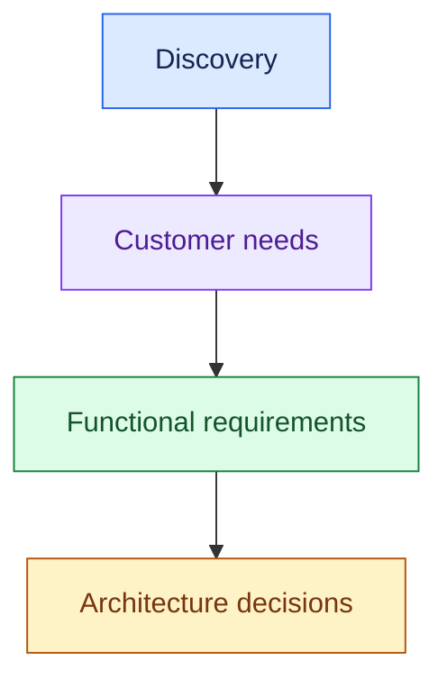

Remember twelve reusable requirements in three groups:

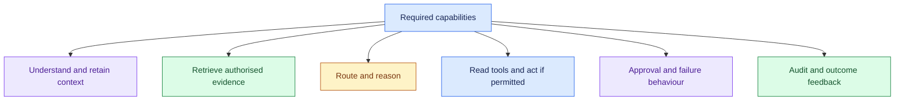

- Select the capabilities the customer needs.
- Permissions apply throughout; routing may happen before retrieval; many requests never need an action or approval.

Select the requirements the customer needs. Keep the labels consistent:

- FR1–FR4: understand, context, retrieve, permissions.
- FR5–FR8: route, reason, tool, act.
- FR9–FR12: human approval, failure, audit, feedback.

### 3. Essential Concepts

#### 1. FR1 Understand: Accept the Request and Identify the Need

- Support the required inputs and identify what the user wants.
- Clarify ambiguity before using tools or acting.

> “The system must accept support requests and identify whether the user needs policy information, order status, or a refund.”

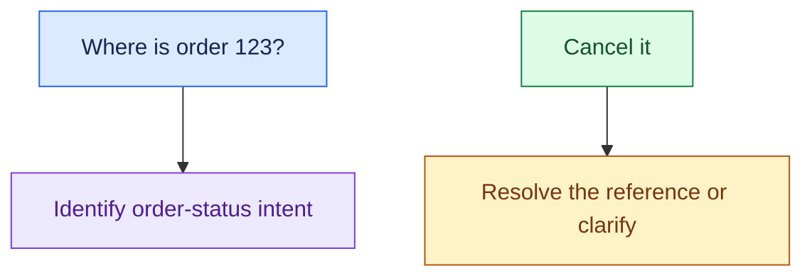

- Mention text, voice, documents, or events only when required.

#### 2. FR2 Context: Keep Relevant Conversation and Workflow State

- Maintain what is needed to continue the task: the order being discussed, prior decisions, or pending approval.
- Avoid blindly sending the entire conversation to the model.

> “The system must retain relevant context across turns and preserve workflow state when work is paused.”

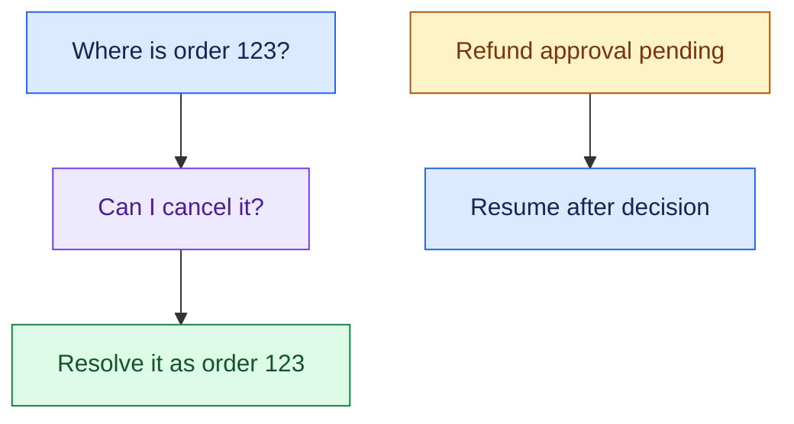

- Conversation context supports follow-up questions.
- Workflow state tracks progress and pending work.

#### 3. FR3 Retrieve + FR4 Permissions: Use Authorised Knowledge

- Retrieve relevant information from approved enterprise sources, within the current user's access scope.
- Retrieval-augmented generation (rag) uses retrieved knowledge to support an answer.

> “The system must retrieve the relevant refund policy and only expose information the user is authorised to access.”

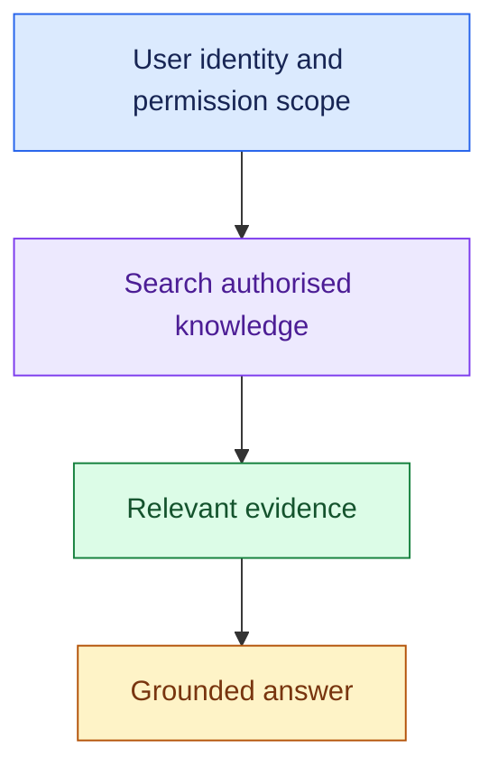

- Permissions also apply to tools and actions.
- A prompt asking the model to hide restricted data is not access enforcement.

#### 4. FR5 Route: Choose the Right Capability

- Route requests to knowledge retrieval, a live tool, a workflow, or a human.
- The requirement does not imply separate agents for every request type.

> “The system must route each request to the capability that can handle it.”

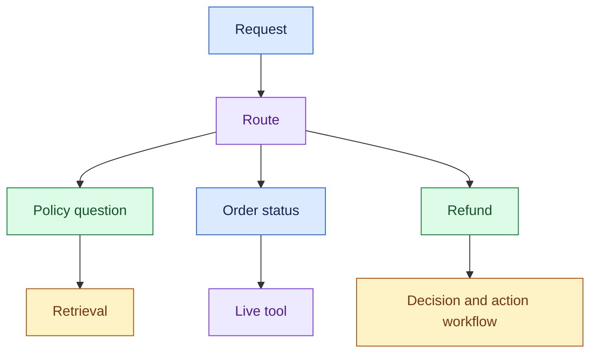

- Routing can use rules or a classifier where sufficient; use model reasoning when the task requires it.

#### 5. FR6 Reason: Produce an Answer or Recommendation

- Use available evidence to answer, determine eligibility, or propose a next step.
- State missing information rather than inventing it.

> “The system must assess refund eligibility from policy and order data, and explain its recommendation.”

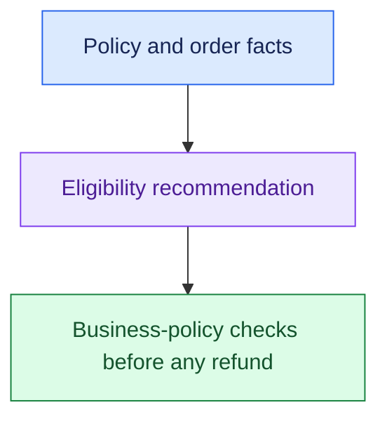

- The model's recommendation does not replace authoritative business-policy checks.

#### 6. FR7 Tool: Access Live Systems

- Read current state through approved APIs or tools.
- Validate inputs and enforce access for the requested operation.

> “The system must fetch the current status of the user's order from the order system.”

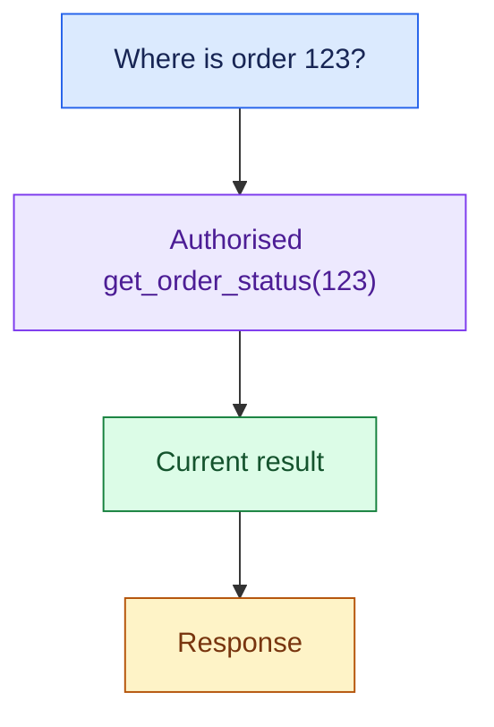

- Maintained policy knowledge and current transactional state need different access paths.

#### 7. FR8 Act + FR9 HITL: Execute Permitted Actions

- Execute approved changes through controlled tools.
- Human-in-the-loop (hitl) adds review or approval when customer policy or risk requires it.

> “The system must issue permitted refunds and request manager approval for cases covered by the approval policy.”

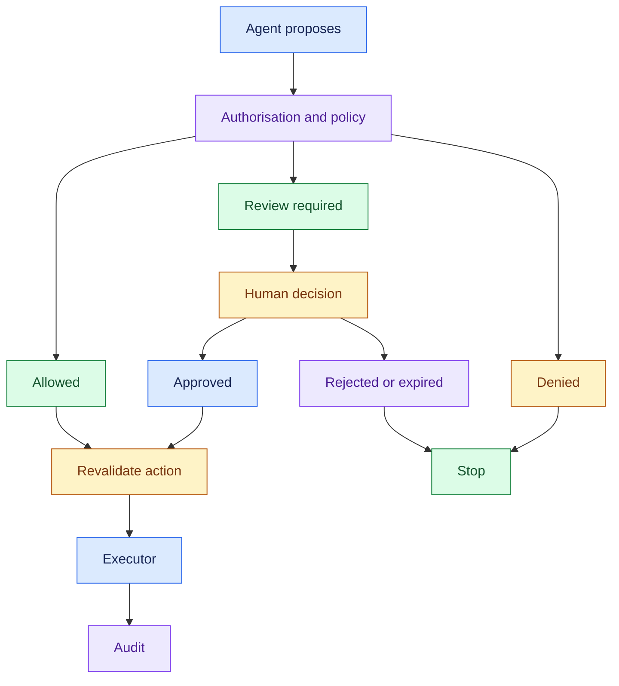

- Give the reviewer the request, evidence, recommendation, and policy reason.
- Approval does not remove permission checks or safe execution requirements.

#### 8. FR10 Failure: Define Uncertainty and Failure Behaviour

- Define what the user or operator experiences when the system cannot complete the task safely.

> “The system must ask for clarification, return a supported partial result, or escalate when evidence or dependencies are insufficient.”

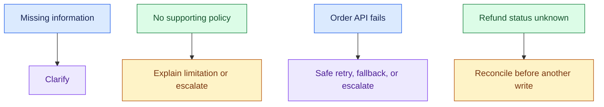

- Do not report a refund as completed without confirmation.
- Retries must not create duplicate side effects; detailed retry and idempotency design comes later.

#### 9. FR11 Audit + FR12 Feedback: Record What Happened and Whether It Worked

- Record evidence, decisions, tool operations, approvals, and the confirmed result.
- Capture feedback and actual outcomes for evaluation.

> “The system must make refund decisions traceable and capture whether the support case was successfully resolved.”

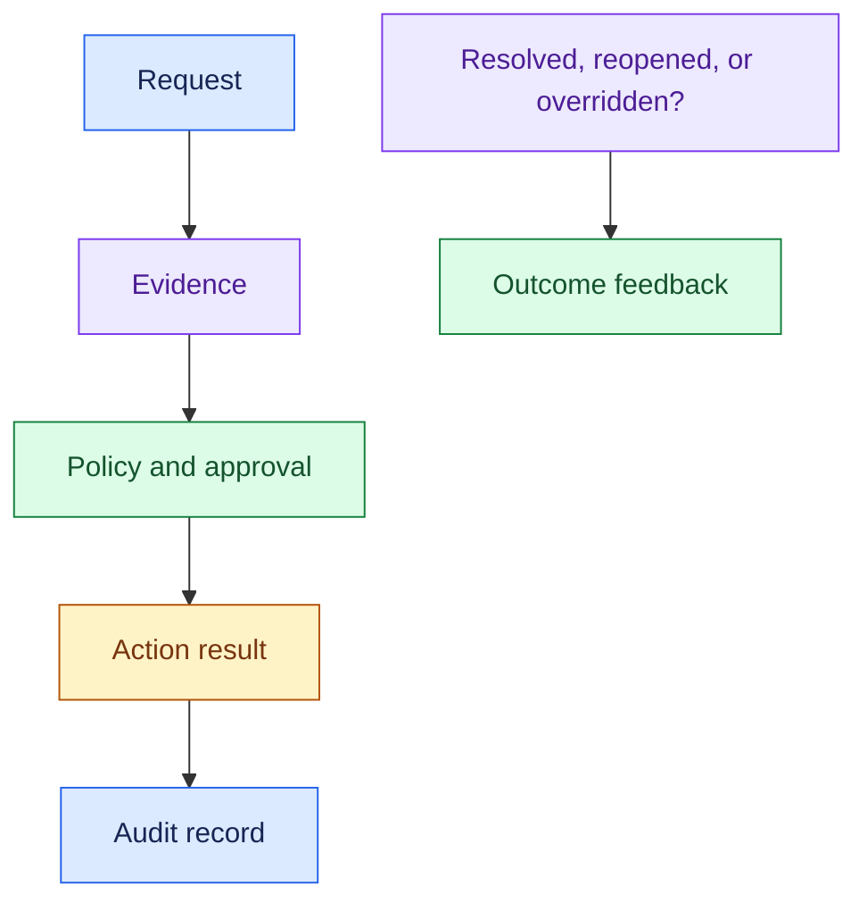

- Capture decision summaries and supporting evidence, not private model reasoning, which is often hidden and not always faithful.
- Keep records within the customer's privacy and retention rules.

### 4. Requirement → Component Reasoning

- Write the capability first.
- Then justify the design that supports it.

| Customer need / requirement            | Component or pattern                             | Why it follows                             | Main trade-off                       |
| -------------------------------------- | ------------------------------------------------ | ------------------------------------------ | ------------------------------------ |
| Continue a conversation or paused task | Context/state store                              | Preserve relevant task information         | Retention and state complexity       |
| Answer from company policy             | RAG retrieval path                               | Supply approved evidence                   | Freshness and retrieval quality      |
| Respect different access rights        | Authorisation + permission-aware retrieval/tools | Enforce access at each boundary            | Integration effort                   |
| Handle different request types         | Router or workflow branching                     | Select the required capability             | Misrouting and routing overhead      |
| Read current order status              | Controlled order API/tool                        | Query current source-of-truth data         | Dependency latency and failure       |
| Issue refunds under approval rules     | Policy + executor + approval workflow            | Separate proposal from permitted execution | Approval delay and durable state     |
| Explain why a refund occurred          | Audit records                                    | Link evidence, approval, and action        | Storage and privacy constraints      |
| Learn whether cases were resolved      | Outcome/feedback capture                         | Evaluate task success                      | Feedback can be incomplete or biased |

- **Gateway terminology, when those components become relevant:**

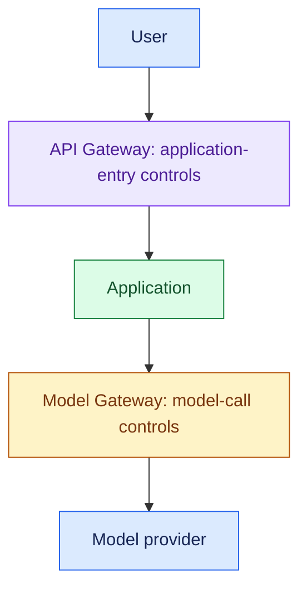

- User/tenant request controls belong at the API Gateway boundary.
- Model-provider routing and fallback belong at the Model Gateway boundary.
- Neither gateway replaces permission checks in retrieval or downstream tools.

#### Example: Customer Support

- Customer asks for policy answers, order status, and eligible refunds.

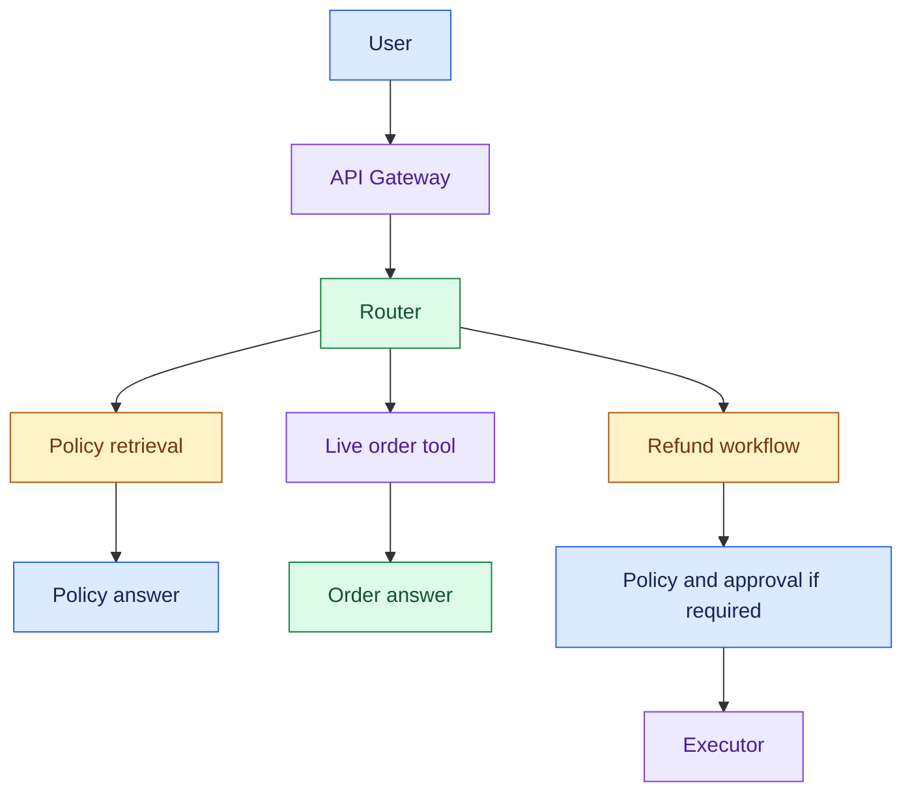

Start with 6–8 grouped requirements:

1. Understand requests and maintain relevant context.
2. Answer policy questions using authorised enterprise knowledge.
3. Read current order information through permitted tools.
4. Route requests and produce grounded answers or recommendations.
5. Execute allowed refunds with policy checks and approval where required.
6. Clarify or escalate when evidence, tools, or approvals are unavailable.
7. Record evidence, decisions, approvals, and action results.
8. Capture resolution outcomes and feedback.

### 5. Important Distinctions and Gotchas

1. **FR vs NFR:** “Fetch order status” is a capability. “Fetch it within an agreed latency target” adds a performance constraint. Security can include both permission-enforcement behaviour and broader constraints.
2. **RAG vs tool:** “What is the refund policy?” → retrieve knowledge. “Has my refund completed?” → query live state.
3. **Reason vs act:** “Customer appears eligible” is a recommendation. Calling the payment API causes the business change.

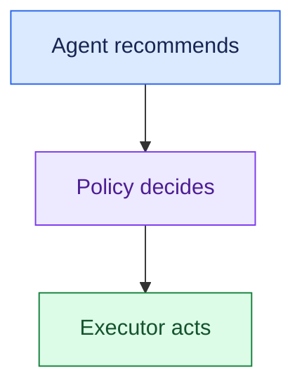
4. **Route vs multi-agent:** multiple request types require routing; they do not automatically require multiple agents.
5. **Observability vs audit:** “Why was it slow?” concerns system behaviour. “Why was this refund issued?” needs the evidence, policy, approval, and action record. A good answer also does not prove successful task completion.

### 6. Trigger → Concept Table

| If the interviewer says…              | Think…         | Then discuss…                                 |
| -------------------------------------- | --------------- | ---------------------------------------------- |
| “Follow-up questions”                | FR2 Context     | Relevant conversation state                    |
| “Company policies”                   | FR3 Retrieve    | Approved sources and evidence                  |
| “Different users see different data” | FR4 Permissions | Access-aware retrieval and tools               |
| “Several request types”              | FR5 Route       | Capability selection; agents only if justified |
| “Recommend the next step”            | FR6 Reason      | Evidence and decision proposal                 |
| “Current order status”               | FR7 Tool        | Authorised live API access                     |
| “Issue a refund”                     | FR8 Act         | Policy, controlled execution, confirmation     |
| “Manager must approve”               | FR9 HITL        | Approval context and resumable workflow        |
| “AI lacks evidence / API fails”      | FR10 Failure    | Clarification, safe fallback, escalation       |
| “Why did it do this?”                | FR11 Audit      | Evidence, decision, approval, action result    |
| “Did it actually work?”              | FR12 Feedback   | Resolution, reopen, override, user feedback    |

### 7. Interview Phrases

> “Based on discovery, I’ll summarise what the system must do before choosing the architecture.”

> “I’ll separate policy knowledge from live order data because they need different access paths.”

> “The requirement is to route work to the right capability; multiple agents are a later design choice.”

> “I’ll separate the recommendation, policy decision, and actual execution.”

> “Alongside the happy path, I’ll define what happens when evidence, tools, or approval are unavailable.”

> “I’ll measure whether the task completed; a helpful-sounding response doesn’t prove that.”

### 8. Practice Questions

1. Define 6–8 functional requirements for a support system that answers policies, checks orders, and issues eligible refunds. Which require retrieval, tools, or actions?
2. A user says, “Can I cancel it?” after asking about an order. What requirements handle context, ambiguity, and authorisation?
3. The customer changes the scope from recommending refunds to executing them. Which requirements become necessary or more explicit?
4. Manager approval may take hours, and the payment API can time out. What behaviour must the system support while waiting and when action status is unknown?
5. A response gets a thumbs-up, but the ticket reopens the next day. What should feedback capture, and how does that differ from audit?

---

## One-Page Memory Card: Functional Requirements

- **Core question:** What must the system DO, based on the customer needs discovered in Review 1?

### Recall Flow

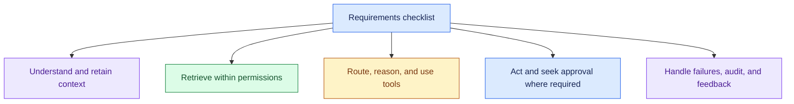

- Select the capabilities that apply.
- Select what applies.
- Permissions and safe failure run across the flow.

### Twelve Reusable FRs

| FR             | Recall question                                                 |
| -------------- | --------------------------------------------------------------- |
| 1. Understand  | What inputs and intents must we handle?                         |
| 2. Context     | What conversation or workflow state must continue?              |
| 3. Retrieve    | What approved knowledge supports the answer?                    |
| 4. Permissions | What data and actions may this user access?                     |
| 5. Route       | Which capability should handle the request?                     |
| 6. Reason      | What answer or recommendation must we produce?                  |
| 7. Tool        | What current system data must we read?                          |
| 8. Act         | What permitted business changes can we execute?                 |
| 9. HITL        | When must a human review or approve?                            |
| 10. Failure    | What happens with ambiguity, missing evidence, or failure?      |
| 11. Audit      | Can we reconstruct evidence, decisions, approvals, and results? |
| 12. Feedback   | Was the task resolved, reopened, or overridden?                 |

- RAG = retrieval-augmented generation.
- HITL = human-in-the-loop.

### Trigger → Concept

| Hear…                                   | Think…                  |
| ---------------------------------------- | ------------------------ |
| “Follow-up question”                   | Context                  |
| “Policy documents / restricted access” | Retrieve + permissions   |
| “Different request types”              | Route                    |
| “Current order state”                  | Live tool/API            |
| “Recommend / issue refund”             | Reason / act             |
| “Manager approval”                     | HITL + workflow state    |
| “No evidence / API unavailable”        | Failure behaviour         |
| “Why did it refund? / Did it resolve?” | Audit / outcome feedback |

### Do Not Confuse

1. **FR vs NFR:** capability vs how well it must work. “Read order status” vs an agreed latency target.
2. **RAG vs live tool:** maintained policy knowledge vs current transactional state.
3. **Recommend vs act:** agent recommends → policy decides → executor acts. Human approval applies where required.
4. **Audit vs observability:** business decision/action trace vs system behaviour. Response quality is also not proof of task success.

### Requirement → Component

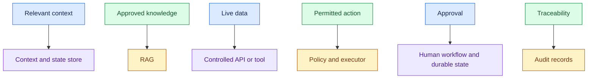

- Do not force every component into the design.
- Routing does not automatically mean multiple agents.

### 30-Second Requirements Summary

Practise these points as one spoken answer:

- “For this support use case, the system must understand requests and retain relevant context, retrieve authorised policy knowledge, and access live order data.”
- “It should route requests, produce grounded answers or recommendations, and execute allowed refunds with policy checks and approval where required.”
- “It must clarify or escalate failures, record important decisions and actions, and capture resolution outcomes.”
- “I’ll select the requirements that apply, then define the non-functional targets.”

- For action failures, never claim completion without confirmation.
- Unknown status requires reconciliation; retries must prevent duplicate side effects.

## Sources (checked 27 Sep 2026)

- [OWASP GenAI LLM07:2025 System Prompt Leakage](https://genai.owasp.org/llmrisk/llm072025-system-prompt-leakage/): access control before model context
- [OWASP GenAI LLM06:2025 Excessive Agency](https://genai.owasp.org/llmrisk/llm062025-excessive-agency/): access control before model context
- [Chen et al. 2025, Reasoning Models Don't Always Say What They Think (arXiv 2505.05410)](https://arxiv.org/abs/2505.05410): chain-of-thought is not always faithful
