# Review 7: Tools, Actions & Enterprise Integration

## Interview Review

### 1. What the Interviewer Is Testing

- Can you connect AI to enterprise systems through controlled interfaces?
- Can you separate recommendations, permissions, and execution?
- Can you handle timeouts and retries without duplicate business effects?
- Can you explain the integration constraints before choosing a framework?

### 2. Core Mental Model

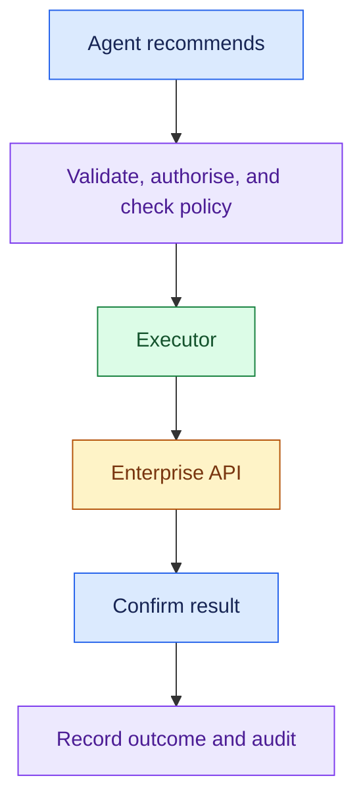

- **Agent recommends → Policy decides → Executor acts.**

For every integration, remember:

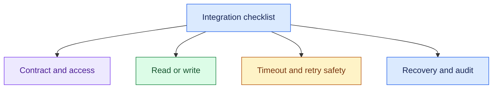

### 3. Essential Concepts

#### 1. Controlled Tool Layer: Expose Operations, Not Unlimited Access

- Give the model approved operations with clear input and output schemas.
- Validate arguments and enforce access in application code or the downstream system.

> “I’d expose specific operations like get_order_status and request_refund, rather than unrestricted production access.”

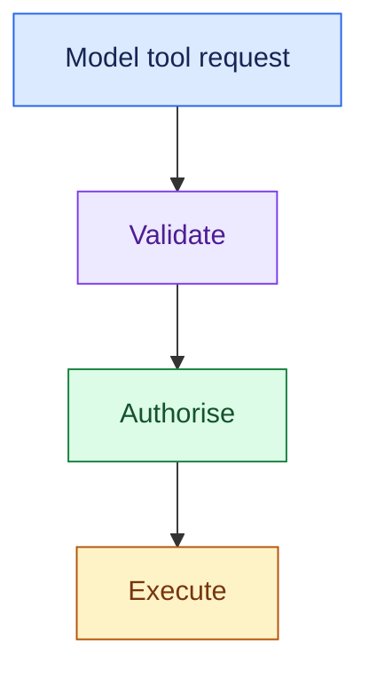

- Tool results are data, not permission to bypass policy.
- The model must not be able to supply its own trusted tenant identity or credentials.

#### 2. Integration Contract: Discover the Real Constraints

- Ask about API availability, authentication, schemas, limits, synchronous vs asynchronous behaviour, ownership, and error semantics.

> “Does this API confirm completion, or only accept the operation for later processing?”

- CRM: Customer context
- Order system: Current order state
- Payment system: Refund execution / status

- CRM means customer relationship management; ERP means enterprise resource planning.
- The integration may be harder than the reasoning step.

#### 3. Read vs Write Tools: Different Consequences

- Reads need access checks and freshness rules.
- Writes also need policy, explicit action scope, duplicate protection, confirmation, and audit.

> “Reading an order and issuing a refund have different risk and recovery requirements.”

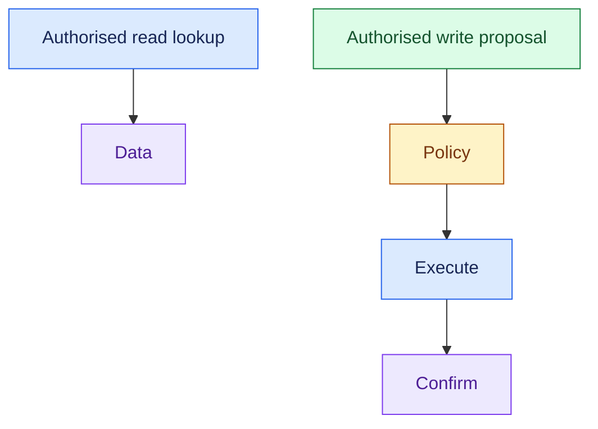

- Read calls still incur cost and may expose sensitive data; do not treat them as unrestricted.

#### 4. Executor: Own the Business Side Effect

- The executor turns a validated, permitted action into a concrete API operation.
- Bind execution to the approved operation and inputs.

> “The model proposes the action; the executor checks that the specific action is still permitted before sending it.”

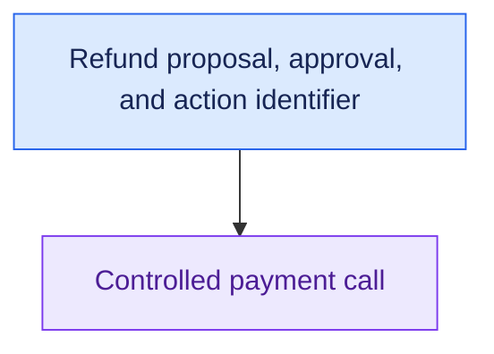

- Keep secrets outside model context.
- Record whether the action was accepted, completed, rejected, or remains unknown.

#### 5. Idempotency: Make Repetition Safe

- An idempotent operation produces no additional business effect when repeated as the same logical operation.
- Use an action/idempotency key supported by the execution path.

> “Retries of the same refund must reuse the same operation identifier.”

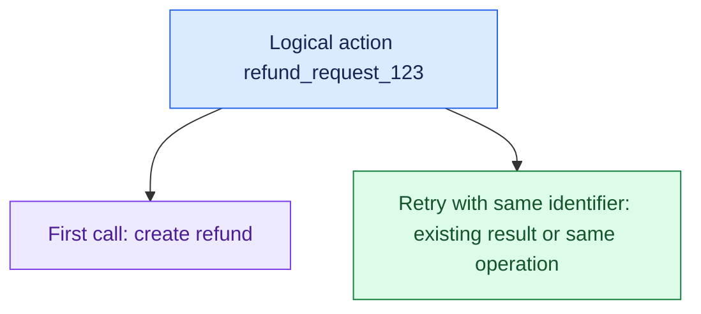

- Do not generate a new key for every retry.
- Idempotency scope, retention, and changed-input behaviour must match the downstream contract.

#### 6. Timeout: Stop Waiting Without Assuming Failure

- Set dependency deadlines within the task's total time budget.
- A timeout means the caller did not receive a result in time; the remote action may have succeeded.

> “After a write timeout, I’d check operation status before sending another refund.”

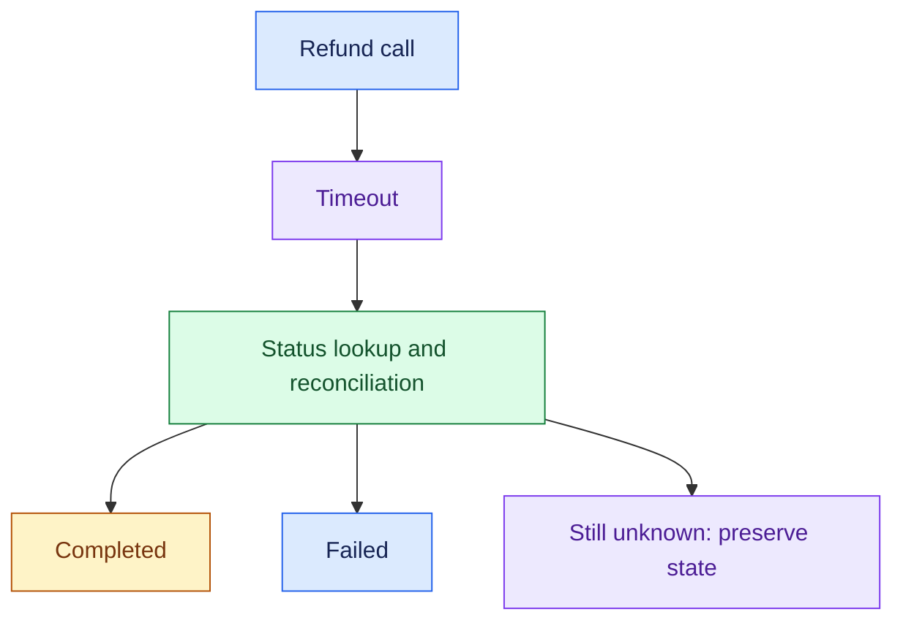

- If status cannot be determined, preserve the unknown state and escalate or reconcile later.
- Never claim completion without confirmation.

#### 7. Retry: Retry Only When Safe and Useful

- Retry transient failures within a bounded budget, with backoff and jitter.
- Do not blindly retry invalid input, denied permission, or policy rejection.

> “I’d distinguish transient dependency failures from permanent errors and uncertain writes.”

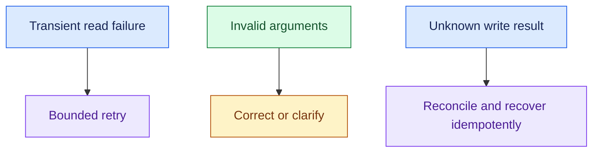

- Avoid nested retry loops at the tool, orchestrator, and model layers multiplying attempts.

#### 8. Circuit Breaker: Protect a Failing Dependency

- After repeated failures, temporarily stop normal calls and later probe recovery.
- Combine this with a defined fallback or safe stop.

> “If the ERP is repeatedly failing, I’d stop hammering it and return a defined unavailable or deferred state.”

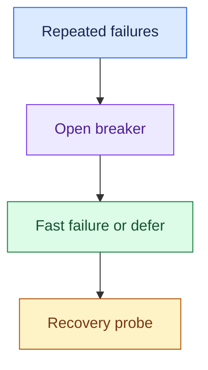

- A breaker does not repair the API, confirm an unknown write, or replace authorisation.

### 4. Requirement → Component Reasoning

| Requirement | Pattern / component | Why | Trade-off |
|---|---|---|---|
| Safe enterprise access | Validated tool layer + scoped authorisation | Restrict operations | Integration effort |
| Execute approved refunds | Policy + executor | Separate reasoning and side effects | More workflow state |
| Prevent duplicate refunds | Idempotency + action records | Safe repeated operation | Downstream support and retention |
| Handle slow dependencies | Deadlines + async work where acceptable | Bound waiting | Deferred completion |
| Recover uncertain writes | Status query / reconciliation | Establish actual outcome | Recovery delay |
| Protect failing ERP | Circuit breaker + bounded retries | Avoid repeated load | Temporary unavailability |

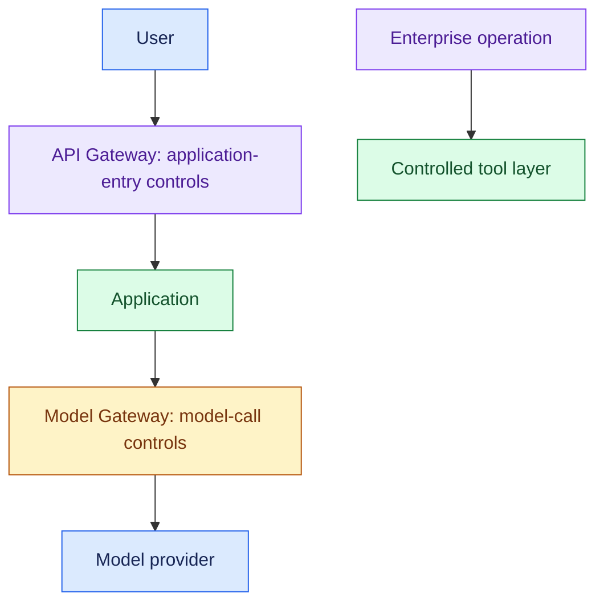

For a refund request:

- Retrieve the policy and read live order state.
- Propose the refund, then authorise it and check policy.
- Execute with a stable action identifier.
- Confirm status and audit the result.

### 5. Important Distinctions and Gotchas

1. **Recommendation vs execution:** eligibility text is not a completed refund.
2. **Timeout vs failure:** no response does not prove the remote action failed.
3. **Idempotency vs retry:** idempotency makes repeated effects safe; retry makes another attempt. Both must follow the API contract.
4. **Accepted vs completed:** asynchronous acceptance needs status tracking before reporting success.
5. **Circuit breaker vs timeout:** stop calls during repeated failure vs stop waiting for one call.

### 6. Trigger → Concept Table

| Hear… | Think… | Discuss… |
|---|---|---|
| “Access production CRM” | Controlled tools | Operations, scopes, secrets |
| “Issue refund” | Write execution | Policy, approval, confirmation |
| “Refund timed out” | Unknown outcome | Reconcile before retry |
| “Duplicate request” | Idempotency | Same logical action identifier |
| “ERP takes 30 seconds” | Deadline / async | User waiting budget and status |
| “Repeated API failures” | Circuit breaker | Recovery probes and fallback |
| “API returns accepted” | Async contract | Completion tracking |

### 7. Interview Phrases

> “I’d expose only the approved operations this task needs.”

> “A write timeout is an unknown outcome until we reconcile it.”

> “The same logical action must keep the same idempotency identifier across retries.”

> “I’d bound retries and protect a failing dependency instead of amplifying the outage.”

### 8. Practice Questions

1. What controls belong around a CRM lookup versus a refund write?
2. A refund succeeds remotely, but the caller times out. How do you recover without issuing another refund?
3. An ERP sometimes takes 30 seconds. What do you ask about deadlines, async completion, and fallback?
4. Why separate the agent's recommendation from policy and execution?
5. Tool and orchestrator layers both retry. What can go wrong, and how do you bound total attempts?

---

## One-Page Memory Card: Tools, Actions & Enterprise Integration

- **Core question:** How do we execute enterprise operations safely and establish their actual outcome?

### Recall Flow

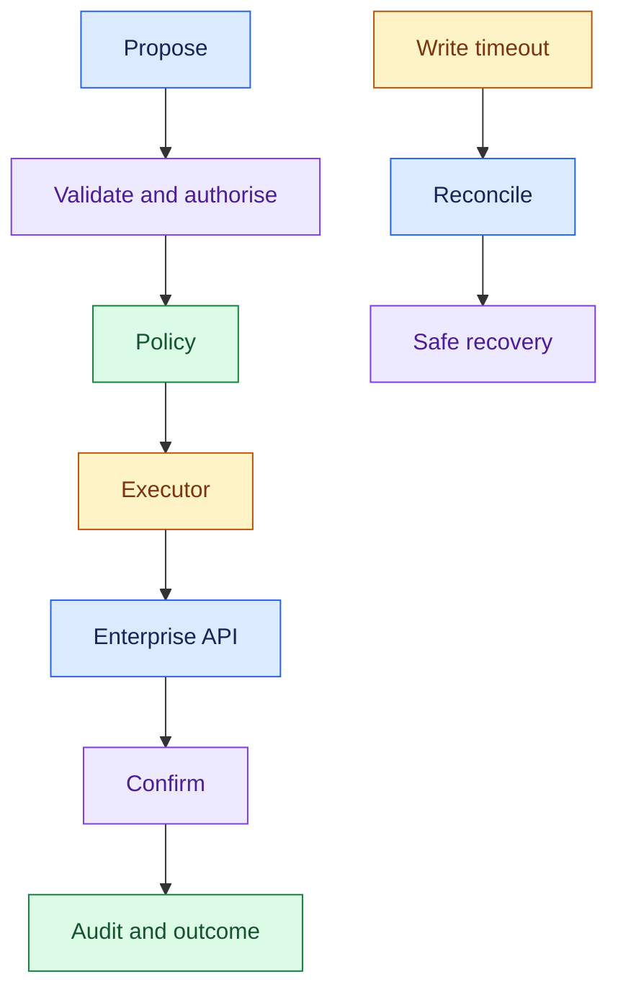

### Checklist

| Concept | Remember |
|---|---|
| Tool layer | Specific approved operations; clear schemas; trusted access scope |
| Contract | Authentication, limits, errors, sync/async, accepted vs completed |
| Reads | Authorisation, sensitive data, freshness, cost |
| Writes | Policy, approval where required, scoped execution, confirmation |
| Executor | Performs the validated business operation; secrets stay outside context |
| Idempotency | Same logical action uses the same identifier across retries |
| Timeout | Caller stopped waiting; remote outcome may be unknown |
| Retry | Transient and safe; bounded attempts, backoff, jitter |
| Circuit breaker | Temporarily stop normal calls after repeated failures; probe recovery |

- CRM = customer relationship management.
- ERP = enterprise resource planning.

### Trigger → Concept

| Hear… | Think… |
|---|---|
| “Production access” | Controlled operation and least privilege |
| “Issue refund” | Write path with policy and audit |
| “Timed out after submitting” | Unknown outcome, status reconciliation |
| “Duplicate delivery / retry” | Stable action key and idempotent execution |
| “Slow ERP” | Dependency deadline, async if acceptable |
| “Repeated failures” | Bounded retry + circuit breaker |
| “Request accepted” | Track actual completion |

### Do Not Confuse

1. **Recommend vs execute:** policy eligibility is not a business side effect.
2. **Timeout vs failed:** the operation may have completed remotely.
3. **Idempotency vs retry:** safe repetition vs another attempt; generating a new key defeats same-operation protection.
4. **Accepted vs completed:** do not report final success from an acceptance acknowledgement.

### Recovery Rules

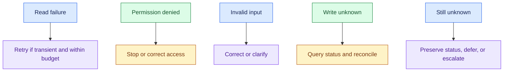

- Check the api's idempotency scope, retention, and treatment of changed inputs.
- Avoid multiplying retries across layers.
- A circuit breaker prevents repeated calls during failure; it does not confirm uncertain actions.

### Requirement → Boundary

- API Gateway = User → Application control.
- Model Gateway = Application → Model control.
- The controlled tool layer owns enterprise operations; downstream authorisation remains necessary.

### 30-Second Answer

Practise these points as one spoken answer:

- “I’d connect the agent through approved tools with validated arguments and scoped access.”
- “Reads need freshness and permission checks; writes also need policy, safe execution, and confirmation.”
- “I’d use stable action identifiers for idempotent retries, reconcile write timeouts, and bound dependency waiting and retries.”
- “Repeated failures would trigger a circuit breaker and a defined fallback or deferred state.”

## Sources (checked 27 Sep 2026)

- [Stripe API reference - Idempotent requests](https://docs.stripe.com/api/idempotent_requests): idempotency key reuse and scope
- [IETF draft-ietf-httpapi-idempotency-key-header-07 (expired) s2.7](https://www.ietf.org/archive/id/draft-ietf-httpapi-idempotency-key-header-07.html): idempotency key reuse and scope
- [OWASP GenAI LLM01:2025 Prompt Injection](https://genai.owasp.org/llmrisk/llm01-prompt-injection/): untrusted retrieved and tool input
- [OWASP GenAI LLM06:2025 Excessive Agency](https://genai.owasp.org/llmrisk/llm062025-excessive-agency/): untrusted retrieved and tool input
